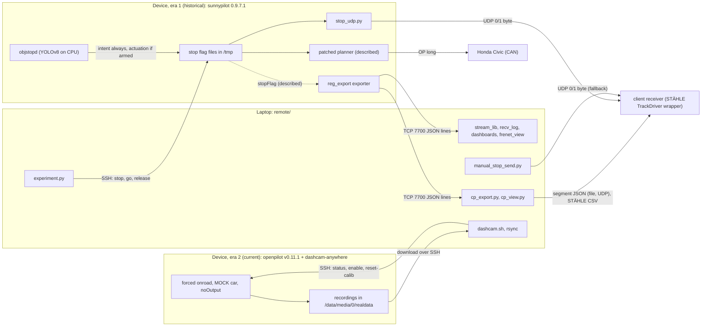
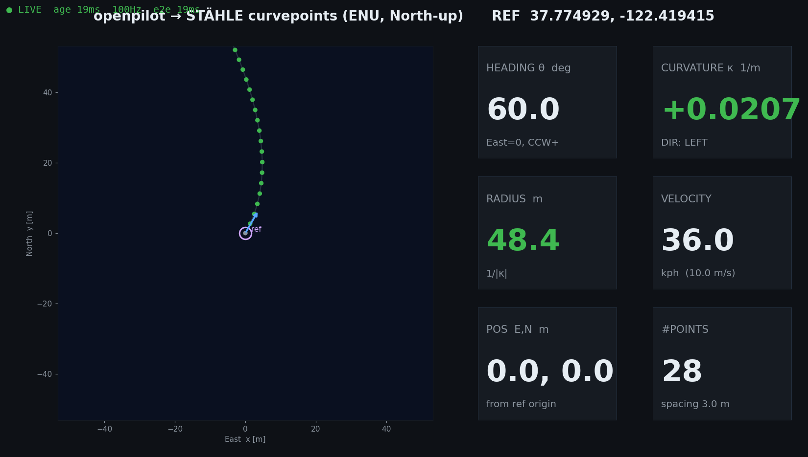

# OP4Anything

**Getting useful openpilot output from anything:** a 2020 Honda Civic driven with openpilot longitudinal control, a truck or bench rig with no CAN bus, and robots that carry a comma 3X as a self-calibrating dashcam. This repository collects the tools, device patches and field notes built on a comma 3X between 2026-07-07 and 2026-10-03 for the client, Arman, whose downstream consumer is the STÄHLE TrackDriver robot ecosystem: a read-only telemetry stream, converters to STÄHLE curvepoints and the client's segment JSON, a stop command, a vision stop daemon, and a dashcam-anywhere patch for openpilot v0.11.1. It is research tooling, documented in 16 English reference docs under [`docs/`](docs/README.md).

> [!CAUTION]
> **Research tooling, not a product.** Run anything that touches a vehicle only on a closed course, with a safety driver ready to take over. Read the [safety and legal notes](docs/01-overview.md#safety-and-legal-notes) first.
>
> - **OP long removed the stock safety net.** On the Civic, `ExperimentalLongitudinalEnabled=1` turned off the stock radar and AEB, and `experiment.py stop` or `objstopd.py --arm` could then brake the car. `--arm` brakes on camera detections alone (YOLOv8, about 4–5 Hz, not lane-aware); validate objstopd in shadow mode first.
> - **The stop outputs are not safety-rated.** The vision stop, the JSON `"stop"` field and the 0/1 UDP byte are experimental. A receiver that acts on them needs its own safety layer.
> - **Forcing onroad bypasses stock guards.** The era-1 no-CAN patchers (hardwared hook, fake ignition) and era-2 dashcam-anywhere put the device onroad without an ignition signal; dashcam-anywhere also skips five stock startup checks (the thermal and disk checks stay). A forced-onroad device records and draws power whenever it is powered, and the era-2 low-battery shutdown acts only when the panda reports a harness.
> - **Recording people needs consent.** The in-cabin camera, stock audio recording (`RecordAudio`, when on) and the era-1 cabin-audio script record occupants. Consent laws apply, and some require the consent of every party.
> - **Not affiliated** with, endorsed or supported by comma.ai, openpilot, sunnypilot or Ultralytics.

**Start here:** [Documentation index](docs/README.md) ([reading paths](docs/README.md#reading-paths)) · [Overview](docs/01-overview.md) · [Client interface specification](docs/06-client-interface-spec.md) · [dashcam-anywhere field guide](docs/12-dashcam-anywhere-field-guide.md) · [Errata](docs/16-errata-and-crosswalk.md#errata)

## Two firmware eras

The same comma 3X ran two software stacks. It was re-flashed between them, at an unrecorded date between 2026-08-13 (the last era-1 file) and 2026-10-03 (the era-2 patch), and the re-flash erased every era-1 device change.

| | Era 1 — sunnypilot 0.9.7.1 | Era 2 — openpilot v0.11.1 `release-tizi` + dashcam-anywhere |
|---|---|---|
| **When** | 2026-07 → 2026-08 | From 2026-10-03 |
| **Vehicles** | 2020 Honda Civic (Bosch); later a truck and a bench rig without CAN | Robots and small vehicles; no harness, ignition line or CAN needed |
| **What the device did** | Steered the Civic, and from 2026-07-17 also controlled its acceleration (OP long); stopped on a file flag or a vision detection; streamed read-only telemetry on TCP 7700 | With the mode on: records whenever powered and never controls (MOCK car, passive, `noOutput` panda safety, every `sendcan` dropped) |
| **How it was changed** | In-place edits next to `.bak_arman*` backups, params and flag files ([revert record](docs/14-device-changes-and-revert.md#era-1-ordered-full-revert)) | One patch on parent `70e157462304e5ce7d03ffbec6cb7f45bf347bb7` (`70e1574`): local commit `8acb496`, tag `dashcam-anywhere-v1`, 10 files, +375/−25 ([rollback](docs/14-device-changes-and-revert.md#era-2-rollback)) |
| **Device Python** | `/usr/local/pyenv/versions/3.11.4/bin/python3` with `PYTHONPATH=/data/openpilot` (plus `:/data` for scripts that import from `/data`) | `/usr/local/venv/bin/python3 -B` with `PYTHONPATH=/data/openpilot` and `PYTHONDONTWRITEBYTECODE=1` |
| **On the device now** | Gone; the docs describe it in the past tense | Last documented state (2026-10-03) |

`/data/force_onroad` exists in both eras with different meanings: era 1 re-checked it live, era 2 reads it once when manager starts, so a change needs a reboot. More in [Hardware and firmware eras](docs/01-overview.md#hardware-and-firmware-eras).

## Seven work streams

| # | Work stream | Runs on | Entry point | Docs | On the device |
|---|---|---|---|---|---|
| 1 | reg_export telemetry (TCP 7700) | device exporter, laptop clients | [`exporter_device.py`](remote/exporter_device.py), [`stream_lib.py`](remote/stream_lib.py) | [03](docs/03-telemetry-stream.md), [04](docs/04-control-principles-and-frenet.md) | historical |
| 2 | STÄHLE curvepoints (`cp_export`) | laptop | [`cp_export.py`](remote/Arman/cp_export.py), [`cp_view.py`](remote/Arman/cp_view.py) | [05](docs/05-curvepoints-pipeline.md), [06](docs/06-client-interface-spec.md) | historical data source |
| 3 | Civic OP-long stop command | laptop → device over SSH | [`experiment.py`](remote/Arman/experiment.py) | [07](docs/07-longitudinal-stop.md) | historical |
| 4 | Vision stop (`objstopd`) | device | [`objstopd.py`](remote/Arman/objstopd.py) | [08](docs/08-vision-stop-objstopd.md) | historical |
| 5 | 0/1 UDP stop signal | device sender, laptop fallback | [`stop_udp.py`](remote/Arman/stop_udp.py), [`manual_stop_send.py`](remote/Arman/manual_stop_send.py) | [09](docs/09-stop-signal-udp.md) | historical |
| 6 | No-CAN truck/bench mode | device patcher scripts | [`enable_dashcam_mode.py`](remote/Arman/enable_dashcam_mode.py), [`force_onroad_v2.py`](remote/Arman/force_onroad_v2.py), [`fake_ignition.py`](remote/Arman/fake_ignition.py) | [10](docs/10-no-can-mode-sunnypilot.md) | historical, superseded by 7 |
| 7 | dashcam-anywhere | device patch, laptop script | [`dashcam_anywhere.patch`](remote/Arman/dashcam_anywhere/dashcam_anywhere.patch), [`dashcam.sh`](remote/Arman/dashcam_anywhere/dashcam.sh) | [11](docs/11-dashcam-anywhere-design.md), [12](docs/12-dashcam-anywhere-field-guide.md) | **current** |

Streams 1–6 are historical on the device, but their laptop code still runs; stream 7 is the current device state. Every entry point is listed in the [capability map](docs/01-overview.md#capability-map).

> [!IMPORTANT]
> **Inferred; verify with `nc -z $COMMA_IP 7700`.** Nothing in `remote/Arman/dashcam_anywhere/` reinstalls the reg_export exporter or objstopd, so they are presumably not installed on the era-2 device, and streams 1–5 do not run against it as-is ([what runs on the era 2 device](docs/01-overview.md#what-runs-on-the-era-2-device)).

## Architecture



"Described" marks era-1 device code that is described in the docs but not included here; the dashed edge is the deployed exporter's `stopFlag`. Both eras in full: [Architecture](docs/01-overview.md#architecture).



*`cp_view.py --selftest` renders synthetic data around the neutral example origin (no drive data). A left-bending track shows κ > 0 and DIR: LEFT, the client's sign convention.*

## Quick start

### Laptop self-tests (no device needed)

Python 3.10 or newer (tested with 3.12). The converters use only the standard library; `test_stopsm.py` needs numpy and the viewers need matplotlib ([laptop requirements](docs/02-setup-ssh-networking.md#laptop-requirements)).

```bash
# laptop
git clone https://github.com/WangYuHang-cmd/OP4Anything.git && cd OP4Anything
python3 -m pip install numpy matplotlib          # in a venv if your distro requires it
python3 remote/Arman/frame.py --test             # 10 PASS -> ALL FRAME TESTS OK
python3 remote/Arman/curvepoints.py --test       # 15 PASS -> ALL CURVEPOINTS TESTS OK
python3 remote/frenet.py --test                  # 7 PASS  -> ALL FRENET TESTS OK
python3 remote/Arman/vision/test_stopsm.py       # 38 PASS -> ALL V2 TESTS OK
python3 remote/Arman/cp_export.py --selftest     # 10 PASS -> ALL CP_EXPORT SELFTESTS OK
```

`cp_export.py --selftest` writes next to the script, so it rewrites the committed samples in `remote/Arman/_selftest_out/` (`git checkout -- remote/Arman/_selftest_out` restores them). To make the notes' original `~/Desktop/Drive/remote/...` paths work, see [Original paths](docs/02-setup-ssh-networking.md#original-paths-optional-symlink).

### Connect to a device

```bash
# laptop  (from the repo root; laptop and comma on the same network)
cd remote/Arman && export COMMA_IP=$(./find_comma.sh)   # first match only; or set it by hand
ssh comma@$COMMA_IP 'cat /data/params/d/DongleId'       # must print YOUR device's dongle ID
ssh comma@$COMMA_IP 'test -f /data/openpilot/common/dashcam_anywhere.py && echo era2 || echo era1-or-stock'
ssh comma@$COMMA_IP 'cat /data/params/d/IsOnroad'       # 1 = onroad (the ground truth)
```

The SSH user is lowercase `comma`. More than one comma can share a hotspot, so always check the dongle ID. An open TCP port 7700 only means an exporter is running, not that the device is onroad. The network options (phone hotspot, comma tethering at 192.168.43.1, lab Wi-Fi, and USB-C Ethernet, which was never confirmed in the field) are in [Setup, SSH and networking](docs/02-setup-ssh-networking.md).

### Pick your path

| You are | Read in this order | Start with |
|---|---|---|
| **Integrator** (you receive the data) | [01](docs/01-overview.md) → [06](docs/06-client-interface-spec.md) → [05](docs/05-curvepoints-pipeline.md) | [Interfaces at a glance](docs/06-client-interface-spec.md#interfaces-at-a-glance), then test your receiver as below |
| **Civic operator** (era 1, historical) | [02](docs/02-setup-ssh-networking.md) → [13](docs/13-operations-runbook.md) → [07](docs/07-longitudinal-stop.md) → [08](docs/08-vision-stop-objstopd.md) | A record of how the era-1 device was run; that device state no longer exists ([device changes](docs/14-device-changes-and-revert.md)) |
| **Robot operator** (era 2) | [02](docs/02-setup-ssh-networking.md) → [12](docs/12-dashcam-anywhere-field-guide.md) | The [cheat sheet](docs/12-dashcam-anywhere-field-guide.md#cheat-sheet) and the commands below |
| **Developer** | [01](docs/01-overview.md) → [03](docs/03-telemetry-stream.md) → [04](docs/04-control-principles-and-frenet.md) → [05](docs/05-curvepoints-pipeline.md) → [08](docs/08-vision-stop-objstopd.md) → [10](docs/10-no-can-mode-sunnypilot.md) → [11](docs/11-dashcam-anywhere-design.md) → [14](docs/14-device-changes-and-revert.md) → [15](docs/15-file-reference.md) → [16](docs/16-errata-and-crosswalk.md) | The self-tests above, then the [file reference](docs/15-file-reference.md) |

**Integrator: test the link.** Start a UDP listener on the receiving machine: `nc -u -l 5005`, or the Python listener in [Link testing](docs/06-client-interface-spec.md#link-testing). OpenBSD `nc` follows only the first sender, so restart it between tools. Then:

```bash
# laptop  (from remote/Arman)
export RECEIVER_IP=192.168.1.50                       # the client's machine
python3 _udp_testsend.py $RECEIVER_IP 5005 15         # no device needed: 15 s of test datagrams
export REF_LAT=37.7749295 REF_LON=-122.4194155        # neutral example: use YOUR mission origin
python3 cp_export.py --ip $COMMA_IP --mode live --ref-lat $REF_LAT --ref-lon $REF_LON \
        --udp $RECEIVER_IP:5005                       # real stream: needs a device serving TCP 7700
```

**Robot operator (era 2).** With the patch installed ([installing on a re-flashed device](docs/11-dashcam-anywhere-design.md#installing-on-a-re-flashed-device)) and a supply of at least 18 W ([power](docs/02-setup-ssh-networking.md#power)):

```bash
# laptop  (from the repo root)
cd remote/Arman/dashcam_anywhere
export COMMA_IP=192.168.43.1      # comma tethering; if unset, dashcam.sh runs ../find_comma.sh
./dashcam.sh status               # one-screen status: run it before every experiment
./dashcam.sh reset-calib          # new robot or moved mount (asks no confirmation)
./dashcam.sh poweroff             # clean shutdown before cutting power
```

`enable`, `disable`, `restore-civic` and `poweroff` print the dongle ID and ask for confirmation; `-y`, given before the command, skips the prompt. Downloading recordings: [field guide](docs/12-dashcam-anywhere-field-guide.md#downloading-recordings).

## Client interfaces

| Interface | Producer | Transport and rate | Doc |
|---|---|---|---|
| **A. Segment JSON** `{ref, stop, segments}` | `cp_export.py` (laptop) | File replaced atomically: ≤ 20 Hz in `--mode live`, every ~2 s and at Ctrl-C in `--mode record`. UDP with `--udp HOST[:PORT]` (default port 5005): compact, ≤ 10 Hz, skipped above 60,000 B | [06](docs/06-client-interface-spec.md) |
| **B. STÄHLE CSV** | `cp_export.py` (laptop) | File written with the JSON: two `#` header lines, a column row, 9 columns, velocity in kph | [06](docs/06-client-interface-spec.md), [05](docs/05-curvepoints-pipeline.md) |
| **C. 0/1 stop byte** | `stop_udp.py` (device, era 1; host and port required) or `manual_stop_send.py` (laptop fallback, default 172.20.10.2:5005) | One ASCII byte per UDP datagram, 10 Hz | [06](docs/06-client-interface-spec.md#interface-c-01-stop-byte), [09](docs/09-stop-signal-udp.md) |
| **D. Raw telemetry** | reg_export exporter (device, era 1) | TCP 7700, newline-delimited JSON, one record per `carState` (~100 Hz). `REG_EXPORT_PORT` / `REG_EXPORT_BIND` override even an explicit `--port` / `--bind` | [03](docs/03-telemetry-stream.md) |

- **`"stop"` is meaningful only in `--mode live`.** Record mode always writes 0, and the baseline exporter in this repo has no `stopFlag`, so against it `"stop"` is always 0 ([stop semantics](docs/06-client-interface-spec.md#stop-semantics)).
- **Frames and units.** x = East, y = North [m] from an origin fixed once per mission; θ counter-clockwise from East; κ left-positive; JSON velocity in m/s, CSV in kph. Raw TCP 7700 keeps openpilot's conventions (car frame y right, κ right-positive).
- **The 0/1 byte reflects flag-file existence only.** A crashed objstopd can leave a stale `1`.

## Repository layout

```text
OP4Anything/                  87 files
├── README.md                 this page
├── LICENSE                   MIT, for the original work
├── THIRD_PARTY_NOTICES.md    openpilot and sunnypilot (MIT); YOLOv8 (AGPL-3.0, not included)
├── .gitignore                keeps tool output, device data and model weights out of git
├── docs/                     index + 16 numbered docs (17 Markdown files), 1 image in img/
└── remote/                   redacted snapshot of the field laptop's work folder, 65 files:
    ├── *.py *.md *.png …     16: exporter, laptop clients, dashboards, Frenet tools, notes, slides
    └── Arman/                35: curvepoints, client link, stop command, objstopd, 0/1 UDP,
        │                         no-CAN patchers, diagnostics, operator notes
        ├── vision/           6: YOLO inference, viewer, tests, pedestrian study, design note
        ├── dashcam_anywhere/ 6: era-2 patch, dashcam.sh, status.py, replay_calib.py, 2 notes
        └── _selftest_out/    2: sample CSV and JSON written by cp_export.py --selftest
```

The original notes in `remote/`, in English and Chinese, are kept as written apart from redaction. Some are stale or contradict the code; where they disagree, the code wins. [Errata and crosswalk](docs/16-errata-and-crosswalk.md) lists 28 numbered errata and 17 [additional findings](docs/16-errata-and-crosswalk.md#additional-inconsistencies-found-in-this-review) (A-items A1–A17), and maps each original section to the doc that replaces it.

## Documentation map

| # | Document | What it covers |
|---|---|---|
| — | [Documentation index](docs/README.md) | Reading paths, status labels, placeholder legend, the original notes |
| 01 | [Overview](docs/01-overview.md) | Eras, the seven work streams, architecture, data products, timeline, included vs not, safety, glossary |
| 02 | [Setup, SSH and networking](docs/02-setup-ssh-networking.md) | Clone, laptop dependencies, SSH as `comma`, network options, `find_comma.sh`, interpreters, onroad checks, power |
| 03 | [Telemetry stream (reg_export)](docs/03-telemetry-stream.md) | The TCP 7700 exporter, record schema, `stream_lib`, laptop loggers and dashboards |
| 04 | [Control principles and Frenet outputs](docs/04-control-principles-and-frenet.md) | How sunnypilot turned plans into steering and acceleration on the Civic, frames and signs, Frenet outputs, porting to a bus |
| 05 | [Curvepoints pipeline (STÄHLE TrackDriver)](docs/05-curvepoints-pipeline.md) | WGS84 to ENU, distance-rule resampling, heading and curvature, `cp_export`, `cp_view`, the sign-validation drill |
| 06 | [Client interface specification](docs/06-client-interface-spec.md) | The receiver contract: segment JSON and `"stop"`, STÄHLE CSV, 0/1 byte, raw TCP 7700, link testing |
| 07 | [Longitudinal stop command (Civic, era 1)](docs/07-longitudinal-stop.md) | The `/tmp/op_stop_requested` flag (v1 stop now, v2 distance ramp), `experiment.py`, `go` vs `release` |
| 08 | [Vision stop daemon (objstopd)](docs/08-vision-stop-objstopd.md) | YOLOv8 stop signs, red lights and pedestrians; distance filter, state machine, flags, CLI, tests |
| 09 | [0/1 stop signal over UDP](docs/09-stop-signal-udp.md) | `stop_udp.py`, the start/stop/watch scripts, the `manual_stop_send.py` fallback |
| 10 | [No-CAN truck/bench mode (sunnypilot era)](docs/10-no-can-mode-sunnypilot.md) | The era-1 patchers that forced the device onroad without CAN, diagnostics, limitations |
| 11 | [dashcam-anywhere: design and validation](docs/11-dashcam-anywhere-design.md) | The 10-file patch, calibration without CAN, safety interlocks, install, validation record, rollback |
| 12 | [dashcam-anywhere: field guide](docs/12-dashcam-anywhere-field-guide.md) | Cheat sheet, mounting, power, `dashcam.sh`, reading `status`, downloading recordings |
| 13 | [Operations runbook](docs/13-operations-runbook.md) | Procedures by scenario (Civic, truck, robot), quick references, troubleshooting matrix |
| 14 | [Device changes and revert](docs/14-device-changes-and-revert.md) | Every device change per era with its backup, the ordered era-1 revert, era-2 rollback |
| 15 | [File reference](docs/15-file-reference.md) | Every file: purpose, runs on, CLI and defaults, dependencies, era; constants appendix |
| 16 | [Errata and crosswalk](docs/16-errata-and-crosswalk.md) | 28 numbered errata, A-items A1–A17, a crosswalk from the original notes |

## What is not included

> [!NOTE]
> **Described, not included.** These items exist, or existed, only on the era-1 device (erased by the re-flash), on the original laptop or desktop, or with the client. The docs describe them; nothing here restores them byte for byte. Locations: [Not included, and where it lives](docs/15-file-reference.md#not-included-and-where-it-lives).

- **Era-1 device-side patched files:** the longitudinal planner patch v1/v2, the Honda `interface.py` startAccel change, the controlsd "VISION: ..." display hook and the reg_export entry in `process_config.py`. The other era-1 edits can be read from the included patcher scripts.
- **Deployed exporter variants:** the exporter with `stopFlag` and `/data/objstop/exporter_nocan.py`. The repo has the baseline of 2026-07-14.
- **Model weights:** the YOLOv8 ONNX models and `.pt` weights (AGPL-3.0). Export or obtain your own ([08](docs/08-vision-stop-objstopd.md)).
- **`stop_command.py` and `params.cc`:** a reference design for an openpilot 0.9.8 checkout that was never deployed.
- **`replay_rlogs/`** (19 Civic segments, 206 MB): desktop only; `replay_calib.py` needs it.
- **The client's "CP Definition" PDF:** it belongs to the client.
- **Raw drive data** (about 1.1 GB of route segments) **and the test-dummy videos:** withheld for privacy, because they contain GPS traces and driver-camera video.
- **Dropped from the snapshot:** a byte-identical duplicate `remote/OPERATIONS.md` and the bench output folder `Arman/cp_out/`.

## Redaction

`remote/` is published redacted but otherwise unchanged. Identifiers were replaced by placeholders, always written in backticks here: the dongle ID (`<DONGLE_ID>`), the tethering SSID (`weedle-<DONGLE_ID_PREFIX>`), a laptop's VPN address, user and hostname (`<TAILSCALE_IP>`, `<LAPTOP_USER>`, `<LAPTOP_HOSTNAME>`), the lab Wi-Fi (`<LAB_WIFI_SSID>`), an SSH key fingerprint (`<SSH_KEY_FINGERPRINT>`) and a client contact ("the client's engineer"). Full legend: [Placeholders](docs/README.md#placeholders).

The GPS origin **37.7749295, -122.4194155** in the notes, code and samples is a neutral example that replaced the real mission origin. Always pass your own mission origin with `--ref-lat/--ref-lon`: without them `cp_export` locks the first fix it accepts, and `_valid_fix()` rejects only a missing or (0, 0) position.

## Test status

Run on the redacted snapshot on 2026-11-05 with Python 3.12.2, numpy 2.0.1 and matplotlib 3.10.1:

| Check | Result |
|---|---|
| `remote/Arman/frame.py --test` | 10 PASS → `ALL FRAME TESTS OK` |
| `remote/Arman/curvepoints.py --test` | 15 PASS → `ALL CURVEPOINTS TESTS OK` |
| `remote/frenet.py --test` | 7 PASS → `ALL FRENET TESTS OK` |
| `remote/Arman/cp_export.py --selftest` | 10 PASS → `ALL CP_EXPORT SELFTESTS OK` (rewrites `remote/Arman/_selftest_out/`) |
| `remote/Arman/vision/test_stopsm.py` | 38 PASS → `ALL V2 TESTS OK` ([what it asserts](docs/08-vision-stop-objstopd.md#tests-test_stopsm)) |
| `remote/controls_monitor.py --selftest` | `selftest OK (rendered synthetic frames)` |
| `remote/dashboard.py --ip x --selftest`, `remote/frenet_view.py --selftest`, `remote/unified.py --selftest`, `remote/Arman/vision/objstop_view.py --selftest` | Each writes its PNG into the current directory, so run them from a scratch folder; `dashboard.py` needs `--ip` even with `--selftest` |
| Syntax | `ast` parse of all 40 `.py` files and `bash -n` on all 5 `.sh` files: OK |
| `dashcam_anywhere.patch` | `git apply --stat`: 10 files, +375/−25 |

**Not runnable on a laptop:** `yolo_infer.py` (onnxruntime and the ONNX models), `ped_analysis.py` (ultralytics, a GPU and the test videos), `replay_calib.py` and the patch's `test_calibrationd.py` (a patched v0.11.1 checkout and the desktop-only logs), and every device script.

**Not re-tested in the field.** Nothing was re-run on a device or a vehicle for these docs; field results quoted from the original notes are labelled "Reported in ...". No on-car validation of the curvepoint sign convention is recorded, and USB-C Ethernet was never confirmed in the field.

## License

The original work is released under the MIT License: see [`LICENSE`](LICENSE). Some files contain, adapt or patch third-party code that keeps its own license, listed in [`THIRD_PARTY_NOTICES.md`](THIRD_PARTY_NOTICES.md): openpilot and sunnypilot (MIT) excerpts in the dashcam-anywhere patch and the era-1 patcher scripts, and two objstopd image helpers adapted from openpilot. YOLOv8 is AGPL-3.0; no Ultralytics code or weights are included, and obtaining, exporting and deploying the models carries your own obligations.

## Acknowledgements

- **Arman**, the client, for the problem and the STÄHLE TrackDriver use case.
- **comma.ai and the openpilot project**, and **the sunnypilot project**, whose software all of the device-side work builds on.
