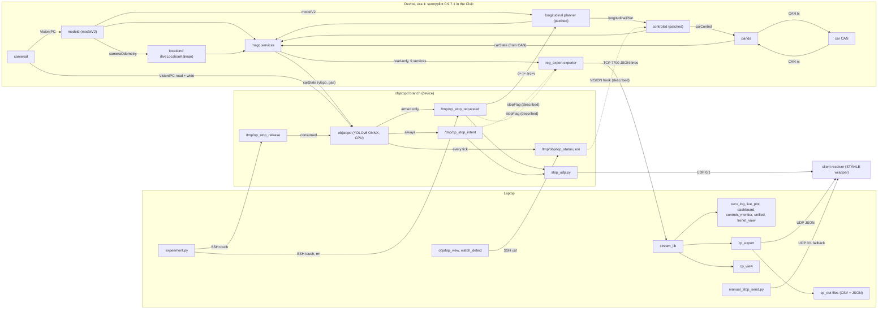
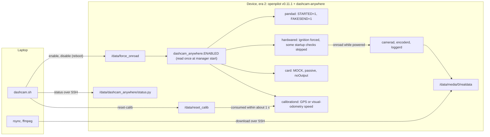
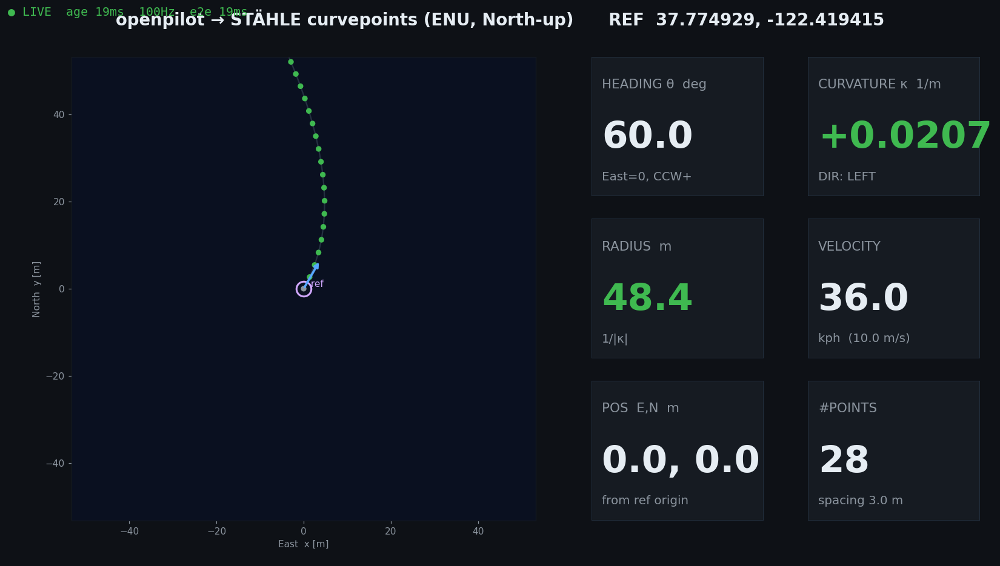

# Overview

OP4Anything collects the laptop tools, on-device daemons, device patches and field notes built between 2026‑07‑07 and 2026‑10‑03 around one comma 3X. The goal was to get openpilot's planning, trajectory and stop decisions off the device and into the formats used by the client, Arman, whose downstream consumer is the STÄHLE TrackDriver robot ecosystem. The work spans two firmware eras: sunnypilot 0.9.7.1 in a 2020 Honda Civic (later also a truck/bench rig with no CAN), and openpilot v0.11.1 with a "dashcam‑anywhere" patch for robots and small vehicles. This page maps the seven work streams, the architecture, the data products, the timeline, what the repository does and does not contain, and the conventions used in every other doc.

## At a glance

| Field | Value |
|---|---|
| **Audience** | Everyone: client integrators, operators, developers, maintainers |
| **Runs on** | Laptop (Python 3 tools, shell scripts) and device (comma 3X daemons, patcher scripts, one openpilot patch) |
| **Era** | Both. **Era 1 — sunnypilot 0.9.7.1** (2026‑07 → 2026‑08) and **Era 2 — openpilot v0.11.1 `release-tizi` + dashcam‑anywhere** (from 2026‑10‑03) |
| **Status** | Reference. Era 1 is historical: a re-flash erased it from the device. Era 2 is the last documented device state |
| **Key files** | [`remote/README.md`](../remote/README.md), [`remote/Arman/README.md`](../remote/Arman/README.md), [`remote/Arman/OPERATIONS.md`](../remote/Arman/OPERATIONS.md), [`remote/Arman/vision/STOP_SIGN_VISION.md`](../remote/Arman/vision/STOP_SIGN_VISION.md), [`remote/Arman/dashcam_anywhere/README.md`](../remote/Arman/dashcam_anywhere/README.md) |

## What this is and is not

**What it is**

- **Research tooling for one client.** The curvepoint work exists "for porting openpilot's driving onto the bus": that bus is actuated by a STÄHLE TrackDriver robot that follows curvepoints (a track defined as position + heading + curvature + speed), per slide 1 of [`cp_slides.html`](../remote/Arman/cp_slides.html). The control-side study asks the same question from the other end: what in openpilot's planning transfers to a bus and what has to be rebuilt (slide 6 of [`openpilot_controls_slides.pdf`](../remote/openpilot_controls_slides.pdf)).
- **A read-only telemetry stream** (reg_export, TCP 7700) plus laptop clients, converters and viewers. The exporter "can NEVER affect the driving stack" because msgq subscribers cannot back-pressure openpilot ([`exporter_device.py`](../remote/exporter_device.py), module docstring).
- **A few era‑1 device modifications** that made the Civic decelerate to a stop on command or on a camera detection, and that forced the device onroad without CAN.
- **An era‑2 openpilot patch**, included as a diff, that turns the device into a self-calibrating dashcam that never controls anything.
- **The original notes**, in English and Chinese, kept under `remote/`, redacted but otherwise unchanged. These docs are their English, code-checked reference; [16](16-errata-and-crosswalk.md) lists the known places where a note disagrees with the code.

**What it is not**

- **Not affiliated** with, endorsed by or supported by comma.ai, the openpilot project, the sunnypilot project or Ultralytics ([`THIRD_PARTY_NOTICES.md`](../THIRD_PARTY_NOTICES.md)).
- **Not a product.** openpilot describes itself as "ALPHA QUALITY SOFTWARE FOR RESEARCH PURPOSES ONLY. THIS IS NOT A PRODUCT." The era‑1 changes went further: OP long without the stock radar/AEB, braking on camera detections, a forced onroad state. Research use only, on a closed course, with a safety driver (see [Safety and legal notes](#safety-and-legal-notes)).
- **Not a fork of openpilot or sunnypilot.** The era‑1 device patches survive either as the scripts that applied them or only as descriptions (see [Described, not included](#described-not-included)); the era‑2 patch is a diff against one openpilot commit.
- **Not an openpilot feature.** openpilot's own driving model does not detect stop signs, traffic lights or pedestrians; objstopd is an added YOLOv8 detector ([`STOP_SIGN_VISION.md`](../remote/Arman/vision/STOP_SIGN_VISION.md), v1 section).
- **Not validated end to end.** There is no record that the curvepoint sign convention was checked on the car (only unit tests and an offroad check exist), USB‑C Ethernet was never confirmed in the field, and the models and raw drive data are not included.

## Hardware and firmware eras

| | Era 1 — sunnypilot 0.9.7.1 | Era 2 — openpilot v0.11.1 `release-tizi` + dashcam‑anywhere |
|---|---|---|
| **Device** | comma 3X: road camera OX03C10, 1928×1208, focal 2648 px (constants in [`objstopd.py`](../remote/Arman/objstopd.py)). No internal battery (power loss = shutdown) and no RTC battery (wall clock wrong until a GPS fix) | The same comma 3X, re-flashed |
| **Firmware** | sunnypilot 0.9.7.1. Device Python: `/usr/local/pyenv/versions/3.11.4/bin/python3` | openpilot v0.11.1 `release-tizi`, parent `70e157462304e5ce7d03ffbec6cb7f45bf347bb7` (`70e1574`) + local commit `8acb496`, tag `dashcam-anywhere-v1`. Device Python: `/usr/local/venv/bin/python3 -B` |
| **Dates** | 2026‑07 → 2026‑08 (files last modified 2026‑07‑07 … 2026‑08‑13) | From 2026‑10‑03 |
| **Vehicles** | 2020 Honda Civic (Bosch), `HONDA_CIVIC_BOSCH`, torque lateral (`EnforceTorqueLateral=1`); later a truck and a bench rig with no CAN | Robots and small vehicles. The mode needs no harness, ignition line or CAN |
| **Longitudinal** | Stock PCM until 2026‑07‑17: accel computed but not sent to CAN, openpilot only spoofed cruise buttons. From 2026‑07‑17 OP long: `ExperimentalLongitudinalEnabled=1`, stock radar and AEB off, `ACC_CONTROL.ACCEL_COMMAND` sent. By 2026‑08‑06 also `DisengageOnAccelerator=0`: a gas tap overrode and released instead of disengaging; the brake still disengaged at once (`OPERATIONS.md` §0) | None. The device never controls: MOCK car, passive, panda safety `noOutput`, every `sendcan` dropped (`FAKESEND=1`) |
| **Phases** | 1) reg_export telemetry, laptop tools, control-chain study (07‑07 → 07‑14). 2) STÄHLE curvepoints (07‑14 → 07‑20; `"stop"` and UDP added by 08‑06). 3) OP long + file-flag stop command (07‑17). 4) Vision stop objstopd v1 → v2 (07‑25) → v2.1 (08‑06). 5) No-CAN truck/bench mode (enabled 08‑06, extended around 08‑12). 6) 0/1 UDP stop signal (08‑13) | Patch, unit tests, replay validation and bench acceptance (10‑03). Use: a pure dashcam on robots, calibrated from GPS or visual-odometry speed |
| **Current device state** | **Gone.** The device was re-flashed; every era‑1 device change is erased. The re-flash date is not recorded: some time between 2026‑08‑13 (the last era‑1 file) and 2026‑10‑03 (the era‑2 patch) | Last documented state (2026‑10‑03): patch installed, `DisableUpdates=1`, Civic params backed up to `/data/dashcam_backup/20261003/`, mode toggled by `/data/force_onroad` |

> [!NOTE]
> Dates in this table come from the files' last-modified times unless a note states them. The objstopd v2 (2026‑07‑25) and v2.1 (2026‑08‑06) dates come from the [`STOP_SIGN_VISION.md`](../remote/Arman/vision/STOP_SIGN_VISION.md) headers, the no-CAN enable date from [`OPERATIONS.md`](../remote/Arman/OPERATIONS.md) §3.1, and the era‑2 date from the dashcam README's validation record. The 2026‑07‑17 switch to OP long is dated by the files that describe it. The longitudinal facts for the Civic (radar/AEB, `ACCEL_COMMAND`, `SCM_BUTTONS`) come from the device's sunnypilot source as recorded in [`STOP_COMMAND.md`](../remote/Arman/STOP_COMMAND.md) and [`controls_principles.md`](../remote/controls_principles.md); that source is not in this repo. See [04](04-control-principles-and-frenet.md).

### Which era is on a device

Set `$COMMA_IP` first ([Device address and command blocks](#device-address-and-command-blocks)). `dashcam.sh enable` runs the same test after its confirmation prompt, before it changes anything:

```bash
# laptop
ssh comma@$COMMA_IP 'test -f /data/openpilot/common/dashcam_anywhere.py && echo era2 || echo era1-or-stock'
```

`/data/force_onroad` exists in both eras with different meanings. In era 1 the hardwared hook and the fake-ignition process conditions re-checked it live. In era 2 manager reads it once at start, so a change needs a reboot. Always say which era you mean.

### What runs on the era 2 device

As documented, the era‑2 setup consists of the patch, `status.py` and `replay_calib.py` under `/data/dashcam_anywhere/`, the flag files (`/data/force_onroad`, `/data/reset_calib`, `/data/calib_from_dashcam`), the `DisableUpdates` param and the backup under `/data/dashcam_backup/20261003/`. Nothing in [`remote/Arman/dashcam_anywhere/`](../remote/Arman/dashcam_anywhere/README.md) reinstalls the reg_export exporter or objstopd. The patch's `system/manager/process_config.py` hunk registers neither: it only sets `restart_if_crash` on 17 stock processes (`DASHCAM_RESTART_IF_CRASH`).

> [!IMPORTANT]
> **Inferred; verify with `nc -z $COMMA_IP 7700`.** The reg_export exporter (TCP 7700) and objstopd are most likely **not** installed on the era‑2 device, so work streams 1–5 below do not run against it as-is.

```bash
# laptop
nc -z $COMMA_IP 7700 && echo "7700 open: an exporter is running" || echo "7700 closed (or device unreachable): no exporter"
ssh comma@$COMMA_IP 'ls /data/objstop 2>/dev/null; ps aux | grep -E "objstop|reg_export" | grep -v grep'
```

**Analysis (from code; not field-tested).** Reinstalling the era‑1 device tools on era 2 would at least mean switching to the era‑2 interpreter (`/usr/local/venv/bin/python3`) instead of the era‑1 path that [`stop_udp_start.sh`](../remote/Arman/stop_udp_start.sh) hard-codes and the notes' run lines use. Every field path the exporter reads would also need checking: [`remote/README.md`](../remote/README.md) warns that "if the device is re-flashed to another version, the field paths in `exporter.py` may need updating."

## Capability map

Seven work streams. "Historical" means the device side existed only in era 1 and was erased by the re-flash. "Current" means it is part of the last documented device state.

| # | Work stream | Runs on | Entry points | Docs | Status |
|---|---|---|---|---|---|
| 1 | **reg_export telemetry stream + laptop tools.** Streams openpilot planning, control and feedback signals as JSON lines | Device: exporter. Laptop: clients | [`exporter_device.py`](../remote/exporter_device.py), installed as `/data/openpilot/tools/reg_export/exporter.py`: first run by hand in tmux, later registered with manager as `always_run` (described, not included). Laptop: [`stream_lib.py`](../remote/stream_lib.py), [`recv_log.py`](../remote/recv_log.py), [`live_plot.py`](../remote/live_plot.py), [`dashboard.py`](../remote/dashboard.py), [`controls_monitor.py`](../remote/controls_monitor.py), [`unified.py`](../remote/unified.py). Frenet outputs: [`frenet.py`](../remote/frenet.py), [`frenet_view.py`](../remote/frenet_view.py) | [03](03-telemetry-stream.md), [04](04-control-principles-and-frenet.md) | Historical on the device (era‑1 baseline snapshot of 2026‑07‑14). The laptop tools work with any compatible exporter |
| 2 | **STÄHLE curvepoints.** Converts the planned path (live) or the driven GPS route (record) into STÄHLE CSV + client segment JSON in the client's ENU frame | Laptop (pure stdlib; matplotlib only for the viewer) | [`cp_export.py`](../remote/Arman/cp_export.py) (main), [`cp_view.py`](../remote/Arman/cp_view.py) (live viewer); libraries [`frame.py`](../remote/Arman/frame.py), [`curvepoints.py`](../remote/Arman/curvepoints.py); client-facing snippet [`udp_snippet.py`](../remote/Arman/udp_snippet.py); link tests [`_udp_probe.py`](../remote/Arman/_udp_probe.py), [`_udp_testsend.py`](../remote/Arman/_udp_testsend.py) | [05](05-curvepoints-pipeline.md), [06](06-client-interface-spec.md) | Historical data source (needs the era‑1 stream). The interface in 06 is the client contract |
| 3 | **Civic OP-long stop command.** Decelerate to a stop when `/tmp/op_stop_requested` exists. v1: stop now. v2: `d=<m> t=<monotonic> src=v` distance ramp | Laptop → device over SSH; patched planner on the device | [`experiment.py`](../remote/Arman/experiment.py), actions `check`, `stop`, `go`, `release`, `status`. Planner patch: described, not included (mirror: `parse_flag()` / `planner_ramp()` in [`test_stopsm.py`](../remote/Arman/vision/test_stopsm.py)) | [07](07-longitudinal-stop.md) | Historical (era 1; planner patch erased) |
| 4 | **Vision stop (objstopd).** On-device YOLOv8 for stop signs, red lights and pedestrians, a distance Kalman filter and a state machine that writes the stop flags | Device (CPU, onnxruntime); laptop viewers | [`objstopd.py`](../remote/Arman/objstopd.py) + [`yolo_infer.py`](../remote/Arman/vision/yolo_infer.py) in `/data/objstop/`; viewers [`objstop_view.py`](../remote/Arman/vision/objstop_view.py), [`watch_detect.py`](../remote/Arman/watch_detect.py); tests [`test_stopsm.py`](../remote/Arman/vision/test_stopsm.py); study [`ped_analysis.py`](../remote/Arman/vision/ped_analysis.py) | [08](08-vision-stop-objstopd.md) | Historical (era 1). Not installed in era 2 (inferred) |
| 5 | **0/1 UDP stop signal.** One ASCII byte, `"1"` while a stop flag exists, else `"0"` | Device sender; laptop helpers and fallback | [`stop_udp.py`](../remote/Arman/stop_udp.py) (device); [`stop_udp_start.sh`](../remote/Arman/stop_udp_start.sh), [`stop_udp_stop.sh`](../remote/Arman/stop_udp_stop.sh) (both hard-code the comma at 172.20.10.3), [`stop_udp_watch.sh`](../remote/Arman/stop_udp_watch.sh), [`manual_stop_send.py`](../remote/Arman/manual_stop_send.py) (laptop) | [09](09-stop-signal-udp.md), [06](06-client-interface-spec.md) | Historical (the device sender reads era‑1 objstopd flags). The laptop fallback still works on its own |
| 6 | **No-CAN truck/bench mode.** Forces onroad without ignition or CAN so camera, model, GPS, objstopd and the client JSON keep running | Device patcher scripts and diagnostics; one laptop stream dump | [`enable_dashcam_mode.py`](../remote/Arman/enable_dashcam_mode.py), [`force_onroad_v2.py`](../remote/Arman/force_onroad_v2.py), [`fake_ignition.py`](../remote/Arman/fake_ignition.py) + [`enable_fake_ignition_autostart.py`](../remote/Arman/enable_fake_ignition_autostart.py), [`write_carparams_mock.py`](../remote/Arman/write_carparams_mock.py), [`suppress_car_prompt.py`](../remote/Arman/suppress_car_prompt.py), [`enable_cabin_audio.py`](../remote/Arman/enable_cabin_audio.py); diagnostics [`_verify_state.py`](../remote/Arman/_verify_state.py), [`_vipc_probe.py`](../remote/Arman/_vipc_probe.py), [`_modeld_diag.py`](../remote/Arman/_modeld_diag.py) (device) and [`_stream_dump.py`](../remote/Arman/_stream_dump.py) (laptop, reads TCP 7700) | [10](10-no-can-mode-sunnypilot.md) | Historical. Superseded by dashcam‑anywhere |
| 7 | **dashcam‑anywhere.** Records whenever powered, never controls, calibrates the camera from GPS or visual-odometry speed | Device patch; laptop control script | [`dashcam_anywhere.patch`](../remote/Arman/dashcam_anywhere/dashcam_anywhere.patch) (10 files, +375/−25), [`dashcam.sh`](../remote/Arman/dashcam_anywhere/dashcam.sh), [`status.py`](../remote/Arman/dashcam_anywhere/status.py), [`replay_calib.py`](../remote/Arman/dashcam_anywhere/replay_calib.py) | [11](11-dashcam-anywhere-design.md), [12](12-dashcam-anywhere-field-guide.md) | **Current** (last documented device state, 2026‑10‑03) |

Reference material that never ran on the device as such:

- the control-chain study: [`controls_principles.md`](../remote/controls_principles.md), [`openpilot_controls_slides.pdf`](../remote/openpilot_controls_slides.pdf) (see [04](04-control-principles-and-frenet.md));
- the curvepoint slide deck [`cp_slides.html`](../remote/Arman/cp_slides.html) (see [05](05-curvepoints-pipeline.md));
- the param-based `StopRequested` design for an openpilot 0.9.8 checkout in [`STOP_COMMAND.md`](../remote/Arman/STOP_COMMAND.md), which was never deployed (see [07](07-longitudinal-stop.md)).

Cross-cutting docs cover setup ([02](02-setup-ssh-networking.md)), operations ([13](13-operations-runbook.md)), device changes ([14](14-device-changes-and-revert.md)), every file ([15](15-file-reference.md)) and errata ([16](16-errata-and-crosswalk.md)).

## Architecture

### Era 1 data and control flow

The era‑1 device in the Civic, the objstopd branch, and the laptop. Solid arrows are implemented by code in this repo or by the device's stock software. Dashed arrows are links that existed only in era‑1 device code that is **described, not included**: the deployed exporter's `stopFlag` and the controlsd "VISION: ..." display hook. The nodes marked "(patched)" ran era‑1 modifications that are also described, not included (see [07](07-longitudinal-stop.md) and [14](14-device-changes-and-revert.md)).



How to read it:

- **Telemetry.** The exporter subscribes read-only to 9 services (`SERVICES` in [`exporter_device.py`](../remote/exporter_device.py)). It emits one record per `carState` frame, so with no CAN the baseline exporter emits nothing. The no-CAN variant `exporter_nocan.py` changed that (described, not included; [`enable_dashcam_mode.py`](../remote/Arman/enable_dashcam_mode.py) docstring).
- **Stop flags.** objstopd writes the actuation flag `/tmp/op_stop_requested` only with `--arm`, and the intent flag `/tmp/op_stop_intent` always, in shadow mode too ([`objstopd.py`](../remote/Arman/objstopd.py) → `main()`, `write_flag()`). Each holds `d=… t=… src=v`, rewritten every 50 ms tick while objstopd wants a stop; when it no longer does, objstopd deletes the file if it carries `src=v`. `experiment.py stop` creates an empty actuation flag (stop now) and `go` deletes it; `release` touches `/tmp/op_stop_release`, which objstopd consumes: from BRAKING or any STOPPED_* state it forces RESUMING.
- **Client outputs.** `cp_export` writes files and optional UDP JSON; `stop_udp.py` sends `"1"` while either flag file exists. Both feed the client's receiver, whose wrapper converts the segment JSON into the STÄHLE format ([`remote/Arman/README.md`](../remote/Arman/README.md)). In live mode the JSON's `"stop"` comes from the deployed exporter's `stopFlag`, which read both flags, with the actuation flag taking priority (described, not included; `OPERATIONS.md` §3.2).

### Era 2 dashcam-anywhere

None of the device boxes above exist after the re-flash. Era 2 is a pure dashcam; the boot path is drawn in full in [11](11-dashcam-anywhere-design.md).



Grounding: `ENABLED = os.path.isfile(FLAG)` is evaluated once in the patch's new `common/dashcam_anywhere.py`. Then: pandad sets `STARTED=1` and `FAKESEND=1`. hardwared forces `onroad_conditions["ignition"] = True` and skips `up_to_date`, `accepted_terms`, `completed_training`, `registered_device` and `no_excessive_actuation`; the thermal and disk checks stay. card loads the MOCK car without waiting for CAN and refuses any non-`noOutput` CarParams. calibrationd uses GPS speed when the fix is good and `cameraOdometry` speed otherwise, and consumes `/data/reset_calib`. selfdrived shows a static "Dashcam Mode" banner plus the calibration progress, and the UI keeps the road view without a real ignition. Entering or leaving the mode clears the camera calibration (marker `/data/calib_from_dashcam`), so Civic and robot calibrations never mix. With the flag absent the device behaves as stock openpilot, except for that marker and the reset flag. Laptop side: [`dashcam.sh`](../remote/Arman/dashcam_anywhere/dashcam.sh) (`enable`, `disable`, `reset-calib`, `status`), with downloads per [12](12-dashcam-anywhere-field-guide.md).

## Data products at a glance

| Product | Producer → consumer | Where / transport | Rate | Shape | Doc |
|---|---|---|---|---|---|
| **Raw telemetry** | `exporter.py` (device) → laptop tools | TCP 7700, bind `0.0.0.0`; env `REG_EXPORT_PORT` / `REG_EXPORT_BIND` (`--port` / `--bind` when run standalone, but the environment variables win when set) | One record per `carState` frame (~100 Hz). Heavy arrays only on frames where the 20 Hz `modelV2` / `longitudinalPlan` updated | Newline-delimited compact JSON: envelope `t_wall`, `t_mono`, `seq`; blocks `carState`, `carControl`, `carOutput`, `controlsState`, `longitudinalPlan`, `modelV2`, `loc`, `radar`, `liveParams`, each with `_upd`, `_valid`, `_mono` (or `_err`). Per-client queue of 300 records, oldest dropped. Data flows only onroad | [03](03-telemetry-stream.md) |
| **Segment JSON file** | `cp_export.py` → client | `<out-dir>/track_live.json` (`--mode live`) or `route_track.json` (`--mode record`); default `--out-dir ./cp_out`; replaced atomically, pretty-printed | Live: at most ~20 Hz. Record: a snapshot every 2 s and a final write at Ctrl‑C | `{"ref":{"latitude","longitude"},"stop":0\|1,"segments":[{"start":{"x","y"},"end":{"x","y"},"velocity","radius","direction"}]}`. x = East, y = North [m] from the fixed origin; velocity m/s; radius 0 = straight; direction `left`/`right` | [06](06-client-interface-spec.md), [05](05-curvepoints-pipeline.md) |
| **Segment JSON over UDP** | `cp_export.py --udp HOST[:PORT]` → client | One compact UTF‑8 JSON per datagram; a bare host uses `--udp-port` (default 5005); sent only once an origin is set | At most `--udp-hz` (default 10 Hz); payloads above 60,000 B are skipped, not fragmented | Same document as the file; no sequence number, no acknowledgement | [06](06-client-interface-spec.md) |
| **STÄHLE CSV** | `cp_export.py` → STÄHLE TrackDriver | `<out-dir>/track_live.csv` or `route_track.csv`, written together with the JSON file | Same as the JSON file | Two `#` header lines (origin; frame/units), a column row, then 9 columns: `Deltatime_s, velocity_kph, gear, index, PositionX_East_m, PositionY_North_m, theta_rad, kappa_1pm, long_accel_mss` (gear 99, long accel 0) | [06](06-client-interface-spec.md), [05](05-curvepoints-pipeline.md) |
| **0/1 stop byte** | `stop_udp.py` (device) or `manual_stop_send.py` (laptop fallback) → client | UDP to a given host:port. Device: host and port are required arguments; laptop fallback default 172.20.10.2:5005 | 10 Hz default (`--hz`) | A single ASCII byte, `"0"` or `"1"`. The device sender sends `"1"` while `/tmp/op_stop_requested` or `/tmp/op_stop_intent` exists | [09](09-stop-signal-udp.md), [06](06-client-interface-spec.md) |
| **Recordings** | stock loggerd (device) → operator | `/data/media/0/realdata/<route>--<seg>/` | 1‑minute segments | Era 2 (per the field guide): `fcamera.hevc`, `ecamera.hevc`, `dcamera.hevc` (~75 MB/min each), `qcamera.ts` (~1 MB/min), `rlog.zst` (~10 MB/min), `qlog.zst` (~0.2 MB/min); about 5.5 h kept, oldest deleted first. Era 1: the stock recordings in the same folder, plus `cabin_audio_44100_mono_s16le.raw` (~5 MB/min) only if `enable_cabin_audio.py` was applied, which is not recorded | [12](12-dashcam-anywhere-field-guide.md), [10](10-no-can-mode-sunnypilot.md) |

Caveats that apply to every consumer:

- **`"stop"` is only live in `--mode live`.** Record mode always writes `"stop": 0` (`emit_record()` in [`cp_export.py`](../remote/Arman/cp_export.py) never passes a stop value). `cp_export` copies `"stop"` from the exporter's `stopFlag` block, and the baseline [`exporter_device.py`](../remote/exporter_device.py) in this repo has no `stopFlag`. Against it, `"stop"` is always 0.
- **The 0/1 byte reflects file existence only.** A crashed objstopd can leave a stale `"1"` (see [09](09-stop-signal-udp.md)).
- **Units differ between the two formats.** Segment JSON velocity is m/s; the STÄHLE CSV is kph ("Units note" in [`remote/Arman/README.md`](../remote/Arman/README.md)).
- **`--stdout`.** In live mode, `cp_export` can also print each update's segment JSON as one line on stdout.
- **Internal files.** The flags in `/tmp` and `/tmp/objstop_status.json` / `/tmp/objstop_last.jpg` link components on the device; they are not client deliverables (see [08](08-vision-stop-objstopd.md)).



*A self-test render of [`cp_view.py`](../remote/Arman/cp_view.py) from synthetic data (no drive data), around the neutral example origin. A left-bending track shows κ > 0 and DIR: LEFT, as the client convention requires.*

## Timeline

> [!NOTE]
> Dates come from the files' last-modified times (recorded before redaction) unless a note states the date. The "Date source" column says which. A last-modified date is not a creation date: a file may have been started earlier. File paths in the table are relative to `remote/`.

| Date | What happened | Files last modified that day | Date source |
|---|---|---|---|
| 2026‑07‑07 | First reg_export laptop client | `stream_lib.py`, `recv_log.py`, `live_plot.py` | mtime |
| 2026‑07‑14 | Exporter baseline snapshot; control-chain study, dashboards and Frenet tools; the curvepoint slide deck | `exporter_device.py`, `controls_monitor.py`, `controls_principles.md`, `dashboard.py`, `frenet.py`, `frenet_view.py`, `openpilot_controls_slides.{html,pdf}`, `README.md`, `unified.py`, `*_selftest.png`; `Arman/cp_slides.html`, `Arman/cp_view_selftest.png` | mtime |
| 2026‑07‑17 | OP long enabled on the Civic and the file-flag stop command (planner v1) deployed; segment JSON format documented | `Arman/README.md`, `Arman/EXPERIMENT_RUNBOOK.md`, `Arman/STOP_COMMAND.md` | mtime |
| 2026‑07‑20 | Curvepoint pipeline code | `Arman/cp_view.py`, `Arman/curvepoints.py`, `Arman/frame.py`, `Arman/stream_lib.py` | mtime |
| Before 2026‑07‑25 | objstopd v1: stop-now flag, shadow then arm (its CLI flags no longer work with v2) | — (described in the "v1 reference" part of `STOP_SIGN_VISION.md`) | undated |
| 2026‑07‑25 | objstopd v2: distance-aware stops, planner ramp v2, Honda `startAccel=0.6`, reliable resume | — | `STOP_SIGN_VISION.md` header |
| 2026‑08‑04 | Field drives with a static test dummy; the laptop status board | `Arman/vision/objstop_view.py` | "the 8/4 drives" in `STOP_SIGN_VISION.md` v2.1 + mtime |
| 2026‑08‑06 | objstopd v2.1 (pedestrian fixes, operator release, intent flag, `"stop"` in the client JSON); no-CAN dashcam mode enabled and verified; Ethernet notes; operations manual | `Arman/ETHERNET_SETUP.md`, `Arman/experiment.py`, `Arman/udp_snippet.py`, `Arman/vision/{objstopd,test_stopsm,yolo_infer,ped_analysis}.py`, `Arman/vision/STOP_SIGN_VISION.md`, `Arman/enable_dashcam_mode.py`, `Arman/objstopd.py`, `Arman/OPERATIONS.md`, `Arman/suppress_car_prompt.py`, `Arman/force_onroad_v2.py`, `Arman/enable_cabin_audio.py` | `STOP_SIGN_VISION.md` v2.1 header, `OPERATIONS.md` §3.1 + mtime |
| 2026‑08‑12 | No-CAN rig extended with fake ignition (`fake_ignition.py` was run by hand, per the autostart script's docstring); scripts for a boot autostart and mock CarParams, whose application is not recorded; device and stream diagnostics, UDP link tests; last edit of `cp_export.py` | `Arman/fake_ignition.py`, `Arman/enable_fake_ignition_autostart.py`, `Arman/write_carparams_mock.py`, `Arman/cp_export.py`, `Arman/_verify_state.py`, `Arman/_modeld_diag.py`, `Arman/_vipc_probe.py`, `Arman/_stream_dump.py`, `Arman/_udp_probe.py`, `Arman/_udp_testsend.py` | mtime |
| 2026‑08‑13 | 0/1 UDP stop signal; detection watcher; discovery script last edited | `Arman/stop_udp.py`, `Arman/stop_udp_start.sh`, `Arman/stop_udp_stop.sh`, `Arman/stop_udp_watch.sh`, `Arman/manual_stop_send.py`, `Arman/watch_detect.py`, `Arman/find_comma.sh` | mtime |
| Not recorded (between 2026‑08‑13 and 2026‑10‑03) | The device was re-flashed to openpilot v0.11.1 `release-tizi`; every era‑1 change was erased | — | inferred: after the last era‑1 file, before the era‑2 patch |
| 2026‑10‑03 | dashcam‑anywhere: patch committed as `8acb496` (tag `dashcam-anywhere-v1`), unit tests, replay and bench acceptance; laptop field guide | `Arman/dashcam_anywhere/{replay_calib.py,dashcam.sh,status.py,dashcam_anywhere.patch,README.md,LAPTOP_GUIDE.md}` | validation record in the dashcam README + mtime |

The client interfaces followed the same timeline: the segment JSON and the STÄHLE CSV were defined between 2026‑07‑14 (slides 5–6 of `cp_slides.html`) and 2026‑07‑17 (`Arman/README.md`), the `"stop"` field was added on 2026‑08‑06 and the 0/1 byte stream on 2026‑08‑13 (details in [06](06-client-interface-spec.md#scope-and-interface-history)). [`OPERATIONS.md`](../remote/Arman/OPERATIONS.md) §0 still lists the no-CAN mode as "pending enable", but its §3.1 records it as applied and verified on 2026‑08‑06. It was enabled on 2026‑08‑06, extended around 2026‑08‑12 with fake ignition (run by hand; applying its boot autostart is not recorded), and erased by the re-flash.

> [!NOTE]
> **Reported in `dashcam_anywhere/README.md`.** The era‑2 results (15/15 calibration unit tests, the 19-segment replay, the bench acceptance on 2026‑10‑03) are field claims from that note; they were not re-run for these docs (see [11](11-dashcam-anywhere-design.md)).

## Included and not included

### Included in this repository

All 65 files under `remote/`, plus one image under `docs/img/`:

| Area | Files |
|---|---|
| Telemetry (stream 1) | [`exporter_device.py`](../remote/exporter_device.py), [`stream_lib.py`](../remote/stream_lib.py) (an identical copy is [`Arman/stream_lib.py`](../remote/Arman/stream_lib.py)), [`recv_log.py`](../remote/recv_log.py), [`live_plot.py`](../remote/live_plot.py), [`dashboard.py`](../remote/dashboard.py), [`controls_monitor.py`](../remote/controls_monitor.py), [`unified.py`](../remote/unified.py), [`dashboard_selftest.png`](../remote/dashboard_selftest.png), [`unified_selftest.png`](../remote/unified_selftest.png), [`README.md`](../remote/README.md) |
| Control principles and Frenet | [`controls_principles.md`](../remote/controls_principles.md), [`frenet.py`](../remote/frenet.py), [`frenet_view.py`](../remote/frenet_view.py), [`frenet_selftest.png`](../remote/frenet_selftest.png), [`openpilot_controls_slides.html`](../remote/openpilot_controls_slides.html), [`openpilot_controls_slides.pdf`](../remote/openpilot_controls_slides.pdf) |
| Curvepoints (stream 2) | [`Arman/README.md`](../remote/Arman/README.md), [`frame.py`](../remote/Arman/frame.py), [`curvepoints.py`](../remote/Arman/curvepoints.py), [`cp_export.py`](../remote/Arman/cp_export.py), [`cp_view.py`](../remote/Arman/cp_view.py), [`cp_slides.html`](../remote/Arman/cp_slides.html), [`cp_view_selftest.png`](../remote/Arman/cp_view_selftest.png), [`_selftest_out/selftest.csv`](../remote/Arman/_selftest_out/selftest.csv), [`_selftest_out/selftest.json`](../remote/Arman/_selftest_out/selftest.json), [`udp_snippet.py`](../remote/Arman/udp_snippet.py), [`_udp_probe.py`](../remote/Arman/_udp_probe.py), [`_udp_testsend.py`](../remote/Arman/_udp_testsend.py) |
| Stop command (stream 3) | [`experiment.py`](../remote/Arman/experiment.py), [`STOP_COMMAND.md`](../remote/Arman/STOP_COMMAND.md), [`EXPERIMENT_RUNBOOK.md`](../remote/Arman/EXPERIMENT_RUNBOOK.md) |
| Vision stop (stream 4) | [`Arman/objstopd.py`](../remote/Arman/objstopd.py) (canonical, deployed v2.1), [`vision/objstopd.py`](../remote/Arman/vision/objstopd.py) (earlier copy without the intent flag, kept for the tests), [`yolo_infer.py`](../remote/Arman/vision/yolo_infer.py), [`test_stopsm.py`](../remote/Arman/vision/test_stopsm.py), [`objstop_view.py`](../remote/Arman/vision/objstop_view.py), [`ped_analysis.py`](../remote/Arman/vision/ped_analysis.py), [`watch_detect.py`](../remote/Arman/watch_detect.py), [`STOP_SIGN_VISION.md`](../remote/Arman/vision/STOP_SIGN_VISION.md), [`docs/img/objstop_view_selftest.png`](img/objstop_view_selftest.png) |
| 0/1 UDP (stream 5) | [`stop_udp.py`](../remote/Arman/stop_udp.py), [`stop_udp_start.sh`](../remote/Arman/stop_udp_start.sh), [`stop_udp_stop.sh`](../remote/Arman/stop_udp_stop.sh), [`stop_udp_watch.sh`](../remote/Arman/stop_udp_watch.sh), [`manual_stop_send.py`](../remote/Arman/manual_stop_send.py) |
| No-CAN mode (stream 6) | [`enable_dashcam_mode.py`](../remote/Arman/enable_dashcam_mode.py), [`force_onroad_v2.py`](../remote/Arman/force_onroad_v2.py), [`fake_ignition.py`](../remote/Arman/fake_ignition.py), [`enable_fake_ignition_autostart.py`](../remote/Arman/enable_fake_ignition_autostart.py), [`write_carparams_mock.py`](../remote/Arman/write_carparams_mock.py), [`suppress_car_prompt.py`](../remote/Arman/suppress_car_prompt.py), [`enable_cabin_audio.py`](../remote/Arman/enable_cabin_audio.py), [`_verify_state.py`](../remote/Arman/_verify_state.py), [`_vipc_probe.py`](../remote/Arman/_vipc_probe.py), [`_modeld_diag.py`](../remote/Arman/_modeld_diag.py), [`_stream_dump.py`](../remote/Arman/_stream_dump.py) |
| dashcam‑anywhere (stream 7) | [`dashcam_anywhere.patch`](../remote/Arman/dashcam_anywhere/dashcam_anywhere.patch), [`dashcam.sh`](../remote/Arman/dashcam_anywhere/dashcam.sh), [`status.py`](../remote/Arman/dashcam_anywhere/status.py), [`replay_calib.py`](../remote/Arman/dashcam_anywhere/replay_calib.py), [`README.md`](../remote/Arman/dashcam_anywhere/README.md), [`LAPTOP_GUIDE.md`](../remote/Arman/dashcam_anywhere/LAPTOP_GUIDE.md) |
| Operations and networking | [`OPERATIONS.md`](../remote/Arman/OPERATIONS.md), [`ETHERNET_SETUP.md`](../remote/Arman/ETHERNET_SETUP.md), [`find_comma.sh`](../remote/Arman/find_comma.sh) |

Snapshot notes:

- [`remote/Arman/_selftest_out/`](../remote/Arman/_selftest_out/selftest.json) was regenerated by `cp_export.py --selftest` with the neutral example origin. It is a sample of both output formats, not drive data.
- [`cp_view_selftest.png`](../remote/Arman/cp_view_selftest.png) and the copy embedded in `cp_slides.html` were re-rendered for publication.
- Two items from the work folder are not published: a byte-identical duplicate of `OPERATIONS.md` at the `remote/` root, and an `Arman/cp_out/` folder of junk bench output.
- Root files: [`LICENSE`](../LICENSE) (MIT), [`THIRD_PARTY_NOTICES.md`](../THIRD_PARTY_NOTICES.md) (openpilot/sunnypilot MIT; YOLOv8 AGPL‑3.0, weights not included), [`.gitignore`](../.gitignore).

### Described, not included

> [!NOTE]
> **Described, not included.** The items below exist, or existed, only on the era‑1 device (erased by the re-flash), on the desktop, or with the client. These docs describe them from the notes and from the scripts that applied them; nothing here restores them byte for byte.

| Item | Where it lives or lived | Described in | Doc |
|---|---|---|---|
| Longitudinal planner patch v1 (flag exists → `v_cruise = 0`) and v2 (distance ramp) | Era‑1 device, `selfdrive/controls/lib/longitudinal_planner.py` | [`STOP_COMMAND.md`](../remote/Arman/STOP_COMMAND.md), [`STOP_SIGN_VISION.md`](../remote/Arman/vision/STOP_SIGN_VISION.md) v2; on-disk mirror `parse_flag()` / `planner_ramp()` in [`test_stopsm.py`](../remote/Arman/vision/test_stopsm.py) | [07](07-longitudinal-stop.md) |
| Honda `interface.py`: `startingState=True, startAccel=0.6` | Era‑1 device | `STOP_SIGN_VISION.md` v2, `OPERATIONS.md` §0 | [07](07-longitudinal-stop.md) |
| controlsd "VISION: ..." display hook (lowest priority, display only) | Era‑1 device, `selfdrive/controls/controlsd.py` | `OPERATIONS.md` §0, §7, §9 | [07](07-longitudinal-stop.md), [08](08-vision-stop-objstopd.md) |
| hardwared force-onroad hook, `process_config.py` entries (reg_export `always_run`, objstopd autostart, fake ignition), `events.py` car prompt, `micd.py` cabin audio | Era‑1 device | The included patcher scripts, whose docstrings and embedded text show the change | [10](10-no-can-mode-sunnypilot.md), [14](14-device-changes-and-revert.md) |
| Deployed exporter variants with `stopFlag`; `/data/objstop/exporter_nocan.py` | Era‑1 device | `STOP_SIGN_VISION.md` v2.1, `OPERATIONS.md` §0, [`enable_dashcam_mode.py`](../remote/Arman/enable_dashcam_mode.py) docstring | [03](03-telemetry-stream.md), [06](06-client-interface-spec.md) |
| YOLOv8 ONNX models `yolov8n_320.onnx`, `yolov8n.onnx` (optional `yolov8s_320.onnx`) | Era‑1 device, `/data/objstop/` | AGPL‑3.0 weights; export your own | [08](08-vision-stop-objstopd.md) |
| `stop_command.py`, `common/params.cc` with `StopRequested` (openpilot 0.9.8 reference design, never deployed) | A desktop 0.9.8 checkout | `STOP_COMMAND.md`, reference section | [07](07-longitudinal-stop.md) |
| `replay_rlogs/` (19 Civic segments, 206 MB) | Desktop only | Dashcam README, `LAPTOP_GUIDE.md` §1.1 | [11](11-dashcam-anywhere-design.md) |
| The client's "CP Definition" PDF (curvepoint definition, distance rule, sign convention) | The client | [`Arman/README.md`](../remote/Arman/README.md), [`frame.py`](../remote/Arman/frame.py) and [`curvepoints.py`](../remote/Arman/curvepoints.py) docstrings | [05](05-curvepoints-pipeline.md) |
| Raw drive data: about 1.1 GB of route segments (rlog, qlog, qcamera, hevc) | Laptop | Deliberately not published: GPS traces and driver-camera video | — |

The era‑1 patches kept `*.bak_arman*` backups next to the files they changed (`OPERATIONS.md` §0). That note's §9 revert table is not a complete inventory of the era‑1 changes and gets one backup backwards; use [14](14-device-changes-and-revert.md).

## Conventions used in these docs

### Eras

- **Era 1 — sunnypilot 0.9.7.1** (2026‑07 → 2026‑08; Honda Civic + truck/bench no‑CAN)
- **Era 2 — openpilot v0.11.1 `release-tizi` + dashcam‑anywhere** (from 2026‑10‑03; robots/small vehicles)

Era 1 is written in the past tense, because the re-flash erased it from the device. Sections that describe era‑1 device state carry this label:

> [!WARNING]
> **Historical (sunnypilot era).** The device is no longer in this state.

### Status labels

| Label | Meaning |
|---|---|
| `[!NOTE]` **Described, not included.** | Exists only on the device or the desktop; described from the notes |
| `[!NOTE]` **Reported in `<note>`.** | A field claim from an original note, not re-verified for these docs |
| `[!WARNING]` **Historical (sunnypilot era).** | Era‑1 device state that no longer exists |
| `[!CAUTION]` | Safety |
| `[!IMPORTANT]`, `[!TIP]` | As needed |
| **Analysis (from code; not field-tested)** | Reasoning derived from reading the code, never observed in the field |

### Placeholders

Redacted values appear as placeholders, always in backticks. `<DONGLE_ID_2>` and `<COMMA_HOSTNAME>` complete the legend but occur in neither the notes nor the code:

| Placeholder | Meaning |
|---|---|
| `<DONGLE_ID>`, `<DONGLE_ID_2>` | comma dongle IDs |
| `weedle-<DONGLE_ID_PREFIX>` | the comma's tethering SSID: `weedle-` + the first 4 characters of the dongle ID |
| `<TAILSCALE_IP>` | VPN address of a laptop |
| `<LAPTOP_USER>` | Linux user |
| `<LAPTOP_HOSTNAME>` | laptop hostname |
| `<COMMA_HOSTNAME>` | device mDNS hostname |
| `<LAB_WIFI_SSID>` | the lab Wi‑Fi saved on the device |
| `<SSH_KEY_FINGERPRINT>` | fingerprint of the SSH key |
| "the client's engineer" | the client contact who confirmed the frame convention |

The GPS origin **37.7749295, -122.4194155** in notes, code and samples is a neutral example, not a mission origin. Always pass your own mission origin with `--ref-lat/--ref-lon`. Without them, `cp_export` locks the first fix it accepts as the origin, and `_valid_fix()` rejects only a missing or (0, 0) position, not an implausible one.

Private LAN addresses (192.168.1.231, 172.20.10.x, 10.42.0.x, 192.168.43.1, 192.168.5.x) are examples taken from the notes, and `swagswagcomma` is comma's public default tethering password.

### Device address and command blocks

Every command block starts with where it runs: `# laptop` or `# device  (ssh comma@$COMMA_IP)`. Commands use `$COMMA_IP`. Set it once per shell:

```bash
# laptop  (from the repo root)
cd remote/Arman && export COMMA_IP=$(./find_comma.sh)
# or set it by hand instead, e.g. on comma tethering:  export COMMA_IP=192.168.43.1
# then confirm it is YOUR device:
ssh comma@$COMMA_IP 'cat /data/params/d/DongleId'     # must print <DONGLE_ID>
```

`find_comma.sh` prints the first host it verifies, and more than one comma can share a network, so always check the dongle ID ([02](02-setup-ssh-networking.md)). If it finds no comma, it says why on stderr and `$COMMA_IP` stays empty; set the address by hand. The SSH user is lowercase `comma`. The notes use the laptop folder `~/Desktop/Drive/remote/`, which is this repo's `remote/`, and sometimes the desktop folder `~/Desktop/Drive/openpilot/Arman/`. To keep the original paths working, link your clone there as in [02](02-setup-ssh-networking.md#get-the-code): `mkdir -p ~/Desktop/Drive && ln -s <clone>/remote ~/Desktop/Drive/remote`, where `<clone>` is the clone's absolute path.

### Device interpreters

The laptop uses `python3`. On the device, use the interpreter of the era it runs:

```bash
# device  (ssh comma@$COMMA_IP)
# era 1 (sunnypilot 0.9.7.1); add :/data to PYTHONPATH for scripts that import from /data
cd /data/openpilot && PYTHONPATH=/data/openpilot /usr/local/pyenv/versions/3.11.4/bin/python3 <script>
# era 2 (openpilot v0.11.1)
cd /data/openpilot && PYTHONDONTWRITEBYTECODE=1 PYTHONPATH=/data/openpilot /usr/local/venv/bin/python3 -B <script>
```

Several notes and patcher-script docstrings use a bare `python3` on the device. These docs show the explicit form.

### Citations and paths

- Code is cited as a relative link plus a symbol, e.g. [`cp_export.py`](../remote/Arman/cp_export.py) → `write_outputs()`; never by line number.
- Repo paths are written `remote/...`. Device paths are absolute (`/data/...`, `/tmp/...`).
- The `file:line` references inside [`controls_principles.md`](../remote/controls_principles.md) and [`STOP_COMMAND.md`](../remote/Arman/STOP_COMMAND.md) point into the device's sunnypilot source, or into a 0.9.8 checkout, not into this repo.

## Safety and legal notes

> [!CAUTION]
> **OP long and armed vision stops brake a real car without the stock safety net.** With `ExperimentalLongitudinalEnabled=1`, the Civic Bosch ran without its stock radar and AEB (per the device's sunnypilot source, recorded in [`STOP_COMMAND.md`](../remote/Arman/STOP_COMMAND.md)). Use `experiment.py stop`, a manual `touch /tmp/op_stop_requested` and `objstopd.py --arm` only on a closed course, at low speed, with a driver whose hands are ready and whose foot is over the brake. Validate objstopd in shadow mode first. The driver is the only safety net (header of [`OPERATIONS.md`](../remote/Arman/OPERATIONS.md)). To end a stop: `experiment.py go` deletes the actuation flag, but an armed objstopd rewrites it every 50 ms while it wants to stop, so end a vision hold with `experiment.py release` or a gas tap, and press Ctrl‑C in the objstopd terminal to stop it and clear its flags ([07](07-longitudinal-stop.md#go-vs-release-who-owns-which-flag)). Undoing OP long and the other era‑1 changes: [14](14-device-changes-and-revert.md).

> [!CAUTION]
> **Vision stop is experimental and crude.** At the default 320 px input it reacts at only about 4–5 Hz. Traffic-light relevance does not know which light governs your lane. "Pedestrian" means a person in the forward zone, not crossing intent ([`STOP_SIGN_VISION.md`](../remote/Arman/vision/STOP_SIGN_VISION.md), "Honest limitations").

> [!CAUTION]
> **A forced-onroad device records and draws power whenever it is powered.** Era 1: `rm /data/force_onroad` before driving the Civic normally; otherwise the device stays onroad and records after the engine is off. Era 2: the device never goes offroad, so stock openpilot's offroad shutdown never runs. The patch's low-battery shutdown acts only when the panda reports a harness; the test is the harness status, not the vehicle type. Whenever `dashcam.sh status` shows `harness=notConnected` (as in the field guide's sample output), the battery needs its own switch or BMS. A robot fed 12 V through a harness box may report a harness, which arms that shutdown on the robot's own supply; the stock `DisablePowerDown` param turns it off (Analysis (from code; not field-tested); [Power](02-setup-ssh-networking.md#power)). Shut down cleanly with `dashcam.sh poweroff`; `dashcam.sh disable` leaves the mode (it reboots). Use a supply of at least 18 W (12 V recommended, through a harness box or an OBD-C cable). 5 V USB can brown out at full load, and the device shuts down hard below about 4 V. Never connect CAN wires on a robot.

> [!CAUTION]
> **Recording people.** In era 2 the device records the in-cabin (driver) camera, `dcamera.hevc`, next to the road cameras. The patch leaves the stock audio recording (the `RecordAudio` setting: audio is recorded when it is on), the in-cabin camera and driver monitoring as they are, and with a network connection the device uploads qlog/qcamera to comma connect as stock does (dashcam README, known limitations; [`LAPTOP_GUIDE.md`](../remote/Arman/dashcam_anywhere/LAPTOP_GUIDE.md) §7). Era 1's [`enable_cabin_audio.py`](../remote/Arman/enable_cabin_audio.py) adds raw in-cabin microphone audio to every segment while `/data/record_audio` exists (the script creates it; `rm /data/record_audio` stops it); nothing records whether it was ever applied. To stop era‑2 audio, switch `RecordAudio` off; `dashcam.sh disable` ends the always-on recording. Recording conversations without consent is illegal in some jurisdictions, and some require the consent of every party. Tell occupants and bystanders, and follow local law.

- **Licences.** The original work is MIT ([`LICENSE`](../LICENSE)). The patch and the patcher scripts contain openpilot/sunnypilot excerpts, and objstopd's `yuv_to_rgb()` / `extract_image()` are adapted from openpilot (all MIT). YOLOv8 is AGPL‑3.0; no Ultralytics code or weights are included, and exporting and deploying the models carries the user's own obligations ([`THIRD_PARTY_NOTICES.md`](../THIRD_PARTY_NOTICES.md)).
- **Privacy.** Raw drives contain GPS traces and driver-camera video; that is why none are published. Treat your own recordings the same way.

## Glossary

| Term | Meaning in these docs | More in |
|---|---|---|
| **onroad / offroad** | openpilot's two device states. Onroad: the driving stack runs (cameras, model, localization, controls, logging) and the screen shows the road view. Offroad: the home screen, with those processes stopped. hardwared decides from `onroad_conditions` (normally the ignition) and `startup_conditions`. Ground truth: `cat /data/params/d/IsOnroad` | [02](02-setup-ssh-networking.md) |
| **manager** | openpilot's process supervisor. It starts each process listed in `system/manager/process_config.py` while that process's condition holds | [10](10-no-can-mode-sunnypilot.md), [11](11-dashcam-anywhere-design.md) |
| **`always_run`** | A manager condition: run whenever manager runs, onroad or offroad. The exporter was registered this way, so an open TCP 7700 only means the exporter is up; records flowing means onroad | [03](03-telemetry-stream.md) |
| **msgq** | openpilot's local publish/subscribe transport for cereal messages (`carState`, `modelV2`, ...): "a lock-free broadcast ring buffer; a subscriber cannot back-pressure openpilot" | [03](03-telemetry-stream.md) |
| **VisionIPC** | openpilot's shared-memory channel for camera frames, separate from the cereal camera metadata. objstopd reads the narrow road and wide road streams with `VisionIpcClient` | [08](08-vision-stop-objstopd.md) |
| **OP long** | openpilot longitudinal control: openpilot, not the car's ACC, commands acceleration. Enabled with `ExperimentalLongitudinalEnabled=1` and a reboot; on the Civic Bosch it turns off the stock radar and AEB | [04](04-control-principles-and-frenet.md), [07](07-longitudinal-stop.md) |
| **PCM** | The car's powertrain control module. With "stock PCM" longitudinal the car's own ACC controls speed and openpilot only spoofs cruise buttons (`SCM_BUTTONS`) to change the set speed. With OP long on a Bosch Honda, openpilot sends `ACC_CONTROL.ACCEL_COMMAND` and the PCM executes it | [04](04-control-principles-and-frenet.md) |
| **shadow / arm** | objstopd's modes. Shadow (default) detects, decides and writes the status file and the intent flag, but never the actuation flag. Arm (`--arm`) also writes `/tmp/op_stop_requested`, which the patched planner brakes on | [08](08-vision-stop-objstopd.md) |
| **curvepoints** | STÄHLE TrackDriver's track description: points with position (East, North), heading θ, curvature κ and speed, spaced by the distance rule `d = clip(0.3·v, 0.6, 5)` m | [05](05-curvepoints-pipeline.md) |
| **ENU** | East-North-Up local frame. The client frame: x = East, y = North [m] from a WGS84 origin fixed once per mission; θ counter-clockwise from East, in (−π, π]; κ left-positive | [05](05-curvepoints-pipeline.md), [06](06-client-interface-spec.md) |
| **NED** | North-East-Down frame. openpilot's heading `loc.yaw` = `calibratedOrientationNED[2]`: 0 = North, positive toward East. Converted with θ = π/2 − yaw | [05](05-curvepoints-pipeline.md) |
| **car frame** | openpilot's calibrated car frame: x forward, y right, z down. Car-frame κ > 0 is a right turn, the opposite of the client's sign | [04](04-control-principles-and-frenet.md) |
| **Frenet** | Path-relative coordinates: arc length s along a reference line and signed lateral offset d. [`frenet.py`](../remote/frenet.py) gives (s, d) against the lane centre (d > 0 = right) and an arc-length profile (s, x, y, θ, κ, v, a) | [04](04-control-principles-and-frenet.md) |
| **panda** | The comma's CAN interface. It enforces a safety model on everything sent to the car | [10](10-no-can-mode-sunnypilot.md), [11](11-dashcam-anywhere-design.md) |
| **harness** | The car cable that brings CAN, the ignition line and 12 V to the device. The panda reports whether one is detected (`harnessStatus`; `dashcam.sh status` prints `harness=...`), and era 2's low-battery shutdown depends on that status, not on the vehicle type. dashcam-anywhere itself needs no harness | [12](12-dashcam-anywhere-field-guide.md) |
| **noOutput** | The panda safety model that allows no CAN transmission. Era 2's card interlock refuses any CarParams other than MOCK + passive + a single `noOutput` safety config | [11](11-dashcam-anywhere-design.md) |
| **MOCK** | The placeholder car openpilot falls back to when fingerprinting finds no match: passive and dashcam-only. Era 1 without CAN ended up there; era 2 selects it directly, without fingerprinting | [10](10-no-can-mode-sunnypilot.md), [11](11-dashcam-anywhere-design.md) |
| **dongle ID** | The device's comma identity, stored in `/data/params/d/DongleId`. Written `<DONGLE_ID>` in these docs. Check it after every connect | [02](02-setup-ssh-networking.md) |
| **rlog / qlog** | Per-segment openpilot logs: `rlog.zst` is the full log (GPS, IMU, model outputs, calibration; ~10 MB/min), `qlog.zst` the decimated log (~0.2 MB/min) | [12](12-dashcam-anywhere-field-guide.md) |
| **route / segment** | A route is one recording session (era 2: a new route per boot), named like `00000066--3f2a9c1b7e`. It is split into 1‑minute segments `<route>--<n>` under `/data/media/0/realdata/` | [12](12-dashcam-anywhere-field-guide.md) |
| **tmpfs** | `/tmp` lives in RAM, so a reboot clears every stop flag in it | [07](07-longitudinal-stop.md) |
| **stopFlag / `"stop"`** | The deployed era‑1 exporter's `stopFlag.stop` (described, not included), which `cp_export` forwards as the top-level `"stop"` 0/1 of the client JSON | [06](06-client-interface-spec.md) |

## See also

- [Documentation index](README.md): reading paths by audience and the list of all docs
- [02 — Setup, SSH and networking](02-setup-ssh-networking.md)
- [03 — Telemetry stream (reg_export)](03-telemetry-stream.md)
- [04 — Control principles and Frenet outputs](04-control-principles-and-frenet.md)
- [05 — Curvepoints pipeline (STÄHLE TrackDriver)](05-curvepoints-pipeline.md)
- [06 — Client interface specification](06-client-interface-spec.md)
- [07 — Longitudinal stop command (Civic, era 1)](07-longitudinal-stop.md)
- [08 — Vision stop daemon (objstopd)](08-vision-stop-objstopd.md)
- [09 — 0/1 stop signal over UDP](09-stop-signal-udp.md)
- [10 — No-CAN truck/bench mode (sunnypilot era)](10-no-can-mode-sunnypilot.md)
- [11 — dashcam-anywhere: design and validation](11-dashcam-anywhere-design.md)
- [12 — dashcam-anywhere: field guide](12-dashcam-anywhere-field-guide.md)
- [13 — Operations runbook](13-operations-runbook.md)
- [14 — Device changes and revert](14-device-changes-and-revert.md)
- [15 — File reference](15-file-reference.md)
- [16 — Errata and crosswalk](16-errata-and-crosswalk.md)
