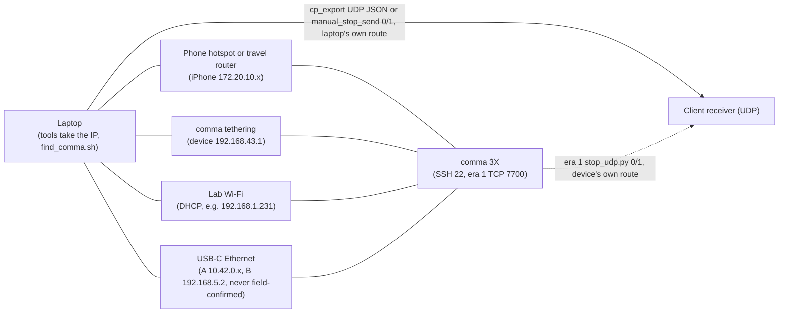

# Setup, SSH and networking

This page gets a laptop ready to work with the comma 3X used in this project. It covers the code and its dependencies, SSH access, the four ways to put the laptop and the device on one network, how to find the device's IP address, which interpreter and paths to use on the device in each era, and how to tell whether the device is onroad. The era-1 material describes a device state that the re-flash (at an unrecorded date between 2026-08-13 and 2026-10-03) erased. It is kept because the tools and the original notes still refer to it.

## At a glance

| Item | Details |
|---|---|
| Audience | Operators and developers |
| Runs on | Laptop (Linux; the original notes use Ubuntu) and the device, over SSH |
| Era | **Era 1 — sunnypilot 0.9.7.1** (2026-07 → 2026-08; Honda Civic + truck/bench no-CAN) and **Era 2 — openpilot v0.11.1 `release-tizi` + dashcam-anywhere** (from 2026-10-03; robots/small vehicles) |
| Status | Current for era 2. Era-1 items are historical. USB-C Ethernet was planned but never confirmed in the field. |
| Key files | [`find_comma.sh`](../remote/Arman/find_comma.sh), [`ETHERNET_SETUP.md`](../remote/Arman/ETHERNET_SETUP.md), [`LAPTOP_GUIDE.md`](../remote/Arman/dashcam_anywhere/LAPTOP_GUIDE.md), [`dashcam.sh`](../remote/Arman/dashcam_anywhere/dashcam.sh), [`experiment.py`](../remote/Arman/experiment.py), [`force_onroad_v2.py`](../remote/Arman/force_onroad_v2.py), [`_verify_state.py`](../remote/Arman/_verify_state.py), [`OPERATIONS.md`](../remote/Arman/OPERATIONS.md), [`README.md`](../remote/README.md) |

## Get the code

```bash
# laptop
git clone <repository-url> OP4Anything      # the clone URL shown on this repository's GitHub page
cd OP4Anything
```

`remote/` is a redacted snapshot of the original laptop work folder, and `docs/` holds these pages. The era-1 laptop tools run from `remote/` and `remote/Arman/`. The era-2 control script runs from `remote/Arman/dashcam_anywhere/`.

### Original paths (optional symlink)

The original notes use the laptop path `~/Desktop/Drive/remote/Arman/` (for example [`OPERATIONS.md`](../remote/Arman/OPERATIONS.md) §1 and §5, and [`EXPERIMENT_RUNBOOK.md`](../remote/Arman/EXPERIMENT_RUNBOOK.md)). To make those commands work unchanged, link the snapshot into that place:

```bash
# laptop — optional, run inside the clone's top folder
mkdir -p ~/Desktop/Drive
ln -s "$(pwd)/remote" ~/Desktop/Drive/remote
```

Two notes also use a desktop path, `~/Desktop/Drive/openpilot/Arman/` ([dashcam README](../remote/Arman/dashcam_anywhere/README.md) and [`LAPTOP_GUIDE.md`](../remote/Arman/dashcam_anywhere/LAPTOP_GUIDE.md) §1.1). It held the same tools plus `replay_rlogs/` (206 MB), which exists only on the desktop and is not in this repository. In this repository, use `remote/Arman/dashcam_anywhere/` instead (see [Errata and crosswalk](16-errata-and-crosswalk.md)).

`LAPTOP_GUIDE.md` §1.1 copied the tools from the desktop to the laptop with `rsync` (excluding `replay_rlogs`), or with a USB stick when there was no network. Cloning this repository replaces that step.

> [!TIP]
> **Executable bits.** The shell scripts (`find_comma.sh`, `stop_udp_*.sh`, `dashcam.sh`) and two laptop Python tools (`watch_detect.py`, `manual_stop_send.py`) are executable in the snapshot. If your checkout lost the executable bit, run `chmod +x remote/Arman/*.sh remote/Arman/dashcam_anywhere/dashcam.sh`, or start them with `bash <script>`.

## Laptop requirements

- **Python:** 3.10 or newer. The test results recorded for this repository used Python 3.12.2 (numpy 2.0.1, matplotlib 3.10.1). While this page was written, all 40 `.py` files also parsed under Python 3.10.12, and the `frame.py`, `curvepoints.py` and `frenet.py` unit tests passed under it.
- **Operating system:** Linux. **Analysis (from code; not field-tested):** `find_comma.sh` needs iproute2's `ip`, `manual_stop_send.py` needs the POSIX `termios`/`tty` modules, and the install line in `LAPTOP_GUIDE.md` §1.3 uses `apt`.
- **No openpilot install** is needed on the laptop. The stream tools talk plain TCP/JSON ([`README.md`](../remote/README.md) top; [`stream_lib.py`](../remote/stream_lib.py) docstring).

### Dependencies per tool

Checked against each script's `import` lines. "Nothing" means the Python standard library only.

| Tool (under `remote/`) | Runs on | Needs beyond the standard library | Notes |
|---|---|---|---|
| `stream_lib.py`, `Arman/stream_lib.py` | laptop | nothing | Identical copies. TCP client for the 7700 stream. |
| `recv_log.py` | laptop | nothing for `.csv`; `pandas` + `pyarrow` for `.parquet` | `pandas` is imported only when `--out` ends in `.parquet`. |
| `controls_monitor.py` | laptop | nothing | Terminal table (no GUI). |
| `frenet.py` | laptop | nothing | Imports only `math` (and `argparse` for `--test`). |
| `live_plot.py`, `dashboard.py`, `unified.py`, `frenet_view.py` | laptop | matplotlib | Live windows need a desktop session. The `--selftest` renders of `dashboard`, `unified` and `frenet_view` also work headless (`MPLBACKEND=Agg`). |
| `Arman/frame.py`, `Arman/curvepoints.py`, `Arman/cp_export.py` | laptop | nothing | |
| `Arman/cp_view.py` | laptop | matplotlib | Imports `cp_export`, `frame`, `curvepoints` and `stream_lib` from its own folder. |
| `Arman/experiment.py` | laptop | `ssh` client | |
| `Arman/vision/objstop_view.py` | laptop | matplotlib, `ssh` client | |
| `Arman/watch_detect.py` | laptop | `ssh` client | |
| `Arman/manual_stop_send.py` | laptop | nothing (POSIX `termios`/`tty`) | Not for Windows. |
| `Arman/udp_snippet.py`, `Arman/_udp_probe.py`, `Arman/_udp_testsend.py`, `Arman/_stream_dump.py` | laptop | nothing | |
| `Arman/find_comma.sh` | laptop | `bash`, `ip`, `timeout`, `ssh`; `nmap` optional | `nmap` makes the scan faster (`LAPTOP_GUIDE.md` §1.3). |
| `Arman/stop_udp_start.sh`, `Arman/stop_udp_stop.sh` | laptop | `bash`, `ssh`, `scp` | |
| `Arman/stop_udp_watch.sh` | laptop | `bash`, `python3` | |
| `Arman/dashcam_anywhere/dashcam.sh` | laptop | `bash`, `ssh` | Calls `../find_comma.sh` when no IP is given. |
| `Arman/vision/test_stopsm.py` | laptop or device | numpy | Through `vision/objstopd.py`, which imports numpy at module level. |
| `Arman/vision/ped_analysis.py` | laptop with a GPU (per its docstring) | `ultralytics`, `ffmpeg` | The 8/4 test videos and the `.pt` weights are not included. |
| `Arman/objstopd.py`, `Arman/vision/objstopd.py`, `Arman/vision/yolo_infer.py` | device (era 1) | numpy, onnxruntime, Pillow; openpilot `cereal` and `msgq` | `yolo_infer.py` states that its three packages are present on the device. ONNX models not included. |
| `exporter_device.py` | device (era 1) | openpilot `cereal` | |
| `Arman/stop_udp.py` | device (era 1) | nothing | Reads the `/tmp` flags on the device. |
| `Arman/enable_*.py`, `Arman/force_onroad_v2.py`, `Arman/suppress_car_prompt.py` | device (era 1) | nothing | They edit files under `/data/openpilot`. |
| `Arman/fake_ignition.py`, `Arman/write_carparams_mock.py`, `Arman/_verify_state.py`, `Arman/_vipc_probe.py`, `Arman/_modeld_diag.py` | device (era 1) | openpilot (`cereal`, `msgq`, `openpilot.*`) | See [No-CAN truck/bench mode](10-no-can-mode-sunnypilot.md). |
| `Arman/dashcam_anywhere/status.py` | device (era 2) | openpilot (`cereal`, `openpilot.common.params`) | Called by `dashcam.sh status`. |
| `Arman/dashcam_anywhere/replay_calib.py` | device (era 2) | numpy, `zstandard`, openpilot `cereal` + the patched `calibrationd` | Needs `replay_rlogs/` (desktop only). |

System tools: an OpenSSH client (`ssh`, `scp`) and `rsync` are required (`LAPTOP_GUIDE.md` §1.3). `nmap` and `ffmpeg` are optional. `nmcli` (NetworkManager) is only needed for USB-C Ethernet. `nc` is handy for the checks on this page.

### Install

```bash
# laptop (Ubuntu)
sudo apt install -y rsync nmap ffmpeg           # LAPTOP_GUIDE §1.3; nmap and ffmpeg are optional
python3 -m pip install matplotlib numpy         # viewers and test_stopsm.py
python3 -m pip install pandas pyarrow           # only for recv_log.py --out <file>.parquet
```

### Verify the install

The `--selftest` renders write their PNG into the current directory, so run them from a scratch folder:

```bash
# laptop
mkdir -p /tmp/op4a_selftest && cd /tmp/op4a_selftest
R=~/OP4Anything/remote                          # adjust to where you cloned
python3 $R/Arman/frame.py --test                # last line: ALL FRAME TESTS OK
python3 $R/Arman/curvepoints.py --test          # last line: ALL CURVEPOINTS TESTS OK
python3 $R/frenet.py --test                     # last line: ALL FRENET TESTS OK
python3 $R/Arman/vision/test_stopsm.py          # last line: ALL V2 TESTS OK   (needs numpy)
python3 $R/Arman/cp_view.py --selftest          # selftest OK -> cp_view_selftest.png   (needs matplotlib)
python3 $R/dashboard.py --ip x --selftest       # dashboard.py requires --ip even with --selftest
```

`cp_export.py --selftest` also passes (`ALL CP_EXPORT SELFTESTS OK`), but it writes into its own folder, not the current one. It rewrites the committed samples in `remote/Arman/_selftest_out/` ([`cp_export.py`](../remote/Arman/cp_export.py) → `_selftest()`).

## SSH access

The commands in this section use `$COMMA_IP`, the device's address. If it is not set yet, see [Finding the device](#finding-the-device); with comma tethering it is simply `export COMMA_IP=192.168.43.1`.

### The user is lowercase comma

Log in as the lowercase user `comma`, as in `ssh comma@$COMMA_IP`. `Comma@…` fails with `Permission denied (publickey)` because no user of that name exists. The message looks like a key problem but is a typo.

### Keys

The device trusts the public keys of the GitHub account configured in the device's SSH settings. For a new laptop, generate a key on that laptop and add its public half to that GitHub account:

```bash
# laptop
ssh-keygen -t ed25519 -f ~/.ssh/id_ed25519_comma -C "comma-laptop"
cat ~/.ssh/id_ed25519_comma.pub                 # paste into GitHub: Settings -> SSH and GPG keys -> New SSH key
ssh -i ~/.ssh/id_ed25519_comma -o BatchMode=yes comma@$COMMA_IP 'cat /data/params/d/DongleId'
```

The last line is the test from `LAPTOP_GUIDE.md` §1.2. `BatchMode=yes` makes it fail at once instead of prompting.

> [!TIP]
> **Not verified in this repository (general openpilot behaviour).** The device keeps the keys it downloaded when the GitHub username was entered. If a key you just added is still refused, enter the username again in the device's SSH key setting so that it downloads the current list.

> [!NOTE]
> **Reported in `LAPTOP_GUIDE.md` §1.2.** On 2026-10-03 the laptop's existing key was already in the GitHub account, so nothing had to be copied. For another computer, the guide suggested copying the desktop's private key with `scp ~/.ssh/id_rsa <laptop>:~/.ssh/id_rsa_comma` and then `chmod 600 ~/.ssh/id_rsa_comma`. Copying private keys between machines is discouraged. Generate one key per laptop instead.

### Confirm you reached the right device

```bash
# laptop
ssh comma@$COMMA_IP 'cat /data/params/d/DongleId'      # must print your device's dongle id (<DONGLE_ID> in the notes)
```

More than one comma was on the same networks (`LAPTOP_GUIDE.md` §3), and a hotspot can hand the same IP to different devices (past-session notes). Check the dongle id at the start of every session. `dashcam.sh` prints it before enable, disable, restore-civic and poweroff, but not before `reset-calib`, which acts at once.

### SSH client configuration

```
# laptop — append to ~/.ssh/config (adapted from LAPTOP_GUIDE.md §1.2)
Host 192.168.*.* 10.42.*.* 172.20.*.*
  User comma
  IdentityFile ~/.ssh/id_ed25519_comma
  StrictHostKeyChecking accept-new
```

- The patterns cover the example networks on this page: comma tethering (192.168.43.x), lab Wi-Fi (192.168.1.x), Ethernet Plan B (192.168.5.x), Ethernet Plan A (10.42.0.x) and an iPhone hotspot (172.20.10.x). Add your own hotspot's range if it differs. The block applies to every host in those ranges.
- The original block used `IdentityFile ~/.ssh/id_rsa_comma`, which was the copied desktop key.
- `StrictHostKeyChecking accept-new` stores the key of a device seen for the first time without asking, but still refuses a changed key. **Analysis (from code; not field-tested):** this matters for `dashcam.sh`, which runs ssh with `BatchMode=yes` and so cannot answer the first-contact prompt.

### Host key warnings

Several commas share hotspot address ranges, so after you switch devices or networks, ssh's `WARNING: REMOTE HOST IDENTIFICATION HAS CHANGED!` banner is expected. Forget the old key for that IP, reconnect, and check which device answered:

```bash
# laptop
ssh-keygen -f ~/.ssh/known_hosts -R 172.20.10.3            # use the IP from the warning
ssh comma@172.20.10.3 'cat /data/params/d/DongleId'
```

`~/.ssh/known_hosts` is hashed, so `grep 172.20.10.3 ~/.ssh/known_hosts` finds nothing even when an entry exists. `ssh-keygen -F 172.20.10.3` does find it.

### How each tool calls ssh

The tools pass different options, so a changed or unknown host key affects them differently. The two right-hand columns are **Analysis (from code; not field-tested)**, based on the OpenSSH meaning of each option.

| Tool | Options it passes | Changed host key | First contact with an unknown key |
|---|---|---|---|
| [`find_comma.sh`](../remote/Arman/find_comma.sh) (check 2) | `-o StrictHostKeyChecking=no -o ConnectTimeout=3 -o BatchMode=yes`, inside `timeout 5` | connects; the warning goes to stderr, which the script discards | key added to `known_hosts` silently |
| [`experiment.py`](../remote/Arman/experiment.py) → `ssh()` | `-o StrictHostKeyChecking=no -o ConnectTimeout=6`; 10 s subprocess timeout | connects with a warning (captured, not shown) | added silently |
| [`stop_udp_start.sh`](../remote/Arman/stop_udp_start.sh), [`stop_udp_stop.sh`](../remote/Arman/stop_udp_stop.sh) | `-o StrictHostKeyChecking=no -o ConnectTimeout=6` (the `scp` in `stop_udp_start.sh` passes only `StrictHostKeyChecking=no`) | connects with a warning | added; ssh's notice appears in the script's output |
| [`watch_detect.py`](../remote/Arman/watch_detect.py) | `-o StrictHostKeyChecking=no -o ConnectTimeout=8 -o ServerAliveInterval=5` | connects; stderr is printed on exit | added; the notice is printed on exit |
| [`objstop_view.py`](../remote/Arman/vision/objstop_view.py) → `pull()` | `-o StrictHostKeyChecking=no -o ConnectTimeout=4`; 8 s timeout; stderr discarded | connects | added silently |
| [`dashcam.sh`](../remote/Arman/dashcam_anywhere/dashcam.sh) | `-o ConnectTimeout=8 -o BatchMode=yes` | **fails** (`Host key verification failed.`) | fails, unless `~/.ssh/config` sets `StrictHostKeyChecking accept-new` |
| plain `ssh comma@$COMMA_IP` | whatever `~/.ssh/config` says | refused, with the warning above | prompts, or accepts with `accept-new` |

With `StrictHostKeyChecking=no`, OpenSSH lets a connection with a changed key go ahead for key-based logins. It disables password login and forwarding. The tools in the first five rows will therefore talk to whichever comma currently holds the IP. Their warning is discarded (`find_comma.sh`, `objstop_view.py`), captured and not shown (`experiment.py`), shown only at exit (`watch_detect.py`), or mixed into the script's output (`stop_udp_*.sh`). The dongle-id check above is the safeguard.

## Network options

The laptop tools take the device address as a parameter (`--ip`; for `dashcam.sh` an argument or `$COMMA_IP`), so the type of link changes nothing except the address ([`ETHERNET_SETUP.md`](../remote/Arman/ETHERNET_SETUP.md) top). The exceptions are `stop_udp_start.sh` and `stop_udp_stop.sh`, which hard-code it (see [Tools with hard-coded addresses](#tools-with-hard-coded-addresses)). In era 1 the exporter bound `0.0.0.0:7700`, so the stream was reachable on every interface ([`exporter_device.py`](../remote/exporter_device.py) → `main()`; `ETHERNET_SETUP.md` Notes). UDP to the client rides whatever route the laptop has to the client, independent of how the comma is attached (`ETHERNET_SETUP.md` Notes).



| Option | Device side | Laptop side | Device IP | Notes |
|---|---|---|---|---|
| **Phone hotspot or travel router** (recommended for long-term use in `LAPTOP_GUIDE.md` §3) | First time: Settings → Network, pick the hotspot and enter its password. The device then joins it automatically at boot. | Join the same hotspot. | `find_comma.sh`, or the hotspot's list of connected devices | Android preferred; an iPhone hotspot may isolate clients ([`README.md`](../remote/README.md) §0, `OPERATIONS.md` §1). iPhone hotspot addresses are 172.20.10.x. |
| **comma tethering** (no other hardware) | After **every** boot: tap the gear in the left sidebar → Settings → **Network** → **Enable Tethering**. The setting does not survive a reboot. | Join Wi-Fi `weedle-<DONGLE_ID_PREFIX>` (`weedle-` + the first 4 characters of the dongle id). The default password is `swagswagcomma` (changeable under Tethering Password). | **192.168.43.1** (fixed) | From `LAPTOP_GUIDE.md` §3 (era 2). |
| **Lab Wi-Fi** | Joins the saved `<LAB_WIFI_SSID>` automatically when in range. | Join the same Wi-Fi. | 192.168.1.231 in the notes (DHCP, may change) | `OPERATIONS.md` §1, `LAPTOP_GUIDE.md` §3, `EXPERIMENT_RUNBOOK.md`. |
| **USB-C Ethernet** | USB-C → Ethernet adapter in the comma's USB-C (OBD-C) port. | `nmcli` shared connection (Plan A) or a static address (Plan B). | Plan A 10.42.0.x; Plan B 192.168.5.2 | Never confirmed in the field. See [USB-C Ethernet](#usb-c-ethernet). |

### Phone hotspot or travel router

From [`README.md`](../remote/README.md) §0 (era 1):

1. Turn on the phone hotspot (Android preferred; an iPhone may isolate clients).
2. On the comma: Settings → Network → join the hotspot, and note the comma's IP.
3. On the laptop: join the same hotspot.
4. Check reachability with `ping <comma_ip>`. If it fails, the hotspot has client isolation. Use an Android hotspot or a cheap travel router instead.

Hotspot addresses change. On an iPhone hotspot the laptop was often 172.20.10.2 and the comma 172.20.10.3, but they rotate, and old addresses go stale. Use `find_comma.sh` instead of remembering them. Several tools still hard-code 172.20.10.x defaults (see [Tools with hard-coded addresses](#tools-with-hard-coded-addresses)).

### comma tethering

The device runs its own hotspot. No phone or router is needed, and the device IP is always 192.168.43.1 (`LAPTOP_GUIDE.md` §9), so `find_comma.sh` is not needed:

```bash
# laptop — after joining weedle-<DONGLE_ID_PREFIX>
export COMMA_IP=192.168.43.1
ssh comma@$COMMA_IP 'cat /data/params/d/DongleId'
```

Tethering must be switched on again after every boot. In era 2 the Settings page returns to the road view after 10 s without input, so do the taps in one go (`LAPTOP_GUIDE.md` §3).

### Lab Wi-Fi

The device has `<LAB_WIFI_SSID>` saved and joins it automatically. The notes use 192.168.1.231 for the device on this network (`OPERATIONS.md` §1; `EXPERIMENT_RUNBOOK.md`; `LAPTOP_GUIDE.md` §3). The address comes from DHCP and can change, so verify it with `find_comma.sh` and the dongle id.

### USB-C Ethernet

> [!IMPORTANT]
> **Never confirmed in the field.** [`ETHERNET_SETUP.md`](../remote/Arman/ETHERNET_SETUP.md) ends with a "Field checklist (tomorrow)" and no recorded result. No note records that an adapter was recognised by the device or that either plan worked. The note also does not say how the device was to be powered while the adapter occupies the port.

**Physical link.** The comma 3X has no RJ45 socket. The plan was a USB-C → Ethernet adapter in the comma's USB-C (OBD-C) port, cabled to the laptop's Ethernet port. After plugging it in, check that the device recognised the adapter (over the hotspot, which still works):

```bash
# laptop
ssh comma@$COMMA_IP 'ip -br link'               # expect a new ethN / enx... interface, UP
ssh comma@$COMMA_IP 'dmesg | tail -20'          # adapter driver messages
```

If no new interface appears, AGNOS does not support the adapter's chipset. Fall back to the hotspot, where everything still works (`ETHERNET_SETUP.md`; `OPERATIONS.md` §1).

**Plan A (recommended): the laptop shares its link over DHCP.** One-time setup on the laptop with NetworkManager. `<ETH_IFACE>` is the laptop's Ethernet interface name (see `nmcli device status` or `ip -br link`):

```bash
# laptop
nmcli con add type ethernet ifname <ETH_IFACE> con-name comma-share ipv4.method shared
nmcli con up comma-share
cd remote/Arman && export COMMA_IP=$(./find_comma.sh)    # should find the comma on 10.42.0.0/24
```

NetworkManager runs a DHCP server on the port, and the comma's Ethernet interface gets a 10.42.0.x address automatically.

**Plan B (fallback): static addresses at both ends.**

```bash
# laptop
nmcli con add type ethernet ifname <ETH_IFACE> con-name comma-static ipv4.method manual \
  ipv4.addresses 192.168.5.1/24
nmcli con up comma-static
```

```bash
# device  (ssh comma@$COMMA_IP)   — log in over the hotspot first, with the adapter plugged in
sudo nmcli con add type ethernet ifname <ethN> con-name eth-static ipv4.method manual \
  ipv4.addresses 192.168.5.2/24
sudo nmcli con up eth-static
```

AGNOS uses NetworkManager too. The device is then at **192.168.5.2**. Plan B adds a saved connection on the device. To remove it later, run `sudo nmcli con delete eth-static` (standard nmcli; not in the original notes).

**Field checklist from `ETHERNET_SETUP.md` (planned, no recorded result):**

1. Boot both on the hotspot first (the known-good path) and run `./find_comma.sh` as a sanity check.
2. Plug in the adapter and cable, then run `ip -br link` on the comma. Is there a new interface?
3. Bring Plan A up and run `./find_comma.sh` again. It should print 10.42.0.x.
4. Re-run `experiment.py --ip <new-ip> check`. Everything else is unchanged.
5. Check latency with `ping -c 20 <ip>` (Ethernet should be about 1 ms).
6. If anything misbehaves, unplug and go back to the hotspot IP. There is no configuration to undo.

Keep the hotspot up as a fallback path during the first Ethernet test (`ETHERNET_SETUP.md` Notes).

### Field connection checklist

1. Power the device and wait for the road view. In era 2 the device boots in about 30–60 s and enters the road view on its own (`LAPTOP_GUIDE.md` §2.3). In era 1 in the Civic, switching the car on brought it onroad (`OPERATIONS.md` §2.1).
2. Put the laptop and the device on one network (table above). With comma tethering, enable tethering again after every boot.
3. Set `COMMA_IP` (see [Finding the device](#finding-the-device)).
4. Check the dongle id.
5. Check the state. In era 2 run `./dashcam.sh status` from `remote/Arman/dashcam_anywhere/` (see the [field guide](12-dashcam-anywhere-field-guide.md)). In era 1 the operator ran `python3 experiment.py --ip $COMMA_IP check` from `remote/Arman/` (see the [operations runbook](13-operations-runbook.md)).

## Finding the device

Set `$COMMA_IP` once per terminal. The other pages assume it is set.

```bash
# laptop
cd remote/Arman && export COMMA_IP=$(./find_comma.sh)    # IP on stdout, progress on stderr
echo "COMMA_IP=$COMMA_IP"                                # empty means not found
ssh comma@$COMMA_IP 'cat /data/params/d/DongleId'        # must be your device's dongle id
```

Or set it by hand, for example `export COMMA_IP=192.168.43.1` with comma tethering. `dashcam.sh` takes the IP from its argument first, then `$COMMA_IP`, and only then runs `../find_comma.sh` ([`dashcam.sh`](../remote/Arman/dashcam_anywhere/dashcam.sh), top of the script).

### How find_comma.sh works

[`find_comma.sh`](../remote/Arman/find_comma.sh) does the following:

1. It lists this laptop's IPv4 networks with `ip -o -4 addr show scope global` (non-loopback). With none, it prints `no active IPv4 interfaces` and exits 1.
2. For each network (`scanning <cidr> ...` on stderr), it collects hosts with TCP port 22 open:
   - **with `nmap` installed:** `nmap -n -p22 --open -T4 --host-timeout 2s <cidr> -oG -`, for the whole network whatever its size;
   - **without `nmap`:** a parallel sweep of `.1`–`.254` in the /24 formed by the first three octets of the laptop's address (`timeout 0.4` per host, using bash's `/dev/tcp`).
3. It skips the laptop's own addresses.
4. It checks each remaining candidate in turn and stops at the **first** one that passes either check:
   - **check 1:** TCP 7700 (the era-1 exporter) accepts a connection within 1 s → `FOUND comma at <ip> (port 7700 open)`;
   - **check 2:** `ssh comma@<ip> 'test -d /data/openpilot'` succeeds (options in [How each tool calls ssh](#how-each-tool-calls-ssh)) → `FOUND comma at <ip> (ssh verified)`.
5. It prints the IP on stdout and exits 0. If nothing passes, it prints `comma not found on: <subnets>` and exits 1.

`./find_comma.sh -v` also logs each candidate. In fact any first argument turns this on (`VERBOSE=${1:-}`).

> [!IMPORTANT]
> **First match, not your comma.** `find_comma.sh` returns the **first** match, not "your" comma. With two commas on one network it can return either, so always check the dongle id. **Analysis (from code; not field-tested):** in era 2 the 7700 exporter is presumably not installed (inferred; verify with `nc -z $COMMA_IP 7700`). Discovery then depends on check 2, which needs a working SSH key. Without one, the script reports "comma not found" even when the device is on the network.

**Analysis (from code; not field-tested):** the script's header says small subnets are swept fully and /24 or larger use nmap. The code actually uses `nmap` for every network whenever it is installed. Without `nmap`, it sweeps only the /24 around the laptop's address. On a laptop that is also on a large network (for example a /16 container bridge), the `nmap` pass can take a long time. Set `COMMA_IP` by hand in that case (A-item A1 in [16](16-errata-and-crosswalk.md#additional-inconsistencies-found-in-this-review)).

### Tools with hard-coded addresses

Only `dashcam.sh` falls back to `find_comma.sh`. The other tools need the address passed in, and a few carry defaults from the iPhone-hotspot days.

| Tool | Where the address comes from | Built-in default |
|---|---|---|
| [`dashcam.sh`](../remote/Arman/dashcam_anywhere/dashcam.sh) | argument → `$COMMA_IP` → `../find_comma.sh` | none |
| `experiment.py`, `cp_export.py`, `cp_view.py`, `vision/objstop_view.py`, `stream_lib.py`, `recv_log.py`, `live_plot.py`, `dashboard.py`, `unified.py`, `frenet_view.py`, `controls_monitor.py` | `--ip` | none. `--ip` is required. Tools with a `--selftest` accept it instead, except `dashboard.py`, which needs `--ip` even then. |
| [`watch_detect.py`](../remote/Arman/watch_detect.py) | `--ip` | 172.20.10.3 |
| [`_stream_dump.py`](../remote/Arman/_stream_dump.py) | first argument | 172.20.10.3 |
| [`stop_udp_start.sh`](../remote/Arman/stop_udp_start.sh), [`stop_udp_stop.sh`](../remote/Arman/stop_udp_stop.sh) | hard-coded `IP=172.20.10.3` in both. In `stop_udp_start.sh` the `find_comma.sh` call is commented out, although its header still says the device is found automatically (and it still prints `finding comma ...`). `stop_udp_stop.sh` has no discovery at all, so its `[ -z "$IP" ]` check can never fire | edit the `IP=` line of both (see [0/1 stop signal over UDP](09-stop-signal-udp.md)) |
| [`manual_stop_send.py`](../remote/Arman/manual_stop_send.py) (destination is the **client**, not the comma) | positional `host port` | 172.20.10.2:5005 (the docstring wrongly says .3) |
| [`_udp_probe.py`](../remote/Arman/_udp_probe.py), [`_udp_testsend.py`](../remote/Arman/_udp_testsend.py) (destination is the client) | first and second argument | 172.20.10.2:5005 |

## Device interpreters and filesystem map

### Interpreters per era

| Era | Interpreter and environment | Defined in |
|---|---|---|
| **Era 1 — sunnypilot 0.9.7.1** | `/usr/local/pyenv/versions/3.11.4/bin/python3` with `PYTHONPATH=/data/openpilot`. Scripts that import from `/data` used `PYTHONPATH=/data/openpilot:/data`. | [`exporter_device.py`](../remote/exporter_device.py) docstring, [`README.md`](../remote/README.md) §1, `OPERATIONS.md` §2.5, [`stop_udp_start.sh`](../remote/Arman/stop_udp_start.sh), [`fake_ignition.py`](../remote/Arman/fake_ignition.py) and [`write_carparams_mock.py`](../remote/Arman/write_carparams_mock.py) docstrings |
| **Era 2 — openpilot v0.11.1 `release-tizi` + dashcam-anywhere** | `/usr/local/venv/bin/python3 -B` with `PYTHONPATH=/data/openpilot` and `PYTHONDONTWRITEBYTECODE=1`, run from `/data/openpilot` | [`dashcam.sh`](../remote/Arman/dashcam_anywhere/dashcam.sh) (`OPPY`), [`status.py`](../remote/Arman/dashcam_anywhere/status.py) and [`replay_calib.py`](../remote/Arman/dashcam_anywhere/replay_calib.py) docstrings |

Several notes and scripts call a bare `python3` on the device: the `enable_*`, `force_onroad_v2` and `suppress_car_prompt` docstrings, `_verify_state.py`, `_vipc_probe.py`, `_modeld_diag.py`, `STOP_COMMAND.md`, `EXPERIMENT_RUNBOOK.md` and `OPERATIONS.md` §4 and §9. These pages use the explicit form instead:

```bash
# device  (ssh comma@$COMMA_IP)   — era 1 (historical): the exporter, as in README.md §1
cd /data/openpilot && PYTHONPATH=/data/openpilot \
  /usr/local/pyenv/versions/3.11.4/bin/python3 tools/reg_export/exporter.py
```

```bash
# device  (ssh comma@$COMMA_IP)   — era 2: the status script, as dashcam.sh runs it
cd /data/openpilot && PYTHONDONTWRITEBYTECODE=1 PYTHONPATH=/data/openpilot \
  /usr/local/venv/bin/python3 -B /data/dashcam_anywhere/status.py
```

### Filesystem map

| Path on the device | Era | What it is | Defined in |
|---|---|---|---|
| `/data/openpilot` | both | The openpilot tree. In era 1 it was sunnypilot 0.9.7.1 with hand patches (described, not included). In era 2 it is commit `8acb496` (tag `dashcam-anywhere-v1`) on parent `70e1574`. | [dashcam README](../remote/Arman/dashcam_anywhere/README.md); [Device changes and revert](14-device-changes-and-revert.md) |
| `/data/openpilot/tools/reg_export/exporter.py` | 1 | Telemetry exporter, TCP 7700 | [`README.md`](../remote/README.md) §1; [`exporter_device.py`](../remote/exporter_device.py) docstring |
| `/data/openpilot/tools/objstop_launcher.py`, `/data/openpilot/tools/fake_ignition_launcher.py` | 1 | Manager launch shims | [`enable_dashcam_mode.py`](../remote/Arman/enable_dashcam_mode.py); [`enable_fake_ignition_autostart.py`](../remote/Arman/enable_fake_ignition_autostart.py) |
| `/data/objstop/` | 1 | objstopd, `yolo_infer.py`, ONNX models (not included), staged patch scripts, `stop_udp.py` | [`objstopd.py`](../remote/Arman/objstopd.py) → `main()` defaults; `enable_dashcam_mode.py`; `stop_udp_start.sh` |
| `/data/objstop/manual_mode` | 1 | Disabled the objstopd autostart while present | `enable_dashcam_mode.py` |
| `/data/force_onroad` | both | Forces onroad. In **era 1** the hardwared hook and the fake-ignition process conditions re-checked it continuously. In **era 2** it is read once when manager starts; reboot to apply. | `enable_dashcam_mode.py`; `force_onroad_v2.py`; `enable_fake_ignition_autostart.py`; patch `common/dashcam_anywhere.py` |
| `/data/onroad_debug.log` | 1 | Forced-onroad diagnostic log | [`force_onroad_v2.py`](../remote/Arman/force_onroad_v2.py) |
| `/data/record_audio` | 1 | Cabin-audio gate (no record that it was applied) | [`enable_cabin_audio.py`](../remote/Arman/enable_cabin_audio.py) |
| `/tmp/op_stop_requested`, `/tmp/op_stop_intent`, `/tmp/op_stop_release` | 1 | Stop, intent and release flags. `/tmp` is tmpfs, so a reboot clears them. | `objstopd.py`; `experiment.py`; [`STOP_COMMAND.md`](../remote/Arman/STOP_COMMAND.md) |
| `/tmp/objstop_status.json`, `/tmp/objstop_last.jpg` | 1 | objstopd status and last annotated frame | `objstopd.py` |
| `/tmp/stop_udp.log` | 1 | Log of the 0/1 UDP sender | `stop_udp_start.sh` |
| `/data/dashcam_anywhere/` (`status.py`, `replay_calib.py`, optional `replay_rlogs/`) | 2 | Device-side helpers | `dashcam.sh`; dashcam README |
| `/data/dashcam_backup/20261003/` | 2 | Backup of the Civic params and the git rev | `dashcam.sh` (`BACKUP`); dashcam README |
| `/data/reset_calib`, `/data/calib_from_dashcam` | 2 | Calibration reset request; marker for "calibration learned in dashcam mode" | [`dashcam_anywhere.patch`](../remote/Arman/dashcam_anywhere/dashcam_anywhere.patch); `dashcam.sh` |
| `/data/params/d/<Key>` | both | One file per param, for example `DongleId`, `IsOnroad`, `ExperimentalLongitudinalEnabled`, `DisableUpdates` | `experiment.py`; `dashcam.sh` |
| `/data/media/0/realdata/<route>--<seg>/` | both | Recordings, one folder per 1-minute segment | [`status.py`](../remote/Arman/dashcam_anywhere/status.py) (`REALDATA`); `LAPTOP_GUIDE.md` §7 |
| `/data/log/swaglog.*` | both | Persistent logs that survive reboots | [`_modeld_diag.py`](../remote/Arman/_modeld_diag.py); `LAPTOP_GUIDE.md` §9 |

## Is the device onroad

"Onroad" means the camera, model and logging stack is running. The table runs from the most to the least direct evidence.

| Check | How (laptop unless marked) | What it proves | Era |
|---|---|---|---|
| **`IsOnroad` param (ground truth)** | `ssh comma@$COMMA_IP 'cat /data/params/d/IsOnroad'` | `1` = onroad, `0` = offroad | both |
| `dashcam.sh status` | `./dashcam.sh status` → `IsOnroad: True` and `started=True` | onroad, and hardwared reports `started` | 2 |
| `experiment.py status` / `check` | `onroad=1`, or `device onroad ✓` | the same param, read over SSH. `check` also prints ✓ when its SSH call fails, so confirm with `status` (see the [operations runbook](13-operations-runbook.md)) | 1 |
| **Records flowing on TCP 7700** | `python3 stream_lib.py --ip $COMMA_IP` prints `[<count>] <rate>Hz vEgo=...` after every 100 records | onroad (the baseline exporter emits one record per `carState` frame) | 1 |
| Port 7700 merely open | `nc -z $COMMA_IP 7700 && echo open \|\| echo closed` | only that the exporter process is up. Manager ran it as `always_run` (the registration is described, not included; its anchor is in `enable_dashcam_mode.py`), so the port was open whenever manager ran, even offroad. | 1 |
| Road view on the screen | look at the device | onroad, in the Civic (era 1) and in dashcam-anywhere mode (era 2) | see note |
| `"Startup blocked"` in the swaglog | device, see below | which startup condition is `False` | both |
| `/data/onroad_debug.log` | device, see below | the ignition source and all conditions at every state change | 1 |
| `_verify_state.py` | device, see below | which services publish; `deviceState.started`; panda `ignitionLine` and harness | 1 |

> [!IMPORTANT]
> **Unreachable is not offroad.** A laptop that cannot reach the device does **not** mean the device is offroad. On a truck with no hotspot, for example, it is a network problem. Look at the screen first, and read the persistent logs afterwards.

**Records vs. open port.** An open 7700 port only means the exporter process is up. Records arriving means onroad. **Analysis (from code; not field-tested):** `stream_lib.stream()` reconnects forever and prints `[stream] disconnected (<reason>); retrying in 1s...`. A reason of `[Errno 111] Connection refused` means the port is closed (exporter not running, or not installed as presumably in era 2). A repeating `timed out` means nothing arrived within the 5 s socket timeout, which covers both the connection attempt and each read. Either the address does not answer at all (wrong or unreachable IP; reproduced against an unused address), or the port is open but no records arrive, because the device is offroad or because it ran without CAN using the baseline exporter. The baseline `exporter_device.py` emits only on `carState`, and the no-CAN `exporter_nocan.py` that fixed this is described, not included ([`enable_dashcam_mode.py`](../remote/Arman/enable_dashcam_mode.py) docstring).

**The screen in era 1 without CAN.** With only `/data/force_onroad`, the backend went onroad but the screen stayed on the home UI. The UI also gates on the panda ignition, which only the fake-ignition publisher supplied ([`enable_fake_ignition_autostart.py`](../remote/Arman/enable_fake_ignition_autostart.py) and [`fake_ignition.py`](../remote/Arman/fake_ignition.py) docstrings). In that configuration the screen is not evidence either way.

**Swaglog.** `/data/log/swaglog.*` survives reboots. Find the most recent `"Startup blocked"` entry and look for the condition that is `false`:

```bash
# device  (ssh comma@$COMMA_IP)
grep -h "Startup blocked" /data/log/swaglog.* | tail -n 1 | tr ',' '\n' | grep -i false
```

The entries list `startup_conditions` and `onroad_conditions`. Per the [`force_onroad_v2.py`](../remote/Arman/force_onroad_v2.py) docstring, the era-1 hardwared logged `"Startup blocked"` only when ignition was already `True`. A boot that stayed offroad because ignition was `False` left no trace there. In era 2 the patch forces ignition `True` while dashcam mode is enabled ([`dashcam_anywhere.patch`](../remote/Arman/dashcam_anywhere/dashcam_anywhere.patch), hardwared hunk), so look at the other conditions. To collect the last 300 lines of every swaglog file in one local file (the era-2 recipe from `LAPTOP_GUIDE.md` §9; `tail` puts a `==> <file> <==` header before each file's lines):

```bash
# laptop
ssh comma@$COMMA_IP 'tail -n 300 /data/log/swaglog.*' > swaglog.txt
```

**`/data/onroad_debug.log` (era 1, historical).** `force_onroad_v2.py` added a line every time the tuple (`should_start`, ignition, real ignition, forced file) changed. Each line has this form: `<unix time> mono=<s> should_start=<bool> ignition=<bool> real_ign=<bool> forced_file=<bool> onroad={...} startup={...}`. It answers three questions: did hardwared see the file, was ignition forced, and which condition was false.

```bash
# device  (ssh comma@$COMMA_IP)   — era 1 only
tail -n 20 /data/onroad_debug.log
```

**`_verify_state.py` (era 1, historical).** It listens for 10 s and prints `deviceState.started`, `pandaStates: ignitionLine=... harness=...` and a message count per service (`deviceState`, `pandaStates`, `roadCameraState`, `modelV2`, `liveLocationKalman`, `carState`, `cameraOdometry`). Silent services are marked `<-- NOTHING`. Its docstring says to run it with `PYTHONPATH=/data/openpilot:/data`. The `/data/objstop/` staging folder below follows the other era-1 scripts.

```bash
# laptop — from the clone's top folder
scp remote/Arman/_verify_state.py comma@$COMMA_IP:/data/objstop/
```

```bash
# device  (ssh comma@$COMMA_IP)   — era 1
cd /data/objstop && PYTHONPATH=/data/openpilot:/data \
  /usr/local/pyenv/versions/3.11.4/bin/python3 _verify_state.py
```

It was written for the era-1 service list. On era 2, use `./dashcam.sh status`.

## Power

A forced-onroad device runs the cameras, the model and the logger continuously, so it draws full power the whole time it is on.

- **Supply.** Use at least **18 W**. In a vehicle, a 12 V → USB-C supply. In era 2, 12 V through a harness box or an OBD-C cable was recommended (`LAPTOP_GUIDE.md` §2.2; `OPERATIONS.md` §3.1).
- **Weak USB supplies brown out.** In era 1, weak desktop USB chargers could not keep up: the device lost power and dropped the connection (`OPERATIONS.md` §3.1). In era 2, 5 V USB-C works but leaves only about 1 V of headroom at full load, and the device is forced to shut down when the input drops below 4 V (`LAPTOP_GUIDE.md` §2.2; [dashcam README](../remote/Arman/dashcam_anywhere/README.md)).
- **No battery.** Cutting power shuts the device down at once. In era 2, run `./dashcam.sh poweroff` and wait for the screen to go dark before cutting power. Otherwise the last minute or so of recording may be damaged (`LAPTOP_GUIDE.md` §2.2, §8).
- **No automatic shutdown without a harness.** In era 2 the device records as long as it has power. The patch's low-battery shutdown acts only when the panda reports a car harness (`in_car` in the [`dashcam_anywhere.patch`](../remote/Arman/dashcam_anywhere/dashcam_anywhere.patch) hardwared hunk). The test is the harness status, not the vehicle type. Whenever `./dashcam.sh status` shows `harness=notConnected` (as in the sample in `LAPTOP_GUIDE.md` §5), nothing protects the battery, so the robot's own switch or BMS must. The voltage threshold and delay are stock constants that are not in this repository. **Analysis (from code; not field-tested):** a robot fed 12 V through a harness box can make the panda report a harness; the check then applies to the robot's own supply, and the stock `DisablePowerDown` param turns it off ([12](12-dashcam-anywhere-field-guide.md#power-and-thermals)).
- **No CAN wires on a robot.** A robot has no vehicle CAN, and connecting to a bus with a different bit rate may disturb that bus (`LAPTOP_GUIDE.md` §2.2).
- **Era 1 in the Civic.** `/data/force_onroad` had to be removed before normal driving. Otherwise the device stayed onroad and kept recording after the engine was off, draining the battery (`OPERATIONS.md` §3.1).

> [!NOTE]
> **Reported in `LAPTOP_GUIDE.md` §2.2.** On the bench (indoors, no airflow), the device peaked at 84 °C with the fan at 87 %. Recording stops above 107 °C and does not start if the device is above 75 °C at boot. These thresholds are stock openpilot constants and cannot be verified from this repository. See the [field guide](12-dashcam-anywhere-field-guide.md) for ventilation advice.

## Troubleshooting

| Symptom | Likely cause | Fix |
|---|---|---|
| `Permission denied (publickey)` | User typed as `Comma`, or the laptop's key is not in the GitHub account the device trusts | Use `comma@`. Add the key ([Keys](#keys)). |
| `WARNING: REMOTE HOST IDENTIFICATION HAS CHANGED!` | Another comma held this IP before | `ssh-keygen -f ~/.ssh/known_hosts -R <ip>`, reconnect, check the dongle id |
| `dashcam.sh` fails with `Host key verification failed.` | Changed key, or a first contact under `BatchMode=yes` | As above, and add `StrictHostKeyChecking accept-new` to `~/.ssh/config` |
| `find_comma.sh`: `no active IPv4 interfaces` | The laptop is not on any network | Join the hotspot, tethering or Wi-Fi first |
| `find_comma.sh`: `comma not found on: ...` | Different networks; client isolation (iPhone); device not joined or not powered; in era 2 also an SSH key that is not accepted | Check both ends are on the same network. Use an Android hotspot, comma tethering (192.168.43.1) or a cable, and try `ping` (`OPERATIONS.md` §7; `LAPTOP_GUIDE.md` §9). |
| `find_comma.sh` finds a different comma | First match wins | Check the dongle id; set `COMMA_IP` by hand (`LAPTOP_GUIDE.md` §9) |
| `find_comma.sh` is very slow | A large network is being scanned with `nmap` | Set `COMMA_IP` by hand |
| `ping` works from the phone but not from the laptop | Hotspot client isolation | Android hotspot or a travel router ([`README.md`](../remote/README.md) §0) |
| `[stream] disconnected ([Errno 111] Connection refused)` | Nothing listens on 7700 (era 2: the exporter is presumably not installed) | In era 1, check the exporter process (see [Telemetry stream](03-telemetry-stream.md)) |
| `[stream] disconnected (timed out)`, repeating | Nothing within 5 s: the address does not answer (wrong IP, other network), or the port is open but sends no records (device offroad, or without CAN on the baseline exporter) | `ping` the address and check the dongle id, then [Is the device onroad](#is-the-device-onroad) |
| Connection drops when the device is busy | Power brown-out | A supply of at least 18 W ([Power](#power)) |
| No new interface after plugging a USB-C Ethernet adapter | Chipset not supported by AGNOS | Fall back to the hotspot ([USB-C Ethernet](#usb-c-ethernet)) |
| Tethering hotspot missing after a reboot | Tethering does not survive a reboot | Settings → Network → Enable Tethering again |
| The Settings page closes by itself (era 2) | It returns to the road view after 10 s without input | Do the taps in one go |

## See also

- [Overview](01-overview.md): eras, hardware and what is in this repository.
- [Telemetry stream (reg_export)](03-telemetry-stream.md): the TCP 7700 exporter and the laptop stream tools.
- [dashcam-anywhere: field guide](12-dashcam-anywhere-field-guide.md): the era-2 daily procedure, `dashcam.sh` and downloading recordings.
- [Operations runbook](13-operations-runbook.md): era-1 Civic and truck procedures, era-2 robot procedure, troubleshooting matrix.
- [No-CAN truck/bench mode (sunnypilot era)](10-no-can-mode-sunnypilot.md): the era-1 forced-onroad hooks and their diagnostics.
- [Device changes and revert](14-device-changes-and-revert.md): what each era changed on the device and how to undo it.
- [File reference](15-file-reference.md) and [Errata and crosswalk](16-errata-and-crosswalk.md).
