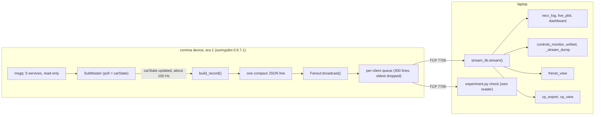
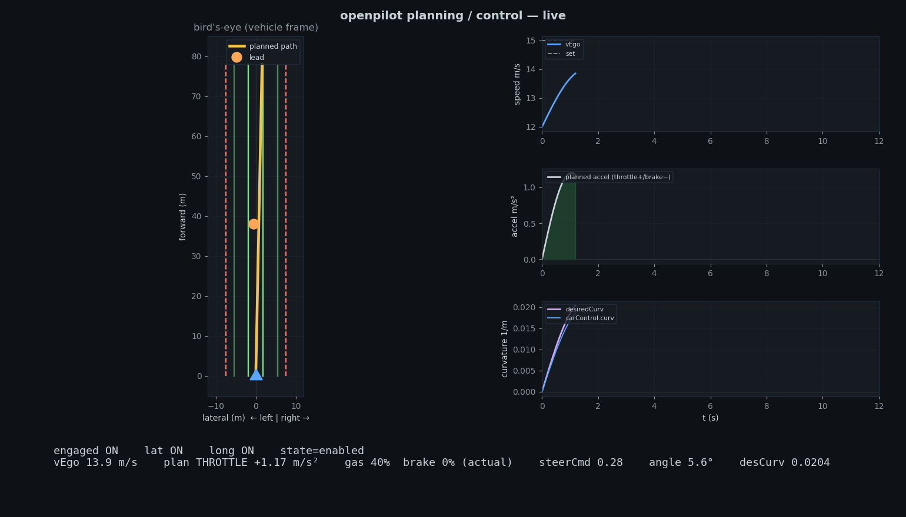
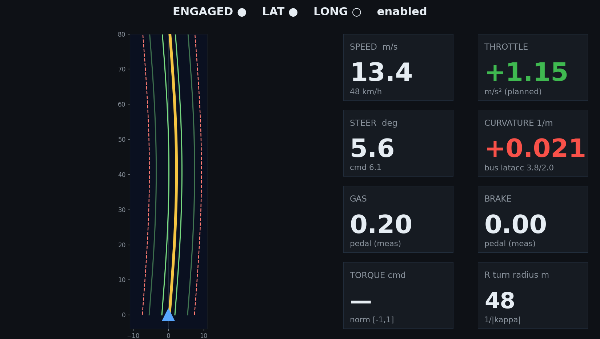

# Telemetry stream (reg_export)

`reg_export` is a small, read-only exporter that ran on the comma 3X in era 1 (sunnypilot 0.9.7.1, 2020 Honda Civic). It subscribes to openpilot's internal message bus and serves one compact JSON record per `carState` frame (about 100 Hz) over TCP port 7700. On the laptop, a stdlib-only client (`stream_lib`) feeds a logger, live plots, two dashboards and a terminal monitor. The curvepoints exporter, the Frenet tools and the experiment checks in this repo consume the same stream.

## At a glance

| Item | Value |
|---|---|
| Audience | Developers, integrators |
| Runs on | Device: the exporter. Laptop: `stream_lib` and every logger, plot and dashboard on this page. |
| Era | **Era 1 — sunnypilot 0.9.7.1** (2026-07 → 2026-08). The laptop tools are era-independent, but they need the exporter. |
| Status | Reference. `exporter_device.py` is the era-1 baseline. The deployed variants are described, not included. Not installed on the era-2 device (inferred). |
| Key files | [`exporter_device.py`](../remote/exporter_device.py), [`stream_lib.py`](../remote/stream_lib.py) (identical copy: [`Arman/stream_lib.py`](../remote/Arman/stream_lib.py)), [`recv_log.py`](../remote/recv_log.py), [`live_plot.py`](../remote/live_plot.py), [`dashboard.py`](../remote/dashboard.py), [`controls_monitor.py`](../remote/controls_monitor.py), [`unified.py`](../remote/unified.py), [`Arman/_stream_dump.py`](../remote/Arman/_stream_dump.py), [`README.md`](../remote/README.md) |

> [!WARNING]
> **Historical (sunnypilot era).** The exporter was installed on the era-1 device. The device was later re-flashed, at an unrecorded date between 2026-08-13 and 2026-10-03, to **Era 2 — openpilot v0.11.1 `release-tizi` + dashcam-anywhere** (in use from 2026-10-03), which erased every era-1 change. Nothing in `remote/Arman/dashcam_anywhere/` reinstalls the exporter, so it is most likely not on the device now. This is inferred; verify with `nc -z $COMMA_IP 7700`.

## Overview

The exporter runs as a process on the device. It reads nine openpilot services from msgq. Each time `carState` updates, it builds one record and fans it out to every connected TCP client.



Everything in the repo that reads port 7700:

| Consumer | What it reads | Doc |
|---|---|---|
| [`recv_log.py`](../remote/recv_log.py), [`live_plot.py`](../remote/live_plot.py), [`dashboard.py`](../remote/dashboard.py), [`controls_monitor.py`](../remote/controls_monitor.py), [`unified.py`](../remote/unified.py) | full records, via `stream_lib` | this page |
| [`Arman/_stream_dump.py`](../remote/Arman/_stream_dump.py) | keys, `modelV2` arrays and `loc` of the first records | this page, [10](10-no-can-mode-sunnypilot.md) |
| [`frenet_view.py`](../remote/frenet_view.py) | `modelV2` frames that carry arrays | [04](04-control-principles-and-frenet.md) |
| [`Arman/cp_export.py`](../remote/Arman/cp_export.py) | `loc`, `modelV2`, `stopFlag` | [05](05-curvepoints-pipeline.md), [06](06-client-interface-spec.md) |
| [`Arman/cp_view.py`](../remote/Arman/cp_view.py) | `loc`, `modelV2`, `t_wall` | [05](05-curvepoints-pipeline.md) |
| [`Arman/experiment.py`](../remote/Arman/experiment.py) → `sample_stream()` | 6 s of records with its own socket reader (`check` action) | [07](07-longitudinal-stop.md) |
| [`Arman/find_comma.sh`](../remote/Arman/find_comma.sh) | only probes whether port 7700 is open, to recognise the comma | [02](02-setup-ssh-networking.md) |

The original laptop README, [`remote/README.md`](../remote/README.md) (partly in Chinese), maps onto this page as follows. Its §0 (phone hotspot) is covered in [02](02-setup-ssh-networking.md). §1 maps to [Install and run](#install-and-run) and §2 to [Laptop tools](#laptop-tools). Its "Control-command & trajectory tools" section is translated in [dashboard](#dashboard) and [controls_monitor](#controls_monitor) (here) and in [04](04-control-principles-and-frenet.md) (frenet, frenet_view, controls_principles, the slides and the closing note on the stock-PCM car). "Record schema" maps to [Record schema](#record-schema), and "Notes" to [Wire protocol](#wire-protocol) and [Limitations](#limitations).

## Which exporter

Three exporter variants existed. Only the first is in this repo.

| Variant | Location | Emits a record | `stopFlag` | In repo |
|---|---|---|---|---|
| **Baseline** | [`remote/exporter_device.py`](../remote/exporter_device.py), installed as `/data/openpilot/tools/reg_export/exporter.py` | only when `carState` updated (`main()` skips the loop iteration otherwise) | no | yes (last modified 2026-07-14) |
| **stopFlag variant** | `tools/reg_export/exporter.py` on the era-1 device | not recorded | yes: a `stopFlag` block with `stop` = 0/1 | no |
| **No-CAN variant** (`exporter_nocan.py`) | staged at `/data/objstop/exporter_nocan.py`; [`enable_dashcam_mode.py`](../remote/Arman/enable_dashcam_mode.py) copies it over `tools/reg_export/exporter.py` (backup `exporter.py.bak_arman_nocan`) | with a car, unchanged (carState-paced); without CAN, on any service update (modelV2/loc at 20 Hz), throttled to 50 Hz max | yes | no |

> [!NOTE]
> **Described, not included.** The stopFlag and no-CAN exporters existed only on the era-1 device. The stopFlag block is documented in [`Arman/OPERATIONS.md`](../remote/Arman/OPERATIONS.md) §0 ("exporter (stopFlag) … TCP:7700 data stream, includes `stopFlag.stop=0/1`") and in [`Arman/vision/STOP_SIGN_VISION.md`](../remote/Arman/vision/STOP_SIGN_VISION.md) v2.1 (2026-08-06: "exporter adds `stopFlag`"). The no-CAN behaviour is documented in the module docstring of [`enable_dashcam_mode.py`](../remote/Arman/enable_dashcam_mode.py); its `main()` recognises an already-installed copy by the marker text `dashcam / no-CAN mode`. OPERATIONS §3.1 (applied and verified 2026-08-06) adds that "the exporter streams normally even without CAN", and reports that after a reboot without a car, `IsOnroad=1` and camerad/modeld/locationd/objstopd/7700 were all up.

What this means for you:

- With the baseline exporter, a record never contains `stopFlag`. Consumers must treat a missing `stopFlag` as "no stop" (erratum 9). [`cp_export.py`](../remote/Arman/cp_export.py) does exactly that: it starts with `"stop": 0` and updates it only when `rec["stopFlag"]` is a dict.
- With the baseline exporter, nothing is sent while there is no `carState`: offroad, on a bench or on a truck without CAN. The [no-CAN mode](10-no-can-mode-sunnypilot.md) needed the variant above.
- How the deployed exporter derived `stopFlag.stop` from `/tmp/op_stop_requested` and `/tmp/op_stop_intent` (actuation has priority, per OPERATIONS §3.2) is described, not included. See [06](06-client-interface-spec.md).

## Install and run

All of this applies to an **era-1** device (sunnypilot 0.9.7.1). The exporter has not been adapted or tested on era 2. [`remote/README.md`](../remote/README.md) warns that after a re-flash "the field paths in `exporter.py` may need updating". To see which era a device runs, use the one-line check in [14 → Which era is on the device](14-device-changes-and-revert.md#which-era-is-on-the-device).

### Find the device

The commands on this page use `$COMMA_IP`. Set it once per shell:

```bash
# laptop  (from the repo root)
cd remote/Arman && export COMMA_IP=$(./find_comma.sh)   # first comma found on your subnets
cd ../..                                               # back to the repo root
# or set it by hand, e.g.:  export COMMA_IP=192.168.1.231
ssh comma@$COMMA_IP 'cat /data/params/d/DongleId; echo'   # must print your own device's dongle ID (<DONGLE_ID>)
```

`find_comma.sh` looks at the hosts on your subnets that have TCP 22 open and treats one as a comma if TCP 7700 is open or if a key-based `ssh comma@<ip> 'test -d /data/openpilot'` succeeds. It returns the first match, so check the dongle ID (last line above) before you trust it. See [02](02-setup-ssh-networking.md).

### Copy the exporter to the device

The target path comes from the exporter's own docstring and from README §1. The notes do not record how the file was copied, so the following is one way to do it:

```bash
# laptop  (from the repo root)
ssh comma@$COMMA_IP 'mkdir -p /data/openpilot/tools/reg_export'
scp remote/exporter_device.py comma@$COMMA_IP:/data/openpilot/tools/reg_export/exporter.py
```

The file is an addition to the device's openpilot checkout. To undo it, delete `/data/openpilot/tools/reg_export/exporter.py` again. [14](14-device-changes-and-revert.md) explains how to inventory such changes.

### Manual run in tmux (first install)

This is README §1, with the era-1 interpreter:

```bash
# device  (ssh comma@$COMMA_IP)   era 1
cd /data/openpilot && tmux new -s reg \
  'PYTHONPATH=/data/openpilot /usr/local/pyenv/versions/3.11.4/bin/python3 tools/reg_export/exporter.py'
# detach: Ctrl-b d      re-attach: tmux attach -t reg      stop: tmux kill-session -t reg
```

The exporter prints lines like these (format from `Fanout.__init__()`, `Fanout._accept()` and `main()`; the values are examples):

```text
reg_export: serving JSON lines on 0.0.0.0:7700
reg_export: client connected ('192.168.1.20', 50412) (total 1)
reg_export: seq=1234 clients=1 vEgo=13.4 curv=0.002
```

The third line repeats every 5 s, but only while records are being produced. README §1 puts it this way: "Data only flows when the car is **onroad** — openpilot's modeld/controlsd only run when connected to the car."

### Port and bind address

| Setting | Default | How to change | Precedence |
|---|---|---|---|
| TCP port | `7700` | env `REG_EXPORT_PORT`, or `--port N` | env var > `--port` > 7700 |
| Bind address | `0.0.0.0` (all interfaces) | env `REG_EXPORT_BIND`, or `--bind ADDR` | env var > `--bind` > `0.0.0.0` |

`main()` reads the environment first, because manager starts the module by calling `main()` with no arguments. A set environment variable therefore silently overrides a command-line flag, which the docstring's "Options: --port 7700  --bind 0.0.0.0" doesn't mention (A-item A6 in [16](16-errata-and-crosswalk.md#additional-inconsistencies-found-in-this-review)). Example: a second, manual copy on another port, next to the manager-run one:

```bash
# device  (ssh comma@$COMMA_IP)   era 1
cd /data/openpilot && REG_EXPORT_PORT=7701 PYTHONPATH=/data/openpilot \
  /usr/local/pyenv/versions/3.11.4/bin/python3 tools/reg_export/exporter.py
```

`Fanout.__init__()` retries `bind()` up to 30 times, 1 s apart, and then raises. The code comment gives the reason: "when manager restarts us, the old instance may still hold the port briefly".

**Analysis (from code; not field-tested).** If the manager instance is already serving 7700 and you start a manual copy on the same port, the manual copy retries for about 30 s and then exits with the bind error. Don't run two copies on one port.

### Manager registration (described, not included)

The exporter's design assumes it runs under openpilot's manager. The `main()` comment says "manager launches this via `mod.main()` (no args)", and OPERATIONS §4 says that after a `pkill` "manager restarts it automatically". README §1 shows only the manual tmux start. That was the first install; the manager registration is the later, deployed form (erratum 8).

> [!NOTE]
> **Described, not included.** The device's `system/manager/process_config.py` contained this entry:
>
> `PythonProcess("reg_export", "tools.reg_export.exporter", always_run),`
>
> [`enable_dashcam_mode.py`](../remote/Arman/enable_dashcam_mode.py) → `main()` uses that exact line as its anchor for adding objstopd. How the entry was added is not recorded. The oldest known backup of `process_config.py` (`.bak_arman_auto`, made by `enable_dashcam_mode.py`) already contains it. See [14](14-device-changes-and-revert.md).

`always_run` means the exporter runs whenever manager runs, onroad **and** offroad. Consequences:

- An open port 7700 only proves that the exporter (and so manager) is running, not that the device is onroad. Don't take "7700 open" as "onroad": no note says that verbatim, but OPERATIONS §3.1 lists 7700 among the services that were up in the verified onroad boot, which invites the shortcut (erratum 17).
- Records flowing ⇒ onroad. The ground truth is `/data/params/d/IsOnroad`.
- To pass `REG_EXPORT_PORT` / `REG_EXPORT_BIND` to the manager-run instance, they would have to be in manager's environment. The notes don't record whether that was ever done.

### Restart, inspect, reboot

These are the exporter-related lines of the era-1 device quick reference in OPERATIONS §4, translated. The full list is in [13](13-operations-runbook.md#device-commands-era-1).

```bash
# device  (ssh comma@$COMMA_IP)   era 1
ps aux | grep -E "objstop|reg_export|modeld"   # which processes are running
pkill -f '[t]ools.reg_export'                  # restart the exporter; manager starts it again
sudo reboot                                    # restart everything; all /tmp flags are cleared
```

The `[t]` in the pattern stops `pkill -f` from matching the shell that runs it, for example when you send the command through `ssh comma@$COMMA_IP '…'`. Manager starts the exporter again only if it is registered in `process_config.py` (previous section). A copy you started by hand in tmux just stops; start it again as in [Manual run in tmux](#manual-run-in-tmux-first-install).

> [!CAUTION]
> **Reboot only with the car stopped.** `sudo reboot` restarts openpilot along with everything else. It also clears every `/tmp` flag, including a pending stop request in `/tmp/op_stop_requested` ([07](07-longitudinal-stop.md)). There is nothing to undo: the device comes back up by itself (an exporter you started by hand in tmux does not), and the notes wait about 45 s before engaging again (OPERATIONS §2.1, EXPERIMENT_RUNBOOK §1).

### Check that it runs and that data flows

```bash
# laptop  (from the repo root)
nc -z $COMMA_IP 7700 && echo "7700 open: exporter is listening" || echo "7700 closed (or device unreachable)"
ssh comma@$COMMA_IP 'cat /data/params/d/IsOnroad; echo'
python3 remote/stream_lib.py --ip $COMMA_IP          # prints a line every 100 records; Ctrl-C to stop
```

| What you see | What it means |
|---|---|
| `nc -z` succeeds | the exporter process is listening. Says nothing about onroad (erratum 17). |
| `[100] 98Hz vEgo=… steer=… curv=… accel=… enabled=…` | records are flowing, so `carState` exists and the device is onroad |
| `[stream] disconnected (timed out); retrying in 1s...` about every 6 s | if `nc -z` succeeds: connected, but no record for 5 s, so the exporter is up with no `carState` (offroad, or no CAN with the baseline exporter). If `nc -z` fails, the TCP connect itself timed out, which is a network problem ([02](02-setup-ssh-networking.md)). |
| `[stream] disconnected ([Errno 111] Connection refused); retrying in 1s...` | nothing listens on 7700: exporter not running, or not installed (era 2) |
| `IsOnroad` prints `1` | ground truth: onroad |

## Wire protocol

| Property | Value | Defined in |
|---|---|---|
| Transport | TCP. The device is the server, default `0.0.0.0:7700`, listen backlog 8. | `Fanout.__init__()` |
| Direction | Device → laptop only. The server never reads from a client; there is no handshake, no request and no authentication. | `Client._run()` |
| Framing | One JSON object per line, terminated by `\n` | `main()` |
| Encoding | `json.dumps(rec, separators=(",", ":"))`: compact, no spaces. Python's default `ensure_ascii` makes the bytes plain ASCII, so they are valid UTF-8. | `main()` |
| Rate | One record per `carState` update, about 100 Hz. Nothing at all while `carState` is absent. | `main()` (`SubMaster(..., poll='carState')`, `sm.update(1000)`) |
| Heavy arrays | `modelV2` and `longitudinalPlan` arrays appear only on records where that 20 Hz service updated, so roughly every fifth record | `HEAVY`, `build_record()` |
| Sequence | `seq` starts at 0 when the exporter starts and grows by 1 per record. It is shared by all clients. | `main()` |
| Flow control | Each client has a `deque(maxlen=300)` and its own sender thread with `TCP_NODELAY`. When the queue is full, the **oldest** line is dropped. The sampling loop never blocks. | `Client` |
| Multiple clients | Yes. Each gets its own queue and thread. A client is removed after a send error. | `Fanout._accept()`, `Fanout.broadcast()` |
| Effect on openpilot | A read-only msgq subscriber "cannot back-pressure openpilot, so this can NEVER affect the driving stack" (module docstring). No measurement of its CPU load on the device is recorded. The script unsets `ZMQ` and `OPENPILOT_PREFIX` so it uses native msgq in openpilot's default namespace. | module top |

**Analysis (from code; not field-tested):**

- A queue of 300 lines holds about 3 s of records at 100 Hz. A client that falls further behind loses the oldest lines silently. You can detect this as gaps in `seq`.
- Non-finite floats would be written as `NaN` / `Infinity`, which is what Python's `json.dumps` does by default. Python's `json.loads` accepts these tokens; strict JSON parsers in other languages may not.
- A laptop that vanishes without closing the connection (sleep, Wi‑Fi loss) is removed only when a send to it finally fails. Until then its queue just keeps dropping lines. This does not affect other clients.

> [!IMPORTANT]
> **Security.** The stream has no authentication or encryption, and by default it listens on every interface. [`Arman/ETHERNET_SETUP.md`](../remote/Arman/ETHERNET_SETUP.md) notes that it is "reachable on every interface automatically". Anyone on the same network can read the vehicle's GPS position and control signals. Use a private hotspot or tether, or restrict the bind address with `REG_EXPORT_BIND`.

## Record schema

Every record has the same top-level shape: three envelope keys, then nine service blocks in this order: `carState`, `carControl`, `carOutput`, `controlsState`, `longitudinalPlan`, `modelV2`, `loc`, `radar`, `liveParams`. Every block is present in every record, whether or not its service updated: it carries the latest message of that service ("the latest planning/control/feedback signals", module docstring), and `_upd` tells you whether that message is new. The field lists below are taken from the extractor functions in [`exporter_device.py`](../remote/exporter_device.py) (`ext_carState()` … `ext_liveParameters()`, `build_record()`).

> [!IMPORTANT]
> **Field names.** Older docstrings in [`stream_lib.py`](../remote/stream_lib.py), [`recv_log.py`](../remote/recv_log.py) and [`live_plot.py`](../remote/live_plot.py) mention `longitudinalPlan.aTarget` and `shouldStop`. The exporter emits **`aTarget0`** and **`vTarget0`** instead: 0.9.7.1 has no `aTarget`/`shouldStop` field. The schema table in [`remote/README.md`](../remote/README.md) and the `stream_lib.py` docstring also omit `liveParams` (erratum 10). The tables below follow the code.

Conventions in the tables:

- "float (n)" means a number rounded to n decimals, or `null` if the source value is missing or not numeric (helper `r()`).
- "list (n)" is a list of numbers rounded to n decimals, or `[]` on error (helper `rl()`).
- "optional" fields are read with a fallback (helper `g()`), so they become `null`, `""`, `false`, `0` or `[]` (depending on the type) if the field doesn't exist in the running openpilot version.
- Where the unit is "—", the repo doesn't document it: the value is whatever sunnypilot 0.9.7.1 publishes.

### Envelope

| Key | Type | Meaning |
|---|---|---|
| `t_wall` | float (4) | Device wall clock, `time.time()`, Unix seconds. The device has no RTC battery, so after an offline boot its clock is wrong until it gets a GPS fix (erratum 24). Don't compare it with the laptop clock unless the device has synced. |
| `t_mono` | float (4) | Device `time.monotonic()` when the record was built, in seconds. Only meaningful relative to other records from the same exporter run. |
| `seq` | int | Record counter (see [Wire protocol](#wire-protocol)) |

### Block metadata

Every block carries three extra keys, added in `build_record()`:

| Key | Type | Meaning |
|---|---|---|
| `_upd` | bool | `sm.updated[service]`: the service published a new message during the last `sm.update()`, which normally means since the previous record. Always `true` for `carState`, which paces the records. |
| `_valid` | bool | SubMaster's `valid` flag for the service |
| `_mono` | int | The source message's `logMonoTime`, a monotonic time in **nanoseconds** ([`replay_calib.py`](../remote/Arman/dashcam_anywhere/replay_calib.py) compares `logMonoTime` differences with `GPS_MAX_AGE * 1e9`). README: "for alignment". |
| `_err` | string | **Instead of** all other keys, if the extractor raised an exception (for example, a field path that doesn't exist in the running version) |

### `carState`

Vehicle feedback, 100 Hz (README). Source message: `carState`.

| Key | Source field | Type | Unit / meaning |
|---|---|---|---|
| `vEgo` | `vEgo` | float (4) | m/s; from wheel speed / transmission KF ([04](04-control-principles-and-frenet.md#measured-pedals-and-sensors)) |
| `vEgoRaw` | `vEgoRaw` | float (4) | — |
| `aEgo` | `aEgo` | float (4) | m/s² |
| `vCruise` | `vCruise` (optional) | float (3) | set speed in **km/h** (erratum 26) |
| `yawRate` | `yawRate` | float (5) | — |
| `steeringAngleDeg` | `steeringAngleDeg` | float (3) | deg (Civic: `STEERING_SENSORS.STEER_ANGLE`) |
| `steeringRateDeg` | `steeringRateDeg` | float (3) | deg/s |
| `steeringTorque` | `steeringTorque` | float (3) | driver torque sensor, raw |
| `steeringTorqueEps` | `steeringTorqueEps` | float (3) | EPS motor torque, raw |
| `steeringPressed` | `steeringPressed` | bool | |
| `gas` | `gas` | float (3) | Civic: DBC scale of `PEDAL_GAS`, not 0–1 |
| `gasPressed` | `gasPressed` | bool | |
| `brake` | `brake` | float (3) | Civic: VSA analog value (`USER_BRAKE`) |
| `brakePressed` | `brakePressed` | bool | |
| `standstill` | `standstill` | bool | |
| `gear` | `gearShifter` (optional) | string | enum name, `""` if absent |
| `leftBlinker`, `rightBlinker` | same | bool | |
| `cruiseEnabled` | `cruiseState.enabled` | bool | |
| `cruiseSpeed` | `cruiseState.speed` | float (3) | — |
| `cruiseAvail` | `cruiseState.available` | bool | |

### `carControl`

The final control command, 100 Hz (README). Source: `carControl`, its `actuators` and its `cruiseControl`.

| Key | Source field | Type | Unit / meaning |
|---|---|---|---|
| `enabled` | `enabled` | bool | openpilot engaged |
| `latActive` | `latActive` | bool | lateral control active |
| `longActive` | `longActive` | bool | openpilot controls longitudinal (OP long). `experiment.py check` uses it as the OP-long indicator. |
| `steer` | `actuators.steer` | float (4) | normalized torque command, [−1, 1] |
| `steeringAngleDeg` | `actuators.steeringAngleDeg` | float (3) | angle command; ≡ 0 for this car's torque controller ([04](04-control-principles-and-frenet.md#lateral-chain)) |
| `curvature` | `actuators.curvature` | float (6) | 1/m; "final lateral command" (`stream_lib` docstring) |
| `accel` | `actuators.accel` | float (4) | m/s²; reaches CAN only with OP long ([04](04-control-principles-and-frenet.md#longitudinal-control-in-two-configurations)) |
| `longControlState` | `actuators.longControlState` (optional) | string | off / pid / stopping / starting |
| `steerOutputCan` | `actuators.steerOutputCan` (optional) | float (4) | the value sent on CAN is in `carOutput` |
| `cancel`, `resume`, `override` | `cruiseControl.*` | bool | cruise-control flags |

### `carOutput`

"Actually-sent (post-limit) values" (README). Source: `carOutput.actuatorsOutput`.

| Key | Source field | Type | Unit / meaning |
|---|---|---|---|
| `steer` | `steer` | float (4) | normalized |
| `steeringAngleDeg` | `steeringAngleDeg` | float (3) | deg |
| `curvature` | `curvature` (optional) | float (6) | 1/m |
| `accel` | `accel` | float (4) | m/s² |
| `steerOutputCan` | `steerOutputCan` (optional) | float (1) | raw EPS torque units as sent on CAN, ±4096 on Honda Bosch (code comment) |
| `gas`, `brake` | same (optional) | float (4) | — |

### `controlsState`

Controller internals, 100 Hz (README), plus one derived field.

| Key | Source field | Type | Unit / meaning |
|---|---|---|---|
| `state` | `state` (optional) | string | e.g. `enabled` |
| `desiredCurvature` | `desiredCurvature` | float (6) | 1/m; controlsd's curvature target. The model's raw value is `modelV2.desiredCurvature`. |
| `curvature` | `curvature` | float (6) | 1/m; current curvature (the "measured" column in `controls_monitor`) |
| `longControlState` | optional | string | |
| `vCruise` | optional | float (3) | set speed, km/h |
| `upAccelCmd`, `uiAccelCmd`, `ufAccelCmd` | optional | float (4) | longitudinal controller terms |
| `latType` | `lateralControlState.which()` | string | name of the active lateral-controller state |
| `lat` | the active state's fields | object | whichever of `output`, `saturated`, `error`, `p`, `i`, `d`, `f`, `steeringAngleDeg`, `steeringAngleDesiredDeg`, `actualLateralAccel`, `desiredLateralAccel`, `angleError` exist. Booleans stay booleans; numbers are rounded to 4 decimals. `latType` and `lat` are omitted if reading the state fails. |
| `desSteerAngleDeg` | **derived** | float (3) | deg; see below. Appended last, after `_mono`. |

`build_record()` derives the steering-wheel angle that corresponds to the desired curvature with the bicycle model, because "torque-mode cars have no angle command":

```text
desSteerAngleDeg = degrees(atan(WHEELBASE · κ)) · sr + off
  κ   = controlsState.desiredCurvature
  WHEELBASE = 2.70 m (Honda Civic constant)
  sr  = liveParams.steerRatio, or DEFAULT_STEER_RATIO = 16.7 if missing/0
  off = liveParams.angleOffsetDeg, or 0.0
```

The field is omitted when `desiredCurvature` is `null`. For the derivation, its sign convention and a worked example, see [04 → Frames and signs](04-control-principles-and-frenet.md#frames-and-signs).

### `longitudinalPlan`

The longitudinal plan, i.e. the MPC solution, 20 Hz (README). The code comment says: "there is NO aTarget/shouldStop field (deprecated). Near-term planned accel = accels[0]; the actual commanded accel is carControl.accel."

| Key | Source field | Type | Unit / meaning |
|---|---|---|---|
| `hasLead` | `hasLead` | bool | |
| `source` | `longitudinalPlanSource` (optional) | string | |
| `fcw` | `fcw` | bool | forward-collision warning |
| `aTarget0` | `accels[0]` | float (4) | m/s²; near-term planned acceleration (`null` if the list is empty) |
| `vTarget0` | `speeds[0]` | float (3) | m/s (`null` if empty) |
| `speeds` | `speeds` | list (3) | **heavy** (only when `_upd`); m/s |
| `accels` | `accels` | list (3) | **heavy**; m/s² |
| `jerks` | `jerks` (optional) | list (3) | **heavy** |

### `modelV2`

The model's trajectory and lateral plan, 20 Hz (README). All geometry is in the openpilot car frame (x forward, y right, z down).

| Key | Source field | Type | Unit / meaning |
|---|---|---|---|
| `desiredCurvature` | `action.desiredCurvature` | float (6) | 1/m; the model's lateral plan |
| `laneChangeState`, `laneChangeDirection` | `meta.*` (optional) | string | |
| `hardBrakePredicted` | `meta.hardBrakePredicted` (optional) | bool | |
| `confidence` | `confidence` (optional) | string | |
| `frameId` | `frameId` (optional) | int | camera frame id |
| `timestampEof` | `timestampEof` (optional) | int | — |
| `pos_x`, `pos_y`, `pos_z` | `position.x/.y/.z` | list (3) | **heavy**; planned path, m |
| `vel_x` | `velocity.x` | list (3) | **heavy**; planned forward speed, m/s |
| `orient_z` | `orientation.z` | list (4) | **heavy**; — |
| `laneLineProbs` | `laneLineProbs` (optional) | list (3) | **heavy**; per-line probability |
| `laneLines` | `laneLines[i].x/.y` | list of `[x[], y[]]`, 2 decimals | **heavy**; four lines, left to right. Index 1 and 2 are the ego lane's left and right lines (`frenet.reference_line()`). |
| `roadEdges` | `roadEdges[i].x/.y` | list of `[x[], y[]]`, 2 decimals | **heavy**; left and right road edge |

### `loc`

Localization, 20 Hz (README). Source: `liveLocationKalman`, renamed to `loc`.

| Key | Source field | Type | Unit / meaning |
|---|---|---|---|
| `status` | `status` (optional) | string | |
| `gpsOK` | `gpsOK` (optional) | bool | |
| `lat`, `lon` | `positionGeodetic.value[0..1]` | float (7) | WGS84 degrees |
| `alt` | `positionGeodetic.value[2]` | float (2) | m |
| `yaw` | `calibratedOrientationNED.value[2]` | float (5) | NED yaw in rad: 0 = North, positive toward East (clockwise seen from above), per [`Arman/frame.py`](../remote/Arman/frame.py) |
| `vel` | `velocityCalibrated.value` | list of 3 (3) | m/s; `cp_export` and `cp_view` take `vel[0]` as the forward (ego) speed ([05](05-curvepoints-pipeline.md#inputs-from-the-stream)) |

`lat`/`lon`/`alt`, `yaw` and `vel` are present only when the source vector has exactly three values. A position of `(0, 0)` means "no fix" to downstream tools: `experiment.py` → `sample_stream()` requires |lat| or |lon| > 1e-6, and `cp_export._valid_fix()` rejects only `(0, 0)` (erratum 14; see [05](05-curvepoints-pipeline.md)).

### `radar`

The lead vehicle. Source: `radarState.leadOne`, renamed to `radar`. If `leadOne` is missing, the block holds only the metadata keys.

| Key | Type | Unit / meaning |
|---|---|---|
| `status` | bool | lead present |
| `dRel` | float (2) | distance to the lead; the dashboards plot it as metres forward |
| `yRel` | float (2) | lateral offset of the lead; the dashboards plot it as metres lateral |
| `vRel`, `vLead`, `aLeadK` | float (3) | — |

From 2026-07-17, with OP long on, the stock radar was disabled (`radarUnavailable=True`, no radar lead; [`Arman/STOP_COMMAND.md`](../remote/Arman/STOP_COMMAND.md)). Interpret this block with that in mind. See [04](04-control-principles-and-frenet.md#longitudinal-control-in-two-configurations).

### `liveParams`

Online vehicle-parameter estimates. Source: `liveParameters`, renamed to `liveParams`.

| Key | Type | Meaning |
|---|---|---|
| `steerRatio` | float (3) | used for `desSteerAngleDeg` |
| `angleOffsetDeg` | float (3) | deg; used for `desSteerAngleDeg` |
| `stiffnessFactor` | float (3) | |
| `roll` | float (4) | — |
| `valid` | bool | the estimator's own validity flag. This is **not** the block's `_valid`. |

### `stopFlag` (deployed variants only)

> [!NOTE]
> **Described, not included.** The era-1 deployed exporter added a `stopFlag` block whose `stop` field is `0` or `1` (OPERATIONS §0). [`cp_export.py`](../remote/Arman/cp_export.py) reads `rec["stopFlag"]["stop"]` and turns it into the top-level `"stop"` of the client JSON. The baseline [`exporter_device.py`](../remote/exporter_device.py) has no such block (erratum 9). For the semantics, see [06](06-client-interface-spec.md).

### Example record

This example was produced by feeding stub messages through `build_record()`, so the keys, their order and the rounding are exact. **The values are illustrative, not a captured record.** Enum strings such as `gear`, `latType` and `source` are examples, and no sign relationship should be read from the numbers. The location is the repo's neutral example coordinate. On the wire, the record is one line with no spaces (compact separators); it is wrapped and spaced here for reading.

```json
{"t_wall": 1784000000.1234, "t_mono": 5321.4567, "seq": 1234,
 "carState": {"vEgo": 13.4, "vEgoRaw": 13.41, "aEgo": 0.05, "vCruise": 50.0, "yawRate": 0.0261, "steeringAngleDeg": 5.6, "steeringRateDeg": 0.2, "steeringTorque": 3.0, "steeringTorqueEps": 120.0, "steeringPressed": false, "gas": 0.0, "gasPressed": false, "brake": 0.0, "brakePressed": false, "standstill": false, "gear": "drive", "leftBlinker": false, "rightBlinker": false, "cruiseEnabled": true, "cruiseSpeed": 13.89, "cruiseAvail": true, "_upd": true, "_valid": true, "_mono": 5321456000000},
 "carControl": {"enabled": true, "latActive": true, "longActive": false, "steer": -0.052, "steeringAngleDeg": 0.0, "curvature": 0.002, "accel": 0.12, "longControlState": "pid", "steerOutputCan": 0.0, "cancel": false, "resume": false, "override": false, "_upd": true, "_valid": true, "_mono": 5321455000000},
 "carOutput": {"steer": -0.052, "steeringAngleDeg": 0.0, "curvature": 0.002, "accel": 0.12, "steerOutputCan": 212.0, "gas": 0.0, "brake": 0.0, "_upd": true, "_valid": true, "_mono": 5321454000000},
 "controlsState": {"state": "enabled", "desiredCurvature": 0.002, "curvature": 0.0019, "longControlState": "pid", "vCruise": 50.0, "upAccelCmd": 0.01, "uiAccelCmd": 0.02, "ufAccelCmd": 0.09, "latType": "torqueState", "lat": {"output": -0.052, "saturated": false, "error": 0.0123, "p": 0.0123, "i": -0.0021, "d": 0.0, "f": -0.0611, "actualLateralAccel": 0.3512, "desiredLateralAccel": 0.3591}, "_upd": true, "_valid": true, "_mono": 5321453000000, "desSteerAngleDeg": 5.412},
 "longitudinalPlan": {"hasLead": false, "source": "cruise", "fcw": false, "aTarget0": 0.12, "vTarget0": 13.41, "_upd": false, "_valid": true, "_mono": 5321452000000},
 "modelV2": {"desiredCurvature": 0.0021, "laneChangeState": "off", "laneChangeDirection": "none", "hardBrakePredicted": false, "confidence": "green", "frameId": 73021, "timestampEof": 5321402000000, "_upd": false, "_valid": true, "_mono": 5321451000000},
 "loc": {"status": "valid", "gpsOK": true, "lat": 37.7749295, "lon": -122.4194155, "alt": 16.2, "yaw": 1.5708, "vel": [13.4, 0.01, 0.0], "_upd": false, "_valid": true, "_mono": 5321450000000},
 "radar": {"status": true, "dRel": 38.0, "yRel": -0.5, "vRel": -1.2, "vLead": 12.2, "aLeadK": 0.0, "_upd": false, "_valid": true, "_mono": 5321449000000},
 "liveParams": {"steerRatio": 16.2, "angleOffsetDeg": 0.4, "stiffnessFactor": 1.0, "roll": 0.0012, "valid": true, "_upd": false, "_valid": true, "_mono": 5321448000000}}
```

Here `desSteerAngleDeg` = degrees(atan(2.70 × 0.002)) × 16.2 + 0.4 = 5.412, and `carOutput.steerOutputCan` = int(−(−0.052) × 4096) = 212 ([04](04-control-principles-and-frenet.md#lateral-chain)). On a heavy frame, `longitudinalPlan` additionally carries `speeds`, `accels` and `jerks` (between `vTarget0` and `_upd`), and `modelV2` carries `pos_x` … `roadEdges` (between `timestampEof` and `_upd`).

## Raw frames and units

The stream uses **openpilot's** conventions. The client-facing products ([05](05-curvepoints-pipeline.md), [06](06-client-interface-spec.md)) use a different frame (ENU, κ left-positive), so don't mix them.

| Quantity | Frame / sign | Unit | Documented in |
|---|---|---|---|
| `modelV2.pos_*`, `laneLines`, `roadEdges` | openpilot car (calibrated) frame: x forward, **y right**, z down | m | [`Arman/frame.py`](../remote/Arman/frame.py) docstring, [`frenet.py`](../remote/frenet.py) docstring, [`controls_principles.md`](../remote/controls_principles.md) §5 |
| Curvatures (`modelV2.desiredCurvature`, `controlsState.desiredCurvature`, `controlsState.curvature`, `carControl.curvature`) | κ > 0 = turning **right** (+y) | 1/m | `controls_principles.md` §5, `frenet.py` |
| `carControl.steer` | normalized torque; the torque controller returns `−output_torque` ("left is positive") | [−1, 1] | `controls_principles.md` §1/§5 (device source) |
| `carOutput.steerOutputCan` | `int(−steer × 4096)`; carcontroller comment: "positive when steering right" | ±4096 raw | same |
| `loc.yaw` | NED yaw: 0 = North, + toward East (clockwise) | rad | `frame.py` |
| `loc.lat`, `loc.lon`, `loc.alt` | WGS84 | deg, deg, m | `frame.py` → `geodetic2ecef()` |
| `vEgo`, `vTarget0`, `speeds`, `vel_x`, `loc.vel` | — | m/s | `controls_principles.md`, README; `cp_export.py` for `loc.vel` |
| `vCruise` (carState and controlsState) | — | **km/h** | `controls_principles.md` §4, erratum 26 |
| `aEgo`, `accel`, `aTarget0`, `accels` | — | m/s² | same |

For the full sign discussion (lateral chain, NED → ENU, bicycle model), see [04 → Frames and signs](04-control-principles-and-frenet.md#frames-and-signs). For the conversion into the client's ENU frame (θ = π/2 − yaw), see [05](05-curvepoints-pipeline.md).

## `stream_lib` API

[`stream_lib.py`](../remote/stream_lib.py) is the stdlib-only client that every laptop tool uses. [`Arman/stream_lib.py`](../remote/Arman/stream_lib.py) is a byte-identical copy (the "vendored" client of [`Arman/README.md`](../remote/Arman/README.md)), so the tools in `remote/Arman/` can import it from their own folder. If you change one copy, copy it over the other.

| Function | Signature | Behaviour |
|---|---|---|
| `stream()` | `stream(ip: str, port: int = 7700, reconnect: bool = True, timeout: float = 5.0) -> Iterator[dict]` | Connects, then yields one decoded `dict` per line |
| `stream_callback()` | `stream_callback(ip: str, on_record, port: int = 7700, **kw)` | Calls `on_record(rec)` for every record. Blocks forever. `**kw` is passed to `stream()` (`reconnect`, `timeout`). |

`stream()` in detail:

- It connects with `socket.create_connection((ip, port), timeout=timeout)` and uses the same `timeout` (default 5 s) for every read.
- It reads UTF-8 text lines. Blank lines are skipped, and so are lines that fail `json.loads`, without a message.
- On `OSError` or `socket.timeout` (refused, unreachable, reset, or **no data for `timeout` seconds**) with `reconnect=True`, it prints `[stream] disconnected (<error>); retrying in 1s...`, sleeps 1 s and reconnects. With `reconnect=False` it re-raises.
- **Analysis (from code; not field-tested):** if the exporter closes the connection cleanly (EOF), the generator reconnects at once, even with `reconnect=False`, because only exceptions are re-raised.
- An exporter that is up but has nothing to send (offroad) therefore produces a timeout and reconnect about every 6 s (5 s timeout + 1 s sleep).

Minimal consumer (the README §2 example, adapted):

```python
# laptop  (run from remote/, or put remote/ on sys.path)
import os
from stream_lib import stream

for rec in stream(os.environ["COMMA_IP"]):
    curv = rec["carControl"]["curvature"]        # final lateral command (1/m)
    acc  = rec["longitudinalPlan"]["aTarget0"]   # near-term planned accel (accels[0])
    des  = rec["modelV2"]["desiredCurvature"]    # model lateral plan
    if rec["modelV2"]["_upd"] and "pos_x" in rec["modelV2"]:
        path = list(zip(rec["modelV2"]["pos_x"], rec["modelV2"]["pos_y"]))   # 20 Hz frames only
```

Quick rate check from the command line (`--ip` required, `--port` default 7700). It prints one line every 100 records; the rate is records divided by seconds since start:

```bash
# laptop  (from the repo root)
python3 remote/stream_lib.py --ip $COMMA_IP
# [100] 98Hz vEgo=13.4 steer=-0.052 curv=0.002 accel=0.12 enabled=True
```

## Laptop tools

### Running the tools

- Run each tool by its path with `python3` (Python 3.10+; tested with 3.12). Python puts the script's own folder on the import path, so `from stream_lib import stream` finds the copy next to the script. If you copy a tool elsewhere, copy `stream_lib.py` with it.
- Output files (CSV, parquet, PNG) are written to the **current working directory**.
- Every tool except `_stream_dump.py` takes `--port` (default `7700`).

| Tool | Dependencies (from its imports) |
|---|---|
| `stream_lib.py`, `recv_log.py` (CSV), `controls_monitor.py`, `Arman/_stream_dump.py` | Python standard library only |
| `recv_log.py --out *.parquet` | pandas + pyarrow (pandas is imported only when the file is written) |
| `live_plot.py`, `dashboard.py`, `unified.py` | matplotlib; the live windows need a GUI backend |

```bash
# laptop
python3 -m pip install matplotlib          # live_plot, dashboard, unified
python3 -m pip install pandas pyarrow      # only for recv_log --out *.parquet
```

### recv_log

[`recv_log.py`](../remote/recv_log.py) logs the stream to CSV or parquet.

| Flag | Default | Meaning |
|---|---|---|
| `--ip` | required | device IP |
| `--port` | `7700` | |
| `--out` | `reg_log.csv` | output file. A name ending in `.parquet` (any case) selects parquet; anything else is CSV. |
| `--warmup` | `80` | CSV only: records buffered to build the header |

```bash
# laptop  (from the repo root; stop with Ctrl-C)
python3 remote/recv_log.py --ip $COMMA_IP --out drive.csv
python3 remote/recv_log.py --ip $COMMA_IP --out drive.parquet    # needs pandas + pyarrow
```

How it works (`flatten()`, `main()`):

- **Columns.** `flatten()` goes one level deep. Envelope keys stay as they are (`t_wall`, `t_mono`, `seq`), and every block key becomes `<block>.<key>`, e.g. `carControl.curvature`, `modelV2.desiredCurvature`, `controlsState._mono`. Values that are lists or dicts (`modelV2.pos_x`, `modelV2.laneLines`, `controlsState.lat`, `loc.vel` …) are stored as compact JSON strings, so each row stays flat. The module's `ARRAY_KEYS` set is not used.
- **CSV.** The first `--warmup` records are buffered. The header is the sorted union of their keys, so the 20 Hz array columns are included (80 records ≈ 0.8 s at 100 Hz). Then the buffer is written and logging continues. The file is flushed and a progress line `[recv_log] <n> rows ~<rate>Hz` is printed every 200 rows. If you stop before the warm-up completes, the buffered rows are written with the partial header.
- **Parquet.** All rows are kept in memory and written once at exit (Ctrl-C) with `pandas.DataFrame(rows).to_parquet()`. `--warmup` is not used.
- Messages: `[recv_log] connecting to <ip>:<port> -> <out>`, `[recv_log] header ready (<N> cols), logging...`, `[recv_log] closed <out> (<n> rows)`; for parquet, `[recv_log] wrote <N> rows -> <out>`.

**Analysis (from code; not field-tested).** In CSV mode, a column that first appears after the warm-up is dropped silently (`extrasaction="ignore"`). This affects, for example, `loc.lat` if the localizer only starts reporting a position later, or a block that showed only `_err` during the warm-up. Raise `--warmup`, or use parquet.

### live_plot

[`live_plot.py`](../remote/live_plot.py) is the first, simple live plot (last modified 2026-07-07).

| Flag | Default | Meaning |
|---|---|---|
| `--ip` | required | |
| `--port` | `7700` | |
| `--seconds` | `20.0` | x-axis window in seconds |

```bash
# laptop  (from the repo root)
python3 remote/live_plot.py --ip $COMMA_IP --seconds 20
```

Four stacked panels share the time axis (seconds since the oldest buffered record, from `t_mono`). They redraw every 100 ms.

| Panel | Lines (legend → field) |
|---|---|
| speed | `vEgo (m/s)` → `carState.vEgo`; `vCruise` → `carState.vCruise` (km/h on the same axis, erratum 26) |
| curvature 1/m | `model desiredCurv` → `modelV2.desiredCurvature`; `carControl.curvature`; `controlsState.desiredCurv` → `controlsState.desiredCurvature` |
| accel | `planned accel[0] (m/s²)` → `longitudinalPlan.aTarget0`; `carControl.accel` |
| steer deg | `steeringAngle (deg)` → `carState.steeringAngleDeg` |

The network read runs in a background thread, so a slow plot never blocks the socket. The buffer holds 2000 records (about 20 s at 100 Hz). A `--seconds` larger than about 20 widens the axis but shows no more data.

### dashboard

[`dashboard.py`](../remote/dashboard.py) is the "pretty" real-time dashboard.

| Flag | Default | Meaning |
|---|---|---|
| `--ip` | required, **even with `--selftest`** | |
| `--port` | `7700` | |
| `--window` | `12.0` | time-series window, s |
| `--selftest` | off | render one synthetic frame to `dashboard_selftest.png` (cwd, 110 dpi) and exit |

```bash
# laptop  (from the repo root)
python3 remote/dashboard.py --ip $COMMA_IP
MPLBACKEND=Agg python3 remote/dashboard.py --ip x --selftest     # preview, writes ./dashboard_selftest.png
```



| Area | What it shows | Fields |
|---|---|---|
| Bird's-eye, left ("vehicle frame") | forward = up, lateral right = +x on screen; axes −12…12 m lateral, −5…85 m forward. Planned path (yellow), up to 4 lane lines (opacity 0.25 + 0.75 × probability), 2 road edges (dashed), lead dot, ego triangle at the origin. | latest `modelV2` with `_upd` and `pos_x`; lead from `radar` (`status`, `dRel`, `yRel`) |
| Speed panel | `vEgo` and the dashed `set` line | `carState.vEgo`, `carState.vCruise` (km/h, erratum 26) |
| Accel panel | "planned accel (throttle+/brake−)", green fill ≥ 0, red fill < 0 | `carControl.accel` |
| Curvature panel | `desiredCurv` and `carControl.curv` | `controlsState.desiredCurvature`, `carControl.curvature` |
| Status strip | `engaged`/`lat`/`long` ON/off, `state=`; `vEgo`; `plan THROTTLE/BRAKE ±a`; `gas %`, `brake %` (actual); `steerCmd`; `angle`; `desCurv` | `carControl.enabled/latActive/longActive/accel/steer`, `controlsState.state/desiredCurvature`, `carState.vEgo/gas/brake/steeringAngleDeg` |

The pedal percentages are self-calibrated: 100 × value ÷ the largest value seen so far, where that maximum starts at 0.5. In the self-test, gas 0.2 therefore shows `gas 40%`. The module docstring describes the steering time series as "curvature + angle", but the code plots only curvature there: the measured angle appears only in the status strip, and the collected `desAngle` (`carControl.steeringAngleDeg`, ≡ 0 in torque mode) is never drawn (`reader()`, `main()`; A-item A17 in [16](16-errata-and-crosswalk.md#additional-inconsistencies-found-in-this-review)). README, "Control-command & trajectory tools" (translated): `dashboard.py` was upgraded so that the planned-accel panel is split into throttle+ (green) and brake− (red), and the status strip shows the measured gas/brake %. History holds 1500 records (about 15 s at 100 Hz).

### controls_monitor

[`controls_monitor.py`](../remote/controls_monitor.py) is a terminal table of command vs feedback, with no GUI. It redraws in place at most every 0.1 s (about 10 Hz) using ANSI escape codes. README (translated): "terminal table: for each signal COMMAND / SENT-CAN / MEASURED (steering angle/rate/torque, speed, accel, gas/brake %). `--csv` saves to disk, `--selftest` demonstrates."

| Flag | Default | Meaning |
|---|---|---|
| `--ip` | required unless `--selftest` | |
| `--port` | `7700` | |
| `--csv PATH` | none | also write **every** record (not just the redrawn ones) to CSV |
| `--selftest` | off | feed synthetic records (one every 0.05 s), render, stop after 3 records |

```bash
# laptop  (from the repo root)
python3 remote/controls_monitor.py --ip $COMMA_IP
python3 remote/controls_monitor.py --ip $COMMA_IP --csv controls.csv
python3 remote/controls_monitor.py --selftest
```

| Row | COMMAND | SENT/CAN | MEASURED | UNIT |
|---|---|---|---|---|
| steering angle | `controlsState.desSteerAngleDeg` | — | `carState.steeringAngleDeg` | deg |
| steering rate | — | — | `carState.steeringRateDeg` | deg/s |
| steering torque | `carControl.steer` | `carOutput.steerOutputCan` | `carState.steeringTorqueEps` | norm/CAN/EPS |
| driver steer torque | — | — | `carState.steeringTorque` | raw |
| desired curvature | `controlsState.desiredCurvature` | — | `controlsState.curvature` | 1/m |
| speed | `controlsState.vCruise` | — | `carState.vEgo` | kph\|m/s |
| acceleration | `carControl.accel` | — | `carState.aEgo` | m/s² |
| gas pedal | — | — | `carState.gas` as self-calibrated % | % |
| brake pedal | — | — | `carState.brake` as self-calibrated % | % |

What the rows mean, and which comparisons are valid, is explained in [04 → Command vs measured](04-control-principles-and-frenet.md#command-vs-measured).

> [!WARNING]
> **Historical (sunnypilot era).** The third header line, "accel command is computed but NOT sent to CAN (stock PCM ACC drives long.)", is hard-coded. It was true only until 2026-07-17. After that, OP long was enabled and the accel command was sent (erratum 16). Check `longActive` in the header instead.

`--csv` writes the columns `t_wall`, `seq` and every **scalar** key of `carState`, `carControl`, `carOutput` and `controlsState` as `<block>.<key>`, including `_upd`/`_valid`/`_mono` and `controlsState.desSteerAngleDeg`. Lists and dicts such as `controlsState.lat` are skipped. The header comes from the **first** record; keys that appear later are ignored.

Self-test output (the second redraw; the date stamp is from the 2026-11-05 run):

```text
 openpilot control monitor   seq=2   t=1793906586.24
 engaged ON    lat ON    long off   state=enabled
 accel command is computed but NOT sent to CAN (stock PCM ACC drives long.)

 SIGNAL                   COMMAND    SENT/CAN    MEASURED  UNIT
 --------------------------------------------------------------------
 steering angle             0.124           —       0.120  deg
 steering rate                  —           —       5.999  deg/s
 steering torque            0.006     -24.558       6.000  norm/CAN/EPS
 driver steer torque            —           —       0.400  raw
 desired curvature          0.000           —       0.000  1/m
 speed                     45.000           —      12.040  kph|m/s
 acceleration               0.024           —       0.022  m/s²
 gas pedal                      —           —      30.000  %
 brake pedal                    —           —       0.000  %

selftest OK (rendered synthetic frames)
```

### unified

[`unified.py`](../remote/unified.py) shows trajectory, control state and bus feasibility on one big-font screen.

| Flag | Default | Meaning |
|---|---|---|
| `--ip` | required unless `--selftest` | |
| `--port` | `7700` | |
| `--bus-max-lat-acc` | `2.0` | lateral-acceleration limit for the CURVATURE tile, m/s² |
| `--selftest` | off | render a synthetic frame to `unified_selftest.png` (cwd, 110 dpi) and exit |

```bash
# laptop  (from the repo root)
python3 remote/unified.py --ip $COMMA_IP
MPLBACKEND=Agg python3 remote/unified.py --selftest      # writes ./unified_selftest.png
```



| Element | Content | Fields |
|---|---|---|
| Header | `ENGAGED ●/○`, `LAT`, `LONG`, state | `carControl.enabled/latActive/longActive`, `controlsState.state` |
| Bird's-eye | path, 4 lanes (opacity 0.2 + 0.8 × probability), 2 edges, lead, ego; −11…11 m × −4…80 m | `modelV2` (latest with `_upd` and `pos_x`), `radar` |
| SPEED m/s | value, plus km/h underneath | `carState.vEgo` |
| THROTTLE / BRAKE | `+a` in green or `−a` in red, "m/s² (planned)"; `ACCEL —` if missing | `carControl.accel` |
| STEER deg | measured angle, `cmd` underneath | `carState.steeringAngleDeg`, `controlsState.desSteerAngleDeg` |
| CURVATURE 1/m | κ, and `bus latacc v²·\|κ\| / limit` underneath. **Red** when v²·\|κ\| > `--bus-max-lat-acc`, else green. | `controlsState.desiredCurvature`, `carState.vEgo` |
| GAS, BRAKE | raw pedal values, "pedal (meas)" | `carState.gas`, `carState.brake` |
| TORQUE cmd | normalized torque, "norm [-1,1]" | `carControl.steer` |
| R turn radius m | 1/\|κ\|, rounded to whole metres; shows `inf` when \|κ\| ≤ 1e-4 or κ is missing | `controlsState.desiredCurvature` |
| Top-left freshness line | `● LIVE` if the last record arrived < 300 ms ago, else `○ STALE`; `age <ms>`; `<n>Hz` over the last 120 records; `e2e <ms>` = laptop `time.time()` − record `t_wall`, shown only when −500 < e2e < 3000 ms, else `e2e n/a(clk)`; `○ waiting for data…` before the first record | laptop clocks, `t_wall` |

The module docstring still describes "four large stat tiles". The code draws eight. The committed `remote/unified_selftest.png` predates the last edit of `unified.py` by 3 minutes. Compared with what the current code renders, it has no top-left freshness line, and its TORQUE cmd tile shows `—` where the current code shows `+0.28`.

`age` and `Hz` use only the laptop's monotonic clock, so they are reliable. `e2e` compares the device wall clock with the laptop's. It is meaningless until the device has GPS time (erratum 24), which is why the code hides out-of-range values.

### _stream_dump

[`Arman/_stream_dump.py`](../remote/Arman/_stream_dump.py) is a diagnostic: "Dump what the device is actually putting on TCP 7700, so we can see whether modelV2 carries a trajectory." It is one of the 2026-08-12 diagnostics from the [no-CAN work](10-no-can-mode-sunnypilot.md) (last-modified date).

```bash
# laptop  (from the repo root)
python3 remote/Arman/_stream_dump.py $COMMA_IP     # positional IP; default 172.20.10.3 (erratum 5)
```

- The port is fixed at 7700. The script imports `stream_lib` from `remote/Arman/`.
- It prints the first 3 records and the first 2 records with `modelV2._upd` true. For each one it prints the top-level keys; `modelV2._upd`, `_valid` and keys; for `pos_x`/`pos_y`/`vel_x` the length and the first 5 values; and `loc.lat/lon/yaw/_valid`.
- It stops after 120 records and prints `<n> records, <m> with modelV2 updated`.
- If no record arrives, `stream()` keeps reconnecting forever. Stop it with Ctrl-C.

## Self-tests

The exporter itself cannot run on a laptop: it needs `cereal` and the device's msgq. The laptop tools with a self-test mode were run on 2026-11-05 (Python 3.12.2, numpy 2.0.1, matplotlib 3.10.1). Run them from a scratch directory, because the PNGs are written to the current directory and would overwrite the committed ones if you ran them inside `remote/`:

```bash
# laptop  (from the repo root)
REPO=$(pwd); mkdir -p /tmp/op4a_selftest && cd /tmp/op4a_selftest
python3 "$REPO/remote/controls_monitor.py" --selftest
MPLBACKEND=Agg python3 "$REPO/remote/dashboard.py" --ip x --selftest
MPLBACKEND=Agg python3 "$REPO/remote/unified.py" --selftest
```

| Command | Result on 2026-11-05 |
|---|---|
| `controls_monitor.py --selftest` | two redraws, then `selftest OK (rendered synthetic frames)` |
| `dashboard.py --ip x --selftest` | `selftest OK -> dashboard_selftest.png`. `--ip` is required even here. |
| `unified.py --selftest` | `selftest OK -> unified_selftest.png` |
| Syntax check of all 40 `.py` files (`ast` parse) | OK |

`stream_lib.py`, `recv_log.py`, `live_plot.py` and `_stream_dump.py` have no self-test; they need a live stream.

## Troubleshooting

| Symptom | Likely cause | What to do |
|---|---|---|
| `[stream] disconnected ([Errno 111] Connection refused); retrying in 1s...` | Nothing listens on 7700: the exporter isn't running, or the device is on era 2 (not installed, inferred) | `nc -z $COMMA_IP 7700`. On era 1: `ps aux \| grep -E "objstop\|reg_export\|modeld"` on the device; start it as in [Manual run in tmux](#manual-run-in-tmux-first-install). |
| `[stream] disconnected (timed out); retrying in 1s...` about every 6 s | Connected, but no record for 5 s: no `carState` (offroad, or no CAN with the baseline exporter). If `nc -z $COMMA_IP 7700` fails, the connect itself timed out: see the next row. | `ssh comma@$COMMA_IP 'cat /data/params/d/IsOnroad; echo'`. Turn the car on. For a bench or truck, see [10](10-no-can-mode-sunnypilot.md). OPERATIONS §7 row: "check shows no stream data → car not onroad / dashcam flag not touched → ignition on, or `touch /data/force_onroad`" (era 1). That era-1 flag keeps the device onroad, recording and drawing power until you `rm /data/force_onroad` (OPERATIONS §3.1), and without CAN the baseline exporter still sends nothing. |
| `No route to host`, the connection times out, or `find_comma.sh` prints `comma not found on: …` | Network: wrong or stale IP, laptop and comma on different networks, hotspot client isolation (iPhone) | `ping $COMMA_IP` must work (README §0). Use an Android hotspot, a travel router or Ethernet ([02](02-setup-ssh-networking.md)); re-run `find_comma.sh` and check the dongle ID |
| `find_comma.sh` finds the device only by SSH, not by port 7700 | Exporter not running | as in the first row |
| A manual exporter exits after about 30 s with an "address in use" error | The manager instance already holds 7700 | Don't run a second copy. Restart with `pkill -f '[t]ools.reg_export'`, or give the manual copy another `REG_EXPORT_PORT`. |
| A block contains only `_err` | The extractor failed, usually on a field path that doesn't exist in the running openpilot version | The field paths are for sunnypilot 0.9.7.1; update them after a re-flash (README Notes). Era 2 is untested. |
| `pos_x` / `speeds` missing from most records | Normal: arrays only on the ~20 Hz frames where that service updated | Test `block["_upd"]` or key presence. `_stream_dump.py` shows what arrives. |
| `KeyError: 'aTarget'`, no `shouldStop` | Outdated docstrings | Use `aTarget0` / `vTarget0` (erratum 10) |
| No `stopFlag`; downstream `"stop"` is always 0 | Baseline exporter | Expected (erratum 9); see [06](06-client-interface-spec.md) |
| A `recv_log` CSV lacks a column you can see in later records | Columns that first appear after the warm-up are dropped | Raise `--warmup`, or write `.parquet` |
| In live_plot or dashboard, the set-speed line sits far above `vEgo` | `vCruise` is km/h on an m/s axis (erratum 26) | Divide by 3.6 when reading it |
| unified shows `e2e n/a(clk)` | Device and laptop wall clocks disagree (the device has no RTC until GPS time) | Use `age`, which depends only on the laptop clock |
| unified shows `○ STALE` | No record for ≥ 300 ms | See the first three rows |
| controls_monitor says accel is "NOT sent to CAN" while OP long is on | Hard-coded banner (erratum 16) | Ignore it after 2026-07-17; read `long ON/off` |
| `ModuleNotFoundError: No module named 'stream_lib'` | A tool was copied away from its folder | Keep `stream_lib.py` next to the tool |
| `ModuleNotFoundError: No module named 'matplotlib'` (or `'pandas'`) | Missing dependency | `python3 -m pip install matplotlib` or `pandas pyarrow` |
| No window appears (SSH session, no display) | The live tools need a GUI backend | Run them on the laptop's desktop. `--selftest` works headless with `MPLBACKEND=Agg`. |
| `ssh: Permission denied (publickey)` | Wrong user name or key | The user is lowercase `comma`; see [02](02-setup-ssh-networking.md) |

## Limitations

- **carState pacing.** The baseline emits nothing without `carState`: offroad, bench, or a vehicle without CAN. The no-CAN variant that fixed this is not included.
- **No `stopFlag`** in the baseline (erratum 9). The deployed variants are not included.
- **Version-specific field paths.** They match sunnypilot 0.9.7.1 (README Notes). The exporter is untested on era 2, where it is probably not installed (inferred).
- **No security.** No authentication or encryption, and the server binds to all interfaces by default.
- **Silent drops.** A client that falls more than 300 lines (about 3 s) behind loses data without notice. Detect it by gaps in `seq`.
- **Clocks.** `t_wall` is the device wall clock, which is unreliable before a GPS fix. Use `t_mono` (s) or `_mono` (ns) to align records.
- **Vehicle-specific derived field.** `desSteerAngleDeg` uses the Civic's 2.70 m wheelbase and assumes the same sign convention as the measured angle, which is not verified ([04](04-control-principles-and-frenet.md#bicycle-model-and-dessteerangledeg)).
- **Non-finite floats** would appear as `NaN`/`Infinity` tokens (Python default); strict JSON parsers may reject them. **Analysis (from code; not field-tested).**
- **Tool quirks:**
  - `recv_log` freezes its CSV columns after the warm-up, and keeps parquet rows in memory until exit.
  - `controls_monitor` takes its CSV columns from the first record, and its accel banner is hard-coded (erratum 16).
  - `live_plot` keeps at most 2000 records.
  - `live_plot` and `dashboard` plot `vCruise` (km/h) on m/s axes (erratum 26).
  - `unified`'s docstring and its committed PNG lag behind the code.
- **Lead marker sign.** `dashboard` and `unified` plot `radar.yRel` directly on the right-positive lateral axis, with no sign conversion. The repo doesn't document `yRel`'s sign, so check a real lead's side before you trust the lateral placement. **Analysis (from code; not field-tested).**
- **`stream(reconnect=False)`** still reconnects after a clean close by the server. **Analysis (from code; not field-tested).**

## See also

- [01 Overview](01-overview.md): eras, architecture, timeline
- [02 Setup, SSH and networking](02-setup-ssh-networking.md): finding the device, hotspot/tether/Ethernet, onroad checks
- [04 Control principles and Frenet outputs](04-control-principles-and-frenet.md): what the command/feedback fields mean, sign conventions, `frenet_view`
- [05 Curvepoints pipeline](05-curvepoints-pipeline.md): `cp_export` / `cp_view`, the main consumers of `loc` and `modelV2`
- [06 Client interface specification](06-client-interface-spec.md): the client-facing JSON, CSV and 0/1 formats, `stopFlag` semantics
- [10 No-CAN truck/bench mode](10-no-can-mode-sunnypilot.md): the no-CAN exporter and `_stream_dump`
- [14 Device changes and revert](14-device-changes-and-revert.md): `tools/reg_export/`, `process_config.py` and their backups
- [15 File reference](15-file-reference.md), [16 Errata and crosswalk](16-errata-and-crosswalk.md) (errata 5, 8, 9, 10, 14, 16, 17, 24, 26; A-items A6 and A17)
