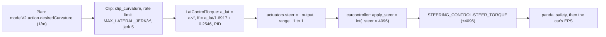
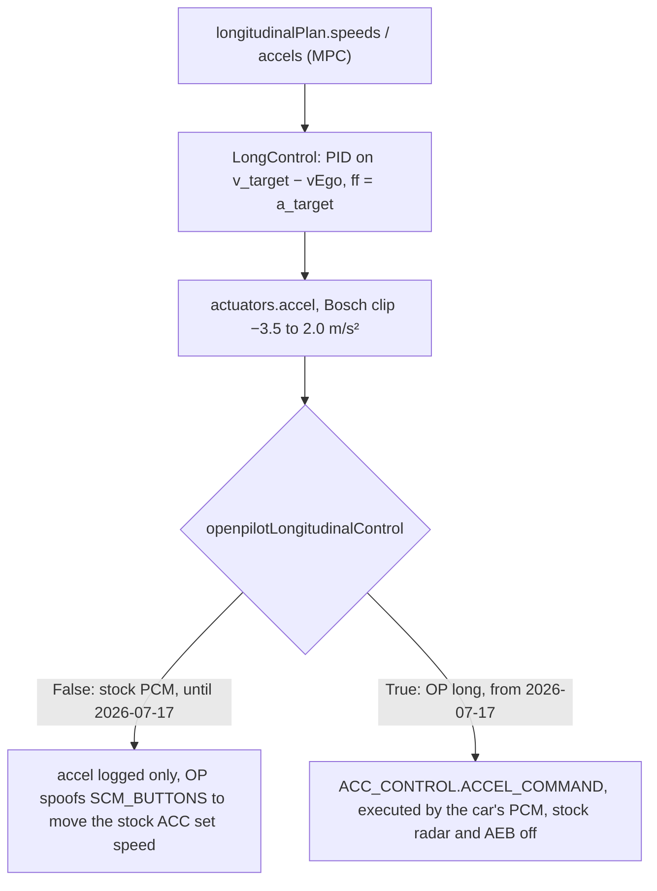
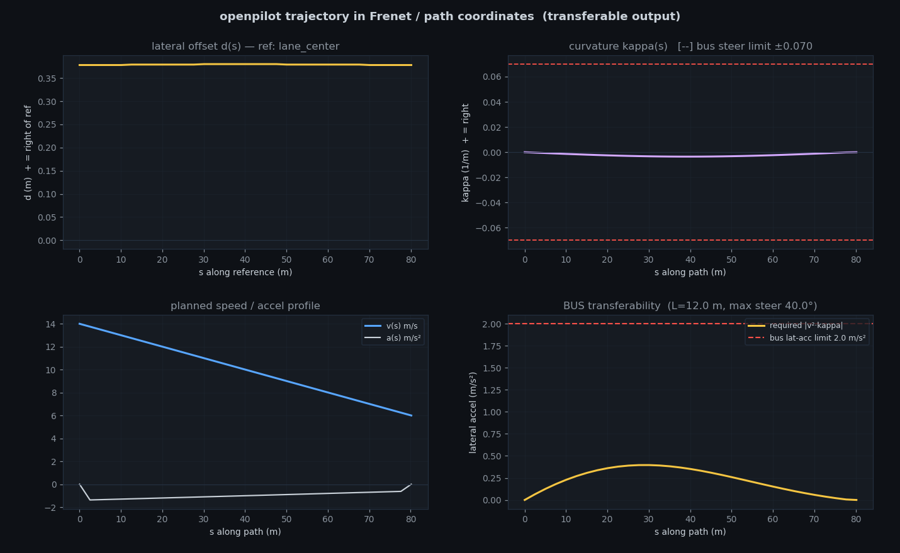

# Control principles and Frenet outputs

This page explains how sunnypilot 0.9.7.1 turned its plan into steering torque and acceleration on the era-1 test car, a 2020 Honda Civic (Bosch). It covers how the two longitudinal configurations differed and how to read command against measurement in the telemetry stream. It then sets out the frame and sign conventions and documents [`frenet.py`](../remote/frenet.py) and [`frenet_view.py`](../remote/frenet_view.py). Those two tools re-express the model's planned path as vehicle-agnostic outputs and check them against a bus's capability envelope.

## At a glance

| Item | Value |
|---|---|
| Audience | Developers, researchers |
| Runs on | Laptop: `frenet.py`, `frenet_view.py`, `controls_monitor.py`. The analysed control chain ran on the device. |
| Era | **Era 1 — sunnypilot 0.9.7.1**, 2020 Honda Civic Bosch (`HONDA_CIVIC_BOSCH`), 2026-07 → 2026-08 |
| Status | Reference. The control analysis describes a vehicle configuration that no longer exists on the device. The Frenet tools work on any [reg_export stream](03-telemetry-stream.md). |
| Key files | [`controls_principles.md`](../remote/controls_principles.md), [`frenet.py`](../remote/frenet.py), [`frenet_view.py`](../remote/frenet_view.py), [`frenet_selftest.png`](../remote/frenet_selftest.png), [`openpilot_controls_slides.pdf`](../remote/openpilot_controls_slides.pdf) / [`.html`](../remote/openpilot_controls_slides.html), [`exporter_device.py`](../remote/exporter_device.py), [`controls_monitor.py`](../remote/controls_monitor.py), [`Arman/STOP_COMMAND.md`](../remote/Arman/STOP_COMMAND.md) |

> [!WARNING]
> **Historical (sunnypilot era).** Everything about the control chain on this page describes the era-1 device: sunnypilot 0.9.7.1 in the Civic. The device was later re-flashed, at an unrecorded date between 2026-08-13 and 2026-10-03, to **Era 2 — openpilot v0.11.1 `release-tizi` + dashcam-anywhere** (in use from 2026-10-03), which runs as a pure dashcam and erased the era-1 software. This page therefore describes era 1 in the past tense.

## Evidence base

The control chain was traced in the **device's own sunnypilot source**, not in a generic openpilot checkout. [`controls_principles.md`](../remote/controls_principles.md) is the source note, a Chinese "control principles quick reference (formulas + file:line + comparison table)". Its header, translated:

> Code evidence is taken from the device `comma@192.168.1.231:/data/openpilot`. Key params on this car: `EnforceTorqueLateral=1` (lateral runs through the Torque controller), `openpilotLongitudinalControl=False` (stock PCM longitudinal), `CustomStockLong=1`.

`EnforceTorqueLateral` and `CustomStockLong` are params. `openpilotLongitudinalControl` is a CarParams value that is set at boot ([`Arman/STOP_COMMAND.md`](../remote/Arman/STOP_COMMAND.md): "reboot so CarParams re-inits").

> [!NOTE]
> **Described, not included.** The device's sunnypilot 0.9.7.1 source is not in this repo. Its exact commit is not recorded, and the source was erased by the re-flash. Every `file:line` reference in `controls_principles.md` and in the tables below points into **that** source, not into this repo. The torque constants (`[1.6917, 0.4013, 0.2546]`), `STEER_MAX = 4096`, the PID gains and the Bosch accel clip `[−3.5, 2.0]` are likewise "per device sunnypilot source, not in this repo". This page reproduces them as recorded; they cannot be re-checked here.

| Source | Last modified | What it contributes | Checkable in this repo |
|---|---|---|---|
| [`controls_principles.md`](../remote/controls_principles.md) (Chinese) | 2026-07-14 | chain tables, constants, device-source refs, bus conclusions | only the parts about the exporter |
| [`openpilot_controls_slides.html`](../remote/openpilot_controls_slides.html) / [`.pdf`](../remote/openpilot_controls_slides.pdf) (English, 6 slides) | 2026-07-14 (PDF created the same day) | the same analysis as a deck | no; same evidence |
| [`exporter_device.py`](../remote/exporter_device.py) | 2026-07-14 | which fields are exported; the `desSteerAngleDeg` derivation | yes |
| [`controls_monitor.py`](../remote/controls_monitor.py) | 2026-07-14 | the command / sent / measured rows | yes |
| [`frenet.py`](../remote/frenet.py), [`frenet_view.py`](../remote/frenet_view.py) | 2026-07-14 | Frenet outputs and the bus check | yes (unit tests) |
| [`Arman/STOP_COMMAND.md`](../remote/Arman/STOP_COMMAND.md) | 2026-07-17 | the OP-long prerequisite and its effects on Honda Bosch | its `file:line` refs point into a desktop **0.9.8** checkout (its reference section), not this repo |

The "Control-command & trajectory tools" section of [`remote/README.md`](../remote/README.md) (Chinese) introduces the same tools. Its lines are translated where they apply below.

## Lateral chain

The Civic ran the **torque** lateral controller (`EnforceTorqueLateral=1`), so there was no steering-angle command. The chain went from a desired curvature to a normalized torque, and from there to a CAN torque. The pipeline below follows slide 1 (Model plan → Lateral / Long controllers → carControl → carController → panda, "safety → car", labelled "100 Hz control loop") and `controls_principles.md` §1.



| Hop | Quantity | Formula / source | Unit | Device source ref (sunnypilot 0.9.7.1; not in this repo) | Closest stream field ([03](03-telemetry-stream.md#record-schema)) |
|---|---|---|---|---|---|
| Plan | `modelV2.action.desiredCurvature` | model output | 1/m | `log.capnp` Action | `modelV2.desiredCurvature` |
| Clip | `desired_curvature` | `clip_curvature`; rate ≤ `MAX_LATERAL_JERK/v²` (jerk = 5) | 1/m | `controlsd.py:649`; `drive_helpers.py:260` | `controlsState.desiredCurvature` |
| Controller | `actuators.steer` | **LatControlTorque**: `a_lat = κ·v²` → `ff = a_lat/1.6917 + 0.2546` → PID (kp 1.0, ki 0.1) → `steer = −output ∈ [−1, 1]`; angle command ≡ 0 | normalized | `latcontrol_torque.py:177,262,286` | `carControl.steer`; PID terms in `controlsState.lat` |
| CAN | `steerOutputCan` | `apply_steer = int(−steer × STEER_MAX)`, `STEER_MAX = 4096` | ±4096 | `carcontroller.py:212` | `carOutput.steerOutputCan` |
| Send | `STEERING_CONTROL.STEER_TORQUE` | = `apply_steer` (while `lkas_active`) | ±4096 | `hondacan.py:123` | not exported. The EPS response is `carState.steeringTorqueEps`. |

Two further points come from `controls_principles.md` §1, translated:

- **Torque conversion parameters.** From `torque_data`, with legend `[latAccelFactor, maxLatAccel, friction]`: `HONDA_CIVIC_BOSCH = [1.6917, 0.4013, 0.2546]`. Slide 2 adds: "latAccelFactor / friction from the car's torque table. Angle command ≡ 0 in torque mode."
- **What actually goes out.** The final value sent is `carOutput.actuatorsOutput.steerOutputCan`. `actuators.steer` is only an intermediate normalized quantity.

### Signs along the lateral chain

These signs are reported in `controls_principles.md` §5 ("sign conventions verified in code", in the device source):

| Quantity | Positive means | Evidence (device source) |
|---|---|---|
| κ (`desiredCurvature`, `curvature`) | turning **right** (+y in the car frame) | car frame x forward, y right, z down |
| `actuators.steer` | **left**: `latcontrol_torque` returns `−output_torque` ("left is positive") | `latcontrol_torque.py` |
| `apply_steer` / `steerOutputCan` | **right**: carcontroller comment "positive when steering right" | `carcontroller.py` |

Because of `apply_steer = int(−steer × 4096)`, `carControl.steer` and `carOutput.steerOutputCan` have **opposite signs** by construction. The synthetic data in `controls_monitor.py` → `synthetic()` mirror this (`steer = 0.3·sin t`, `steerOutputCan = −1228·sin t`). Slide 2 also notes: "Angle-controlled cars instead send a steering-angle target; the +/− and scaling differ per brand."

## Longitudinal control in two configurations

The longitudinal controller was the same in both configurations. What changed on **2026-07-17** was whether its output reached the car. That date is the last-modified date of [`Arman/STOP_COMMAND.md`](../remote/Arman/STOP_COMMAND.md) and [`Arman/EXPERIMENT_RUNBOOK.md`](../remote/Arman/EXPERIMENT_RUNBOOK.md), which record the switch; the notes themselves carry no date.

The controller, from `controls_principles.md` §2 (device source, not in this repo):

| Quantity | Formula / source | Unit | Device source ref |
|---|---|---|---|
| Plan: `longitudinalPlan.speeds` / `accels` | MPC solution | m/s, m/s² | `longitudinal_planner.py` |
| Controller: `actuators.accel` | state machine off / pid / stopping / starting + PID (err = v_target − vEgo, ff = a_target); **Bosch clip [−3.5, 2.0]** | m/s² | `longcontrol.py:132`; `controlsd.py:643` |
| Actually sent (stock PCM) | `openpilotLongitudinalControl=False`: accel only goes to the log, not to CAN. OP only fakes cruise-button presses (`SCM_BUTTONS`) to change the stock ACC set speed. | — | `carcontroller.py:269`; `interface.py:50` |



| | Stock PCM longitudinal | OP longitudinal ("OP long") |
|---|---|---|
| When | era 1 until 2026-07-17 | 2026-07-17 to the end of era 1 |
| Switch | `ExperimentalLongitudinalEnabled` not set | `ExperimentalLongitudinalEnabled=1`, then a reboot so CarParams re-initialise |
| CarParams | `openpilotLongitudinalControl=False` | `openpilotLongitudinalControl=True`, `pcmCruise=False` ("openpilot manages cruise, not the stalk") |
| What reaches the car | Nothing from `accel`. OP spoofs `SCM_BUTTONS` to change the stock ACC set speed (`CustomStockLong=1`, slide 3). | `ACC_CONTROL.ACCEL_COMMAND`, executed by the car's PCM. The panda gets `FLAG_HONDA_BOSCH_LONG`; accel is clipped to `[BOSCH_ACCEL_MIN, BOSCH_ACCEL_MAX]`. |
| Pedal command | none | none: Bosch has no pedal-percentage command (`compute_gb` returns 0) |
| Radar / AEB | stock radar and AEB active | **stock radar disabled** (`radarUnavailable=True`): longitudinal uses the vision model only, with no radar lead and no AEB |
| In the stream | `carControl.longActive` false (inferred: the notes use `longActive` as the OP-long indicator). `carControl.accel` is computed but not actuated. | `longActive` true while engaged. `carControl.accel` is actuated; `carOutput.accel` holds the post-limit value. |
| Described by | `controls_principles.md`, slide 3, the `README.md` note, the `controls_monitor` banner | `STOP_COMMAND.md`, `EXPERIMENT_RUNBOOK.md`, `Arman/OPERATIONS.md` |

The OP-long column combines two sources. The first is the "HARD prerequisite" section of `STOP_COMMAND.md`; its `interface.py:33-41,195` refs belong to the desktop 0.9.8 checkout, not to this repo. The second is `controls_principles.md` §2: "if Bosch enables OP long → it sends `ACC_CONTROL.ACCEL_COMMAND` (executed by the car's PCM), no pedal-percentage command (`compute_gb` returns 0)". The deployed section of `STOP_COMMAND.md` reports "`ExperimentalLongitudinalEnabled = 1` set → OP longitudinal enabled (verified after reboot)", and its revert step ends with "back to stock ACC + radar + AEB". Nidec Hondas differ: they compute gas and brake and send `BRAKE_COMMAND` + `PCM_GAS` (`controls_principles.md` §2, slide 3). "The command→actuation mapping is always brand-specific."

> [!CAUTION]
> **Safety.** OP long **disables the stock radar and AEB** on this car. [`EXPERIMENT_RUNBOOK.md`](../remote/Arman/EXPERIMENT_RUNBOOK.md) says: "No stock AEB while OP long is on — you are the safety net." Use it only on a closed course, at low speed, with a driver ready to take over and a foot over the brake. Switching it on or off takes a reboot; reboot only with the car stopped. The procedure, the stop command and the safety checklist are in [07](07-longitudinal-stop.md); the revert is in [14](14-device-changes-and-revert.md).

You can check which configuration an era-1 device is in without changing anything. The commands use `$COMMA_IP`; set it and check the dongle ID as in [03 → Find the device](03-telemetry-stream.md#find-the-device).

```bash
# device  (ssh comma@$COMMA_IP)   era 1
cat /data/params/d/ExperimentalLongitudinalEnabled; echo     # 1 = OP long requested
```

```bash
# laptop  (from the repo root)
python3 remote/Arman/experiment.py --ip $COMMA_IP status     # prints ExpLong=…, onroad=…, stop_flag=…
python3 remote/Arman/experiment.py --ip $COMMA_IP check      # "longActive (OP long)" after engaging
```

If `longActive` stays ✗ after you engage, CarParams were not initialised for OP long. With the car stopped, reboot (`ssh comma@$COMMA_IP 'sudo reboot'`), wait about 45 s and engage again (OPERATIONS §2.1 and §7; EXPERIMENT_RUNBOOK §1).

### Which sources are stale

These sources describe only the stock-PCM configuration. Read them as true **before 2026-07-17** (erratum 16):

- `controls_principles.md` §2, titled "Longitudinal: speed plan → acceleration (not sent to CAN on this car)", and its header line `openpilotLongitudinalControl=False`.
- Slide 3, "Reality on this car (stock PCM): accel is computed but NOT sent to CAN."
- The [`README.md`](../remote/README.md) note, translated: "On this car (Civic Bosch, stock PCM) the **accel command is not sent to CAN** (openpilot only fakes cruise-button presses to change the set speed); Bosch has no pedal-percentage command, gas/brake are measured only. Steering goes through torque (±4096); the angle command is derived from the curvature as `desSteerAngleDeg`."
- The [`controls_monitor.py`](../remote/controls_monitor.py) docstring and its hard-coded banner, "accel command is computed but NOT sent to CAN (stock PCM ACC drives long.)".

## Measured pedals and sensors

From `controls_principles.md` §3, translated. The CAN signals and line refs are per the device source, not in this repo.

| Stream field | CAN signal (Civic Bosch) | Unit | Device source ref |
|---|---|---|---|
| `carState.steeringAngleDeg` | `STEERING_SENSORS.STEER_ANGLE` | deg | `carstate.py:185` |
| `carState.steeringRateDeg` | `STEER_ANGLE_RATE` | deg/s | `carstate.py:186` |
| `carState.steeringTorque` (driver) | `STEER_STATUS.STEER_TORQUE_SENSOR` | raw | `carstate.py:207` |
| `carState.steeringTorqueEps` (EPS actual) | `STEER_MOTOR_TORQUE.MOTOR_TORQUE` | raw | `carstate.py:208` |
| `carState.gas` | `POWERTRAIN_DATA.PEDAL_GAS` | DBC scale, **not 0–1**; needs a self-calibrated % | `carstate.py:204` |
| `carState.brake` | `VSA_STATUS.USER_BRAKE` | VSA analog value | `carstate.py:244` |
| `carState.vEgo` / `aEgo` | wheel speed / transmission KF | m/s, m/s² | `carstate.py:167-178` |

The pedals are measured only. Bosch has no pedal-percentage command in either configuration. The tools display them in two ways:

- **Self-calibrated percentage.** `dashboard.py` (status strip) and `controls_monitor.py` show 100 × value ÷ the largest value seen so far, where that maximum starts at 0.5.
- **Raw value.** `unified.py` shows the raw values in its GAS and BRAKE tiles.

See [03 → Laptop tools](03-telemetry-stream.md#laptop-tools).

## Command vs measured

[`controls_monitor.py`](../remote/controls_monitor.py) puts command, sent value and measurement side by side. Its rows and CSV are in [03](03-telemetry-stream.md#controls_monitor). This section explains which comparisons are meaningful. It is based on `controls_principles.md` §4 and slides 2–4, and corrected for the two longitudinal configurations.

| Signal | Command | Sent / CAN | Measured | How to compare |
|---|---|---|---|---|
| Steering torque | `carControl.steer`, [−1, 1] | `carOutput.steerOutputCan`, ±4096 | `carState.steeringTorqueEps` (EPS actual, raw) | **Sign and trend only**; the scales are not directly comparable. `steer` and `steerOutputCan` have opposite signs by construction. |
| Steering angle | `controlsState.desSteerAngleDeg` (derived by the exporter) | none: torque mode has no angle command | `carState.steeringAngleDeg` | Same unit (deg). Check the sign convention first ([below](#bicycle-model-and-dessteerangledeg)). |
| Curvature | `controlsState.desiredCurvature` | — | `controlsState.curvature` | 1/m, same convention |
| Speed | `controlsState.vCruise`: set speed, **km/h** | — | `carState.vEgo`: **m/s** | Different units; divide `vCruise` by 3.6 |
| Acceleration | `carControl.accel` (planned) | `carOutput.accel` | `carState.aEgo` | m/s². **Before 2026-07-17** the command was not sent at all. After that it is actuated while `longActive` is true. |
| Gas / brake | none | none | `carState.gas`, `carState.brake` (self-calibrated %) | No command exists on Bosch |

The two remaining `controls_monitor` rows are measurements only: steering rate (`carState.steeringRateDeg`, deg/s) and driver steer torque (`carState.steeringTorque`, raw).

`controls_principles.md` §4, translated. The acceleration line is stale after 2026-07-17:

- **Steering torque:** `carControl.steer` [−1, 1] (cmd) → `carOutput.steerOutputCan` ±4096 (sent) → `carState.steeringTorqueEps` (EPS actual). Compare only sign and trend; the scales are not directly comparable.
- **Steering angle:** torque mode has no native angle command, so the exporter derives `controlsState.desSteerAngleDeg = deg(atan(L·κ))·steerRatio + offset` (L = 2.7, steerRatio from liveParameters). The measurement is `carState.steeringAngleDeg`.
- **Speed:** `controlsState.vCruise` (set, kph) vs `carState.vEgo` (measured, m/s).
- **Acceleration:** `carControl.accel` (planned, **not actually sent on this car**) vs `carState.aEgo` (measured).
- **Gas/brake:** this car has measured pedals only (self-calibrated %), no commanded percentage.

**Analysis (from code; not field-tested).** With OP long, the useful acceleration pair is `carControl.accel` against `carOutput.accel`, which [`remote/README.md`](../remote/README.md) calls "actually-sent (post-limit) values", and then `carState.aEgo`. `controls_monitor` never shows `carOutput.accel`: its SENT/CAN cell for acceleration is always empty. Read it from `recv_log` or `controls_monitor --csv` (`carOutput.accel` column) instead.

## Frames and signs

Three frames meet in this project. Mixing them up is the most likely source of sign errors.

| Quantity | openpilot stream (car frame / NED) | Client ENU frame (`cp_export`, [05](05-curvepoints-pipeline.md)) |
|---|---|---|
| Axes | x forward, **y right**, z down | x = East, y = North |
| Heading | `loc.yaw` (NED): 0 = North, positive toward East (clockwise seen from above) | θ: 0 = East, counter-clockwise positive; θ = π/2 − yaw |
| Curvature sign | κ > 0 = **right** turn | κ > 0 = **left** turn |
| Lateral offset sign (Frenet) | d > 0 = right of the reference | — |
| Origin | the vehicle (car frame); WGS84 for `loc` | a reference lat/lon fixed once per mission |

### Car frame

From `controls_principles.md` §5, slide 4 and the [`frenet.py`](../remote/frenet.py) docstring: the openpilot car (calibrated / device) frame has **x forward, y right, z down**, so κ > 0 means turning right (+y). The model's `position` and `laneLines` live in this frame, and so do all `modelV2` arrays in the stream. In the Frenet outputs below, d > 0 means right of the reference, and the path-profile heading θ = atan2(Δy, Δx) is positive toward +y (right).

### NED and the global chain

Localization uses the chain geodetic ↔ ECEF ↔ NED ("lat/lon → local N/E/D", slide 4). The stream's `loc.yaw` is `calibratedOrientationNED[2]`: a NED yaw where 0 = North and positive is toward East, i.e. clockwise seen from above ([`Arman/frame.py`](../remote/Arman/frame.py) docstring).

### Client ENU frame

The STÄHLE TrackDriver client works in a local ENU frame. Per the `frame.py` docstring, it comes from the client's "CP Definition" PDF (not included) and was confirmed by the client's engineer:

- x = East (θ = 0), y = North (θ = +π/2). θ is counter-clockwise positive, κ is left-positive.
- The origin is a reference lat/lon fixed once at mission start (WGS84).
- θ = π/2 − yaw, wrapped to (−π, π] by `frame.wrap_pi()`.
- A car-frame point (fx forward, fy right) maps to E = E0 + fx·cos θ + fy·sin θ and N = N0 + fx·sin θ − fy·cos θ (`car_point_to_enu()`).
- κ is **recomputed in ENU**, not taken from the car frame, "so that a left (CCW) turn is naturally positive".

The pipeline is documented in [05](05-curvepoints-pipeline.md) and the interface in [06](06-client-interface-spec.md). The car-frame Frenet outputs on this page are **not** in the client frame.

### Bicycle model and `desSteerAngleDeg`

The kinematic relations on slide 4 ("Curvature ↔ steer angle (bicycle model)"):

```text
κ = 1 / R = yaw_rate / v
δ_wheel ≈ atan(L · κ)              (L = wheelbase)
δ_steer ≈ δ_wheel · steerRatio + offset
```

[`exporter_device.py`](../remote/exporter_device.py) → `build_record()` publishes the result as `controlsState.desSteerAngleDeg`, "so torque-mode cars still show an angle command" (slide 4):

```text
desSteerAngleDeg = round( degrees(atan(WHEELBASE · κ)) · sr + off , 3 )
  κ         = controlsState.desiredCurvature          (omitted if null)
  WHEELBASE = 2.70 m                                  (Honda Civic constant)
  sr        = liveParams.steerRatio, else DEFAULT_STEER_RATIO = 16.7
  off       = liveParams.angleOffsetDeg, else 0.0
```

| κ (1/m) | R (m) | sr | off (deg) | `desSteerAngleDeg` |
|---|---|---|---|---|
| 0.002 | 500 | 16.2 | 0.4 | 5.412 |
| 0.01 | 100 | 16.7 (fallback) | 0.0 | 25.828 |
| 0.021 | 47.6 | 16.7 (fallback) | 0.0 | 54.195 |

**Analysis (from code; not field-tested).** The repo never documents the sign convention of `carState.steeringAngleDeg`; `controls_principles.md` §3 gives only its CAN signal and unit. The derivation keeps κ's sign (κ > 0 = right turn) and adds `angleOffsetDeg`. The synthetic frames in `controls_monitor.py` and `unified.py` simply assume that command and measurement share a sign. Before you trust the "steering angle" comparison:

1. Drive a steady right-hand curve.
2. Check that `desSteerAngleDeg` and `carState.steeringAngleDeg` have the same sign.
3. If they don't, the curvature term in `build_record()` needs its sign changed for the comparison. How `angleOffsetDeg` should then enter depends on the same convention.

No field record of this check exists.

## Frenet outputs

[`frenet.py`](../remote/frenet.py) is pure stdlib (only `math`). It converts **one `modelV2` block from the stream** into two vehicle-agnostic representations. The block must come from a frame where `_upd` is true, so that it carries `pos_x`, `pos_y`, `vel_x`, `laneLines` and `laneLineProbs`. The docstring says: "Any downstream planner (e.g. a bus) can consume these directly — no Honda-specific units are involved." README, translated: it "converts the trajectory into **vehicle-agnostic** Frenet outputs: ① `(s,d)` relative to the lane centre; ② arc-length parameterisation `s,x,y,θ,κ,v,a`. `frenet.to_csv()` exports for the bus planner."

All outputs are in the **car frame of that model frame**: x forward, y right, origin at the vehicle. Each one is a snapshot, not a global track. For a georeferenced track, use [`cp_export`](05-curvepoints-pipeline.md).

### Reference line

`reference_line(mv)` returns `(xs, ys, source)`:

| Condition | Reference | `source` |
|---|---|---|
| At least 3 lane lines and 3 probabilities; `laneLineProbs[1]` and `[2]` both > `MIN_LANE_PROB` = 0.3; lines 1 and 2 have the same number of points (≥ 2) | centreline of the **inner** lines (index 1 = inner-left, index 2 = inner-right): x = mean of the two x values, y = probability-weighted mean (lp·y_left + rp·y_right)/(lp + rp) | `lane_center` |
| Otherwise | the planned path itself (`pos_x`, `pos_y`), so d ≡ 0 | `path` |

Because y is probability-weighted, an asymmetric confidence pulls the reference toward the more confident line. In the `frenet_view` self-test (probabilities 0.95 and 0.92), the reference sits about 0.03 m left of the geometric centre. That is why the plotted d is ≈ +0.38 m although the path is drawn 0.35 m right of the geometric centre.

### Representation 1: (s, d)

`frenet_sd(mv, ref=None)` returns `(list of (s, d), source)`:

- Each path point is projected onto every reference segment, with the projection clamped to the segment. The projection with the smallest |d| wins.
- `s` = arc length along the reference at that projection, in m. `d` = signed lateral offset, in m: **d > 0 = right of the reference** (the y-right car frame). Both are rounded to 3 decimals.
- `source` is `lane_center` or `path` (see above), `custom` when you pass `ref=(xs, ys)`, or `none` (with an empty list) when there are fewer than 2 path or reference points.

Slide 5 says it "answers 'where is the path within the lane.'"

### Representation 2: arc-length path profile

`path_profile(mv)` returns one tuple `(s, x, y, theta, kappa, v, a)` per path point, or `[]` with fewer than 3 points:

| Column | Definition | Unit | Decimals |
|---|---|---|---|
| `s` | cumulative arc length along (`pos_x`, `pos_y`) | m | 3 |
| `x`, `y` | the path point (car frame) | m | 3 |
| `theta` | heading vs the x-axis: `atan2(Δy, Δx)` of the segment that ends at the point (point 0 uses the first segment) | rad | 5 |
| `kappa` | signed 3-point (Menger) curvature 2·(a×b)/(\|a\|·\|b\|·\|c\|) with a = p1−p0, b = p2−p1, c = p2−p0; **> 0 = right turn**. 0 at both end points, and 0 when two points are closer than 1e-6 m. | 1/m | 6 |
| `v` | `vel_x[i]`; falls back to the last value, or 0 | m/s | 3 |
| `a` | tangential acceleration v·dv/ds by central difference, v_i·(v_{i+1} − v_{i−1})/(s_{i+1} − s_{i−1}); 0 at both end points | m/s² | 3 |

Slide 5: "Pure geometry + motion. This is the portable trajectory — feed κ(s), v(s), a(s) to the bus planner directly."

### CSV export

`to_csv(profile, path, sd=None)` writes a plain CSV with no units row:

| Call | Header |
|---|---|
| `to_csv(prof, path)` | `s,x,y,theta,kappa,v,a` |
| `to_csv(prof, path, sd=sd)` with a non-empty `sd` | `s,x,y,theta,kappa,v,a,s_ref,d_ref`. The rows pair the profile with `(s, d)` point by point. |

The first rows produced from the `frenet_view` self-test geometry (an S-curve with deceleration):

```text
s,x,y,theta,kappa,v,a,s_ref,d_ref
0.0,0.0,0.35,0.08763,0.0,14.0,0.0,0.033,0.378
2.51,2.5,0.57,0.08763,-0.000347,13.75,-1.37,2.543,0.378
5.019,5.0,0.787,0.08676,-0.000691,13.5,-1.345,5.051,0.378
```

### Unit tests

```bash
# laptop  (from the repo root)
python3 remote/frenet.py --test       # exit code 0 if all pass, 1 otherwise
python3 remote/frenet.py              # without --test: prints the module docstring
```

Result on 2026-11-05 (Python 3.12.2): 7 PASS → `ALL FRENET TESTS OK`.

| Test line | What it asserts |
|---|---|
| `straight: ref=lane_center` | a straight path with straight lanes (probabilities 0.2/0.9/0.9/0.2) uses the lane centre |
| `straight: \|d\|<=0.01` | the centred path has d ≈ 0 |
| `straight: \|kappa\|<=1e-6` | a straight path has κ ≈ 0 |
| `straight: s monotonic` | s strictly increases |
| `offset right: d≈+0.5` | a path shifted 0.5 m to +y gives d within 0.05 of +0.5 (for 1 < s < 35) |
| `arc R=20 right: kappa≈+0.05` | an arc of radius 20 m bending to +y gives κ within 0.002 of +1/20 (interior points) |
| `decel: a<0 mid-path` | a speed profile falling from 10 m/s by 0.3 per point gives a < 0 away from the ends |

### Use from your own code

```python
# laptop  (run from remote/, or put remote/ on sys.path)
import os
import frenet
from stream_lib import stream

for rec in stream(os.environ["COMMA_IP"]):
    mv = rec.get("modelV2", {})
    if not (mv.get("_upd") and mv.get("pos_x")):
        continue                          # arrays arrive only on ~20 Hz frames
    sd, src = frenet.frenet_sd(mv)        # [(s, d), ...], "lane_center" | "path" | "none"
    prof = frenet.path_profile(mv)        # [(s, x, y, theta, kappa, v, a), ...]
    frenet.to_csv(prof, "traj.csv", sd=sd)
    break
```

## `frenet_view` and bus transferability

[`frenet_view.py`](../remote/frenet_view.py) is a live, four-panel view of `frenet.py`'s outputs with a **bus-transferability** check. README, translated: "four-panel visualisation: d(s), κ(s), v/a(s), **bus transferability** panel (required v²κ vs the bus envelope, red when exceeded)".

```bash
# laptop  (from the repo root)
python3 remote/frenet_view.py --ip $COMMA_IP
python3 remote/frenet_view.py --ip $COMMA_IP --bus-wheelbase 12 --bus-max-steer-deg 40 --bus-max-lat-acc 2.0
python3 remote/frenet_view.py --ip $COMMA_IP --dump-csv out/
MPLBACKEND=Agg python3 remote/frenet_view.py --selftest      # writes ./frenet_selftest.png
```

| Flag | Default | Meaning |
|---|---|---|
| `--ip` | required unless `--selftest` | device IP |
| `--port` | `7700` | |
| `--bus-wheelbase` | `12.0` | bus wheelbase L, m |
| `--bus-max-steer-deg` | `40.0` | maximum steering angle δmax, deg. It enters κmax = tan(δmax)/L, so it is the road-wheel angle. |
| `--bus-max-lat-acc` | `2.0` | maximum lateral acceleration, m/s² |
| `--dump-csv DIR` | none | also save a CSV snapshot about once per second (see below) |
| `--selftest` | off | render a synthetic frame to `frenet_selftest.png` (cwd, 110 dpi) and exit |

The bus defaults are the tool's example values, not the specification of a particular bus. Set them from your vehicle's data.

`frenet_view.py` needs matplotlib (`python3 -m pip install matplotlib`), and the live window needs a GUI backend; `--selftest` also runs headless with `MPLBACKEND=Agg`. It imports `frenet` and `stream_lib` from its own folder, so keep it in `remote/`. Stop the live view by closing its window.

### Panels

| Panel | Shows | Red shading |
|---|---|---|
| Top left: "lateral offset d(s) — ref: …" | d against s along the reference; the title names the reference source (`lane_center` / `path`) | — |
| Top right: "curvature kappa(s) [--] bus steer limit ±κmax" | κ against s along the path, with dashed lines at ±κmax | where \|κ\| > κmax |
| Bottom left: "planned speed / accel profile" | v(s) in m/s, a(s) in m/s² | — |
| Bottom right: "BUS transferability (L=… m, max steer …°)" | the required \|v²·κ\| against the dashed `--bus-max-lat-acc` line | where \|v²·κ\| > limit |

The reader thread keeps only the latest `modelV2` block that has `_upd` and `pos_x`. The figure redraws every 150 ms.

### Bus envelope

```text
κmax_bus      = tan(radians(bus_max_steer_deg)) / bus_wheelbase      (frenet_view.main())
lateral check : |v² · κ(s)| ≤ bus_max_lat_acc                          (per path point)
```

With the defaults, κmax = tan 40° / 12 m = 0.0699 1/m. The panel title shows ±0.070, which corresponds to a minimum turning radius of about 14.3 m. The lateral-acceleration limit allows κ ≤ 2.0/v²:

| v (m/s) | κ limit from 2.0 m/s² (radius) | Tighter of the two limits |
|---|---|---|
| 5 | 0.08 1/m (12.5 m) | steering: 0.0699 1/m (14.3 m) |
| 10 | 0.02 1/m (50 m) | lateral acceleration |
| 15 | 0.0089 1/m (112.5 m) | lateral acceleration |
| 20 | 0.005 1/m (200 m) | lateral acceleration |

Above about 5.35 m/s (√(2.0/0.0699)), the lateral-acceleration limit is the tighter of the two. Slide 6: "segments the bus can't follow are shaded red → tells you where openpilot's plan is infeasible for the bus **before** you actuate." [`unified.py`](../remote/unified.py) applies the same lateral-acceleration test to the single current curvature: its CURVATURE tile turns red ([03](03-telemetry-stream.md#unified)).

### Dumping CSV snapshots

With `--dump-csv DIR`, each redraw that comes more than 1 s after the previous dump creates `DIR` if needed and writes `DIR/traj_<unix seconds>.csv` with `frenet.to_csv(prof, …, sd=sd)`. The columns are `s,x,y,theta,kappa,v,a,s_ref,d_ref`, or the first seven only when no (s, d) could be computed. Each file is one model frame in the car frame at that moment.

### Self-test image

`--selftest` draws a synthetic S-curve with deceleration (`synthetic_mv()`):

- 33 points 2.5 m apart (0–80 m), centre y = 2.2·sin(x/25), path offset +0.35 m.
- v falls from 14.0 m/s by 0.25 m/s per point.
- Lane probabilities are 0.3 / 0.95 / 0.92 / 0.35.

The result is d ≈ +0.38 m against `lane_center`, |κ| of at most about 0.0035 1/m and |v²κ| ≤ 0.40 m/s², so nothing is shaded red. Result on 2026-11-05: `selftest OK -> frenet_selftest.png`.



## Porting to a bus

The conclusion of `controls_principles.md` ("Porting to a bus") and slide 6 is that **the plan transfers and the execution layer does not**. Slide 1 puts it as: "The plan is transferable; the execution layer is not."

| Transfers (vehicle-independent) | Must be rebuilt for the bus |
|---|---|
| The predicted trajectory, κ(s) and θ(s): pure physical quantities | **κ → steering:** bus kinematics (long wheelbase, articulation), the actuator (hydraulic or steer-by-wire), and its torque or angle scaling |
| The speed and acceleration profile, v(s) and a(s) | **a → propulsion and braking:** engine, retarder and air-brake maps |
| Frenet (s, d) against the lane centre | **The safety layer** (a panda equivalent), and rate and limit tuning |
| The perception → plan idea (curvature + speed target) | **The capability envelope:** maximum lateral acceleration and minimum turning radius are far tighter. `frenet_view`'s transferability panel compares v²κ(s) with the bus envelope and shades violations red. |

Vehicle-specific values in this repo that a port would have to replace:

| Value | Where | Note |
|---|---|---|
| `WHEELBASE = 2.70` m, `DEFAULT_STEER_RATIO = 16.7` | [`exporter_device.py`](../remote/exporter_device.py) | used only for `desSteerAngleDeg` |
| `STEER_MAX = 4096`, torque table `[1.6917, 0.4013, 0.2546]`, Bosch accel clip `[−3.5, 2.0]` | device sunnypilot source (not in this repo) | belong to the Honda execution layer that a bus would replace |
| Bus envelope 12 m / 40° / 2.0 m/s² | `frenet_view.py` defaults; `unified.py --bus-max-lat-acc` | example values |

> [!NOTE]
> **Reported in `Arman/OPERATIONS.md` §3.3 (translated).** The modelV2 trajectory used the camera calibration stored for the Civic. Mounted on a truck windshield at a different angle, "the trajectory geometry is biased". On the truck, the note recommends GPS record mode or the vision stop flag as the main deliverable. A port must recalibrate the camera for the new mounting. In era 2, dashcam-anywhere calibrates from GPS or vision speed without CAN; see [11](11-dashcam-anywhere-design.md).

**Analysis (from code; not field-tested).** The transferability check is purely kinematic and per point. It does not model articulation, off-tracking, steering-rate limits, load or road grade. Treat a "green" result as necessary, not sufficient.

## Slides

| File | How to view |
|---|---|
| [`remote/openpilot_controls_slides.pdf`](../remote/openpilot_controls_slides.pdf) | Renders directly on GitHub. 6 pages, US-letter; created 2026-07-14 by headless Chrome from the HTML. |
| [`remote/openpilot_controls_slides.html`](../remote/openpilot_controls_slides.html) | GitHub shows only its source, so open it locally in a browser. It is self-contained (inline CSS and SVG). → / PageDown / Space go forward, ← / PageUp go back; "Print → Save as PDF" reproduces the PDF. |

```bash
# laptop  (from the repo root)
xdg-open remote/openpilot_controls_slides.html     # Linux; on macOS use: open remote/openpilot_controls_slides.html
```

| # | Title | Content | Caveat |
|---|---|---|---|
| 1 | From Planning to Actuation — and porting it to a bus | pipeline Model plan → controllers → carControl → carController → panda; "the plan is transferable; the execution layer is not" | — |
| 2 | Curvature → steering torque | LatControlTorque equations, STEER_MAX, command vs feedback | constants per device source |
| 3 | Speed plan → gas / brake | LongControl; "Reality on this car (stock PCM)" | **stale after 2026-07-17** (erratum 16) |
| 4 | Frames & transforms | car frame, geodetic ↔ ECEF ↔ NED, bicycle model, `desSteerAngleDeg` | sign check above |
| 5 | Frenet representation of the trajectory | (s, d), arc-length profile, `frenet.to_csv()` | — |
| 6 | Putting openpilot's planning on a bus | transfers vs must be rebuilt; the `frenet_view` check | — |

README, translated: "Slides: `openpilot_controls_slides.pdf` (English, 6 pages, including coordinate-frame conversion and transferability)."

## Limitations

- **Unverifiable constants.** The chain tables, constants and `file:line` refs come from the device's sunnypilot source. That source is not in this repo and has been erased from the device.
- **Stale longitudinal statements.** Several sources describe only the stock-PCM configuration (erratum 16; see [Which sources are stale](#which-sources-are-stale)).
- **`desSteerAngleDeg`.** It is a kinematic estimate that uses the Civic's wheelbase constant, and its sign relationship to `carState.steeringAngleDeg` is unverified ([above](#bicycle-model-and-dessteerangledeg)).
- **Frenet outputs are per-frame snapshots in the moving car frame.** The lane-centre reference is used only when the model reports both inner lane lines with probability > 0.3. Otherwise d is measured against the path itself and is always 0.
- **Analysis (from code; not field-tested):**
  - The probability weighting can bias the reference toward one line.
  - Projections are clamped to the ends of the reference, so points beyond its ends get distances to an end point.
  - The search is brute force: every path point against every reference segment.
  - `v` is the model's forward component `vel_x`, not the speed along the path. The difference grows with heading.
  - κ and `a` are 0 at both end points by construction.
- **`frenet_view` κ shading.** The red shading on the κ panel spans the plotted data range, not the limit lines.

## See also

- [03 Telemetry stream (reg_export)](03-telemetry-stream.md): the record schema, `controls_monitor`, `unified`, `stream_lib`
- [05 Curvepoints pipeline](05-curvepoints-pipeline.md): the client ENU frame, `cp_export`, `cp_view` and its sign-validation drill
- [06 Client interface specification](06-client-interface-spec.md): κ left-positive, θ range, units
- [07 Longitudinal stop command (Civic, era 1)](07-longitudinal-stop.md): enabling OP long, the stop flag, safety checklist
- [11 dashcam-anywhere: design and validation](11-dashcam-anywhere-design.md): calibration without CAN (era 2)
- [14 Device changes and revert](14-device-changes-and-revert.md): reverting OP long and the other era-1 changes
- [16 Errata and crosswalk](16-errata-and-crosswalk.md): erratum 16; `controls_principles` → this page
