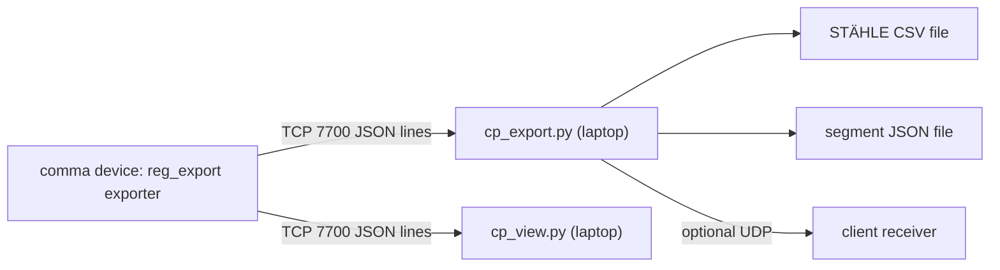
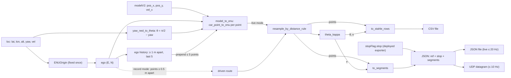
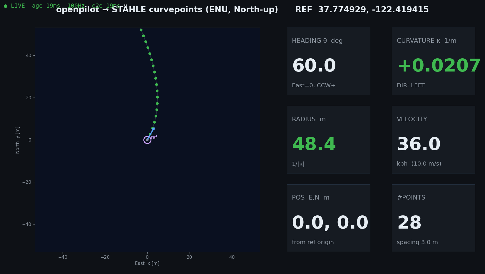

# Curvepoints pipeline (STÄHLE TrackDriver)

The curvepoints pipeline turns openpilot's GPS pose and planned path into the two track formats of the STÄHLE TrackDriver ecosystem: a per-point STÄHLE curvepoint CSV and the client's line/arc segment JSON. It reads the reg_export telemetry stream (TCP 7700) and runs on the laptop as pure-stdlib Python (`cp_view.py` also needs matplotlib). This page explains how every number is computed and how to run the tools. The receiver-side contract (schemas, transport, the `"stop"` field) is in [Client interface specification](06-client-interface-spec.md).

## At a glance

| Field | Value |
|---|---|
| **Audience** | Developers (how the numbers are made); operators (running `cp_export.py` and `cp_view.py`) |
| **Runs on** | Laptop: Python 3, stdlib only, plus matplotlib for `cp_view.py`. Data source: the reg_export exporter on the device (TCP 7700) |
| **Era** | Built and used in **Era 1 — sunnypilot 0.9.7.1** (2026‑07 → 2026‑08). The laptop code does not depend on the era, but its data source does (see the warning under [Context](#context)) |
| **Status** | Current code with unit tests. No record exists of the sign convention being validated on the car |
| **Key files** | [`frame.py`](../remote/Arman/frame.py), [`curvepoints.py`](../remote/Arman/curvepoints.py), [`cp_export.py`](../remote/Arman/cp_export.py), [`cp_view.py`](../remote/Arman/cp_view.py), [`stream_lib.py`](../remote/Arman/stream_lib.py), [`cp_slides.html`](../remote/Arman/cp_slides.html), [`_selftest_out/`](../remote/Arman/_selftest_out/), [`Arman/README.md`](../remote/Arman/README.md) |

## Context

The client (Arman) works with the STÄHLE TrackDriver robot ecosystem. A TrackDriver robot actuates a vehicle (the slides say "the bus") and follows **curvepoints**: a track defined as position, heading, curvature and speed ([`cp_slides.html`](../remote/Arman/cp_slides.html), slide 1). The job was to take what openpilot plans and drives and emit it live, in exactly the frame and sign convention TrackDriver expects, from the existing reg_export stream.

The deliverables named on slide 1 are:

- `cp_export.py`, which writes both formats in live and record modes;
- `cp_view.py`, which you watch while driving;
- the pure-math modules `frame.py` and `curvepoints.py`.

The frame and sign convention come from the client's "CP Definition of Curvepoints" PDF and from the client's engineer (see [`Arman/README.md`](../remote/Arman/README.md) and the docstring of [`frame.py`](../remote/Arman/frame.py)).



> [!NOTE]
> **Described, not included.** The client's "CP Definition of Curvepoints" PDF is not in this repository. Statements below that say "per the PDF" quote the code comments and notes that cite it.

> [!IMPORTANT]
> **The sign convention has not been validated on the car.** No record exists of an on-car check. The only evidence is the unit tests (`frame.py --test`, `curvepoints.py --test`, `cp_export.py --selftest`) and an offroad check. [`EXPERIMENT_RUNBOOK.md`](../remote/Arman/EXPERIMENT_RUNBOOK.md) ends with "Verified offroad (2h before): config ✓, planner patch ✓, stop flag ✓, cp_export JSON ✓" and "To confirm ONROAD (step 1): longActive ✓ + first smooth stop + JSON segs>0.", and no onroad result was ever written down. Run the [sign-validation drill](#sign-validation-drill) before you rely on the signs.

> [!WARNING]
> **Historical (sunnypilot era).** The reg_export exporter that feeds this pipeline was installed on the Era 1 device (sunnypilot 0.9.7.1). The device was later re-flashed to **Era 2 — openpilot v0.11.1 `release-tizi` + dashcam‑anywhere**. The re-flash date is not recorded: it falls between 2026‑08‑13 (the last era‑1 file) and 2026‑10‑03 (the era‑2 patch). Nothing in `remote/Arman/dashcam_anywhere/` reinstalls the exporter. It is therefore presumably absent (inferred; verify with `nc -z $COMMA_IP 7700`). The exporter in this repo was written for sunnypilot 0.9.7.1 and has not been tested on Era 2. Installing it is covered in [Telemetry stream](03-telemetry-stream.md).

Unless a block says otherwise, the laptop commands below run in `remote/Arman` and assume `COMMA_IP` is set:

```bash
# laptop  (from the root of your clone)
cd remote/Arman && export COMMA_IP=$(./find_comma.sh)   # or set it by hand: export COMMA_IP=192.168.1.231
```

`find_comma.sh` prints the first device it finds, so check the DongleId when more than one comma is around (see [Setup, SSH and networking](02-setup-ssh-networking.md)).

## Inputs from the stream

`cp_export.py` and `cp_view.py` each open their own TCP connection through `stream()` in [`stream_lib.py`](../remote/Arman/stream_lib.py) (`remote/Arman/stream_lib.py` is identical to `remote/stream_lib.py`). `stream()` uses a 5 s socket timeout. On any socket error or timeout it prints `[stream] disconnected (<error>); retrying in 1s...` and reconnects after 1 s. The baseline exporter emits one record per carState frame (~100 Hz). The heavy `modelV2` arrays appear only on the records where the 20 Hz modelV2 service updated (see the docstring of [`exporter_device.py`](../remote/exporter_device.py)).

The pipeline uses only these fields:

| Stream field | Exporter source ([`exporter_device.py`](../remote/exporter_device.py) → `ext_loc()`, `ext_modelV2()`) | Unit, rounding | Used for |
|---|---|---|---|
| `loc.lat`, `loc.lon` | `liveLocationKalman.positionGeodetic[0]`, `[1]` | deg, 7 decimals | origin lock, ego position |
| `loc.alt` | `positionGeodetic[2]` | m, 2 decimals | origin altitude (when the origin locks automatically), ENU conversion |
| `loc.yaw` | `calibratedOrientationNED[2]` | rad, 5 decimals | vehicle heading θ |
| `loc.vel` | `velocityCalibrated` (3 values) | m/s, 3 decimals | `vel[0]` (forward) is the speed of ego-history and route points |
| `loc.gpsOK`, `loc.status` | sent by the exporter | — | **not used** (see [Origin locking](#origin-locking-and-_valid_fix)) |
| `modelV2.pos_x`, `modelV2.pos_y` | `modelV2.position.x`, `.y` (car frame) | m, 3 decimals | the planned path (live mode) |
| `modelV2.vel_x` | `modelV2.velocity.x` | m/s, 3 decimals | speed along the planned path |
| `modelV2._upd` | per-block update flag | bool | a live track is built only on records where modelV2 updated |
| `stopFlag.stop` | deployed exporter only | 0/1 | copied into the JSON `"stop"` (live mode) |

[`Arman/README.md`](../remote/Arman/README.md) lists the fields as `loc.{lat,lon,alt,yaw}` and `modelV2.{pos_x,pos_y,vel_x}`, and slide 2 shows `loc{lat,lon,yaw}`. The code also reads `loc.vel` (A-item A8 in [16](16-errata-and-crosswalk.md#additional-inconsistencies-found-in-this-review)).

The README adds "Data only flows when the car is **onroad** with a GPS fix", and slide 2 says the same. More precisely, the baseline exporter emits records only while carState updates (onroad), and `cp_export.py` writes output only once it also has a GPS pose, unless `--local-frame` is set (see [Origin locking](#origin-locking-and-_valid_fix)).

> [!NOTE]
> **Described, not included.** The exporter in this repo ([`exporter_device.py`](../remote/exporter_device.py)) is the era‑1 baseline and has **no `stopFlag` block**. The deployed variants that add `stopFlag` (the stopFlag exporter on the Civic; `/data/objstop/exporter_nocan.py` for no-CAN mode) are not included. A record without `stopFlag` leaves `cp_export.py`'s last `"stop"` value unchanged, and that value starts at 0, so with the baseline exporter `"stop"` is always 0 (erratum 9).

## Frames and transforms

All transforms live in [`frame.py`](../remote/Arman/frame.py) (math module only, no numpy).

### Source and target frames

| Quantity | openpilot (input) | STÄHLE / client (output) |
|---|---|---|
| Position | car (calibrated) frame: x = Forward, y = Right, z = Down (`modelV2.position`) | ENU: x = **East**, y = **North** [m] from the mission origin |
| Heading | NED yaw: 0 = North, positive toward East (clockwise seen from above) | θ: 0 = East, **counter-clockwise positive**, North = +π/2, range ±π |
| Curvature | car-frame κ is right-positive (per [`Arman/README.md`](../remote/Arman/README.md) and slide 3) | κ = 1/R [1/m], **left turn positive** |
| Velocity | m/s | always > 0 ("else the vehicle stands still"), except a final JSON segment of 0.0 that means "stop there"; JSON in m/s, CSV in kph |
| Origin | — | a WGS84 lat/lon fixed **once** at mission start, never changed |

### WGS84 to ENU

`geodetic2ecef()` and `ecef2enu()` implement the standard WGS84 conversion, and `ENUOrigin` holds the fixed origin:

```text
a = 6378137.0 m        f = 1/298.257223563        e2 = f·(2 − f)
Rn(φ) = a / sqrt(1 − e2·sin²φ)
X = (Rn + h)·cos φ·cos λ      Y = (Rn + h)·cos φ·sin λ      Z = (Rn·(1 − e2) + h)·sin φ
dX, dY, dZ = ECEF(point) − ECEF(origin)
E =  −sin λ0·dX + cos λ0·dY
N =  −sin φ0·cos λ0·dX − sin φ0·sin λ0·dY + cos φ0·dZ
U =   cos φ0·cos λ0·dX + cos φ0·sin λ0·dY + sin φ0·dZ      (computed, then discarded)
```

- **Point altitude.** `cp_export.py` passes each fix's `loc.alt`. When it is missing, `ENUOrigin.enu()` uses the origin's altitude.
- **Origin altitude.** With a preset origin it is `--ref-alt` (default 0.0). With an automatic lock it is the altitude of the first fix.
- **Effect on E/N.** Analysis (from code; not field-tested): an altitude difference Δh shifts E/N by about Δh·D/R, where D is the distance from the origin and R ≈ 6.4·10⁶ m. That is about 1.6 cm at D = 1 km for Δh = 100 m.

### Heading

`yaw_ned_to_theta(yaw) = wrap_pi(π/2 − yaw)`, wrapped into (−π, π] by `wrap_pi()`:

| Facing | NED yaw | θ |
|---|---|---|
| North | 0 | +π/2 |
| East | +π/2 | 0 |
| South | π | −π/2 |
| West | −π/2 | π |

These four cases are unit tests in `frame.py` (`_tests()`).

### Car frame to ENU

`car_point_to_enu(fx, fy, e0, n0, θ)` places a car-frame point (fx = forward, fy = right) using the vehicle pose (e0, n0, θ):

```text
E = E0 + fx·cos θ + fy·sin θ
N = N0 + fx·sin θ − fy·cos θ
```

Right is 90° clockwise from forward, hence the (sin θ, −cos θ) column. The tests check the result:

| Vehicle facing | Car-frame point | ENU result |
|---|---|---|
| North (θ = π/2) | 10 m forward | +10 m North |
| North | 3 m right | +3 m East |
| East (θ = 0) | 10 m forward, 2 m right | +10 m East, −2 m North |

### Curvature is recomputed in ENU

openpilot's right-positive curvature is **not** converted. Instead κ is recomputed on the ENU points, where the standard signed-curvature formula makes a counter-clockwise (left) turn positive automatically (`frame.py` docstring; slide 4).

[`Arman/README.md`](../remote/Arman/README.md) writes the continuous form, `kappa = (xE'*yN'' - xE''*yN')/(...)^1.5`. The code (`_signed_kappa()` in [`curvepoints.py`](../remote/Arman/curvepoints.py)) uses the discrete three-point form instead, which is the signed curvature of the circle through three consecutive points:

```text
a = P1 − P0,  b = P2 − P1,  c = P2 − P0
κ = 2·(a.x·b.y − a.y·b.x) / (|a|·|b|·|c|)          (0 if any side < 1e-6 m)
```

The two forms agree for points on a circle.

### Data flow



`build_track()` in [`cp_export.py`](../remote/Arman/cp_export.py) chains resample → `theta_kappa` → `to_stahle_rows` + `to_segments`. Output positions always come from the resampled points. The θ/κ smoothing never moves them (see [Heading and curvature](#heading-and-curvature)).

## Distance-rule resampling

Point spacing follows the PDF's distance rule (`spacing_for()` in [`curvepoints.py`](../remote/Arman/curvepoints.py)):

```text
d = v[kph]/3.6 · dsdv,  dsdv = 0.3,  min 0.6 m,  max 5 m   →   d = clip(0.3·v_mps, 0.6, 5.0) m
```

| v (m/s) | v (kph) | d (m) |
|---|---|---|
| 0.3 (floor) | 1.08 | 0.6 |
| 1 | 3.6 | 0.6 |
| 2 | 7.2 | 0.6 |
| 3 | 10.8 | 0.9 |
| 5 | 18 | 1.5 |
| 8 | 28.8 | 2.4 |
| 10 | 36 | 3.0 |
| 15 | 54 | 4.5 |
| ≥ 16.67 | ≥ 60 | 5.0 (cap) |

`resample_by_distance_rule(E, N, V)` works as follows:

1. Compute the cumulative arc length of the input polyline (`_cumlen()`).
2. Start at s = 0, the first input point. In live mode that is the oldest ego-history point.
3. At each s, linearly interpolate (E, N, v) along the polyline (`_interp()`, a binary search over the arc length). Floor the speed at **V_FLOOR = 0.3 m/s** and emit the point.
4. Advance s by `spacing_for(v)` at that point and repeat until s passes the end (guarded at 100 000 steps).
5. Append the polyline's last point (speed floored) if it is more than 1 mm from the last emitted point. The final gap can therefore be shorter than the rule.

V_FLOOR exists so that velocity is strictly > 0 ("spec: else vehicle stands still", comment in `curvepoints.py`). Every resampled point therefore has v ≥ 0.3 m/s, and the CSV never shows less than 1.08 kph. A single input point is returned as one point. An empty input returns nothing.

## Heading and curvature

`theta_kappa(E, N, smooth=0, kappa_straight=1/200)` returns one θ and one κ per point:

- **Optional smoothing.** If `smooth > 1` and there are at least 3 points, E and N first go through a centred moving average (`_movavg()`, window 2·⌊smooth/2⌋ + 1 points, truncated at the ends). The docstring says to use it "for raw GPS; the PDF asks for filtering". The smoothing changes only θ and κ (and therefore the segment split). The positions written to the CSV/JSON are the unsmoothed resampled points.
  - Analysis (from code; not field-tested): the window counts points, not metres. At 10 m/s (3 m spacing) a 5-point window spans about 12 m.
- **θ.** `atan2(ΔN, ΔE)`: a forward difference at the first point, a backward difference at the last, and a central difference (i−1, i+1) elsewhere. A single point gets θ = 0.
- **κ.** `_signed_kappa()` of points (i−1, i, i+1). It is **0 at both endpoints** by construction.
- **Snap to straight.** Any |κ| < 1/200 (radius > 200 m) is set to 0. The docstring gives the reason: "so a straight->arc threshold point uses the straight's curvature (PDF tip)". Slide 6 adds "to avoid interpolation overshoot".

Default smoothing: `cp_export.py --smooth` is 5 in record mode and 0 in live mode. `cp_view.py` hard-codes the same values.

## Output builders

### STÄHLE rows

`to_stahle_rows(pts, thetas, kappas)` produces the STÄHLE "10000" layout, one row of 9 values per resampled point. Both the docstring and the README use the name "10000"; it comes from the client's PDF, which is not included.

| # | Column (`STAHLE_HEADER`) | Value | Rounding |
|---|---|---|---|
| 1 | `Deltatime_s` | 0.0 on the first row. After that, the gap from the previous point divided by **this point's** speed: `hypot(ΔE, ΔN) / v_i` | 4 decimals |
| 2 | `velocity_kph` | `max(v_i, 0.3) · 3.6` | 3 decimals |
| 3 | `gear` | always `99` | integer |
| 4 | `index` | 0-based row number | integer |
| 5 | `PositionX_East_m` | E | 4 decimals |
| 6 | `PositionY_North_m` | N | 4 decimals |
| 7 | `theta_rad` | θ | 6 decimals |
| 8 | `kappa_1pm` | κ (left-positive) | 6 decimals |
| 9 | `long_accel_mss` | always `0.0`. The docstring says "fixed 0 -> recalculated by TrackDriver" | — |

`write_stahle_csv()` in [`cp_export.py`](../remote/Arman/cp_export.py) adds two `#` header lines and the column header. The exact file layout is in [Interface B](06-client-interface-spec.md#interface-b-curvepoint-csv).

### Segments

`to_segments(pts, kappas, kappa_straight=1/200, min_run=3)` turns the resampled points into the client's internal line/arc segments. The docstring calls it "an approximation of a proper spline fit — the client's own wrapper is authoritative; kept simple and sign-correct here". The algorithm:

1. **Fewer than 2 points:** return an empty list.
2. **Label each point:** `straight` if |κ| < 1/200, otherwise `left` (κ > 0) or `right` (κ < 0).
3. **Merge short runs.** Only if there are more than 3 points: repeatedly take the first run of equal labels that is shorter than 3 points and relabel it with the previous run's label. A short first run takes the next run's label instead. Stop when no short run is left or only one run remains. This keeps noisy κ near the threshold from fragmenting the track.
4. **Walk the runs.** A segment starts at boundary point i and takes the label of point i+1. It extends while the next point has the same label and ends at point `end`, where the next segment starts. Consecutive segments therefore **share their boundary point** exactly.
5. **Radius.** A `straight` label, or no point in the segment with |κ| ≥ 1/200, gives `radius = 0.0`. Otherwise `radius = 1 / mean(|κ|)` over the segment's points with |κ| ≥ 1/200, so an arc radius is never above 200 m.
6. **Direction.** For an arc, the label. For radius 0, it is `"left"` if the κ sum over the segment is ≥ 0, else `"right"`. **It means nothing for straights.**
7. **Velocity.** The mean of the segment's (floored) point speeds, in m/s.
8. **Final-segment rule.** If the **last** segment's velocity is ≤ V_FLOOR + 0.05 = **0.35 m/s**, it is set to `0.0` (client convention "velocity 0 at the end = stop there").

Rounding is 4 decimals for x/y and 3 decimals for velocity and radius.

> [!IMPORTANT]
> **The final-velocity rule looks at the segment's mean speed, not the speed at the end.** The `to_segments()` docstring says "The final segment's velocity is 0.0 when the plan ends at (floored) standstill". The code, however, tests the **mean** speed of the whole last segment. Analysis (from code; not field-tested), computed for this doc with the repo functions: a 29 m straight track whose speed falls linearly from 5 m/s to 0 at 25 m and stays 0 to the end (so the plan does end at standstill) comes out as one straight segment with velocity 1.761, not 0.0. A track whose last segment crawls at ≤ 0.35 m/s on average does get 0.0. Do not read a non-zero final velocity as "the track does not end in a stop" (A-item A10 in [16](16-errata-and-crosswalk.md#additional-inconsistencies-found-in-this-review)).

Worked examples. Analysis (from code; not field-tested): computed for this doc with the repo's `build_track()`.

| Input | Segments |
|---|---|
| The self-test path (facing East, `pos_y = −0.02·pos_x²`, 8 m/s) | 1 × left, radius 49.644 m, velocity 8.0 (the [sample JSON](../remote/Arman/_selftest_out/selftest.json)) |
| A left arc of R = 20 m followed by a right arc of R = 20 m, 8 m/s | left, radius 20.803 m, then right, radius 20.919 m; the shared boundary point is identical |
| A straight line at 0.2 m/s (floored to 0.3) | 1 × straight, radius 0.0, direction "left", velocity 0.0 (the final-segment rule) |

The radius overestimates R slightly because the mean |κ| includes the transition points.

## cp_export

[`cp_export.py`](../remote/Arman/cp_export.py) is the exporter: stream → both formats, in `live` or `record` mode.

### Modes

| | `--mode live` (default) | `--mode record` |
|---|---|---|
| Track content | The planned path ahead (modelV2), placed in ENU at the current GPS pose, preceded by up to 5 ego-history points | The whole driven GPS route since start-up |
| Built when | on every record whose `modelV2._upd` is true and `pos_x` is non-empty, if the polyline has ≥ 3 points | every time a record arrives more than 2 s after the previous attempt (once the route has ≥ 3 points), and once more at Ctrl‑C |
| Files | `track_live.csv`, `track_live.json` | `route_track.csv`, `route_track.json` |
| File writes | at most every 50 ms (≤ 20 Hz) | each emit (about every 2 s) and at Ctrl‑C |
| UDP (`--udp`) | each build, rate-limited to `--udp-hz` | each emit (also rate-limited) |
| `--stdout` | one JSON line per build | no effect |
| `"stop"` | the last `stopFlag.stop` seen in the stream | **always 0** (erratum 12) |
| Default `--smooth` | 0 | 5 |
| Ctrl‑C | Python `KeyboardInterrupt` traceback; the last files stay on disk | prints `finalizing route ...`, writes the final files, exits 0 |

Per incoming record, `run()` does the following:

1. Update `"stop"` if the record has a `stopFlag` dict.
2. Remember the latest `loc` block.
3. Lock the origin on the first valid fix (unless preset). With `--local-frame`, set a dummy origin.
4. Print the heartbeat (~1 Hz).
5. Compute the pose. In record mode, append to the route. In live mode, either update the ego history or build and emit a track.

### Ego-history tail

Live mode keeps `HIST_TAIL = 5` ego points "behind" the vehicle:

- On every record **without** a fresh modelV2 trajectory and with a valid pose, the ego ENU position is appended if it is at least 1.0 m from the last stored point.
- Only the last 5 points are kept. Their speed is `max(loc.vel[0], 0.3)`.
- `model_to_enu()` prepends these points to the model path before resampling.

The live track therefore **starts up to 5 history points (each ≥ 1 m apart) behind the vehicle**. At speed that is typically a few metres. The vehicle's own position is not marked in the output.

### Record mode route

On each record with a valid pose, the ego ENU position is appended to the route if it is at least `RECORD_MIN_MOVE = 0.5` m from the last route point ("dedup/dequantize accumulated GPS route"), with speed `max(loc.vel[0], 0.3)`. Every emit rebuilds the whole route (`build_track(..., smooth=args.smooth)`), rewrites both files, sends one UDP datagram with `"stop": 0` (if `--udp` is set and the rate limit allows), and prints `[cp_export] wrote route_track.{csv,json}  points=<rows> segments=<n>`.

[`Arman/README.md`](../remote/Arman/README.md), EXPERIMENT_RUNBOOK §3, OPERATIONS §2.2 and slide 8 say the record files are written at Ctrl‑C (on exit). The code also rewrites them, and sends UDP if `--udp` is set, about every 2 s while recording, as the module docstring says ("on exit (Ctrl-C) or periodically") (A-item A3 in [16](16-errata-and-crosswalk.md#additional-inconsistencies-found-in-this-review)).

### Origin locking and _valid_fix

The ENU origin is set **once per process** and never changed. Reconnects keep it.

- **Preset.** If **both** `--ref-lat` and `--ref-lon` are given, the origin is `ENUOrigin(ref_lat, ref_lon, ref_alt or 0.0)` and the tool prints `[cp_export] ref fixed at <lat>,<lon>`. Passing only one of them is silently ignored.
- **First fix.** Otherwise the first record for which `_valid_fix(loc)` is true becomes the origin, including that fix's altitude. The tool prints `[cp_export] ref locked at first fix <lat>,<lon>`. Restarting `cp_export.py` without `--ref-*` locks a **new** origin.
- **`_valid_fix(loc)`** is true when `loc` exists, `lat` and `lon` are numbers, and they are not both within 1e-6° of 0. It does **not** look at `loc.gpsOK` or `loc.status`.
- **Pose.** A pose is available when an origin exists, `_valid_fix(last_loc)` holds, and `loc.yaw` is a number. Without a pose (and without `--local-frame`) the record is skipped.

> [!IMPORTANT]
> **Always pass your own mission origin.** `_valid_fix()` only rejects (0, 0) (erratum 14). Any other position that locationd reports, even without a real GPS fix, is accepted. An unpublished output of a 2026‑08‑12 bench session has its origin in the mid-Atlantic at −2854 m altitude, which is consistent with this. **Always pass your own mission origin with `--ref-lat/--ref-lon`.** The coordinate 37.7749295, −122.4194155 used throughout the repo is a neutral example only.

### Options

| Flag | Default | Meaning |
|---|---|---|
| `--ip IP` | required unless `--selftest` | device address (source of the TCP 7700 stream) |
| `--port N` | `7700` | source TCP port of the reg_export stream. Not the UDP destination port (that is `--udp-port`) |
| `--mode {live,record}` | `live` | see [Modes](#modes) |
| `--ref-lat DEG`, `--ref-lon DEG` | none | fixed origin; both are needed |
| `--ref-alt M` | `0.0` | origin altitude; used only with a preset origin |
| `--out-dir DIR` | `./cp_out` | output directory, created if missing, **relative to the current directory** (`cp_out/` and `*.tmp` are in `.gitignore`) |
| `--smooth N` | 5 in record mode, 0 in live mode | moving-average window on E,N before θ/κ; values ≤ 1 switch it off |
| `--stdout` | off | live mode only: also print each track's JSON to stdout |
| `--udp HOST[:PORT]` | off | also send the client JSON as UDP datagrams; a bare host uses `--udp-port` |
| `--udp-port N` | `5005` | destination port when `--udp` has no `:PORT` |
| `--udp-hz HZ` | `10.0` | maximum UDP rate. The minimum send interval is `1/max(HZ, 0.1)` s |
| `--local-frame` | off | no-GPS fallback: body-fixed, North-up frame ("NOT true North"); see the [caveats](#local-frame-caveats) |
| `--selftest` | — | run the self-tests (see [Self-tests and sample outputs](#self-tests-and-sample-outputs)) |

`cp_export.py` imports `frame`, `curvepoints` and `stream_lib` from its own directory, so keep the `remote/Arman/` files together. If `stream_lib.py` cannot be imported, `run()` prints `stream_lib unavailable` to stderr and exits with code 2.

### Outputs and rates

| Output | Live | Record |
|---|---|---|
| `<out-dir>/track_live.csv` / `route_track.csv` | rewritten ≤ 20 Hz | rewritten about every 2 s and at Ctrl‑C |
| `<out-dir>/track_live.json` / `route_track.json` | same moments as the CSV | same moments as the CSV |
| UDP datagram | ≤ `--udp-hz` (10 Hz) | at most one per emit |
| stdout JSON line | one per track build (~20 Hz, not rate-limited) | none |

Both files are written by `_atomic_write()`: the text goes to `<file>.tmp`, then `os.replace()` swaps it in. A reader never sees a half-written file, but `*.tmp` files appear briefly. The CSV and JSON are replaced one after the other, not as a pair. The JSON file is pretty-printed (`indent=2`) with no trailing newline. The CSV ends with a newline.

Analysis (from code; not field-tested): a run of `run()` against a synthetic 100 Hz stream (modelV2 on every 5th record), made for this doc, measured ~19.6 file rewrites/s and ~9.8 datagrams/s in live mode.

### UDP and stdout

- **`--udp`.** `HOST[:PORT]` is split at the last `:`, so a bare IPv4 address or hostname takes `--udp-port`. The socket is IPv4 and unconnected.
- **Payload.** One datagram carries one compact JSON document (`separators=(",", ":")`, UTF-8): `{"ref":{...},"stop":<0|1>,"segments":[...]}`.
- **Rate limit.** If less than `1/--udp-hz` s has passed since the last send, the update is dropped (not queued).
- **Oversize payloads.** A payload over 60,000 bytes is skipped with `[cp_export] UDP payload <n>B too large, skipped` on stderr. One segment is about 104 bytes, so this only happens with very long record-mode routes (Analysis (from code; not field-tested): roughly 570 segments).
- **Send errors.** A local send error prints `[cp_export] UDP send failed: <error>`. An unconnected UDP socket does not report "port unreachable", so a missing receiver produces **no** error here. Use `_udp_probe.py` ([Link testing](06-client-interface-spec.md#link-testing)).
- **`--stdout`** (live only) prints one JSON line per track with Python's default separators (`", "`, `": "`). The heartbeat, `[cp_export] ...` and `[stream] ...` lines go to the **same** stdout, so a downstream reader must keep only the lines that start with `{`.

The full receiver contract is in [Interface A](06-client-interface-spec.md#interface-a-segment-json).

### Heartbeat and log lines

Exact strings, from `run()` and `stream_lib.stream()`:

| Line | When |
|---|---|
| `[cp_export] ref fixed at <lat>,<lon>` | start-up, preset origin |
| `[cp_export] UDP -> <host>:<port> at <= <hz> Hz` | start-up with `--udp` (`<hz>` prints as a float, e.g. `10.0`) |
| `[cp_export] mode=<mode>  streaming from <ip>:<port> ... (Ctrl-C to stop)` | start-up |
| `[cp_export] ref locked at first fix <lat>,<lon>` | first valid fix, no preset origin |
| `[cp_export] --local-frame: dummy origin (0,0); NOT true North/ENU` | first record without origin and without a fix, with `--local-frame` |
| `[cp_export] waiting for GPS fix (or pass --ref-lat/--ref-lon, or --local-frame)` | heartbeat: no origin yet |
| `[cp_export] have origin, waiting for valid GPS pose (lat/lon/yaw)` | heartbeat: origin set, but the current `loc` has no valid lat/lon/yaw |
| `[cp_export] GPS ok, waiting for modelV2 trajectory (is the car onroad?)` | heartbeat, live mode: the record that triggered the heartbeat has no `modelV2.pos_x` |
| `[cp_export] OK -> track_live.{csv,json}  segs=<N>` | heartbeat, live mode, otherwise (N = segments of the last built track) |
| `[cp_export] OK -> route_track.{csv,json}  segs=0` | heartbeat, record mode with a pose |
| `[cp_export] wrote route_track.{csv,json}  points=<rows> segments=<n>` | record mode, each emit |
| `[cp_export] finalizing route ...` | record mode, Ctrl‑C (preceded by an empty line) |
| `[cp_export] UDP payload <n>B too large, skipped` | stderr, payload > 60,000 B |
| `[cp_export] UDP send failed: <error>` | stderr, local socket error |
| `[stream] disconnected (<error>); retrying in 1s...` | `stream_lib`: connection refused, timeout (5 s without data) or drop |

The heartbeat is evaluated per record, at most once per second, so it is **silent while no records arrive**.

[`OPERATIONS.md`](../remote/Arman/OPERATIONS.md) §2.2 and [`EXPERIMENT_RUNBOOK.md`](../remote/Arman/EXPERIMENT_RUNBOOK.md) §3 say the heartbeat "should show" `[cp_export] OK -> track_live.{csv,json}  segs=N`, and EXPERIMENT_RUNBOOK §3 adds: "If heartbeat says "waiting for GPS/modelV2", you're not onroad with a fix yet." Read the heartbeat with these quirks in mind (A-item A9 in [16](16-errata-and-crosswalk.md#additional-inconsistencies-found-in-this-review)). Analysis (from code; not field-tested), all three reproduced with a synthetic stream for this doc:

- **Live mode mostly prints "waiting for modelV2".** The check looks only at the record that triggers the heartbeat. With the baseline exporter, `pos_x` is present only on the roughly 1 in 5 records where modelV2 updated. A working live export therefore mostly prints `GPS ok, waiting for modelV2 trajectory (is the car onroad?)` with an occasional `OK -> ...` line. Judge it by the files' modification time or the receiver instead.
- **Record mode always shows `segs=0`.** The heartbeat counter is only updated in live mode (A-item A4 in [16](16-errata-and-crosswalk.md#additional-inconsistencies-found-in-this-review)). Use the `wrote route_track...` lines.
- **`--local-frame` always shows "waiting for valid GPS pose".** Without GPS the heartbeat keeps printing `have origin, waiting for valid GPS pose (lat/lon/yaw)` even though files are being written.

### Local-frame caveats

`--local-frame` is meant for indoor or no-GPS tests (OPERATIONS §3.2: "indoors / no GPS: add `--local-frame` (vehicle body frame, not true North)"). When no origin exists and no valid fix has been seen, it sets a dummy origin at lat/lon (0, 0). While no pose is available, each model path is placed with the ego at (0, 0), θ = π/2 (North-up) and speed 0. The JSON then carries `"ref": {"latitude": 0.0, "longitude": 0.0}`.

Caveats (erratum 13, plus code analysis):

- **Record mode collects nothing without a pose.** The route stays at one point (0, 0), so no file is ever written.
- **A fix arriving later mixes frames.** It is projected about lat/lon (0, 0) and produces coordinates of millions of metres.
- **Losing the pose silently switches frames, even with a real origin.** Analysis (from code; not field-tested), reproduced with a synthetic stream for this doc: if a real origin is set (`--ref-*`, or an earlier fix) and the pose is lost, `--local-frame` produces body-fixed tracks under the **real** `ref`. The stale ego-history points are still prepended, giving a spurious segment that jumps back to (0, 0). Without `--local-frame`, records without a pose are simply skipped.
- **`cp_view.py` has no `--local-frame` flag.**
- **The heartbeat misleads.** It keeps saying "waiting for valid GPS pose" (see above).

Use `--local-frame` only in live mode, only when GPS stays absent for the whole run, and never together with `--ref-lat/--ref-lon` (its body-fixed output would then carry your real `ref`). Restart without it once GPS is available.

### Field recipes (era 1)

> [!WARNING]
> **Historical (sunnypilot era).** These procedures ran against the era‑1 device (Civic with CAN, and the no-CAN truck/bench mode). The device no longer has that software state; see [Operations runbook](13-operations-runbook.md).

Civic, live export with UDP (OPERATIONS §2.2, EXPERIMENT_RUNBOOK §3; adapted: the origin flags are added, as both notes recommend for a fixed origin):

```bash
# laptop  (in remote/Arman, with COMMA_IP set as above)
export REF_LAT=37.7749295 REF_LON=-122.4194155        # neutral example: use your own mission origin
python3 cp_export.py --ip $COMMA_IP --mode live --out-dir ./cp_out \
        --ref-lat $REF_LAT --ref-lon $REF_LON \
        --udp 192.168.1.50:5005                         # optional: the client's receiver (example address); --udp-hz 10 is the default
# second terminal: cd remote/Arman and repeat the COMMA_IP and REF_* exports (a new shell does not inherit them)
python3 cp_view.py --ip $COMMA_IP --ref-lat $REF_LAT --ref-lon $REF_LON
```

Record a whole route instead with `--mode record`. `route_track.{csv,json}` is written while driving and finalized at Ctrl‑C. OPERATIONS §2.3 runs `cp_view.py` and `vision/objstop_view.py` in separate terminals. OPERATIONS §8: after each experiment, "the json/csv in `cp_out/` are the deliverables; copy them away to archive".

Truck / no CAN (OPERATIONS §3.2–3.3), translated:

- The device side needed no action: power on, and objstopd autostarted in shadow.
- On the laptop, run `cp_export.py --mode live ... --udp <client IP>:<port>`.
- "Outdoors, wait for a GPS fix (the heartbeat will prompt); indoors / no GPS: add `--local-frame`."
- Optional: `python3 vision/objstop_view.py --ip $COMMA_IP` shows the detection status board ([08](08-vision-stop-objstopd.md#objstop_view-laptop-status-board)).
- The honest limitation (§3.3 ②): "the modelV2 trajectory uses the camera calibration stored from the Civic; mounted on a truck windshield the angle differs, so the trajectory geometry is biased. On a truck it is recommended to produce the route with **GPS record mode**, or to use the vision stop flag as the main deliverable."

The no-CAN mode itself is in [No-CAN truck/bench mode](10-no-can-mode-sunnypilot.md).

## cp_view

[`cp_view.py`](../remote/Arman/cp_view.py) is the live viewer. It opens its own TCP connection and reuses `model_to_enu`, `build_track`, `_valid_fix`, `HIST_TAIL` and `RECORD_MIN_MOVE` from `cp_export.py`, so it shows what `cp_export.py` computes. It does not read the output files.



- **Left: a North-up ENU map** (x = East right, y = North up), exactly the client frame:
  - the ref origin (circle);
  - the ego and a heading arrow;
  - the curvepoints coloured by direction: left = green, right = orange, straight = grey.
- **Right: six tiles** (table below).
- **Top-left: the freshness line.**
  - `● LIVE` when the last record arrived less than 400 ms ago, otherwise `○ STALE`, measured on the laptop's own clock.
  - The receive rate over the last 120 records.
  - `e2e`: laptop wall time minus the record's `t_wall`, shown only when it falls between −500 and 3000 ms. It compares two clocks, and the device has no RTC battery, so its clock can be wrong until it gets a GPS fix (the same limitation as erratum 24).
- **Header:** `REF  <lat>, <lon>` (6 decimals) or `REF  (waiting for GPS fix)`.

| Tile | Shows |
|---|---|
| HEADING θ deg | the vehicle heading, East = 0, CCW+ |
| CURVATURE κ 1/m + DIR | κ read **ahead** of the ego, at point `min(n−2, max(1, i_ego + max(2, ⌊(n − i_ego)/4⌋)))`, because endpoints have κ = 0 by construction (n = number of points, i_ego = the point nearest the ego) |
| RADIUS m | 1/\|κ\| (∞ when \|κ\| ≤ 1e-4) |
| VELOCITY | kph of that point, with m/s underneath |
| POS E,N m | the ego position from the origin |
| #POINTS | the point count and the mean spacing |

Options: `--ip` (required unless `--selftest`), `--port` (7700), `--mode {live,record}` (live), `--ref-lat`, `--ref-lon`, `--ref-alt` (0.0), `--selftest`. The map refreshes every 100 ms. There is no `--local-frame`, `--smooth`, `--udp` or `--out-dir`. Smoothing is fixed at 5 (record) or 0 (live).

Analysis (from code; not field-tested):

- **Pass the same origin to both tools.** Without `--ref-lat/--ref-lon`, `cp_view.py` locks its **own** first fix, which can differ slightly from the origin `cp_export.py` locked.
- **Record mode gets heavier over time.** In record mode `cp_view.py` rebuilds the whole route on every record with a pose (~100 Hz), so its CPU load grows with the route length.

### Sign-validation drill

From [`Arman/README.md`](../remote/Arman/README.md) ("Validating the sign convention live") and slide 7:

```bash
# laptop  (in remote/Arman, with COMMA_IP, REF_LAT and REF_LON exported as in Field recipes)
python3 cp_view.py --ip $COMMA_IP --ref-lat $REF_LAT --ref-lon $REF_LON
```

Do the steering checks at low speed in a safe, open place, with a passenger watching `cp_view`; the driver keeps their eyes on the road.

1. **Heading.** With the car onroad and a GPS fix, check the HEADING tile: East = 0, increasing counter-clockwise; facing North shows about 90°.
2. **Left.** Steer **left**: the track must bend **counter-clockwise**, and the CURVATURE tile must show **κ > 0 / DIR: LEFT** (green).
3. **Right.** Steer **right**: the track bends **clockwise**, with **κ < 0 / DIR: RIGHT** (orange).
4. **If anything reads inverted,** "the yaw or y-sign assumption is wrong — fix in `frame.py`". All three transforms live there.

No result of this drill on the car is recorded (see [Context](#context)). If you run it, record the date, the vehicle and the outcome.

## Self-tests and sample outputs

```bash
# laptop  (start in the root of your clone; the tests run in a scratch directory
#          so the committed cp_view_selftest.png is not overwritten)
REPO=$PWD && mkdir -p /tmp/cp_tests && cd /tmp/cp_tests
python3 $REPO/remote/Arman/frame.py --test          # 10 checks -> ALL FRAME TESTS OK
python3 $REPO/remote/Arman/curvepoints.py --test    # 15 checks -> ALL CURVEPOINTS TESTS OK
python3 $REPO/remote/Arman/cp_export.py --selftest  # 10 checks -> ALL CP_EXPORT SELFTESTS OK; rewrites remote/Arman/_selftest_out/
python3 $REPO/remote/Arman/cp_view.py --selftest    # writes ./cp_view_selftest.png, prints "selftest OK -> cp_view_selftest.png"
```

Each test prints `PASS <name>` or `FAIL <name>` and exits with 0 (all passed) or 1.

> [!IMPORTANT]
> **Self-test side effects.** `cp_export.py --selftest` always writes `_selftest_out/selftest.{csv,json}` **next to the script** (whatever the current directory is), so it rewrites the committed samples. `cp_view.py --selftest` writes `cp_view_selftest.png` into the current directory.

What the tests check (`_tests()` in `frame.py` and `curvepoints.py`; `_selftest()` in `cp_export.py`):

| Suite | Checks |
|---|---|
| `frame.py --test` (10) | ENU of the origin = 0; +1″ latitude ≈ +30.8 m North; +1″ longitude → East; yaw 0/π/2/−π/2/π → θ π/2/0/π/−π/2; North-facing forward → +N, right → +E; East-facing forward → +E, right → −N |
| `curvepoints.py --test` (15) | straight: θ ≈ 0, κ ≈ 0, one segment with r = 0; R = 20 m left arc: κ ≈ +1/R, direction left, radius ≈ R; mirrored right arc: κ ≈ −1/R, direction right; spacing 0.6/3.0/5.0 m at 1/10/30 m/s; 100 m straight at 10 m/s → gaps 3.0 m; STÄHLE rows: 9 columns, velocity_kph > 0, gear 99 and index correct |
| `cp_export.py --selftest` (10) | a left-curving model path facing East gives κ > 0 and a left arc segment; rows have velocity_kph > 0 and 9 columns; a straight path facing East goes +East with θ ≈ 0; the written JSON has the ref, `stop` ∈ {0, 1} and ≥ 1 segment; the CSV has the ref header |

Results on the published snapshot (2026‑11‑05, Python 3.12.2): frame 10 PASS → `ALL FRAME TESTS OK`; curvepoints 15 PASS → `ALL CURVEPOINTS TESTS OK`; cp_export 10 PASS → `ALL CP_EXPORT SELFTESTS OK`.

`cp_view.py --selftest` only renders the synthetic scene to a PNG. It asserts nothing (erratum 28). The scene is the neutral origin, a heading of 60° (NED yaw 30°), `pos_y = −0.015·pos_x²` at 10 m/s, with 28 points at 3.0 m spacing, as shown above.

**Sample outputs** in [`remote/Arman/_selftest_out/`](../remote/Arman/_selftest_out/) were regenerated by `cp_export.py --selftest` with the neutral origin 37.7749295, −122.4194155:

- [`selftest.csv`](../remote/Arman/_selftest_out/selftest.csv): 22 rows. 28.8 kph throughout, Deltatime ≈ 0.3 s (2.4 m gaps at 8 m/s), a final short gap of 0.2046 s, θ rising from 0.05316 to 0.976583 rad. κ lies between 0.00761 and 0.03823 on the interior points and is 0.0 at both endpoints and at row 20 (below the 1/200 snap threshold).
- [`selftest.json`](../remote/Arman/_selftest_out/selftest.json): one left segment from (0.0, 0.0) to (38.0, 28.88), velocity 8.0, radius 49.644, `"stop": 0`.

Both files are reproduced in full in [Client interface specification](06-client-interface-spec.md).

## Slides

[`remote/Arman/cp_slides.html`](../remote/Arman/cp_slides.html) is an 8-slide deck with the `cp_view` self-test image embedded (re-rendered for this snapshot). GitHub shows the HTML source, so download the file and open it in a browser.

| Slide | Content |
|---|---|
| 1 | Goal and deliverables |
| 2 | Data pipeline (device → TCP 7700 → `stream_lib` → `frame` → `curvepoints` → CSV/JSON, `cp_view`) |
| 3 | The two coordinate frames and why they differ |
| 4 | The transforms, with a test table |
| 5 | STÄHLE curvepoints and the distance rule |
| 6 | Client segment format |
| 7 | `cp_view` and the sign check |
| 8 | Modes, assumptions and hand-off |

Two slides are stale:

- **Slide 6.** The JSON example has no `"stop"`; the field was added on 2026‑08‑06. The JSON example in [`Arman/README.md`](../remote/Arman/README.md) lacks it too (erratum 23). Use the schema in [Interface A](06-client-interface-spec.md#interface-a-segment-json).
- **Slide 8.** It says conversions are "covered by `--test` / `--selftest` in frame.py, curvepoints.py, cp_export.py, cp_view.py". `cp_view.py --selftest` only renders a PNG (erratum 28). It also says record mode emits the route "on exit"; the code also rewrites it about every 2 s (A-item A3; see [Record mode route](#record-mode-route)).

## Troubleshooting

| Symptom | Likely cause | What to do |
|---|---|---|
| `find_comma.sh` prints `comma not found on: <subnets>` and `COMMA_IP` stays empty | The laptop and the comma are not on the same network, or an iPhone hotspot isolates its clients | OPERATIONS §7: switch to an Android hotspot or Ethernet; try `ping`. See [Setup, SSH and networking](02-setup-ssh-networking.md) |
| `[stream] disconnected ([Errno 111] Connection refused); retrying in 1s...` | The device is reachable, but nothing listens on 7700 (exporter not installed or not running; on Era 2 it is presumably absent) | Install or start the exporter ([Telemetry stream](03-telemetry-stream.md)); check with `nc -z $COMMA_IP 7700` |
| `[stream] disconnected (timed out); ...` every ~6 s (or `No route to host`) | Device unreachable, **or** exporter up but silent (the baseline exporter emits only on carState, i.e. onroad) | Check the network ([Setup, SSH and networking](02-setup-ssh-networking.md)); check `ssh comma@$COMMA_IP 'cat /data/params/d/IsOnroad'` (`1` = onroad). On a no-CAN rig the baseline exporter stays silent even onroad ([No-CAN truck/bench mode](10-no-can-mode-sunnypilot.md)) |
| No `[cp_export]` heartbeat at all | No records arrive (see the two rows above) | — |
| `waiting for GPS fix (or pass ...)` for minutes | No fix (indoors) | OPERATIONS §7: "wait 1–2 min outdoors; or `--local-frame`" (live mode only; see [Local-frame caveats](#local-frame-caveats)). `--ref-lat/--ref-lon` sets the origin but a fix is still needed for the pose |
| `have origin, waiting for valid GPS pose (lat/lon/yaw)` | The origin is set but the current `loc` lacks lat/lon/yaw | Wait for the fix. With `--local-frame` this line is normal and output still flows |
| `GPS ok, waiting for modelV2 trajectory (is the car onroad?)` | Either modelV2 is not running (offroad), or the heartbeat sampled a record without trajectory (common, see the heartbeat quirks) | Check whether `track_live.json` is being rewritten; run `python3 _stream_dump.py $COMMA_IP` to see whether modelV2 carries `pos_x` |
| Record heartbeat always `segs=0` | Code quirk | Look for the `wrote route_track...` lines |
| No record-mode files | Fewer than 3 route points (the first pose plus two moves of ≥ 0.5 m each), or no pose | Drive with a fix; watch the heartbeat |
| `UDP payload <n>B too large, skipped` | A long record-mode route | Use the files; record shorter routes |
| Receiver gets nothing, `cp_export.py` shows no error | Wrong IP/port, a firewall, or no route; unconnected UDP hides ICMP errors | Use `_udp_probe.py`, and a freshly started `nc -u -l <port>` on the receiver (OpenBSD netcat shows only the first sender it hears) ([Link testing](06-client-interface-spec.md#link-testing)) |
| Coordinates in the millions of metres | `--local-frame` dummy origin (0, 0), then a fix arrived | Restart without `--local-frame` |
| Track jumps back to (0, 0) mid-run | `--local-frame` while the pose was lost | Do not use `--local-frame` when GPS is expected |
| The track bends the wrong way on the map | The sign assumption is wrong on the real car | Run the [drill](#sign-validation-drill); fix in `frame.py` |
| Files appear in an unexpected folder | `--out-dir` is relative to the current directory | Pass an absolute `--out-dir` |
| `stream_lib unavailable`, exit code 2 | `stream_lib.py` is missing next to `cp_export.py` | Run from a complete `remote/Arman/` |

## Limitations and open questions

**Limitations:**

- **Signs.** Validation on the car is not recorded.
- **Segments are an approximation.** The radius is biased by transition points, short runs are merged, and the client's wrapper is authoritative.
- **The final-velocity rule uses the last segment's mean speed** (see above).
- **No timestamp or sequence number** in either output.
- **The vehicle's pose is not in the output.** In live mode the track starts a few metres behind the vehicle.
- **Live tracks move with GPS noise.** Each live track is placed at the GPS pose of the moment, so successive tracks shift with GPS noise. Analysis (from code; not field-tested).
- **No smoothing in live mode by default.** κ comes from three resampled points.
- **`_valid_fix()` accepts any non-(0, 0) position** (erratum 14).
- **The heartbeat can mislead** (see the quirks above).
- **`--local-frame` hazards** (see the caveats above).
- **Truck geometry.** On a vehicle other than the Civic, the modelV2 path uses the Civic's stored camera calibration (OPERATIONS §3.3).
- **Record mode does not scale well.** It rebuilds the whole route every ~2 s, and very long routes exceed the 60,000-byte UDP limit.

**Open questions** (from [`Arman/README.md`](../remote/Arman/README.md) and slide 8):

- **Velocity unit.** The segment JSON uses **m/s** ("the client example's `velocity: 2.0` reads as m/s"); the CSV uses **kph**. Should the wrapper expect otherwise?
- **Format.** Does the client prefer the STÄHLE curvepoints directly, or the segment JSON through their wrapper? Both are produced.

The transport questions (framing, rate, destination) are in [Open questions to the client](06-client-interface-spec.md#open-questions-to-the-client).

## See also

- [Client interface specification](06-client-interface-spec.md): the receiver contract for these outputs
- [Telemetry stream (reg_export)](03-telemetry-stream.md): the TCP 7700 source and its [record schema](03-telemetry-stream.md#record-schema)
- [Control principles and Frenet outputs](04-control-principles-and-frenet.md): openpilot frames and signs
- [No-CAN truck/bench mode (sunnypilot era)](10-no-can-mode-sunnypilot.md)
- [Operations runbook](13-operations-runbook.md)
- [File reference](15-file-reference.md) and [Errata and crosswalk](16-errata-and-crosswalk.md) (errata 9, 12, 13, 14, 23, 24, 28; A-items A3, A4, A8, A9, A10)
