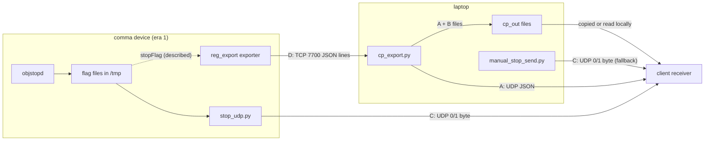
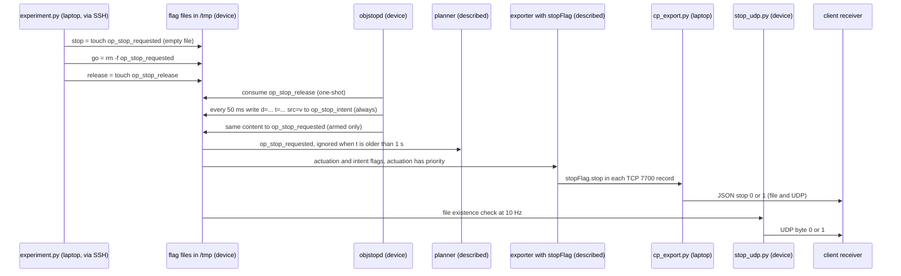

# Client interface specification

This is the contract between the OP4Anything tools and a client receiver, such as the client's STÄHLE TrackDriver wrapper. It defines four interfaces: **A** the segment JSON (file and UDP), **B** the STÄHLE curvepoint CSV, **C** the 0/1 stop byte over UDP, and **D** the raw TCP 7700 telemetry. For each it gives exact schemas, units, rates and failure modes, and the page ends with test tools and an example receiver. It is self-contained: you can implement a receiver from this page alone. [Curvepoints pipeline](05-curvepoints-pipeline.md) explains how the numbers are computed.

## At a glance

| Field | Value |
|---|---|
| **Audience** | Client integrators (the receiver side); operators who set up the link |
| **Runs on** | Producers: laptop (`cp_export.py`, `manual_stop_send.py`) and device (the reg_export exporter, objstopd, `stop_udp.py`). Receiver: the client's machine |
| **Era** | Defined during **Era 1 — sunnypilot 0.9.7.1** (2026‑07 → 2026‑08). The device-side producers are not installed on the **Era 2 — openpilot v0.11.1 `release-tizi` + dashcam‑anywhere** device (inferred; see [Scope and interface history](#scope-and-interface-history)) |
| **Status** | The reference contract for the code in this repo. A and B: current code, but they need the TCP 7700 stream. The `"stop"` field needs the deployed stopFlag exporter (not included). C: device sender historical, laptop fallback current. D: see [Telemetry stream](03-telemetry-stream.md) |
| **Key files** | [`cp_export.py`](../remote/Arman/cp_export.py), [`curvepoints.py`](../remote/Arman/curvepoints.py), [`frame.py`](../remote/Arman/frame.py), [`stop_udp.py`](../remote/Arman/stop_udp.py), [`manual_stop_send.py`](../remote/Arman/manual_stop_send.py), [`udp_snippet.py`](../remote/Arman/udp_snippet.py), [`_udp_probe.py`](../remote/Arman/_udp_probe.py), [`_udp_testsend.py`](../remote/Arman/_udp_testsend.py), [`stop_udp_watch.sh`](../remote/Arman/stop_udp_watch.sh), [`objstopd.py`](../remote/Arman/objstopd.py), [`_selftest_out/`](../remote/Arman/_selftest_out/) |

## Scope and interface history

**In scope:** everything a client receives (files, UDP datagrams, an optional stdout stream) and the meaning of every field.

**Out of scope:**

- how the device brakes (the actuation flag is internal to the device; see [Longitudinal stop command](07-longitudinal-stop.md));
- the client's own wrapper and TrackDriver;
- the client's "CP Definition of Curvepoints" PDF, which defines the target convention and is not included.

| Date | Change | Evidence |
|---|---|---|
| 2026‑07‑14 → 2026‑07‑17 | B (CSV) and A (segment JSON, **without** `"stop"`) defined; files and `--stdout` only | `cp_slides.html` slides 5–6 (last modified 2026‑07‑14); [`Arman/README.md`](../remote/Arman/README.md) (last modified 2026‑07‑17) |
| 2026‑07‑17 | Manual stop flag `/tmp/op_stop_requested` on the Civic (OP longitudinal) | [Longitudinal stop command](07-longitudinal-stop.md) |
| 2026‑07‑25 | objstopd v2: the flag carries `d=<m> t=<monotonic> src=v` | `STOP_SIGN_VISION.md` "v2 (2026-07-25)" |
| 2026‑08‑06 | objstopd v2.1 adds the intent flag `/tmp/op_stop_intent`; "exporter adds `stopFlag`; cp_export/UDP carry top-level `"stop": 0/1`"; UDP delivery (`--udp`) documented | `STOP_SIGN_VISION.md` "v2.1 (2026-08-06)"; [`objstopd.py`](../remote/Arman/objstopd.py) → `INTENT_FLAG`; [`OPERATIONS.md`](../remote/Arman/OPERATIONS.md) §2.2 and §3.2; [`udp_snippet.py`](../remote/Arman/udp_snippet.py) (the last three last modified 2026‑08‑06) |
| 2026‑08‑12 | Last change to `cp_export.py`; UDP test tools `_udp_probe.py` and `_udp_testsend.py` | last-modified dates |
| 2026‑08‑13 | C: the 0/1 byte stream (`stop_udp.py`, `stop_udp_start.sh`, `stop_udp_stop.sh`, `stop_udp_watch.sh`) and the laptop fallback `manual_stop_send.py` | last-modified dates |
| 2026‑08‑13 → 2026‑10‑03 | Device re-flashed to Era 2 at an unrecorded date in this window (the dashcam-anywhere patch is dated 2026‑10‑03); every era‑1 device change is gone | [Overview](01-overview.md) |

Dates are the original files' last-modified dates, except where a note states the date (the `STOP_SIGN_VISION.md` version headers do).

> [!WARNING]
> **Historical (sunnypilot era).** All device-side producers were installed on the era‑1 device:
>
> - the reg_export exporter (A, B and D);
> - objstopd and the deployed stopFlag exporter (`"stop"` in A);
> - `stop_udp.py` (C).
>
> The later re-flash to Era 2 removed them (its date is not recorded; it falls between 2026‑08‑13 and 2026‑10‑03), and nothing in `remote/Arman/dashcam_anywhere/` reinstalls them (inferred; verify with `nc -z $COMMA_IP 7700`). The laptop code and the laptop fallback sender are unaffected.

To get the device address used in the commands below:

```bash
# laptop
cd remote/Arman && export COMMA_IP=$(./find_comma.sh)   # or set it by hand: export COMMA_IP=192.168.1.231
```

## Interfaces at a glance

| ID | Interface | Producer (runs on) | Transport | Payload | Rate | Since |
|---|---|---|---|---|---|---|
| **A** | Segment JSON | `cp_export.py` (laptop) | file `track_live.json` / `route_track.json`; UDP datagram (`--udp`); stdout line (`--stdout`) | JSON `{"ref", "stop", "segments"}` | file ≤ 20 Hz (live) or every ~2 s (record); UDP ≤ 10 Hz | 2026‑07 (`"stop"` from 2026‑08‑06) |
| **B** | STÄHLE curvepoint CSV | `cp_export.py` (laptop) | file `track_live.csv` / `route_track.csv` | 2 `#` lines, header, 9 columns | as the A files | 2026‑07 |
| **C** | 0/1 stop byte | `stop_udp.py` (device, era 1) or `manual_stop_send.py` (laptop) | UDP datagram | one ASCII byte, `0` or `1` | 10 Hz, continuous | 2026‑08‑13 |
| **D** | Raw telemetry | reg_export exporter (device, era 1) | TCP 7700 | JSON lines, **openpilot conventions** | ~100 Hz | 2026‑07 |



## Common conventions

### Coordinate frame and origin

All positions in A and B are in the **STÄHLE / client ENU frame** (from the CP Definition PDF and the client's engineer):

- **x = East, y = North**, in metres, relative to the origin `ref`.
- **Up is computed and discarded.**
- **The origin is a WGS84 latitude/longitude fixed once at mission start** and never changed.

The conversion is the standard WGS84 geodetic → ECEF → local ENU rotation (`geodetic2ecef()`, `ecef2enu()` and `ENUOrigin` in [`frame.py`](../remote/Arman/frame.py)). Use it to project your own GPS positions into the same frame:

```text
a = 6378137.0 m        f = 1/298.257223563        e2 = f·(2 − f)
Rn(φ) = a / sqrt(1 − e2·sin²φ)
X = (Rn + h)·cos φ·cos λ      Y = (Rn + h)·cos φ·sin λ      Z = (Rn·(1 − e2) + h)·sin φ
dX, dY, dZ = ECEF(point) − ECEF(origin)            (φ0, λ0 = origin latitude, longitude)
x = E =  −sin λ0·dX + cos λ0·dY
y = N =  −sin φ0·cos λ0·dX − sin φ0·sin λ0·dY + cos φ0·dZ
```

Rules for the origin:

- **Fixed once per producer process.** `cp_export.py` takes the origin from `--ref-lat/--ref-lon` (with `--ref-alt`, default 0.0). Without them it locks the first fix it considers valid, which is any position other than (0, 0); GPS quality is not checked (erratum 14). A restart without `--ref-*` therefore locks a **new** origin. **Agree the mission origin with the operator and have it passed with `--ref-lat/--ref-lon` on every run.** The coordinate 37.7749295, −122.4194155 used throughout this repo is a neutral example. Always pass your own mission origin.
- **Repeated in every message.** Every A message repeats the origin in `ref` (latitude/longitude only). The B header repeats it with the altitude (`ref_lat`, `ref_lon`, `ref_alt`).
- **`ref` = (0.0, 0.0) means `--local-frame`.** The data are then body-fixed and **not** geo-referenced: every message places the vehicle at (0, 0) facing +y ("North" = vehicle forward, +x = vehicle right). If a GPS fix arrives later in the same run, positions are projected about lat/lon (0, 0) instead and jump to millions of metres (erratum 13).

> [!IMPORTANT]
> **With `--local-frame`, a real `ref` does not guarantee ENU.** The known `--local-frame` problems are listed in erratum 13; this one is in addition. Analysis (from code; not field-tested), reproduced with a synthetic stream: when `--local-frame` is combined with a real origin (`--ref-*`, or an earlier fix) and the GPS pose is lost, `cp_export.py` keeps sending body-fixed tracks under the real `ref`, with a spurious segment back to (0, 0). Without `--local-frame` this cannot happen, because nothing is sent while there is no pose. Agree with the operator that `--local-frame` is never used on runs you geo-reference.

### Angles, curvature and signs

| Quantity | Convention |
|---|---|
| θ (`theta_rad`, B) | radians. 0 = East, **counter-clockwise positive**, North = +π/2. Computed with `atan2`, nominally in (−π, π]; after rounding to 6 decimals both `3.141593` and `-3.141593` can occur, and both mean West |
| κ (`kappa_1pm`, B) | 1/m, **left (counter-clockwise) turn positive**. Values with \|κ\| < 1/200 are written as 0. The first and last points always have κ = 0 |
| `radius` (A) | metres, ≥ 0. `0.0` = straight. An arc radius is at most 200 m (arcs need \|κ\| ≥ 1/200) |
| `direction` (A) | `"left"` or `"right"`; meaningful **only when radius > 0** |

### Units

| Quantity | A: segment JSON | B: curvepoint CSV | C: stop byte |
|---|---|---|---|
| Position | m (`x` East, `y` North) | m (`PositionX_East_m`, `PositionY_North_m`) | — |
| Speed | **m/s** (`velocity`) | **kph** (`velocity_kph`) | — |
| Heading | — | rad (`theta_rad`) | — |
| Curvature | `radius` (m) + `direction` | 1/m (`kappa_1pm`) | — |
| Time | — | s (`Deltatime_s`) | — |
| Longitudinal acceleration | — | m/s² (`long_accel_mss`, always 0.0) | — |
| Origin | deg (`ref.latitude`, `ref.longitude`) | deg and m in the header (`ref_lat`, `ref_lon`, `ref_alt`) | — |
| Stop | integer `0` / `1` | — | ASCII `0` / `1` |

OPERATIONS §6 (translated): "Units: segments velocity = m/s; STÄHLE csv velocity = kph. Final segment velocity = 0.0 = stop at the end point." The m/s choice for A is an open question to the client ([Open questions](#open-questions-to-the-client)).

### Numeric format and precision

| Value | Decimals | Resolution |
|---|---|---|
| A `x`, `y`; B `PositionX_East_m`, `PositionY_North_m` | 4 | 0.1 mm |
| A `velocity`, `radius` | 3 | 1 mm/s, 1 mm |
| B `velocity_kph` | 3 | 0.001 kph |
| B `Deltatime_s` | 4 | 0.1 ms |
| B `theta_rad`, `kappa_1pm` | 6 | 1e-6 |
| `ref` latitude/longitude, B `ref_alt` | not rounded by `cp_export.py` | a first-fix origin carries the exporter's 7 decimals (lat/lon) and 2 decimals (alt) |

Precision is not accuracy. The inputs are quantized upstream: lat/lon to 7 decimals (1e-7° ≈ 1.1 cm of latitude), yaw to 5 decimals, model positions and speeds to 3 decimals. The real accuracy is that of the GPS/locationd pose, typically metres.

All numbers are written by Python (`str()` for the CSV, `json.dumps()` for the JSON):

- the shortest round-trip form, so trailing zeros are dropped (`0.2999`, `28.8`);
- floats always carry a decimal point or an exponent (`8.0`, `0.0`);
- **exponent notation can appear** (`1.2e-05`, typically for a θ close to 0);
- **negative zero (`-0.0`) occurs** in normal output;
- `gear` and `index` in B are integers (`99`, `0`).

Parse with a full float parser and never assume a fixed number of decimals.

### Encoding

- **Character set.** All content is ASCII, which is valid UTF-8. `json.dumps()` escapes non-ASCII by default, the only strings are `"left"` and `"right"`, and the CSV header writes `STAHLE` without the umlaut. UDP payloads are explicitly `.encode("utf-8")`.
- **Line endings.** The files use LF when produced on Linux, as on the project laptop. The CSV ends with a newline. The JSON file has **no** trailing newline.

## Interface A: segment JSON

### Message structure

Built by `write_segments_json()` (file) and the nested `udp_send()` in `run()` (UDP) of [`cp_export.py`](../remote/Arman/cp_export.py), from `to_segments()` in [`curvepoints.py`](../remote/Arman/curvepoints.py).

| Path | JSON type | Unit | Meaning and guarantees |
|---|---|---|---|
| `ref` | object | — | the mission origin |
| `ref.latitude` | number | deg (WGS84) | origin latitude; `0.0` together with longitude `0.0` = local frame |
| `ref.longitude` | number | deg (WGS84) | origin longitude |
| `stop` | integer | — | `1` = a stop is commanded or intended, `0` = drive. See [Stop semantics](#stop-semantics) |
| `segments` | array | — | ordered along the track, from the oldest/rearmost point forward. **May be empty** |
| `segments[i].start` | object `{x, y}` | m | ENU position of the segment's first point |
| `segments[i].end` | object `{x, y}` | m | ENU position of its last point; **identical to `segments[i+1].start`** (segments share boundary points) |
| `segments[i].velocity` | number | m/s | mean speed of the segment's points; each point speed is floored at 0.3 m/s, so ≥ 0.3, except the last segment (next row) |
| (last segment) `velocity` | number | m/s | set to `0.0` when the last segment's **mean** speed ≤ 0.35 m/s |
| `segments[i].radius` | number | m | `0.0` = straight; arc: 1 / mean(\|κ\|) over its points with \|κ\| ≥ 1/200, so ≤ 200 |
| `segments[i].direction` | string | — | `"left"` / `"right"`; ignore it when `radius` is 0 |

Key order is fixed (`ref`, `stop`, `segments`; `start`, `end`, `velocity`, `radius`, `direction`), but do not rely on it. Test traffic adds keys (`test`, `seq`, `ts`), so ignore unknown keys.

The JSON examples in [`Arman/README.md`](../remote/Arman/README.md) and on slide 6 of `cp_slides.html` predate `"stop"` (erratum 23); this table supersedes them.

### Track semantics

- **Live mode (`track_live.*`):** the path openpilot plans ahead of the vehicle, placed in ENU at the current GPS pose. Each message **replaces** the previous one; there are no deltas.
  - **The first points can be up to 5 ego-history points behind the vehicle.** Each history point is at least 1 m from the next, so a live track typically starts a few metres behind the vehicle.
  - **The vehicle's current position is not in the message.** Localize the vehicle on the track with your own pose.
- **Record mode (`route_track.*`):** the whole driven GPS route since `cp_export.py` started. It grows with every update.
- **Point spacing** before segmentation follows the distance rule d = clip(0.3·v, 0.6, 5) m.
- **Straight segments** have `radius` 0.0 and a meaningless `direction`. The code writes `"left"` when the curvature sum is ≥ 0, which is usually the case.
- **Short runs are merged.** A run of fewer than 3 points with a different label is merged into its neighbour, so short wiggles do not create segments. The radius is a mean over the run, which includes transition points. The code calls the split "an approximation of a proper spline fit — the client's own wrapper is authoritative".
- **Final velocity 0.0** means the **whole last segment** averages ≤ 0.35 m/s (client convention "velocity 0 at the end = stop there"). It is **not** a test of the speed at the end. Analysis (from code; not field-tested): a 29 m straight track whose speed falls linearly from 5 m/s to 0 at 25 m and stays 0 to the end comes out as one segment with velocity 1.761, not 0.0. A non-zero final velocity therefore does not prove the track continues (A-item A10 in [16](16-errata-and-crosswalk.md#additional-inconsistencies-found-in-this-review)).
- **No timestamp and no sequence number.** Use the arrival time (UDP) or the file's modification time.

### JSON example

The committed sample [`_selftest_out/selftest.json`](../remote/Arman/_selftest_out/selftest.json), regenerated by `cp_export.py --selftest` with the neutral origin, is the exact file format (pretty-printed, 2-space indent, no trailing newline):

```json
{
  "ref": {
    "latitude": 37.7749295,
    "longitude": -122.4194155
  },
  "stop": 0,
  "segments": [
    {
      "start": {
        "x": 0.0,
        "y": 0.0
      },
      "end": {
        "x": 38.0,
        "y": 28.88
      },
      "velocity": 8.0,
      "radius": 49.644,
      "direction": "left"
    }
  ]
}
```

The same message as a UDP datagram (compact, 183 bytes):

```text
{"ref":{"latitude":37.7749295,"longitude":-122.4194155},"stop":0,"segments":[{"start":{"x":0.0,"y":0.0},"end":{"x":38.0,"y":28.88},"velocity":8.0,"radius":49.644,"direction":"left"}]}
```

A two-segment datagram (307 bytes), computed for this doc with the repo's `build_track()`. The input is an S-curve: a left arc of radius 20 m, then a right arc of radius 20 m, at 8 m/s. `"stop"` is set to 1 for illustration:

```text
{"ref":{"latitude":37.7749295,"longitude":-122.4194155},"stop":1,"segments":[{"start":{"x":0.0,"y":0.0},"end":{"x":18.7859,"y":26.8447},"velocity":8.0,"radius":20.803,"direction":"left"},{"start":{"x":18.7859,"y":26.8447},"end":{"x":37.1584,"y":54.8072},"velocity":8.0,"radius":20.919,"direction":"right"}]}
```

### File delivery

| Property | Value |
|---|---|
| Path | `<out-dir>/track_live.json` (live) or `<out-dir>/route_track.json` (record). `--out-dir` defaults to `./cp_out`, relative to where `cp_export.py` runs |
| Format | pretty-printed JSON (`indent=2`), no trailing newline |
| Atomicity | written to `<file>.tmp`, then `os.replace()`: a reader never sees a partial file; ignore `*.tmp` |
| Live rate | rewritten on each new track, at most every 50 ms (≤ 20 Hz) |
| Record rate | about every 2 s (once ≥ 3 route points exist) and once more at Ctrl‑C |
| Pairing | the CSV (B) is replaced just before the JSON, not atomically as a pair |
| Delivery to the client | by copying (OPERATIONS §8: "the json/csv in `cp_out/` are the deliverables; copy them away to archive"), or by reading the folder on the laptop |

Analysis (from code; not field-tested):

- **The files are never deleted.** After `cp_export.py` stops (or loses GPS or the model), the last files stay as they were.
- **Old files survive into the next run.** A new run overwrites them only when it writes its first track.
- **Check freshness yourself.** Judge it by the file's modification time, because the content has no timestamp.

### UDP delivery

| Property | Value |
|---|---|
| Enable | `cp_export.py ... --udp HOST[:PORT]`. A bare host uses `--udp-port` (default **5005**). The value is split at the last `:` |
| Socket | IPv4 (`AF_INET`), unconnected, ephemeral source port |
| Payload | one complete JSON message per datagram, compact (`separators=(",", ":")`), UTF-8, no header, no framing, no compression |
| Rate | at most `--udp-hz` (default **10 Hz**). An update arriving sooner than `1/udp_hz` s after the last send is **dropped, not queued**. The minimum interval is `1/max(udp_hz, 0.1)` s |
| Live mode | one datagram per new track, subject to the rate limit (Analysis (from code; not field-tested): ~9.8/s measured on a synthetic stream made for this doc) |
| Record mode | at most one datagram per emit (about every 2 s), carrying the whole route, with `"stop": 0` |
| Size limit | payloads over **60,000 bytes are skipped** (`[cp_export] UDP payload <n>B too large, skipped` on the sender's stderr). One segment is about 104 bytes, so only very long record-mode routes hit it (Analysis (from code; not field-tested): roughly 570 segments) |
| Reliability | no sequence number, no acknowledgement, no retransmission. Errors on the sender side are only local ones (`[cp_export] UDP send failed: <error>`); a missing listener is **not** reported |
| Silence | nothing is sent while `cp_export.py` has no GPS pose (unless `--local-frame`) or no modelV2 trajectory, or while the TCP 7700 stream is down |

OPERATIONS §6 (translated) sums up the same contract: "UDP: one UTF-8 JSON per datagram, ≤10 Hz, format = `{ref:{latitude,longitude}, "stop":0|1, segments:[{start,end,velocity,radius,direction}]}`". [`udp_snippet.py`](../remote/Arman/udp_snippet.py) says "Typical payload is a few hundred bytes; we skip (never fragment) anything > 60 kB".

Analysis (from code; not field-tested): "never fragment" refers to splitting a message across datagrams. A datagram larger than the path MTU payload (1472 bytes on standard 1500-byte Ethernet/Wi‑Fi, i.e. about a dozen segments) is still fragmented by IP, and losing any fragment loses the whole datagram.

### Stdout delivery

`--stdout` (live mode only; it has no effect in record mode) prints each new track as one JSON line, with Python's default separators (`", "` and `": "`) and **no rate limit** (one line per modelV2 update, ~20 Hz). The same stdout also carries the `[cp_export] ...` heartbeat and `[stream] ...` lines, so **keep only lines that start with `{`**.

### The review snippet sent to the client

[`udp_snippet.py`](../remote/Arman/udp_snippet.py) is a short English file written for the client's review (OPERATIONS §6: "code snippet and explanation: `udp_snippet.py` (English, can be sent as-is)"). Its docstring describes the wire format above and asks the [open questions](#open-questions-to-the-client).

- **Its `send_track()` omits `"stop"`** (erratum 11), although the docstring includes it. The authoritative payload builder is `udp_send()` in `cp_export.run()`.
- **Its demo sends to an example receiver.** The module constants `UDP_HOST, UDP_PORT = "192.168.1.50", 5005` and `SEND_HZ = 10.0` are example values. Running the file as a script sends a two-segment demo track there once per second, so edit the address first.

### Formal schema

A JSON Schema (draft 2020-12) derived from `write_segments_json()` and `to_segments()`. It was written for this specification and is not shipped by the original project. Additional properties are allowed on purpose (test traffic adds `test`, `seq`, `ts`).

```json
{
  "$schema": "https://json-schema.org/draft/2020-12/schema",
  "title": "OP4Anything segment JSON (cp_export.py)",
  "type": "object",
  "required": ["ref", "stop", "segments"],
  "properties": {
    "ref": {
      "type": "object",
      "required": ["latitude", "longitude"],
      "properties": {
        "latitude":  {"type": "number", "minimum": -90,  "maximum": 90},
        "longitude": {"type": "number", "minimum": -180, "maximum": 180}
      }
    },
    "stop": {"type": "integer", "enum": [0, 1]},
    "segments": {
      "type": "array",
      "items": {
        "type": "object",
        "required": ["start", "end", "velocity", "radius", "direction"],
        "properties": {
          "start":     {"$ref": "#/$defs/point"},
          "end":       {"$ref": "#/$defs/point"},
          "velocity":  {"type": "number", "minimum": 0},
          "radius":    {"type": "number", "minimum": 0, "maximum": 200},
          "direction": {"enum": ["left", "right"]}
        }
      }
    }
  },
  "$defs": {
    "point": {
      "type": "object",
      "required": ["x", "y"],
      "properties": {"x": {"type": "number"}, "y": {"type": "number"}}
    }
  }
}
```

`cp_export.py` writes `"stop"` as `int()` of the exporter's `stopFlag.stop`, which the notes document as 0/1.

### Stop semantics

`"stop"` tells the client whether the vision/stop system wants the vehicle stopped. OPERATIONS §2.2 (translated): "1 = the vehicle is being commanded to stop (vision-triggered or manual); 0 = normal driving / pulling away". OPERATIONS §3.2 (translated): "objstopd writes the 'intent flag' even in shadow — when it detects that it should stop (stop sign / red light / pedestrian) → top-level `"stop":1` in the JSON/UDP; when it recovers → `0`. The client can use it directly to drive the truck's own braking."

Where the value comes from:

1. **objstopd writes flag files on the device.** On every ~50 ms tick of its main loop it calls `write_flag()`. While its state machine wants a stop (states BRAKING, STOPPED_SIGN, STOPPED_RED, STOPPED_PED) it writes `d=<metres to the stop line, %.2f> t=<device monotonic s, %.3f> src=v`. `d=0.00` means "stop now".
   - `/tmp/op_stop_intent` is written **always**, including in shadow mode.
   - `/tmp/op_stop_requested` (the actuation flag) is written only with `--arm`.
   - In DRIVING and RESUMING it deletes the file(s) it writes, but only if they contain `src=v`. A shadow instance never touches the actuation file, so it leaves a manual (empty) stop file alone.
   - An **armed** instance can take over a manual stop (Analysis (from code; not field-tested)). When it starts its own stop, `os.replace()` overwrites the empty file with `src=v` content. When that stop ends, objstopd deletes the file, which cancels the manual stop too. See [07](07-longitudinal-stop.md#edge-cases) and [08](08-vision-stop-objstopd.md#actuation-flag).
2. **The deployed exporter turns the flags into `stopFlag.stop`** in each TCP 7700 record (described, not included).
3. **`cp_export.py` copies the latest `stopFlag.stop`** into `"stop"` (live mode). Records without `stopFlag` leave the last value unchanged; it starts at 0.
4. **Interface C is independent of steps 2–3.** `stop_udp.py` reads the same two files and sends `1` if either exists.

> [!NOTE]
> **Described, not included.** The deployed exporter variants that add the `stopFlag` block are not in this repository:
>
> - the stopFlag exporter at `/data/openpilot/tools/reg_export/exporter.py` on the Civic;
> - `/data/objstop/exporter_nocan.py` for no-CAN mode.
>
> OPERATIONS §0 says the stream carries `stopFlag.stop=0/1`. OPERATIONS §3.2 says manual `experiment.py stop/go` keep working because the "actuation flag has priority" over the intent flag. How exactly the exporter combines the two files (existence only, or also parsing `t=` for staleness) is not recorded. In the table below, the JSON column follows those notes; the 0/1-byte column follows the code of `stop_udp.py`.



| Situation | Flag files on the device | JSON `"stop"` (A) | 0/1 byte (C) |
|---|---|---|---|
| **Normal driving.** objstopd in DRIVING or RESUMING, no manual stop | actuation absent, intent absent | `0` | `0` |
| **objstopd decides to stop, shadow mode** (the default, no `--arm`): BRAKING, STOPPED_SIGN, STOPPED_RED or STOPPED_PED | intent present, rewritten every ~50 ms; actuation absent | `1`: **intent only, nothing brakes** | `1` |
| **objstopd decides to stop, armed** (`--arm`) | actuation and intent present, same content | `1` | `1` |
| **Manual `experiment.py stop`** | actuation created **empty** by `touch` (if it already exists, only its timestamp changes); intent unchanged. An armed objstopd that starts its own stop takes the file over (see step 1 above) | `1` ("actuation has priority", described) | `1` |
| **After `experiment.py go`** | actuation removed (`rm -f`), whoever wrote it; intent **unchanged**. An armed objstopd that is still holding rewrites the actuation file within ~50 ms | `0` only if vision is not holding; otherwise stays `1` | `0` only if the intent file is absent too |
| **After `experiment.py release`** while objstopd holds | objstopd consumes `/tmp/op_stop_release`, enters RESUMING and deletes its own (`src=v`) files | `0`, unless a manual empty actuation file remains (described) | `0`, unless a manual empty actuation file remains |
| **objstopd stopped with Ctrl‑C or SIGTERM** | its `src=v` files are deleted ("flags cleared"); a manual empty file is kept | per the remaining files | per the remaining files |
| **objstopd killed with SIGKILL, crashed, hung, or ended by the hang-up of its SSH session** | stale files stay until removed or until reboot. The planner ignores an actuation file whose `t` is older than 1 s (described) | **unknown**: depends on whether the deployed exporter checks `t` (not included) | **stays `1`** |
| **Device reboot** | `/tmp` is cleared | `0` | no datagrams until the sender is started again (it does not autostart) |
| **`cp_export.py --mode record`** | — | **always `0`** (erratum 12) | not affected |
| **Baseline exporter of this repo** (`exporter_device.py`, no `stopFlag`) | — | **always `0`** (erratum 9) | not affected (C reads the files directly) |
| **No CAN (truck/bench, era 1), stop sign in view.** Analysis (from code; not field-tested) | intent present ≈ 3.05–3.1 s, then absent ≈ 15.1–15.5 s; repeats while the sign stays in view | `1` pulses, via the no-CAN exporter (described) | `1` for ≈ 3.05–3.1 s, repeating every ≈ 18.15–18.6 s |

Notes on the table:

- **`release` has no effect outside a hold.** A release sent while objstopd is in DRIVING or RESUMING is consumed without effect. `go` does not release a vision hold, `release` does (erratum 25).
- **Recovering from stale files** (Analysis (from code; not field-tested)):
  - Restarting objstopd deletes a stale **intent** file on its first DRIVING tick (it contains `src=v`).
  - A **shadow** instance never touches the actuation file, so a stale actuation file left by an armed run stays until you remove it.
  - The clean fixes are `ssh comma@$COMMA_IP 'rm -f /tmp/op_stop_requested /tmp/op_stop_intent'` from the laptop, or a device reboot. Removing the actuation file is what `experiment.py go` does, so it also ends a manual stop: on an engaged era‑1 Civic with OP long, the car can move off. Do it with a driver ready.
- **The no-CAN row** (Analysis (from code; not field-tested); the state machine was also stepped in a simulation for this doc):
  - **Why v stays 0.** Without CAN there is no carState, so objstopd's `v_ego` stays 0.
  - **The latch.** A stop sign confirmed by ≥ 3 detections between 3 and 90 m ahead (more than 3.5 m, so that the 3 m setback leaves > 0.5 m) latches immediately. The dilemma-zone check computes a required deceleration of 0 at v = 0.
  - **The pulse.** BRAKING lasts one 50 ms tick, then STOPPED_SIGN. After `--wait-sec` (3 s) objstopd goes to RESUMING, which ends only on its 15 s timer, because odometry never advances. Back in DRIVING it latches again while the sign is still tracked.
  - **Result.** A `1` pulse of ≈ 3.05–3.1 s every ≈ 18.15 s, or ≈ 18.6 s when the sign is closer than 12 m (RESUMING ignores new detections closer than 12 m, so the track is rebuilt from 3 hits in DRIVING; simulated with detections at 5 Hz). The pulse length does **not** depend on the distance to the sign.
  - **Red lights and pedestrians.** A red light confirmed more than 10.5 m ahead (the 10 m setback + 0.5 m) gives `1` until a green is confirmed or an operator `release` arrives; without CAN there is no gas-pedal override. The `0` that follows lasts only for RESUMING (15 s at v = 0): a light that is still red and more than 10.5 m away then latches again. A pedestrian gives `1` from the second sighting within 1 s until 1.5 s after the last sighting.
  - **Context.** OPERATIONS §3.3 already notes, translated: "no vEgo → the distance KF has no dead reckoning, so the distance estimate is less accurate (detection itself is unaffected)".

> [!CAUTION]
> **Not safety-rated.** `"stop"` and the 0/1 byte come from an experimental camera detector and simple flag files. They are **not** safety-rated. A receiver that brakes a vehicle on them needs its own independent safety layer, and must define its own behaviour for silence, stale values and false triggers. Without CAN, the dilemma-zone guard is ineffective (it computes with v = 0), and the pulse timing is not tied to the stop line.

## Interface B: curvepoint CSV

### CSV layout

Written by `write_stahle_csv()` in [`cp_export.py`](../remote/Arman/cp_export.py) from `to_stahle_rows()` in [`curvepoints.py`](../remote/Arman/curvepoints.py), to `<out-dir>/track_live.csv` (live) or `<out-dir>/route_track.csv` (record). It is updated at the same moments as the A file, with the same atomic `.tmp` + `os.replace()`. The layout:

1. **Line 1** (`#`): `# STAHLE TrackDriver curvepoints  ref_lat=<lat> ref_lon=<lon> ref_alt=<alt>`. There are two spaces before `ref_lat`, and the values are Python floats.
2. **Line 2** (`#`, constant): `# frame: x=East y=North theta=CCW-from-East(rad) kappa=left-positive(1/m) velocity=kph`.
3. **Line 3**, the column header: `Deltatime_s,velocity_kph,gear,index,PositionX_East_m,PositionY_North_m,theta_rad,kappa_1pm,long_accel_mss`.
4. **One data row per curvepoint:** 9 comma-separated values, no quoting, no spaces, LF line ends, and a final newline.

The code calls it the STÄHLE "10000" layout, and [`Arman/README.md`](../remote/Arman/README.md) says: 'This is the "10000" layout the robot consumes directly.' The term comes from the client's PDF, which is not included. The CSV is a file only; it is never sent over UDP.

### CSV columns

| # | Column | Type | Unit | Value |
|---|---|---|---|---|
| 1 | `Deltatime_s` | float, 4 decimals | s | `0.0` on the first row. Otherwise the distance from the previous point divided by **this point's** speed: `hypot(ΔE, ΔN) / v_i` |
| 2 | `velocity_kph` | float, 3 decimals | kph | `max(v_i, 0.3 m/s) · 3.6`, so always ≥ 1.08. **kph, unlike A** |
| 3 | `gear` | integer | — | always `99` |
| 4 | `index` | integer | — | 0-based row number |
| 5 | `PositionX_East_m` | float, 4 decimals | m | East of `ref` |
| 6 | `PositionY_North_m` | float, 4 decimals | m | North of `ref` |
| 7 | `theta_rad` | float, 6 decimals | rad | tangent heading, East = 0, CCW+ (central difference; one-sided at the ends) |
| 8 | `kappa_1pm` | float, 6 decimals | 1/m | curvature through the point and its neighbours, left-positive; `0.0` at both ends and wherever \|κ\| < 1/200 |
| 9 | `long_accel_mss` | float | m/s² | always `0.0` ("recalculated by TrackDriver", per the `to_stahle_rows()` docstring) |

Rows are spaced by the distance rule d = clip(0.3·v, 0.6, 5) m, and the last gap can be shorter. In live mode the first rows can lie behind the vehicle (ego history). Positions are the unsmoothed resampled points. The optional `--smooth` (default 5 in record mode) only affects θ and κ.

### CSV example

[`_selftest_out/selftest.csv`](../remote/Arman/_selftest_out/selftest.csv), complete (regenerated by `cp_export.py --selftest`; neutral origin; a left-curving path at 8 m/s):

```text
# STAHLE TrackDriver curvepoints  ref_lat=37.7749295 ref_lon=-122.4194155 ref_alt=0.0
# frame: x=East y=North theta=CCW-from-East(rad) kappa=left-positive(1/m) velocity=kph
Deltatime_s,velocity_kph,gear,index,PositionX_East_m,PositionY_North_m,theta_rad,kappa_1pm,long_accel_mss
0.0,28.8,99,0,0.0,0.0,0.05316,0.0,0.0
0.2999,28.8,99,1,2.3956,0.1275,0.099021,0.03823,0.0
0.2998,28.8,99,2,4.7688,0.4738,0.189171,0.036912,0.0
0.2998,28.8,99,3,7.1021,1.0286,0.275413,0.03498,0.0
0.2998,28.8,99,4,9.3808,1.7771,0.356491,0.032606,0.0
0.2999,28.8,99,5,11.5944,2.7015,0.431564,0.02997,0.0
0.2999,28.8,99,6,13.7361,3.7828,0.500199,0.027234,0.0
0.2999,28.8,99,7,15.803,5.0018,0.562311,0.024529,0.0
0.3,28.8,99,8,17.7946,6.3403,0.618082,0.021948,0.0
0.3,28.8,99,9,19.713,7.7819,0.667876,0.019549,0.0
0.3,28.8,99,10,21.5617,9.3118,0.712168,0.017363,0.0
0.2999,28.8,99,11,23.345,10.9174,0.751478,0.0154,0.0
0.2999,28.8,99,12,25.0677,12.5877,0.786339,0.013654,0.0
0.2999,28.8,99,13,26.7348,14.3136,0.817258,0.012115,0.0
0.3,28.8,99,14,28.3511,16.0873,0.845566,0.011477,0.0
0.3,28.8,99,15,29.9182,17.9051,0.874879,0.012952,0.0
0.3,28.8,99,16,31.428,19.7707,0.900685,0.008553,0.0
0.3,28.8,99,17,32.899,21.6667,0.92008,0.00761,0.0
0.3,28.8,99,18,34.3352,23.5893,0.93988,0.00889,0.0
0.3,28.8,99,19,35.7302,25.5422,0.961047,0.00875,0.0
0.3,28.8,99,20,37.0838,27.524,0.973589,0.0,0.0
0.2046,28.8,99,21,38.0,28.88,0.976583,0.0,0.0
```

Row 20 shows the straight snap: its |κ| is below 1/200, so it is written as 0. Row 21 is the end point (κ = 0 by construction), reached after a short final gap of 0.2046 s.

### Reading the CSV

An example reader, written for this doc (stdlib; tested on the sample above):

```python
import csv

def read_stahle_csv(path):
    """Return (ref, rows): ref = {'ref_lat':..,'ref_lon':..,'ref_alt':..}, rows = list of dicts of floats."""
    with open(path, newline="") as f:
        first = f.readline()   # "# STAHLE TrackDriver curvepoints  ref_lat=.. ref_lon=.. ref_alt=.."
        ref = {k: float(v) for k, v in (t.split("=", 1) for t in first.split() if "=" in t)}
        body = (line for line in f if not line.startswith("#"))
        rows = [{k: float(v) for k, v in r.items()} for r in csv.DictReader(body)]
    return ref, rows
```

With pandas, `pd.read_csv(path, comment="#")` skips both `#` lines.

## Interface C: 0/1 stop byte

### Payload and timing

| Property | Value |
|---|---|
| Payload | exactly **one ASCII byte**: `0x30` (`"0"`, drive/resume) or `0x31` (`"1"`, the vision/stop system wants the vehicle stopped). No newline, header or framing |
| Transport | UDP over IPv4, unconnected socket, to `HOST:PORT` |
| Rate | sent **continuously** at `--hz` (default 10 Hz), whether or not the value changes |
| Meaning of `1` | `/tmp/op_stop_requested` **or** `/tmp/op_stop_intent` exists on the device (`stop_now()` in [`stop_udp.py`](../remote/Arman/stop_udp.py)); the laptop fallback sends whatever the operator chose |
| Liveness | the steady 10 Hz rate makes silence detectable (see [Watchdog](#watchdog)) |

Because the byte is re-sent continuously and is idempotent, a lost or duplicated datagram does no harm. It has no sequence number or timestamp.

### Senders

**Device sender** ([`stop_udp.py`](../remote/Arman/stop_udp.py), era 1). The docstring says it "RUNS ON THE COMMA. Send ONLY "0" or "1" over UDP, nothing else".

- **CLI.** `stop_udp.py HOST PORT [--hz HZ]`: host and port are required; `--hz` defaults to 10 (minimum 0.1).
- **Behaviour.** It prints one start-up line, `[stop_udp] -> HOST:PORT  10 Hz  (payload: '0' / '1' only)`, and silently ignores send errors.
- **Start and stop.** It is started detached from the laptop with `stop_udp_start.sh DEST_IP DEST_PORT [HZ]`, which logs to `/tmp/stop_udp.log` and installs `stop_udp.py` to `/data/objstop/` if it is missing. `stop_udp_stop.sh` stops it.
- **Caveats of the launch scripts.** Both scripts hard-code the comma at `172.20.10.3` (erratum 5). In `stop_udp_start.sh` the `find_comma.sh` call is commented out, although its header still says it finds the comma automatically. `stop_udp_stop.sh` just sets `IP=172.20.10.3` and makes no discovery claim. `stop_udp_start.sh` also hard-codes the era‑1 interpreter `/usr/local/pyenv/versions/3.11.4/bin/python3`.
- See [0/1 stop signal over UDP](09-stop-signal-udp.md).

```bash
# laptop  (in remote/Arman; era-1 device only; first edit IP=172.20.10.3 in both scripts to your device's address)
./stop_udp_start.sh 192.168.1.50 5006        # comma -> 192.168.1.50:5006, 10 Hz
./stop_udp_stop.sh
```

**Laptop fallback** ([`manual_stop_send.py`](../remote/Arman/manual_stop_send.py)). The docstring, translated: "fallback sender, runs directly on the LAPTOP. Bypasses the comma and objstopd; the laptop itself sends "0"/"1" to the receiver; the protocol is exactly the same as `stop_udp.py` on the device: each datagram payload is a single ASCII byte b"0" or b"1"." It imports `termios` and `tty` for its hotkeys, so it runs on Linux and macOS, not on Windows.

| Argument | Default | Meaning |
|---|---|---|
| `host` (positional) | `172.20.10.2` | receiver. The docstring wrongly says `.3` (erratum 6), so pass it explicitly |
| `port` (positional) | `5005` | receiver port |
| `--hz` | `10.0` | send rate (minimum 0.01) |
| `--value {0,1}` | **`1`** | initial payload. **Started without `--value 0`, it immediately sends "stop"** |
| `--duration N` | `0` | exit after N s (0 = run until stopped) |
| `--pulse N` | `0` | switch the payload to `0` once, N s after the start, and keep sending. The first N s carry `--value` (default `1`), so `--pulse 3 --value 0` sends `0` throughout. The help text says "first send '1' for N seconds" |

Hotkeys when the terminal is a tty: `1` = send 1, `0` = send 0, space = toggle, `q` / Ctrl‑C = quit. It prints a status line once per second.

> [!CAUTION]
> **It sends "stop" from the first datagram unless you pass `--value 0`.** A receiver that brakes on `1` reacts at once. To go back to drive, press `0` (or Space). Quitting (`q`, Ctrl‑C or `--duration`) sends nothing more: the receiver then hears silence, not `0`, so switch to `0` before you quit (see [Watchdog](#watchdog)).

```bash
# laptop  (in remote/Arman)
python3 manual_stop_send.py 192.168.1.50 5006 --value 0          # steady "0"
python3 manual_stop_send.py 192.168.1.50 5006 --pulse 3          # "1" for 3 s, then "0"
```

### Caveats of the 0/1 byte

- **It checks only whether a file exists.** A crashed or SIGKILLed objstopd, or one ended by the hang-up (SIGHUP) of its closed SSH session, leaves its files behind, and the byte **stays `1`** although the planner already ignores the stale actuation flag (> 1 s). A manual empty actuation file also gives `1` (erratum 25).
- **`0` does not prove that the vision system is running.** If objstopd is not running there are no files, and the sender reports `0`.
- **`experiment.py go` does not clear the intent flag.** While objstopd holds, the byte stays `1`; use `release` (erratum 25).
- **Era.** The device sender existed only on the era‑1 device. On Era 2 neither objstopd nor `stop_udp.py` is installed (inferred). The laptop fallback works with any device.

## Interface D: raw TCP 7700 telemetry

> [!IMPORTANT]
> **Not a client interface.** TCP 7700 is a developer telemetry stream in **openpilot's own conventions**. Do not feed it to a STÄHLE consumer without the transforms in [Curvepoints pipeline](05-curvepoints-pipeline.md). The differences:
>
> - car frame x = forward, y = right, z = down;
> - openpilot curvature is right-positive (per [`Arman/README.md`](../remote/Arman/README.md));
> - the heading is NED yaw (0 = North, clockwise);
> - speeds are in m/s, except the set speed `vCruise` (in `carState` and `controlsState`), which is in km/h;
> - one compact JSON object per line, one per carState frame (~100 Hz);
> - heavy arrays only on 20 Hz update frames;
> - per-block `_upd` / `_valid` / `_mono` / `_err`;
> - the baseline exporter has no `stopFlag` (erratum 9).
>
> The full schema is in [Telemetry stream](03-telemetry-stream.md#record-schema).

## Receiver guidance

### Parsing rules

1. **Socket buffer.** Bind a UDP socket and read with a buffer of at least 65,535 bytes (A datagrams are ≤ 60,000 bytes).
2. **One datagram, one message.** Never join datagrams.
3. **Tell A and C apart by length first.** A 1-byte datagram `0`/`1` is C; everything else is UTF-8 JSON (A). `0` and `1` are also valid JSON numbers, so a JSON-first parser would misread C.
4. **Ignore unknown keys.** Test datagrams from `_udp_testsend.py` carry `"test": true`, `"seq"` and `"ts"` (A-item A7 in [16](16-errata-and-crosswalk.md#additional-inconsistencies-found-in-this-review)). Drop datagrams without a `segments` array, such as `{"probe": N}` from `_udp_probe.py`. Treat `"test": true` as test traffic.
5. **Snapshots, not deltas.** Each A message replaces the previous track.
6. **Order.** There is no sequence number. UDP can reorder or duplicate, though rarely on a LAN at ≤ 10 Hz; the latest arrival wins.
7. **Check `ref`.** Compare it with the agreed mission origin and alert on a change (a restarted producer may have locked a new origin). `(0.0, 0.0)` means local frame.
8. **`stop`.** Treat any non-zero value as stop. If it is missing, assume 0; `cp_export.py` always sends it, but `udp_snippet.py`'s `send_track()` does not.
9. **`segments`.** It can be empty. Segments are contiguous. A straight has radius 0 and its `direction` must be ignored. A final velocity of 0.0 means the last segment averages ≤ 0.35 m/s.
10. **Numbers.** Use a full float parser (exponents, `-0.0`).
11. **Files.** Read the whole file after it changes, ignore `*.tmp`, and use the file's modification time for freshness. The CSV and the JSON are not replaced as a pair.

### Example receiver

Written for this specification (stdlib, Python 3.6+). It is not part of the original project and has not been field-tested. It was checked on loopback against `_udp_probe.py`, `_udp_testsend.py`, single `0`/`1` bytes, a malformed datagram and real `cp_export.py` UDP output from a synthetic stream.

```python
#!/usr/bin/env python3
"""Example receiver for interface A (segment JSON) and interface C (0/1 byte).
Written for this specification; not part of the original project; not field-tested."""
import json
import socket
import sys
import time

PORT = int(sys.argv[1]) if len(sys.argv) > 1 else 5005
EXPECTED_REF = None      # (lat, lon) of your mission origin, to detect a changed origin
WATCHDOG_S = 1.0         # your choice: silence longer than this = link or producer lost

sock = socket.socket(socket.AF_INET, socket.SOCK_DGRAM)
sock.bind(("0.0.0.0", PORT))
sock.settimeout(0.1)
last_rx, alarmed = time.monotonic(), False

while True:
    try:
        data, (src, _) = sock.recvfrom(65535)
    except socket.timeout:
        if not alarmed and time.monotonic() - last_rx > WATCHDOG_S:
            alarmed = True
            print(f"WATCHDOG: nothing for {WATCHDOG_S} s -> apply your own safe behaviour")
        continue
    last_rx, alarmed = time.monotonic(), False

    if data in (b"0", b"1"):                   # interface C: exactly one ASCII byte
        print(f"{src}: stop byte {data.decode()}")
        continue
    try:
        msg = json.loads(data.decode("utf-8"))
    except ValueError:                          # also covers UnicodeDecodeError
        continue                                # not ours, or malformed
    if not isinstance(msg, dict) or not isinstance(msg.get("segments"), list):
        continue                                # e.g. {"probe": N} from _udp_probe.py
    if msg.get("test"):
        print(f"{src}: test datagram seq={msg.get('seq')}")   # from _udp_testsend.py
    ref = msg.get("ref") or {}
    ref = (ref.get("latitude"), ref.get("longitude"))
    if ref == (0.0, 0.0):
        print("WARNING: --local-frame output (body-fixed, not geo-referenced)")
    elif EXPECTED_REF is not None and ref != EXPECTED_REF:
        print(f"WARNING: origin changed to {ref}")
    stop = bool(msg.get("stop", 0))             # treat any non-zero value as stop
    track = []                                  # this datagram replaces the previous track
    for seg in msg["segments"]:
        track.append({
            "x0": seg["start"]["x"], "y0": seg["start"]["y"],  # m East / North of ref
            "x1": seg["end"]["x"], "y1": seg["end"]["y"],
            "v": seg["velocity"],                               # m/s
            "radius": seg["radius"],                            # 0.0 = straight
            "left": seg["radius"] > 0 and seg["direction"] == "left",
        })
    print(f"{src}: {len(track)} segments, stop={int(stop)}")
```

Save it as `receiver.py` on the receiving machine and pass the port. It accepts A and C on any port, so with A on 5005 and C on 5006, run one instance per port:

```bash
# receiver  (the client's machine)
python3 receiver.py 5005
python3 receiver.py 5006      # second terminal, if C uses its own port
```

### Watchdog

The original project defines no watchdog. What follows is a recommendation only.

- **C:** the sender transmits continuously at 10 Hz, so silence of a few periods (e.g. 0.5 s) means a lost link or a stopped sender.
- **A:** UDP comes at ≤ 10 Hz, but **only while a track exists**. `cp_export.py` sends nothing without a GPS pose or a modelV2 trajectory (offroad), while the TCP 7700 stream is down, or after it stops. Silence on A is therefore expected in some normal states; pick a threshold (e.g. 1 s) and decide what it means for your vehicle.
- **Files:** compare the file's modification time with your clock.

The safe behaviour on a timeout (hold, slow down, stop) is the client's decision. Neither interface carries a heartbeat of its own.

### One port or two

`cp_export.py --udp-port` defaults to 5005, and the 0/1 senders' examples use 5005 too. A and C can share a port if the receiver separates them by length, as the example does. Using two ports (for example A on 5005 and C on 5006) is simpler and is this spec's suggestion.

## Link testing

| Tool | Runs on | Usage | What it shows |
|---|---|---|---|
| [`_udp_probe.py`](../remote/Arman/_udp_probe.py) | laptop | `python3 _udp_probe.py HOST PORT` (defaults `172.20.10.2` `5005`) | Sends 5 datagrams `{"probe":N}` 0.4 s apart on a **connected** socket, so ICMP errors come back. Prints `ICMP port unreachable -> HOST REACHED, no listener on <port>`, `no error`, or the OS error |
| [`_udp_testsend.py`](../remote/Arman/_udp_testsend.py) | laptop | `python3 _udp_testsend.py HOST PORT [SECONDS]` (defaults `172.20.10.2` `5005` `15`) | 10 Hz test datagrams "shaped exactly like cp_export --udp output", plus `"test": true`, `"seq"` and `"ts"`. `"stop"` toggles about every second, and there are two segments. Not compact (default separators). Counts errors |
| [`stop_udp_watch.sh`](../remote/Arman/stop_udp_watch.sh) | a laptop that is the C receiver | `./stop_udp_watch.sh PORT` | Binds `0.0.0.0:PORT` and prints `HH:MM:SS  from <ip>  ->  <value>` on each change, or `… no datagrams in 5s (sender running? right IP/port?)`. It reads 16 bytes per datagram, so it is meant for C only |
| `nc` | receiver | `nc -u -l 5005` (OpenBSD netcat; traditional netcat: `nc -u -l -p 5005`; OPERATIONS §7 writes `nc -lu <port>`) | Raw datagrams. OpenBSD netcat shows only the first sender (see the note below) |
| Python one-liner | receiver | see below | First 200 bytes of each datagram |
| Wireshark | receiver | display filter `udp.port == 5005` | Whether packets reach the machine at all |

Suggested sequence:

```bash
# receiver  (the client's machine): start a listener first
nc -u -l 5005
# or, without netcat:
python3 -c "import socket;s=socket.socket(socket.AF_INET,socket.SOCK_DGRAM);s.bind(('0.0.0.0',5005));print('listening');[print(s.recvfrom(65535)[0][:200]) for _ in iter(int,1)]"
```

The Python listener is the one from the `_udp_testsend.py` docstring, joined into one line. Pasted as printed there (two lines), Python stops with `IndentationError: unexpected indent` (A-item A15 in [16](16-errata-and-crosswalk.md#additional-inconsistencies-found-in-this-review)).

> [!IMPORTANT]
> **`nc -u -l` shows only the first sender.** OpenBSD netcat, the usual `nc` on Linux, ties its UDP listener to the first sender it hears. Each test tool and `cp_export.py` sends from its own source port, so after step 1 below `nc` shows nothing from the later steps, and those senders may even report `ICMP port unreachable`. Restart `nc` before each step, or use the Python listener, which accepts any sender. This is general guidance, not from the original notes (checked on loopback with OpenBSD netcat 1.218).

```bash
# laptop  (from remote/Arman; RECEIVER_IP = the client's machine)
export RECEIVER_IP=192.168.1.50
export REF_LAT=37.7749295 REF_LON=-122.4194155     # neutral example: use your own mission origin
python3 _udp_probe.py $RECEIVER_IP 5005            # 1. routing and listener check
python3 _udp_testsend.py $RECEIVER_IP 5005 15      # 2. 15 s of A-shaped test datagrams
python3 cp_export.py --ip $COMMA_IP --mode live --ref-lat $REF_LAT --ref-lon $REF_LON \
        --udp $RECEIVER_IP:5005                     # 3. the real A stream (runs until Ctrl-C)
python3 manual_stop_send.py $RECEIVER_IP 5006 --value 0   # 4. C from the laptop (or stop_udp_start.sh); runs until q
```

Steps 3 and 4 keep running until you stop them, so give each its own terminal, with the same exports. Step 4 sends C to port 5006 ([One port or two](#one-port-or-two)), so start a second listener there (`nc -u -l 5006`).

How to read `_udp_probe.py` (from its docstring):

| Result | Meaning |
|---|---|
| `ICMP port unreachable` | the host answered: routing is fine, but nothing is listening yet |
| nothing at all (`no error`) | either a listener is there and silently consuming, or a firewall is dropping; check on the receiving machine |
| `network unreachable` | a routing problem on the laptop |

`_udp_testsend.py` ends with "no errors here only means the packets left this machine — confirm on the receiver". Its docstring adds: "If nothing arrives here but the sender reports no error, the packets are being dropped on the receiving host — on Windows that is almost always Windows Defender Firewall blocking inbound UDP for the listening program (same reason that machine ignores ping)."

Allowing inbound UDP on Windows is general guidance, not from the original notes. In an Administrator PowerShell:

```powershell
# receiver  (Windows, Administrator PowerShell; 5006 is needed only if C uses its own port)
New-NetFirewallRule -DisplayName "OP4Anything UDP 5005-5006" -Direction Inbound -Protocol UDP -LocalPort 5005,5006 -Action Allow
```

If Wireshark on the receiver shows the datagrams but your program receives nothing, a host firewall is the usual cause. If Wireshark shows nothing, check the IP, the port and the route (hotspots with client isolation, such as some iPhone hotspots, block traffic between clients; see [Setup, SSH and networking](02-setup-ssh-networking.md)). OPERATIONS §7: "client receives no UDP → firewall / IP port → first verify locally with `nc -lu <port>`; confirm routing".

## Open questions to the client

From the `udp_snippet.py` docstring ("Open questions for you"):

1. "Destination: which IP:port should we send to on your machine?"
2. "Is one-JSON-per-datagram OK, or does your receiver expect a different framing / the native STÄHLE curvepoint packets instead? (We also produce the per-point STÄHLE table: Deltatime, velocity_kph, gear, index, East, North, theta, kappa.)"
3. "Is 10 Hz a good rate, and m/s the right unit for `velocity`?"

From [`Arman/README.md`](../remote/Arman/README.md) ("Units note"): "STÄHLE curvepoints use **kph**; the segment JSON keeps openpilot's native **m/s** (the client example's `velocity: 2.0` reads as m/s). Flagged here so the client can adjust if their wrapper expects otherwise." Slide 8 of `cp_slides.html` adds: "whether they prefer the STÄHLE curvepoints directly or the segment JSON through their wrapper".

No answers are recorded in this repository.

The questions below are not in the original notes; this specification raises them:

- Would a `seq` field and a timestamp in A help your receiver?
- Should `stop` reach you inside A, on its own port (C), or both, and what must happen on silence?
- How is the mission origin agreed and handed over, so that a re-locked origin can be detected?
- Is "last segment averages ≤ 0.35 m/s" the stop-at-end semantics your wrapper expects?
- For use without CAN: is a `1` pulse of ≈ 3.05–3.1 s about every 18.15–18.6 s acceptable while a stop sign is in view? objstopd cannot tell whether the vehicle is moving, so this happens at any speed.

## See also

- [Curvepoints pipeline](05-curvepoints-pipeline.md): how A and B are computed, `cp_export.py` options, heartbeat lines
- [0/1 stop signal over UDP](09-stop-signal-udp.md): the C senders in detail
- [Vision stop daemon (objstopd)](08-vision-stop-objstopd.md): the state machine behind `"stop"`
- [Longitudinal stop command](07-longitudinal-stop.md): the actuation flag and `experiment.py`
- [Telemetry stream (reg_export)](03-telemetry-stream.md): interface D
- [Setup, SSH and networking](02-setup-ssh-networking.md): hotspots, Ethernet, finding the device
- [Errata and crosswalk](16-errata-and-crosswalk.md): errata 5, 6, 9, 11, 12, 13, 14, 23, 25; A-items A7, A10, A15
