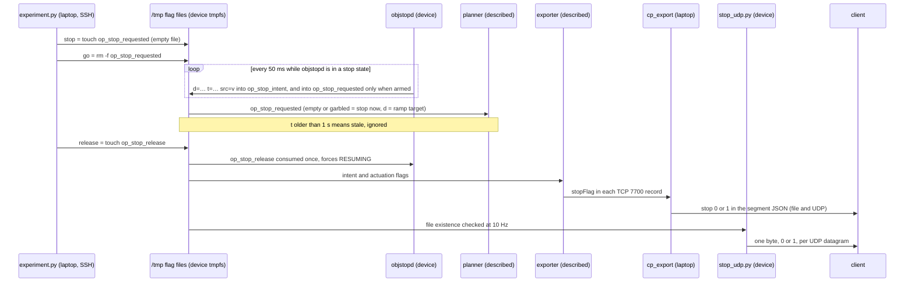
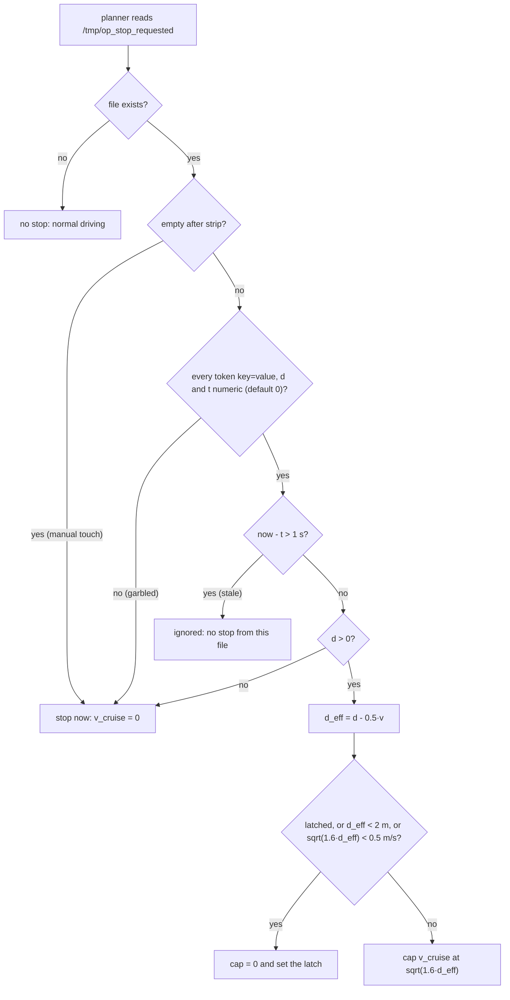

# Longitudinal stop command (Civic, era 1)

In era 1, a laptop could make openpilot bring the 2020 Honda Civic (Bosch) to a controlled stop just by creating a file on the comma 3X. **Version 1** (2026-07-17) patched the sunnypilot 0.9.7.1 longitudinal planner to force `v_cruise = 0` while `/tmp/op_stop_requested` existed. **Version 2** (2026-07-25) let the vision daemon write a target distance into that file, so the planner could glide onto a stop line with a square-root speed ramp and then latch a full stop. This page covers both mechanisms, the companion patches, the `experiment.py` helper, the field procedure, flag ownership (`go` vs `release`) and the revert.

> [!WARNING]
> **Historical (sunnypilot era).** Everything this page describes on the device existed only in era 1: the planner, Honda interface and controlsd patches, the params and the `/tmp` flag protocol. The device was later re-flashed to openpilot v0.11.1, at an unrecorded date between 2026-08-13 (the last era-1 file) and 2026-10-03 (the era-2 patch), so none of it is there any more. The procedures are kept so the work can be understood or reproduced.

## At a glance

| | |
|---|---|
| **Audience** | Operators who ran the Civic experiments; developers who want to reproduce or port the stop mechanism |
| **Runs on** | **Device:** the patched planner reads the flag file; objstopd writes it. **Laptop:** [`experiment.py`](../remote/Arman/experiment.py) drives the flags over SSH and samples the reg_export stream (TCP 7700) for `check` |
| **Era** | Era 1 — sunnypilot 0.9.7.1 (Civic). v1 2026-07-17 (last-modified date of `STOP_COMMAND.md`); v2 2026-07-25 (stated in `STOP_SIGN_VISION.md`); companion patches in place by 2026-08-06 (`OPERATIONS.md` §0) |
| **Status** | Historical. The planner, interface and controlsd patches are **described, not included**. In the repo: `experiment.py`, the on-disk mirror of the v2 parser and ramp (`parse_flag()`, `planner_ramp()` in `test_stopsm.py`), and objstopd's flag writer (`write_flag()`) |
| **Key files** | [`STOP_COMMAND.md`](../remote/Arman/STOP_COMMAND.md), [`EXPERIMENT_RUNBOOK.md`](../remote/Arman/EXPERIMENT_RUNBOOK.md), [`OPERATIONS.md`](../remote/Arman/OPERATIONS.md), [`experiment.py`](../remote/Arman/experiment.py), [`vision/test_stopsm.py`](../remote/Arman/vision/test_stopsm.py), [`objstopd.py`](../remote/Arman/objstopd.py), [`vision/STOP_SIGN_VISION.md`](../remote/Arman/vision/STOP_SIGN_VISION.md), [`controls_principles.md`](../remote/controls_principles.md) |

## Safety

> [!CAUTION]
> **This actuates the brakes of a real car, with no stock AEB.** On the Honda Bosch, enabling openpilot longitudinal control disables the stock radar (`radarUnavailable=True`). While OP long is on there is no radar lead and no stock AEB, so the driver is the only safety net. Run the stop command and `objstopd --arm` only on a closed or empty course, at low speed (start at ≤ ~15 km/h), with the driver's hands ready and a foot over the brake. A real brake press overrides everything. Sources: `STOP_COMMAND.md` (warning and checklist), `EXPERIMENT_RUNBOOK.md` §2, the `OPERATIONS.md` header.

This is research code. It is not affiliated with or endorsed by comma.ai, openpilot or sunnypilot.

## How the pieces fit

| Component | Where | Role | In this repo? |
|---|---|---|---|
| `/tmp/op_stop_requested` (the **actuation** flag) | device, tmpfs | the stop request that the planner obeys | the protocol only |
| Patched `longitudinal_planner.py` (v1, then v2) | `/data/openpilot/selfdrive/controls/lib/` | turns the flag into `v_cruise = 0` (v1) or a speed cap that ramps to a latched stop (v2) | Described, not included. v2 is mirrored by [`test_stopsm.py`](../remote/Arman/vision/test_stopsm.py) → `parse_flag()`, `planner_ramp()` |
| `experiment.py` | laptop | `stop` / `go` / `release` / `status` / `check` over SSH | yes |
| objstopd (vision stop daemon) | device, `/data/objstop/` | writes `d=… t=… src=v` into the actuation flag when armed; always writes the intent flag; consumes the release flag | yes: [`objstopd.py`](../remote/Arman/objstopd.py) (see [08](08-vision-stop-objstopd.md)) |
| Honda `interface.py` launch assist | device | `startingState=True, startAccel=0.6` | Described, not included |
| controlsd `VISION: …` hook | device | on-screen status line | Described, not included |
| `DisengageOnAccelerator=0` | device param | a gas tap overrides instead of disengaging | a param (applied) |

The flag protocol, end to end. The exporter, `cp_export` and `stop_udp` lines are detailed in [06](06-client-interface-spec.md) and [09](09-stop-signal-udp.md).



> [!NOTE]
> **Described, not included.** The deployed exporter variant that turned the flags into `stopFlag` is not in this repo. The repo's [`exporter_device.py`](../remote/exporter_device.py) is the 2026-07-14 baseline and has no `stopFlag`. Per `OPERATIONS.md` §3.2, "the actuation flag has priority" in that derivation; the code is not available to confirm it.

## Prerequisite: openpilot longitudinal control

### Two longitudinal configurations on the Civic

| Period | Configuration | What reaches the car | Effect of the stop flag |
|---|---|---|---|
| until 2026-07-17 | stock PCM longitudinal (`openpilotLongitudinalControl=False`) | `actuators.accel` is computed and logged only. openpilot just fakes cruise-control buttons (`SCM_BUTTONS`) to change the stock ACC set speed | none: "the stop is inert until OP long is enabled" (`STOP_COMMAND.md`) |
| from 2026-07-17 | openpilot longitudinal (`ExperimentalLongitudinalEnabled=1`) | `ACC_CONTROL.ACCEL_COMMAND`, executed by the car's PCM. The stock radar is disabled, so there is no radar lead and no AEB | active while openpilot is engaged |

Sources: [`controls_principles.md`](../remote/controls_principles.md) §2 and `STOP_COMMAND.md`. The note "accel is not sent to CAN" in `controls_principles.md`, slide 3, `README.md` and the hard-coded `controls_monitor.py` banner was true **only before 2026-07-17** (erratum 16 in [16](16-errata-and-crosswalk.md)). [04](04-control-principles-and-frenet.md) covers the whole control chain.

### Enabling OP long

Set `$COMMA_IP` first ([Finding the device](#finding-the-device)). Laptop commands on this page run from `remote/Arman`.

```bash
# device  (ssh comma@$COMMA_IP)
cd /data/openpilot && PYTHONPATH=/data/openpilot /usr/local/pyenv/versions/3.11.4/bin/python3 \
  -c "from openpilot.common.params import Params; Params().put_bool('ExperimentalLongitudinalEnabled', True)"
sudo reboot      # so CarParams re-initialise with OP long
```

> [!CAUTION]
> **From this reboot on, the car has no stock radar lead and no stock AEB** ([What OP long changes on a Honda Bosch](#what-op-long-changes-on-a-honda-bosch)). To undo it, remove the param and reboot ([Revert](#revert)).

`STOP_COMMAND.md` shows the same one-liner with a bare `python3`. The form above uses the explicit era-1 interpreter. After the reboot, `python3 experiment.py --ip $COMMA_IP status` on the laptop should print `ExpLong=1`. `STOP_COMMAND.md` records that OP long was "verified after reboot".

### What OP long changes on a Honda Bosch

> [!NOTE]
> **Described, not included.** The items below rest on openpilot source that is not in this repo. `STOP_COMMAND.md` cites the Honda `interface.py` of a desktop openpilot 0.9.8 checkout. `controls_principles.md` cites `longcontrol.py`, `carcontroller.py` and `interface.py` in the device's sunnypilot 0.9.7.1 source. Both notes give line numbers in those trees; they are not reproduced here.

- `openpilotLongitudinalControl=True` and `pcmCruise=False`: openpilot manages cruise, not the stalk.
- **The stock radar is disabled** (`radarUnavailable=True`). Longitudinal control uses the vision model only: no radar lead, no AEB.
- The panda gets `FLAG_HONDA_BOSCH_LONG`, and accel is clipped to `[BOSCH_ACCEL_MIN, BOSCH_ACCEL_MAX]`. `controls_principles.md` gives the Bosch limits as [−3.5, 2.0] m/s².
- The longitudinal controller has the states off / pid / stopping / starting, plus a PID with `err = v_target − vEgo` and `ff = a_target`. On Bosch the command is `ACC_CONTROL.ACCEL_COMMAND`, executed by the PCM. There is no pedal-percentage command (`compute_gb` returns 0); only Nidec cars send `BRAKE_COMMAND` + `PCM_GAS`.

## Mechanism v1: the flag's existence forces a stop (2026-07-17)

### The v1 planner patch

> [!NOTE]
> **Described, not included.** The patched `longitudinal_planner.py` lived only on the device. The sketch below is reconstructed from the description in `STOP_COMMAND.md` ("DEPLOYED" section). It is not the patch text.

```python
# selfdrive/controls/lib/longitudinal_planner.py (sunnypilot 0.9.7.1), at the force_slow_decel hook
import os
...
stop_requested = os.path.exists('/tmp/op_stop_requested')
if force_slow_decel or stop_requested:
  v_cruise = 0.0
```

- One edited Python file: no new param and no C++ rebuild. The backup `longitudinal_planner.py.bak_arman` is the **stock** file.
- `/tmp` is tmpfs, so a reboot always clears a stale stop.
- The file was deployed on the lab device at `192.168.1.231` (`STOP_COMMAND.md` header).

### v1 trigger commands

```bash
# laptop
ssh comma@$COMMA_IP 'touch /tmp/op_stop_requested'     # STOP: decelerate to a full stop
ssh comma@$COMMA_IP 'rm -f /tmp/op_stop_requested'     # GO: resume normal speed
ssh comma@$COMMA_IP 'ls -l /tmp/op_stop_requested 2>/dev/null && echo STOP-ARMED || echo GO'   # status
```

`experiment.py stop` and `go` run exactly the first two commands. `experiment.py status` reports the same flag as `stop_flag=ARMED` / `stop_flag=clear`, plus two params (see [experiment.py reference](#experimentpy-reference)). An empty file means "stop now" under v2 as well, so the manual commands behave the same in both versions.

### What happens after v_cruise = 0

`STOP_COMMAND.md` traces the chain that the forced `v_cruise = 0` sets off. It cites file and line in a desktop openpilot 0.9.8 checkout, not in this repo:

1. `v_cruise = 0` takes exactly the existing forced-deceleration path.
2. The MPC plans a smooth, jerk-limited deceleration to 0.
3. `longitudinal_planner.py`: `should_stop` becomes true when `v_target < vEgoStopping`.
4. `longcontrol.py`: in the `stopping` state, `output_accel` ramps down at `stoppingDecelRate` to `stopAccel`.
5. `honda/carcontroller.py`: `ACCEL_COMMAND` is sent, but only when `openpilotLongitudinalControl` is true.

As `EXPERIMENT_RUNBOOK.md` §2 puts it: "The stop is openpilot's own jerk/accel-limited decel (smooth, not a hard brake). It only acts when engaged + OP long."

> [!NOTE]
> **Reported in `EXPERIMENT_RUNBOOK.md`.** "Verified offroad (2h before): config ✓, planner patch ✓, stop flag ✓, cp_export JSON ✓." The runbook's last line lists the on-road confirmation as still to do ("longActive ✓ + first smooth stop + JSON segs>0"). No note records the result for the manual stop. The flag path was later exercised by vision stops on the 2026-08-04 drives (see [Simulation and field results](#simulation-and-field-results)).

## Mechanism v2: distance-aware ramp (2026-07-25)

v1 could only say "stop now". For stop signs and red lights, objstopd v2 needed the car to stop **at a point**, so the flag gained a target distance. The device planner was patched again; the backup `longitudinal_planner.py.bak_arman2` holds **v1** (`STOP_SIGN_VISION.md` v2).

> [!NOTE]
> **Described, not included.** The v2 planner patch is not in this repo. Its logic is mirrored, on disk, by [`vision/test_stopsm.py`](../remote/Arman/vision/test_stopsm.py) → `parse_flag()` ("mirror of the device planner v2 patch") and `planner_ramp()` ("Mirror of device planner v2"), which calls `ramp_v()` from objstopd. The parse results and the ramp below come from that mirror. The mirror does not show what the planner does with a `now` result: "stop-now" is from `STOP_SIGN_VISION.md` v2 and `OPERATIONS.md` §0, and `v_cruise = 0` is assumed from v1.

### Flag grammar

objstopd → `write_flag()` writes one line, with no newline:

```text
d=<metres, 2 decimals> t=<device time.monotonic(), 3 decimals> src=v
```

Example (from `test_flag_protocol()`): `d=12.30 t=99.8 src=v`.

| Token | Meaning |
|---|---|
| `d` | Distance in metres from the car to the **target stop point**: the Kalman-filtered distance to the object minus the setback (3 m for a stop sign, `--sign-setback`; 10 m for a traffic light, `--tl-setback`), clamped to ≥ 0. `d=0.00` means "stop now" |
| `t` | objstopd's `time.monotonic()` when it wrote the line. The planner judges staleness against it (`now − t > 1 s`) |
| `src=v` | The ownership tag ("vision"). The parser ignores it. objstopd uses it to recognise its own files: it never deletes a file that lacks `src=v` |

The write is atomic: objstopd writes `<path>.tmp`, then calls `os.replace()`, so a reader never sees a half-written file. While objstopd is in a stop state the file is rewritten every main-loop tick (about 50 ms), so `t` keeps advancing. If the writer dies, the file goes stale within 1 s. objstopd's docstring calls this the "daemon-crash fail-safe".

### Parse rules

| File state | Example | `parse_flag()` result | Planner action |
|---|---|---|---|
| absent | — | `none` | normal driving |
| empty or whitespace only | made by `touch` | `now` | stop now (`v_cruise = 0`). The "legacy empty file (manual touch)" |
| garbled (a token without `=`, or a non-numeric `d`/`t`) | `hello;;` | `now` | stop now ("garbled -> fail-safe stop") |
| stale: `now − t > 1.0` | `d=12.0 t=90.0 src=v` at now = 100 | `ignore` | flag ignored ("stale -> daemon died, release") |
| `d ≤ 0` | `d=0.00 t=99.9 src=v` | `now` | stop now |
| valid | `d=12.30 t=99.8 src=v` | `('dist', 12.3)` | distance ramp (next section) |

**Edge cases.** Analysis (from code; not field-tested). Each was checked by calling the mirror's `parse_flag()` directly:

- A missing `t` defaults to 0, so the file is **always stale and ignored**. `d=5` alone, or any foreign `key=value` text such as `foo=bar`, is ignored. It is **not** a stop. objstopd's docstring says "d=0 (or an empty/foreign file) = legacy stop-now". Per the mirror, that holds for an empty or unparsable file, but not for foreign `key=value` content.
- A missing `d` with a fresh `t` defaults to `d = 0`, which means stop now.
- Staleness is checked before `d`. A stale `d=0.00` file is ignored.
- A line exactly 1.0 s old is still valid (the test is `>`, not `≥`). A `t` in the future is accepted.
- An empty file has no `t`, so it never goes stale. A manual stop lasts until `go` or a reboot.
- `t` must come from the device's monotonic clock, which a laptop cannot write sensibly. In practice, the only manual stop is the empty file, which means "stop now".

### Speed ramp and latch

The mirror's `planner_ramp(d, v, hold)` returns `(v_cruise_cap, hold)`:

```text
d_eff = d − 0.5·v                              v = current speed (m/s)
v_cap = sqrt(2·a·max(d_eff, 0)),  a = 0.8 m/s²  →  sqrt(1.6·d_eff)
if hold or d_eff < 2.0 m or v_cap < 0.5 m/s:   cap = 0, hold = True   (latched full stop)
else:                                           cap = v_cap
```

- `a = 0.8 m/s²` is `A_STOP` in [`objstopd.py`](../remote/Arman/objstopd.py), commented "must match the planner ramp". `ramp_v(d_eff, a=A_STOP)` computes `sqrt(2·a·max(d_eff, 0))`.
- The test harness applies the cap as `v_target = min(set speed, cap)`. How the device patch combines the cap with the cruise speed is described, not included.
- **The latch.** Once set, `hold` stays true inside `planner_ramp()`. The test "hold latched under d jitter" feeds `d` = 0.5, −0.5, 1.5, 2.5, −1.0 at standstill, and the cap stays 0. This is the "latches a full stop near zero (no creep-through)" of `STOP_SIGN_VISION.md` v2.
- **Latch release is not in the on-disk mirror.** `planner_ramp()` never clears `hold`. The field report that the 3 s stop-sign auto-resume works implies the device patch clears it once objstopd removes the flag on entering RESUMING (an inference; the patch is not available).
- Analysis (from code; not field-tested): `v² = 2·a·d` is the speed from which a constant 0.8 m/s² deceleration stops exactly in `d`. Subtracting `0.5·v` takes off the distance covered in half a second at the current speed. With `a = 0.8`, the condition `v_cap < 0.5` (that is, `d_eff < 0.156 m`) can never trigger on its own, because `d_eff < 2 m` always latches first. A non-zero cap is never below `sqrt(3.2) ≈ 1.79 m/s` (6.4 km/h): once `d_eff` falls below 2 m, the cap drops from about 1.79 m/s straight to 0.

### Planner flow



### Worked numbers

Computed with the mirror's `planner_ramp()`:

| d (m) | v (m/s) | d_eff (m) | Cap (m/s) | Cap (km/h) | Result |
|---|---|---|---|---|---|
| 40 | 8 | 36.0 | 7.59 | 27.3 | ramp |
| 30 | 6 | 27.0 | 6.57 | 23.7 | ramp |
| 20 | 6 | 17.0 | 5.22 | 18.8 | ramp |
| 10 | 4 | 8.0 | 3.58 | 12.9 | ramp |
| 6 | 3 | 4.5 | 2.68 | 9.7 | ramp |
| 3.0 | 2.0 | 2.0 | 1.79 | 6.4 | ramp (`d_eff` is not < 2) |
| 2.5 | 1.5 | 1.75 | 0 | 0 | latched stop |
| 1.0 | 0 | 1.0 | 0 | 0 | latched stop |

### Simulation and field results

`test_stopsm.py` → `test_ramp()` closes the loop with a simple vehicle model: a first-order lag of 0.4 s, acceleration clipped to [−1.2, +1.5] m/s², a 50 ms step, starting at 8 m/s with 40 m to go. On the redacted snapshot (2026-11-05) all 38 checks pass (`ALL V2 TESTS OK`), including these:

```text
PASS ramp: stops before target   remaining=1.19m
PASS ramp: stops close to target (<4m early)   remaining=1.19m
PASS ramp: decel within -1.2   max_dec=-1.20
PASS ramp: hold latched under d jitter
PASS flag: valid dist
PASS flag: d=0 -> now
PASS flag: empty (manual touch) -> now
PASS flag: stale -> ignore
PASS flag: garbled -> fail-safe now
PASS flag: absent -> none
```

Analysis (from code; not field-tested): an instrumented re-run of the same loop shows the latch firing at about 3.0 m before the target at about 2.1 m/s. The simulated car then brakes at its −1.2 m/s² limit for about 1.35 s; that is the `max_dec=-1.20`. The model is not openpilot's MPC. On the car, the deceleration after the latch is openpilot's own jerk-limited stop.

> [!NOTE]
> **Reported in `STOP_SIGN_VISION.md`.** v2: the tests were "all green locally + on device". v2.1 (2026-08-06): "rlog forensics on the 8/4 drives proved: stop-sign 3s auto-resume WORKS (standstill → `starting`, accel 0.6)". The "stuck" cases turned out to be pedestrian holds on the static test dummy (by design), plus `DisengageOnAccelerator=1` turning the driver's gas tap into a disengage.

### What objstopd writes in each state

The flag comes from `VisionStopSM.update()` and `write_flag()` in [`objstopd.py`](../remote/Arman/objstopd.py). The actuation file is written only with `--arm`; the intent file `/tmp/op_stop_intent` always gets the same content. The state machine is documented in [08](08-vision-stop-objstopd.md).

| objstopd state | Flag value | File content | v2 planner result |
|---|---|---|---|
| DRIVING, RESUMING | `None` | file removed (only if it contains `src=v`) | normal driving |
| BRAKING for a stop sign or red light | `('dist', d_line)` with `d_line = max(track d − setback, 0)` | `d=<d_line> t=<now> src=v` | ramp (stop now once `d_line` reaches 0) |
| BRAKING for a pedestrian | `('now',)` | `d=0.00 t=<now> src=v` | stop now |
| STOPPED_SIGN, STOPPED_RED, STOPPED_PED | `('now',)` | `d=0.00 t=<now> src=v` | stop now |
| any BRAKING or STOPPED state while a pedestrian hold is active | `('now',)` | `d=0.00 t=<now> src=v` | stop now |

On SIGINT or SIGTERM (Ctrl-C, `pkill`), objstopd's `finally` block removes its own files and prints `[objstopd] exit; flags cleared`. A SIGKILL skips that block, and so does the hang-up (SIGHUP) that ends a manual run when its SSH session closes, because objstopd installs no handler for it (Analysis (from code; not field-tested); run it in `tmux`, as in step 6 of the [Field procedure](#field-procedure)). See [go vs release](#go-vs-release-who-owns-which-flag).

### Reboot clears everything

`/tmp` is tmpfs. A reboot clears `/tmp/op_stop_requested`, `/tmp/op_stop_intent`, `/tmp/op_stop_release` and objstopd's status files (`STOP_COMMAND.md`; `OPERATIONS.md` §4: "sudo reboot (all /tmp flags cleared automatically)").

## Companion patches

> [!NOTE]
> **Described, not included.** The interface and controlsd patches lived only on the device. They are known from `STOP_SIGN_VISION.md` v2, `OPERATIONS.md` §0 and the revert table in `OPERATIONS.md` §9.

| Patch | Device file (under `/data/openpilot`) | Backup | Effect |
|---|---|---|---|
| Launch assist | `selfdrive/car/honda/interface.py` | `.bak_arman2` | `startingState=True, startAccel=0.6`: "firm, bounded open-loop push off the line" after a standstill (one of the v1 field problems that v2 fixed: "weak launch") |
| `VISION: …` display hook | `selfdrive/controls/controlsd.py` | `.bak_arman_ui` | the comma screen shows a status line such as `VISION: RED LIGHT / braking...`, at LOWEST priority, display only |
| `DisengageOnAccelerator=0` | param | (revert: set it back to `True`) | a gas tap is an override/release and does not disengage; the brake still disengages immediately |

### Launch assist

v2's list of field problems included "weak launch". From then on, after any standstill, the Honda interface's `startingState=True, startAccel=0.6` gave a firm, bounded push off the line. The v2.1 forensics quoted above show it at work: "standstill → `starting`, accel 0.6".

### VISION status line on the comma screen

objstopd's `display_info()` is "one source of truth for what every UI shows". It produces `screen1` / `screen2` texts and a `level` (`ok` / `info` / `prompt` / `danger`, which it "maps to status colors / device alert status"). objstopd writes these into `/tmp/objstop_status.json` on every tick. The controlsd hook that displays them is described, not included. Per `OPERATIONS.md` §7, a missing bar means objstopd isn't running or the device isn't onroad, and "the bar expiring after 2 s is normal".

### Gas tap overrides instead of disengaging

`STOP_SIGN_VISION.md` v2.1 still listed `DisengageOnAccelerator=0` as a "pending user decision" (Settings → Toggles → "Disengage on Accelerator" off). `OPERATIONS.md` §0 shows it applied: **it was applied** (erratum 19). objstopd reads `carState.gasPressed` and treats a gas press in BRAKING or any STOPPED state as a release ("driver gas tap or an explicit operator release always wins"). With `DisengageOnAccelerator=0`, openpilot stays engaged, so the car simply resumes. With the stock setting (`DisengageOnAccelerator=1`), the same tap disengaged openpilot. That, together with by-design pedestrian holds on the static test dummy, explained the "stuck" cases in v2.1.

## experiment.py reference

[`experiment.py`](../remote/Arman/experiment.py) is the laptop's "day-of control + readiness" tool for the Civic experiment. It runs on the laptop, which "can ssh comma@`<ip>` with its key and reach the device stream". It needs only the Python standard library.

### Options

| Option | Default | Meaning |
|---|---|---|
| `--ip` | (required) | device IP |
| `--user` | `comma` | SSH user |
| `--port` | `7700` | reg_export TCP port, sampled by `check` |
| `action` | (required) | one of `check`, `stop`, `go`, `release`, `status` |

`release` was added in v2.1 (`STOP_SIGN_VISION.md`). It is a valid argparse choice, but the docstring lists only check / stop / go / status (A-item A5 in [16](16-errata-and-crosswalk.md#additional-inconsistencies-found-in-this-review)). Every SSH call uses `ssh -o StrictHostKeyChecking=no -o ConnectTimeout=6 comma@<ip> '<command>'` and is abandoned after 10 s. On failure, `stop`, `go`, `release` and `status` print `failed: <ssh stderr>`; `check` does not (see [Reading the check output](#reading-the-check-output)).

### Finding the device

```bash
# laptop
cd remote/Arman && export COMMA_IP=$(./find_comma.sh)     # or set it by hand, e.g. export COMMA_IP=192.168.1.231
ssh comma@$COMMA_IP 'cat /data/params/d/DongleId'          # must print your own <DONGLE_ID>
```

`find_comma.sh` returns the **first** host that answers on port 7700 or passes the SSH check. There can be more than one comma on a network, so always verify the DongleId. See [02](02-setup-ssh-networking.md) for networking.

### Actions and their SSH commands

| Action | Remote command | Prints |
|---|---|---|
| `stop` | `touch /tmp/op_stop_requested` | `■ STOP requested` |
| `go` | `rm -f /tmp/op_stop_requested` | `▶ GO (stop cleared)` |
| `release` | `touch /tmp/op_stop_release` | `⏩ RELEASE sent (objstopd will resume)` |
| `status` | three params/flag reads (below) | `ExpLong=…`, `onroad=…`, `stop_flag=…` |
| `check` | three config reads over SSH, then about 6 s of the TCP stream | the readiness report |

The equivalent manual commands:

```bash
# laptop
ssh comma@$COMMA_IP 'touch /tmp/op_stop_requested'    # stop
ssh comma@$COMMA_IP 'rm -f /tmp/op_stop_requested'    # go
ssh comma@$COMMA_IP 'touch /tmp/op_stop_release'      # release
ssh comma@$COMMA_IP "echo -n 'ExpLong='; cat /data/params/d/ExperimentalLongitudinalEnabled 2>/dev/null; echo; \
  echo -n 'onroad='; cat /data/params/d/IsOnroad 2>/dev/null; echo; \
  ls /tmp/op_stop_requested >/dev/null 2>&1 && echo 'stop_flag=ARMED' || echo 'stop_flag=clear'"      # status
ssh comma@$COMMA_IP "cat /data/params/d/ExperimentalLongitudinalEnabled 2>/dev/null; echo '|'; \
  cat /data/params/d/IsOnroad 2>/dev/null; echo '|'; \
  grep -q op_stop_requested /data/openpilot/selfdrive/controls/lib/longitudinal_planner.py && echo patched || echo NOTPATCHED"   # check (config part)
```

### Reading the check output

The shape of the output, assembled from the print statements in `main()` (values elided):

```text
[check] config via ssh …
  OP-long param set      ✓
  planner stop patch     ✓
  device onroad          ✓   (camera/stream/braking only work onroad)
[check] sampling stream 192.168.1.231:7700 …
  stream records         ✓ (N)
  --- longitudinal ---
  openpilot enabled      ✓  state=…
  longActive (OP long)   ✓  accel=…  vEgo=…
  --- JSON export (cp_export needs these) ---
  GPS fix (loc)          ✓  loc=(lat, lon, yaw)
  modelV2 trajectory     ✓

  LONGITUDINAL ready: ✓    JSON export ready: ✓
```

| Line | How `experiment.py` computes it | ✓ means | If ✗ |
|---|---|---|---|
| `OP-long param set` | SSH `cat` of the param; ✓ if the output contains `1` | OP long is configured | set it and reboot ([Enabling OP long](#enabling-op-long)) |
| `planner stop patch` | SSH `grep -q op_stop_requested` on the planner | the planner mentions the flag. This can be v1 or v2: `check` cannot tell which. A `longitudinal_planner.py.bak_arman2` next to it means v2 was applied | the patch is missing (described, not included) |
| `device onroad` | SSH `cat /data/params/d/IsOnroad`; ✓ if it contains `1` | the device is onroad | turn the car on |
| `stream records ✓ (N)` | connects to `--port` and parses JSON lines for about 6 s | N records arrived. The exporter emits one per carState frame, about 100 per second | `no stream data (<error>). If offroad, turn the car on & engage.` |
| `openpilot enabled … state=` | last `carControl.enabled`; last non-empty `controlsState.state` | openpilot is engaged | engage |
| `longActive (OP long) … accel= vEgo=` | last `carControl.longActive`, `carControl.accel`, `carState.vEgo` | openpilot is controlling longitudinal | reboot after `ExpLong=1`, re-engage |
| `GPS fix (loc) … loc=` | ✓ if any record had an absolute `loc.lat` or `loc.lon` above 1e-6; `loc=` is the last (lat, lon, yaw) | a non-zero position | wait outdoors for a fix |
| `modelV2 trajectory` | ✓ if any record carried a non-empty `modelV2.pos_x` | the model trajectory is flowing | onroad? |
| `LONGITUDINAL ready` | the last `longActive` | stop/go will act | prints `→ engage openpilot; confirm OP long (longActive ✓). If ✗ onroad, reboot after ExpLong=1.` |
| `JSON export ready` | GPS fix **and** modelV2 trajectory | `cp_export` will produce output ([05](05-curvepoints-pipeline.md)) | prints `→ need a GPS fix + onroad model. Or run cp_export with --ref-lat/--ref-lon / --local-frame.` |

> [!IMPORTANT]
> **A failed SSH call shows ✓ on the first three lines.** Analysis (from code; not field-tested): `check` sets the three config results to the placeholder `"?"` and overwrites them only when the SSH call succeeds. `yn("?")` prints ✓ because a non-empty string is truthy, and the SSH error itself is not printed. If the stream part works but those three lines look suspiciously perfect, run `experiment.py … status`, which prints `failed: …` when SSH fails.

### Reading the status output

```text
ExpLong=1
onroad=1
stop_flag=clear
```

- `ExpLong=` is the raw content of `/data/params/d/ExperimentalLongitudinalEnabled` (empty when the param is unset).
- `onroad=` is the raw content of `/data/params/d/IsOnroad`.
- `stop_flag=ARMED` means only that `/tmp/op_stop_requested` **exists**, whoever wrote it and however old it is. "ARMED" here has nothing to do with objstopd's `--arm`. `status` does not look at `/tmp/op_stop_intent` or `/tmp/op_stop_release`. To see who owns the flag:

```bash
# laptop
ssh comma@$COMMA_IP 'for f in /tmp/op_stop_requested /tmp/op_stop_intent /tmp/op_stop_release; do echo "$f: $(cat $f 2>/dev/null || echo absent)"; done'
```

An empty value means the file exists but is empty: on `/tmp/op_stop_requested` that is a manual stop, and on `/tmp/op_stop_release` a release that hasn't been consumed yet. A value with `src=v` belongs to objstopd, which rewrites it about every 50 ms with a fresh `t`. Run the command twice, a few seconds apart: if `t` hasn't changed, the writer is gone and the file is stale.

### What check does not test

It does not check which planner version is installed, whether objstopd is running or armed, the launch-assist or controlsd patches, or `DisengageOnAccelerator`.

## Field procedure

This procedure follows [`EXPERIMENT_RUNBOOK.md`](../remote/Arman/EXPERIMENT_RUNBOOK.md) and `OPERATIONS.md` §2.1–2.5, with the corrections noted. Run the laptop commands from `remote/Arman`. Device commands use the era-1 interpreter.

> [!CAUTION]
> **Steps 5 and 6 brake a real car that has no stock AEB while OP long is on.** Closed course, low speed, the driver's hands ready and a foot over the brake; a brake press overrides everything ([Safety checklist](#safety-checklist)). To undo: `go` ends a manual stop; `release`, or a light gas tap with `DisengageOnAccelerator=0`, ends a vision hold; Ctrl-C stops objstopd and clears its flags; [Revert](#revert) turns OP long off.

1. **Power on and get onroad.** Turn the car on. The comma goes onroad and the screen shows the road view. The camera, model and stream only run onroad.
2. **Find and verify the device** ([Finding the device](#finding-the-device)).
3. **Engage openpilot, then run the readiness check:**

   ```bash
   # laptop
   python3 experiment.py --ip $COMMA_IP check
   ```

   You want `OP-long param set ✓`, `planner stop patch ✓`, `device onroad ✓`, `longActive (OP long) ✓`, `GPS fix ✓`, `modelV2 trajectory ✓`, and the bottom line `LONGITUDINAL ready: ✓    JSON export ready: ✓`. If you see `longActive ✗` after engaging, the OP-long config needs a fresh boot: run `ssh comma@$COMMA_IP 'sudo reboot'`, wait about 45 s, re-engage and re-check.
4. **Optional monitors**, each in its own terminal. `unified.py` shows an `ENGAGED ● LAT ● LONG ●` header; `controls_monitor.py` shows `long ON`. The client JSON export is covered in [05](05-curvepoints-pipeline.md).

   ```bash
   # laptop
   python3 ../unified.py --ip $COMMA_IP
   python3 ../controls_monitor.py --ip $COMMA_IP
   ```

5. **Stop and go.** Closed area, driver ready, foot over the brake. Do the first test from a slow crawl: check for a smooth stop, then `go`.

   ```bash
   # laptop
   python3 experiment.py --ip $COMMA_IP stop      # ■ controlled decel-to-stop
   python3 experiment.py --ip $COMMA_IP go        # ▶ resume: clears the manual stop
   python3 experiment.py --ip $COMMA_IP status    # config + flag state
   ```

6. **Optional vision auto-stop, shadow first** (details in [08](08-vision-stop-objstopd.md)). The runbook's step 4 (`--onnx yolov8n_320.onnx --imgsz 320`) is v1 syntax that the v2 CLI rejects (erratum 4). From 2026-08-06, manager also autostarted a shadow instance, so `manual_mode` had to be set first (erratum 18):

   ```bash
   # device  (ssh comma@$COMMA_IP)
   touch /data/objstop/manual_mode              # manager stops the autostarted shadow instance
   cd /data/objstop && PYTHONPATH=/data/openpilot \
     /usr/local/pyenv/versions/3.11.4/bin/python3 objstopd.py --save-every 0.3          # shadow: shows its decisions, never brakes
   # once it looks reliable: Ctrl-C, then run the same command with --arm added
   rm /data/objstop/manual_mode                 # afterwards: re-enable the autostart
   ```

   **Analysis (from code; not field-tested):** start objstopd inside `tmux new -s objstop`. If the SSH session running it closes (a closed terminal, a dropped hotspot link), the hang-up ends objstopd without clearing its flags; inside tmux it keeps running, and `tmux attach -t objstop` gets the console back for a clean Ctrl-C ([08](08-vision-stop-objstopd.md#manual-run-shadow-first)).

   Watch it from the laptop with `python3 vision/objstop_view.py --ip $COMMA_IP`. If an armed objstopd holds the car, for example on a static test dummy, release it with `python3 experiment.py --ip $COMMA_IP release` (`OPERATIONS.md` §2.4: "force the vision daemon to release (dummy scenario)") or a light gas tap ([go vs release](#go-vs-release-who-owns-which-flag)).
7. **After the experiment** (`OPERATIONS.md` §8). Make sure objstopd exited; Ctrl-C clears its flags. If the era-1 dashcam mode is enabled and the car is going back to normal use, `rm /data/force_onroad`. Copy the `cp_out/` JSON/CSV deliverables off the laptop. To return the car to stock, see [Revert](#revert).

## go vs release: who owns which flag

### Ownership

| File | Written by | Removed by | Read by |
|---|---|---|---|
| `/tmp/op_stop_requested` (actuation) | `experiment.py stop` (`touch`, an empty file); objstopd `--arm` (`d=… t=… src=v` every tick in a stop state) | `experiment.py go` (`rm -f`, **whatever the owner**); an **armed** objstopd when its flag becomes `None` or on a clean exit, **only if the file contains `src=v`** (a shadow instance never touches this file); a reboot | the planner (v1: existence; v2: parse); `stop_udp.py` (existence); the deployed exporter (described) |
| `/tmp/op_stop_intent` (intent) | objstopd, always (shadow too) | objstopd, as above; a reboot. **Not** `experiment.py go` | `stop_udp.py`; the deployed exporter (described) |
| `/tmp/op_stop_release` (one-shot) | `experiment.py release` (`touch`) | objstopd consumes it on its next 20 Hz tick and prints `[objstopd] operator RELEASE received` | objstopd |

### Which command to use

| Situation | Use | Why |
|---|---|---|
| You issued a manual `stop` | `go` | it removes your empty file |
| An armed objstopd is holding the car (stop sign, red light, pedestrian) | `release`, or a light gas tap (with `DisengageOnAccelerator=0`) | objstopd owns its file and rewrites it every ~50 ms, so a `go` is undone within one tick. `release` makes objstopd enter RESUMING and remove its own files; it also drops the pedestrian hold ("operator takes responsibility (static dummy case)"). A dummy still in the path sets the hold again within about 0.5 s ([Edge cases](#edge-cases)) |
| objstopd runs in shadow (the autostart) | `stop` / `go` as usual | shadow mode never touches the actuation file |
| objstopd was killed with SIGKILL during a stop, or ended by the hang-up of its closed SSH session | nothing for the v2 planner (it ignores the file after 1 s); `go` removes the stale actuation file; remove `/tmp/op_stop_intent` by hand | the `finally` cleanup did not run, and `go` does not touch the intent flag (erratum 25) |

### Edge cases

Analysis (from code; not field-tested):

- **A manual stop can be taken over by vision.** objstopd's `write_flag()` refuses only to **delete** a foreign file. When it has a stop to write, it overwrites any file. If an armed objstopd starts a vision stop while your manual stop is active, it replaces the empty file with `d=… src=v`. When the vision stop ends, it deletes the file, and your manual stop is gone too. Issue `stop` again if you still need the hold (A-item A16 in [16](16-errata-and-crosswalk.md#additional-inconsistencies-found-in-this-review)). Similarly, `touch` on an existing vision file only changes its timestamp, not its content.
- **`release` does not outlast a pedestrian who is still there.** It clears the pedestrian hold once. If the person or dummy is still detected in the forward zone, two sightings within 1 s set the hold again, and objstopd goes from RESUMING back to BRAKING about 0.2–0.5 s later at the 4–5 Hz detection rate (0.25–0.5 s in a simulation with the canonical state machine). Keep the gas pressed until you are past the dummy, or move the dummy out of the path. `test_operator_release` checks only the first tick after the release.
- **`release` with no objstopd running** leaves the file in place. The next objstopd start consumes it, with no effect in DRIVING. It is harmless.
- **A fresh objstopd cleans up stale vision files** on its first tick: always the intent file, and the actuation file only when it was started with `--arm`. A stale actuation file from an armed run that was killed therefore survives a later shadow (autostart) instance. Use `go`, or reboot.

## Safety checklist

Merged from `STOP_COMMAND.md`, `STOP_SIGN_VISION.md`, `EXPERIMENT_RUNBOOK.md` and `OPERATIONS.md`:

- [ ] Closed or empty area. Start at low speed (≤ ~15 km/h).
- [ ] Driver's hands ready, foot over the brake. A real brake press overrides everything and disengages immediately.
- [ ] Remember: no stock radar lead and no stock AEB while OP long is on. You are the safety net.
- [ ] Confirm OP long is actually engaged before every test: `longActive (OP long) ✓` in `check`, `LONG ●` in `unified.py`, `long ON` in `controls_monitor.py`.
- [ ] Do the first `stop` from a slow crawl: smooth deceleration, no jerk, full stop.
- [ ] `go` clears cleanly, and the car resumes only as expected.
- [ ] Vision: validated in shadow first. `--arm` only once it looks reliable. `touch /data/objstop/manual_mode` before a manual run.
- [ ] After a resume, no stale flag remains: `status` shows `stop_flag=clear`.
- [ ] After the session, objstopd was stopped with Ctrl-C (flags cleared). A reboot clears all `/tmp` flags.

## Troubleshooting

| Symptom | Check | Fix |
|---|---|---|
| `find_comma.sh` finds nothing | laptop and comma not on the same network; an iPhone hotspot may isolate clients | use an Android hotspot or Ethernet; `ping` the device (`OPERATIONS.md` §7; [02](02-setup-ssh-networking.md)) |
| `check`: `no stream data (…)` | car not onroad, or the exporter is down | turn the car on. On the era-1 dashcam setup: `touch /data/force_onroad` (`OPERATIONS.md` §7); `rm` it again before normal driving (step 7 of the [Field procedure](#field-procedure)) |
| `check`: `longActive ✗` after engaging | CarParams were not initialised for OP long | `sudo reboot`, wait about 45 s, engage again |
| `check`: `OP-long param set ✗` | param missing | [Enabling OP long](#enabling-op-long) |
| `check`: `planner stop patch ✗` | the planner is stock (after a revert or an update) | the patch is not in this repo |
| `check` is all ✓ on the config lines, but `status` prints `failed: …` | SSH is failing; `check` shows placeholder ✓ marks | fix SSH ([02](02-setup-ssh-networking.md)) |
| `stop` has no effect | not engaged, OP long off, or stock planner | `check` (`longActive (OP long) ✓`); `LONG ●` in `unified.py`, `long ON` in `controls_monitor.py` or `dashboard.py` |
| The car stays stopped after `go` | a vision hold (an armed objstopd rewrites its file within ~50 ms), or the `go` SSH call failed (it prints `failed: …`) | `release`, or a light gas tap; inspect the flag contents (above) |
| Vision stop does not stop | objstopd in shadow, not `--arm`; or not engaged | add `--arm`; confirm OP long: `LONG ●` (`OPERATIONS.md` §7) in `unified.py`, `long ON` in `controls_monitor.py` or `dashboard.py`, `longActive (OP long) ✓` in `check` |
| Stopped and won't go | `objstop_view` STATE / NEXT | pedestrian → light gas tap or `release` (a dummy still in the path sets the hold again: [Edge cases](#edge-cases)); red light → wait for green or `release` |
| A gas tap disengages instead of resuming | `DisengageOnAccelerator=1` | set it to 0 |
| No `VISION` bar on the comma screen | objstopd not running, or not onroad | start objstopd. The bar expiring after 2 s is normal |
| objstopd exits with an argparse error | v1 flags such as `--onnx` (ambiguous) or `--imgsz` (unrecognized) | use the v2.1 CLI (erratum 4) |
| `status` says `stop_flag=ARMED` but nobody stopped | a vision file (armed objstopd), or a stale one | read the file: empty = manual, `src=v` = vision |
| `controls_monitor` says "accel command is computed but NOT sent to CAN" | a hard-coded banner that predates OP long | ignore it after 2026-07-17 (erratum 16) |

## Revert

The full era-1 inventory and ordered revert are in [14](14-device-changes-and-revert.md). After the re-flash to openpilot v0.11.1 (at an unrecorded date between 2026-08-13 and 2026-10-03) this is moot, because era 1 is already gone. The longitudinal part, for reference:

| File (under `/data/openpilot`) | Restore from | Why this backup |
|---|---|---|
| `selfdrive/controls/lib/longitudinal_planner.py` | `.bak_arman` | the v1 patch made it from the **stock** file. `.bak_arman2` holds **v1** |
| `selfdrive/car/honda/interface.py` | `.bak_arman2` | made by the launch-assist patch (before `startAccel`) |
| `selfdrive/controls/controlsd.py` | `.bak_arman_ui` | made by the `VISION` hook (before the hook) |

```bash
# device  (ssh comma@$COMMA_IP)
cd /data/openpilot
cp selfdrive/controls/lib/longitudinal_planner.py.bak_arman selfdrive/controls/lib/longitudinal_planner.py
cp selfdrive/car/honda/interface.py.bak_arman2 selfdrive/car/honda/interface.py
cp selfdrive/controls/controlsd.py.bak_arman_ui selfdrive/controls/controlsd.py
PYTHONPATH=/data/openpilot /usr/local/pyenv/versions/3.11.4/bin/python3 -c \
  "from openpilot.common.params import Params; p=Params(); p.remove('ExperimentalLongitudinalEnabled'); p.put_bool('DisengageOnAccelerator', True)"
git diff --stat          # if the backups were stock, these three files are no longer listed
sudo reboot              # back to stock ACC + radar + AEB
```

> [!WARNING]
> **Historical (sunnypilot era).** `OPERATIONS.md` §9 restores `longitudinal_planner.py.bak_arman2` and comments "for v1 use `.bak_arman`". That is backwards: `.bak_arman2` **is** v1, so §9 leaves the v1 patch in the planner, and `.bak_arman` is stock. The table is also incomplete (erratum 15). `EXPERIMENT_RUNBOOK.md` and `STOP_COMMAND.md` revert only the planner and the param. Use [14](14-device-changes-and-revert.md).

## Reference design, not deployed: StopRequested param

> [!NOTE]
> **Described, not included.** `stop_command.py`, the `common/params.cc` change and the `StopRequested` planner hook lived in a desktop openpilot 0.9.8 checkout. They were **never deployed** (erratum 2). The device ran sunnypilot 0.9.7.1 and used the file flag instead.

The second half of `STOP_COMMAND.md` ("Reference implementation (0.9.8 repo — param-based, NOT the deployed device)") designed the same stop as a param:

1. `common/params.cc` registers `{"StopRequested", CLEAR_ON_MANAGER_START}`, so a stale stop is cleared when manager starts.
2. `longitudinal_planner.py` reads `StopRequested` each cycle and forces `v_cruise = 0` (the same `forceDecel` path as v1).
3. The device-side helper `Arman/stop_command.py --stop` / `--go` / `--status` sets and clears it.
4. Deployment needs a C++ params rebuild on the device (`cd /data/openpilot && scons -j4 common/`, then a reboot), "same as when `RouteFollowEnabled` was added".

| | File flag (deployed) | `StopRequested` param (reference) |
|---|---|---|
| Codebase | sunnypilot 0.9.7.1 on the device | openpilot 0.9.8 checkout on the desktop |
| Files changed | `longitudinal_planner.py` only | `params.cc`, `longitudinal_planner.py`, new `stop_command.py` |
| Rebuild | none | `scons -j4 common/` |
| Cleared on reboot by | tmpfs `/tmp` | `CLEAR_ON_MANAGER_START` |
| Trigger | `touch` / `rm` over SSH (`experiment.py`) | `stop_command.py --stop` / `--go` |
| Distance target | v2: yes | no |

The "Open item to confirm before deploying" at the end of `STOP_COMMAND.md` is stale: the file flag was deployed instead. The file also ends with an unbalanced code fence (erratum 27).

## Corrections to the original notes

All errata and A-items are listed in [16](16-errata-and-crosswalk.md). The ones that touch this page:

| Original | Correct |
|---|---|
| `STOP_COMMAND.md` reference section (`stop_command.py`, `params.cc`, `StopRequested`) | not in this repo and never deployed; the deployed design is the file flag (erratum 2) |
| `EXPERIMENT_RUNBOOK.md` §4 and `STOP_SIGN_VISION.md` v1 use `--onnx`, `--imgsz` | the v2 CLI rejects them; use the v2.1 flags (erratum 4) |
| `OPERATIONS.md` §9 planner line | `.bak_arman` is stock, `.bak_arman2` is v1; the table is incomplete (erratum 15) |
| "accel not sent to CAN" | true only before 2026-07-17 (erratum 16) |
| `OPERATIONS.md` §2.5 manual objstopd run | `touch /data/objstop/manual_mode` first, or two instances run (erratum 18) |
| `STOP_SIGN_VISION.md` v2.1: `DisengageOnAccelerator=0` "pending" | applied (erratum 19) |
| `go` releases a stop | `go` removes only the actuation file; `release` ends a vision hold (erratum 25) |
| `STOP_COMMAND.md` "open item"; the unbalanced code fence | stale wording (erratum 27) |
| `STOP_COMMAND.md` checklist: "LONG ● in cp_view / controls_monitor" (the `STOP_SIGN_VISION.md` v1 checklist: "LONG ● in controls_monitor / cp_view"); `STOP_COMMAND.md`: "Watch it live with `cp_view.py` on the laptop (speed tile → 0)" | `cp_view.py` has no engagement indicator, and its VELOCITY tile is the curvepoint speed a little ahead of the car, not `vEgo`. `LONG ●` is drawn by `unified.py`; `controls_monitor.py` prints `long ON` (A-item A13) |
| `experiment.py check` config lines | show ✓ when the SSH call fails (see [Reading the check output](#reading-the-check-output); A-item A11) |
| `objstopd.py` docstring: "an empty/foreign file = legacy stop-now" | true for empty or unparsable content. A foreign `key=value` file without a fresh `t` is ignored by the mirrored parser (see [Parse rules](#parse-rules); A-item A14) |
| `STOP_SIGN_VISION.md` v2: objstopd "never deletes a file it didn't write" | an armed objstopd that starts its own stop overwrites a manual empty file and deletes it when that stop ends (see [Edge cases](#edge-cases); A-item A16) |

## See also

- [04 — Control principles and Frenet outputs](04-control-principles-and-frenet.md): the full lateral/longitudinal chain and both longitudinal configurations
- [08 — Vision stop daemon (objstopd)](08-vision-stop-objstopd.md): the state machine that writes the distance flag, and the release flag
- [06 — Client interface specification](06-client-interface-spec.md): how a stop reaches the client as `"stop"` in the segment JSON
- [09 — 0/1 stop signal over UDP](09-stop-signal-udp.md): the same flags as a single-byte UDP stream
- [13 — Operations runbook](13-operations-runbook.md): the whole Civic session (scenario A)
- [14 — Device changes and revert](14-device-changes-and-revert.md): every era-1 file change, backup and param
- [02 — Setup, SSH and networking](02-setup-ssh-networking.md): finding the device, SSH keys, host-key warnings
- [16 — Errata and crosswalk](16-errata-and-crosswalk.md): all 28 errata, the A-items (A5, A11, A13, A14 and A16 concern this page) and where each original note went
