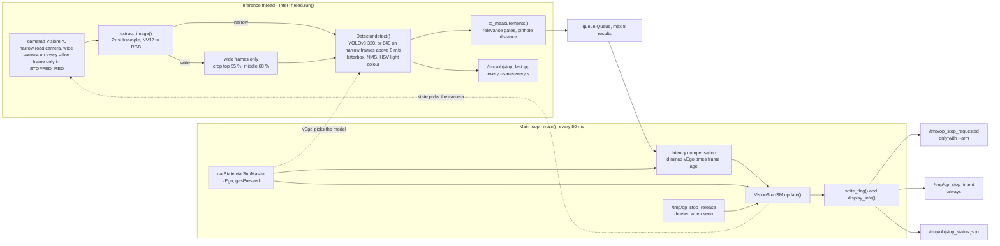
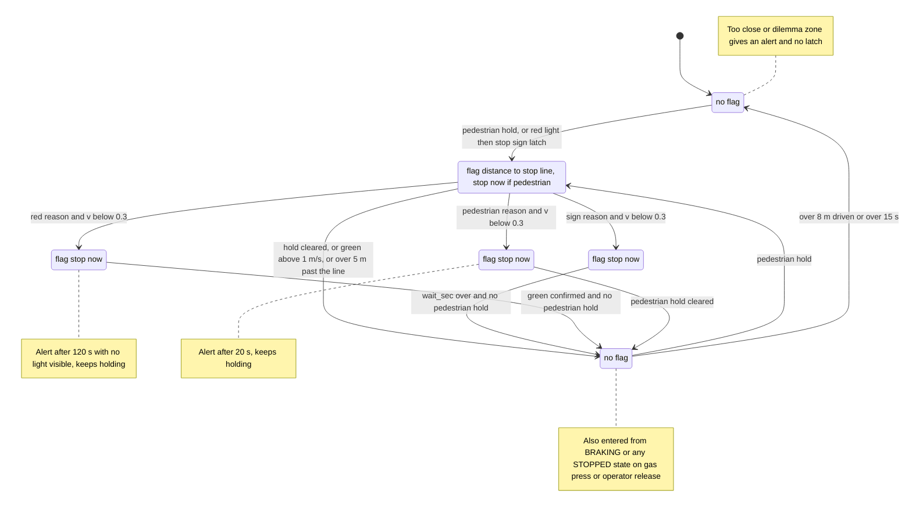
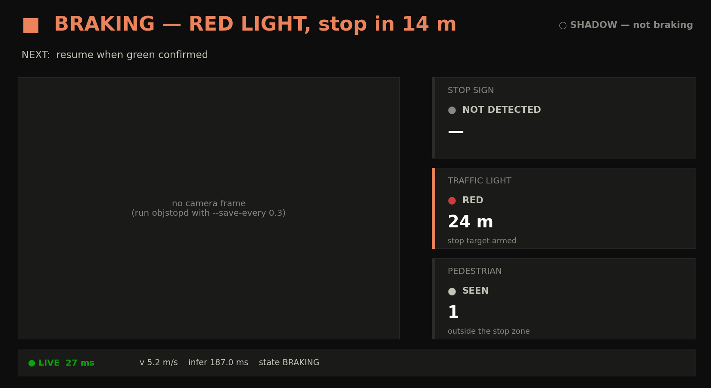

# Vision stop daemon (objstopd)

`objstopd` is a daemon that ran on the comma 3X in era 1 and added something openpilot's own driving model does not provide: a YOLOv8 detector for stop signs, red traffic lights and pedestrians in the forward path. It estimates the distance to the stop line from the bounding-box height, runs a stop / wait / resume state machine at 20 Hz, and publishes its decision as small files in `/tmp`: an actuation flag that a patched planner turned into a smooth stop (only with `--arm`), an intent flag behind the client's `"stop": 0/1`, and a status JSON for two laptop viewers. This page documents the deployed v2.1 code that is in this repo, its tests and tools, and what was only reported or lived on the device.

> [!WARNING]
> **Historical (sunnypilot era).** objstopd ran only on the **Era 1 — sunnypilot 0.9.7.1** device (2026‑07 → 2026‑08; Honda Civic and the no‑CAN truck/bench rig). The device was later re-flashed, at an unrecorded date between 2026‑08‑13 (the last era‑1 file) and 2026‑10‑03 (the era‑2 patch), for **Era 2 — openpilot v0.11.1 `release-tizi` + dashcam‑anywhere** (from 2026‑10‑03), which removed `/data/objstop/`, the manager autostart, the patched planner and the controlsd display hook. Nothing in `remote/Arman/dashcam_anywhere/` reinstalls objstopd, so it is not running on the era‑2 device (inferred; verify with `ssh comma@$COMMA_IP 'ls -d /data/objstop; ps aux | grep objstop | grep -v grep'`, which should only report that `/data/objstop` does not exist; set `COMMA_IP` as in [Running](#running)).

> [!CAUTION]
> `--arm` lets a camera-only detector stop a real car through the patched planner. On the Civic this needed openpilot longitudinal control, which runs without the stock radar and AEB ([07](07-longitudinal-stop.md)). The original notes require SHADOW validation first, a closed area, low speed, and a driver ready to take over with a foot over the brake. objstopd is not a safety system: it misses distant and small objects, reacts at about 4–5 Hz, and does not know which traffic light governs your lane. How to end a vision stop is under [Releasing a hold](#releasing-a-hold), and how to disarm under [Stopping and cleaning up](#stopping-and-cleaning-up). The brake still disengages openpilot immediately (OPERATIONS §0).

## At a glance

| Item | Details |
|---|---|
| Audience | Developers; Civic operators (era 1) |
| Runs on | **Device:** `objstopd.py` + `yolo_infer.py` in `/data/objstop/`. **Laptop:** `objstop_view.py`, `watch_detect.py`, `test_stopsm.py`, `ped_analysis.py` |
| Era | **Era 1 — sunnypilot 0.9.7.1**. `STOP_SIGN_VISION.md` dates v2 to 2026‑07‑25 and v2.1 to 2026‑08‑06 |
| Status | Historical. Code, tests and viewers are included. The ONNX models, the patched planner, the controlsd display hook and the deployed exporter (`stopFlag`) are described, not included. Not on the era‑2 device (inferred) |
| Key files | [`objstopd.py`](../remote/Arman/objstopd.py) (canonical) · [`vision/yolo_infer.py`](../remote/Arman/vision/yolo_infer.py) · [`vision/test_stopsm.py`](../remote/Arman/vision/test_stopsm.py) · [`vision/objstop_view.py`](../remote/Arman/vision/objstop_view.py) · [`watch_detect.py`](../remote/Arman/watch_detect.py) · [`vision/ped_analysis.py`](../remote/Arman/vision/ped_analysis.py) · [`vision/objstopd.py`](../remote/Arman/vision/objstopd.py) (test copy) · [`vision/STOP_SIGN_VISION.md`](../remote/Arman/vision/STOP_SIGN_VISION.md) |

## What it is and what it is not

**It is:**

- **An added detector.** "openpilot's own model does NOT detect these — this is an added YOLOv8 detector" (the warning in [`STOP_SIGN_VISION.md`](../remote/Arman/vision/STOP_SIGN_VISION.md)). The code uses COCO class ids, so it expects a stock COCO-trained YOLOv8 export; no custom training is recorded anywhere.
- **CPU only.** onnxruntime with `CPUExecutionProvider`, numpy and Pillow; no OpenCV and no torch. The [`yolo_infer.py`](../remote/Arman/vision/yolo_infer.py) docstring reports these three as "all present on the comma device".
- **Advisory by default.** In shadow mode (the default) it writes the intent flag, the status file and the camera JPEG, but never the actuation flag. Braking needs `--arm`, the patched planner (described, not included) and openpilot engaged with openpilot longitudinal control ("OP long").
- **Distance-aware.** The flag carries the distance to a stop line, so the planner can glide to the line instead of stopping as soon as something is seen.

**It is not:**

- **An emergency brake.** A "stop now" request asks the planner for zero speed. [`EXPERIMENT_RUNBOOK.md`](../remote/Arman/EXPERIMENT_RUNBOOK.md) §2 describes that path, for the manual stop, as "openpilot's own jerk/accel-limited decel (smooth, not a hard brake)".
- **A lane-aware traffic-light reader.** Any red light high enough in the image counts.
- **A pedestrian-intent predictor.** It reacts to a person inside a forward zone of the image.
- **Field-validated for red lights.** The notes record field results only for stop signs and a pedestrian dummy (the 2026‑08‑04 drives).

## Files and the canonical copy

| File | Role | Notes |
|---|---|---|
| [`remote/Arman/objstopd.py`](../remote/Arman/objstopd.py) | **Canonical, deployed v2.1 daemon.** It writes the actuation **and** the intent flag, uses absolute `/data/objstop/` model paths and defaults to `--save-every 0.3` | Last modified 2026‑08‑06 |
| [`remote/Arman/vision/objstopd.py`](../remote/Arman/vision/objstopd.py) | An earlier v2.1 copy **without the intent flag**. It is kept because `test_stopsm.py` imports `objstopd` from its own directory | Legacy duplicate |
| [`remote/Arman/vision/yolo_infer.py`](../remote/Arman/vision/yolo_infer.py) | ONNX detector module (`from yolo_infer import Detector`). Deploy it next to `objstopd.py` | Device module + small CLI |
| [`remote/Arman/vision/test_stopsm.py`](../remote/Arman/vision/test_stopsm.py) | Simulation tests: KF, planner-ramp mirror, state machine, flag protocol (38 checks) | Laptop |
| [`remote/Arman/vision/objstop_view.py`](../remote/Arman/vision/objstop_view.py) | Laptop status board (matplotlib) | Last modified 2026‑08‑04 |
| [`remote/Arman/watch_detect.py`](../remote/Arman/watch_detect.py) | Laptop console monitor, Chinese UI, with per-gate pedestrian verdicts | Last modified 2026‑08‑13 |
| [`remote/Arman/vision/ped_analysis.py`](../remote/Arman/vision/ped_analysis.py) | Offline pedestrian study with `ultralytics` | Laptop + GPU |
| [`remote/Arman/vision/STOP_SIGN_VISION.md`](../remote/Arman/vision/STOP_SIGN_VISION.md) | Original design and field notes (v2.1, v2, v1 reference) | Partly stale; see [History](#history-v1-v2-and-v21) |
| [`docs/img/objstop_view_selftest.png`](img/objstop_view_selftest.png) | `objstop_view.py --selftest` render | Sample |

Both docstrings say "objstopd v2". A `diff` of the two copies shows that they differ only in these lines. `Track`, `VisionStopSM`, `display_info()`, `to_measurements()` and `InferThread` are byte-identical.

| Aspect | `Arman/objstopd.py` (canonical) | `Arman/vision/objstopd.py` |
|---|---|---|
| Intent flag `/tmp/op_stop_intent` | written every tick, cleared at exit | absent |
| `write_flag()` | `write_flag(flag, now, path=STOP_FLAG)` | `write_flag(flag, now)`: actuation file only |
| `--onnx-320` default | `/data/objstop/yolov8n_320.onnx` | `yolov8n_320.onnx` (relative to the working directory) |
| `--onnx-640` default | `/data/objstop/yolov8n.onnx` | `yolov8n.onnx` |
| `--save-every` default | `0.3` (camera JPEG on) | `0.0` (no JPEG) |
| Exit message | `[objstopd] exit; flags cleared` | `[objstopd] exit; flag cleared` |

Deploy `remote/Arman/objstopd.py` together with `remote/Arman/vision/yolo_infer.py`. The `vision/` copy is only there for the tests.

## On-device layout (era 1)

| Device path | What | In this repo |
|---|---|---|
| `/data/objstop/objstopd.py` | the daemon | [`remote/Arman/objstopd.py`](../remote/Arman/objstopd.py) |
| `/data/objstop/yolo_infer.py` | the detector module | [`remote/Arman/vision/yolo_infer.py`](../remote/Arman/vision/yolo_infer.py) |
| `/data/objstop/yolov8n_320.onnx` | default model, 320 input | no (see below) |
| `/data/objstop/yolov8n.onnx` | high-speed model, 640 input | no |
| `/data/objstop/yolov8s_320.onnx` | optional larger model ("97% but 2 Hz", v2.1 note) | no |
| `/data/objstop/manual_mode` | operator flag that disables the autostart | created by hand |
| `/data/openpilot/tools/objstop_launcher.py` | manager shim | written by [`enable_dashcam_mode.py`](../remote/Arman/enable_dashcam_mode.py) |
| `/data/openpilot/system/manager/process_config.py` | the `objstopd` process entry | patched by `enable_dashcam_mode.py` (backup `.bak_arman_auto`) |

`/data/objstop/` was also the staging folder for the era‑1 no‑CAN scripts and `exporter_nocan.py` ([10](10-no-can-mode-sunnypilot.md)) and for `stop_udp.py` ([09](09-stop-signal-udp.md)). The v1 note also lists a 480-input model (`yolov8n_320.onnx` / `_480` / `yolov8n.onnx`); v2 does not use one.

### ONNX models

> [!NOTE]
> **Described, not included.** The model files lived only in `/data/objstop/` on the era‑1 device. Ultralytics YOLOv8 code and weights are AGPL‑3.0, so this repo ships no weights and `.gitignore` excludes `*.onnx` and `*.pt`. See [`THIRD_PARTY_NOTICES.md`](../THIRD_PARTY_NOTICES.md). Obtaining, exporting and deploying the models is your responsibility and may carry AGPL‑3.0 obligations.

What the code expects (from [`yolo_infer.py`](../remote/Arman/vision/yolo_infer.py) → `Detector`):

- One input, `float32`, NCHW, RGB scaled to 0..1, fed as a **square tensor of size `imgsz`**. objstopd builds a 320 detector from `--onnx-320` and a 640 detector from `--onnx-640`, so each file must accept that input size. A standard static export at that `imgsz` does.
- One output of shape `(1, 84, N)`: 4 box values (centre x, centre y, w, h in input pixels) followed by 80 COCO class scores. The code comment gives `(1, 84, 8400)` for 640 input.
- Both files are loaded when the inference thread starts. If `/data/objstop/yolov8n.onnx` is missing, pass `--onnx-640 ''`. **Analysis (from code; not field-tested):** otherwise the `Detector` constructor raises, the inference thread dies, and the main loop keeps running with no detections (see [Troubleshooting](#troubleshooting)).

### Exporting the models (reconstructed)

**Reconstructed procedure.** The notes do not record how the files were exported. `ped_analysis.py`'s docstring runs it from a virtualenv named `yolo_export`, which suggests that environment was also used for the export. The commands below are the standard Ultralytics export and produce the layout described above.

```bash
# laptop
# outside the repo; installs Ultralytics (AGPL-3.0); yolov8n.pt / yolov8s.pt download on first use
python3 -m venv yolo-env && yolo-env/bin/pip install ultralytics
yolo-env/bin/yolo export model=yolov8n.pt format=onnx imgsz=320 && mv yolov8n.onnx yolov8n_320.onnx
yolo-env/bin/yolo export model=yolov8n.pt format=onnx imgsz=640        # -> yolov8n.onnx (640 input)
yolo-env/bin/yolo export model=yolov8s.pt format=onnx imgsz=320 && mv yolov8s.onnx yolov8s_320.onnx   # optional
```

If the device's onnxruntime rejects a file (an opset or IR version that is too new), re-export with a lower `opset=` value. The version used originally is not recorded.

### Manager autostart and the launcher

[`enable_dashcam_mode.py`](../remote/Arman/enable_dashcam_mode.py) (step 3, "objstopd auto-start under manager") wrote this launcher to `/data/openpilot/tools/objstop_launcher.py`:

```python
import os
import sys


def main():
  sys.path.insert(0, '/data/objstop')
  os.chdir('/data/objstop')
  sys.argv = [sys.argv[0]]      # manager argv must not leak into argparse
  import objstopd
  objstopd.main()


if __name__ == '__main__':
  main()
```

It also added a condition function and a process entry to `system/manager/process_config.py`. The entry goes right after the existing `reg_export` entry, which is the anchor:

```python
# inserted before `def driverview(` (and `import os` added before `from cereal import car` if missing):
def objstop_auto(started, params, CP) -> bool:
  # vision stop daemon: onroad (incl. forced dashcam mode), shadow by default;
  # `touch /data/objstop/manual_mode` disables auto-start for manual --arm runs
  return started and not os.path.exists('/data/objstop/manual_mode')

# inserted in the process list, right after the anchor line:
  PythonProcess("reg_export", "tools.reg_export.exporter", always_run),
  PythonProcess("objstopd", "tools.objstop_launcher", objstop_auto),
```

Consequences:

- Because `sys.argv` is reset, the autostarted instance always runs with **default arguments**. That means **shadow** mode, both default models, and a JPEG every 0.3 s. So both `/data/objstop/yolov8n_320.onnx` and `/data/objstop/yolov8n.onnx` must exist: `--onnx-640 ''` cannot be passed to it, and a missing file leaves it running with no detections (see [ONNX models](#onnx-models)).
- `started` is true whenever the device is onroad. That includes the Civic, not only forced dashcam mode. **Run `touch /data/objstop/manual_mode` before any manual run**, or two instances run at once (erratum 18 in [16](16-errata-and-crosswalk.md)).
- [`enable_fake_ignition_autostart.py`](../remote/Arman/enable_fake_ignition_autostart.py) later used this `objstopd` entry as the anchor for its own entry ([10](10-no-can-mode-sunnypilot.md)).

> [!NOTE]
> **Reported in `OPERATIONS.md`.** §3.1 (translated) says the dashcam mode, including the objstopd autostart, was "applied and verified 2026-08-06". After a reboot with no car, `IsOnroad=1` and camerad, modeld, locationd, objstopd and port 7700 were all up. The `fake_ignition.py` docstring also lists objstopd among the processes "verified running with real_ign=False". STOP_SIGN_VISION.md still lists autostart as "not yet done"; that line is stale (erratum 27).

## Pipeline and threads



The two threads share one small dict (`shared` in `main()`) with three keys: `quit`, `state` (used to pick the camera) and `v_ego` (used to pick the model).

**Inference thread** ([`objstopd.py`](../remote/Arman/objstopd.py) → `InferThread.run()`):

1. Creates `Detector(--onnx-320, conf=--conf, imgsz=320, class_conf={0: --ped-conf})`. It also creates the same detector at 640 from `--onnx-640`, unless that flag is `''`.
2. Opens two VisionIPC clients to `camerad`: `VISION_STREAM_ROAD` (narrow) and `VISION_STREAM_WIDE_ROAD`. The narrow connection is retried every 0.5 s until it succeeds; offroad, with no camerad, it waits forever. The wide stream gets one non-blocking attempt. The thread then prints `[objstopd] narrow <W>x<H> connected; wide=ok|NO`.
3. Each frame, it picks the wide camera on every other frame, but only while the shared state is `STOPPED_RED` and the wide client is connected. It then calls `recv()`. If `recv()` returns nothing, it sleeps 50 ms and tries again; for the wide client it first attempts a reconnect. The frame time is `time.monotonic()` taken right after `recv()` returns.
4. `extract_image()` subsamples Y, U and V by 2 **before** converting NV12 to RGB (`yuv_to_rgb()`). The native 1928×1208 narrow frame becomes 964×604, so detector pixel sizes are half the native sizes. [`THIRD_PARTY_NOTICES.md`](../THIRD_PARTY_NOTICES.md) notes that these two functions are adapted from openpilot's camerad `snapshot.py`.
5. Wide frames are cropped to a centre-top region: rows 0–55 %, columns 20–80 %. That is where overhead lights appear. The wide camera is needed because, per the v2 note, the fisheye "sees overhead lights the narrow cam loses inside ~17 m", while a car stopped for a red light waits about 10 m before it (the light setback).
6. It uses the 640 model when that model exists, the shared `v_ego` is above 8 m/s **and** the frame is narrow. Otherwise it uses the 320 model.
7. `to_measurements()` turns the detections into state-machine measurements (see [Relevance gates](#relevance-gates)).
8. It calls `put_nowait()` with `{t, cam, meas, ped, infer_ms, imgsz, dets}` into a queue of size 8. When the queue is full, the new result is dropped.
9. Every `--save-every` seconds it draws the boxes and saves `/tmp/objstop_last.jpg`.

**Main loop** ([`objstopd.py`](../remote/Arman/objstopd.py) → `main()`), on a 50 ms period:

1. `dt = min(now - last, 0.2)` on `time.monotonic()`.
2. If `cereal.messaging` imports, `SubMaster(['carState'])` supplies `vEgo` and `gasPressed`, updated only when a new carState arrives. With no carState, `v_ego` stays `0.0` (see [Without carState](#without-carstate-no-can-rig)).
3. Drains the queue. Each measurement that has a distance is moved forward to "now": `d -= v_ego * (now - t_frame)`. Pedestrian flags are OR-ed, and the last `dets` and `infer_ms` are kept.
4. If `/tmp/op_stop_release` exists, deletes it and passes `release=True` (see [Release flag](#release-flag)).
5. `VisionStopSM.update(now, dt, v_ego, meas, ped, gas, release)`.
6. With `--arm`, calls `write_flag()` on the actuation file. It always calls `write_flag()` on the intent file.
7. `display_info()` and the status JSON, written atomically.
8. Prints a console line whenever a flag or an alert is active.
9. Sleeps for the rest of the 50 ms. SIGINT or SIGTERM ends the loop, and the `finally` block clears objstopd's own flags.

## Detection with yolo_infer

[`yolo_infer.py`](../remote/Arman/vision/yolo_infer.py) is "YOLOv8 (COCO) ONNX inference, pure numpy post-processing".

| Step | Implementation (`Detector.detect()` and helpers) |
|---|---|
| Classes kept | `KEEP = {PERSON, TRAFFIC_LIGHT, STOP_SIGN}` = COCO ids **0, 9, 11**. Every other class is discarded |
| Session | `onnxruntime.InferenceSession(..., providers=["CPUExecutionProvider"])`, `intra_op_num_threads=4`, `inter_op_num_threads=1` |
| Letterbox | `letterbox()`: keeps the aspect ratio, resizes with PIL bilinear, pads to `imgsz × imgsz` with grey 114, centred |
| Inference | input `/255.0` in NCHW. `last_ms` times **only** `sess.run()`; this is the `infer_ms` in the status |
| Decoding | per anchor: class = argmax of the 80 scores, confidence = max. Threshold `conf > thr`, where `thr` is `conf` by default with per-class overrides from `class_conf` (objstopd: person 0.30, others 0.4). Boxes go from centre-xywh to xyxy, the letterbox is undone, and boxes are clipped to the image |
| NMS | `nms()`: pure numpy, **per class**, IoU 0.45 |
| Light colour | `classify_light_color()` on each traffic-light crop (below) |
| Output | `Det` objects: `cls`, `name`, `conf`, `x1..y2` in the pixels of the image passed in (the subsampled frame or the wide crop), `color`. Properties `w`, `h`, `cx`, `cy` |

**Analysis (from code; not field-tested).** For a sense of scale: the 964×604 subsampled frame is letterboxed to 320×200 inside a 320×320 input (scale 0.332), or to 640×401 inside 640×640 (scale 0.664). The 320 model therefore sees the road at about 1/6 of native resolution, and the 640 model at about 1/3.

### Traffic-light colour

`classify_light_color(crop)` converts the RGB crop to PIL HSV, where hue runs 0..255 for 0..360°. Pixels with saturation > 60 and value > 90 count as lit lamp pixels. It returns `None` when the crop is smaller than 3×3 or has fewer lit pixels than `max(4, 1 % of the crop)`. Otherwise each lit pixel votes:

| Colour | PIL hue | ≈ degrees |
|---|---|---|
| red | `< 12` or `> 244` | below 16.9° or above 344.5° |
| yellow | `12 ≤ h < 50` | 16.9°–70.6° |
| green | `50 ≤ h < 110` | 70.6°–155.3° |

The colour with the most votes wins. A light with `color` `yellow` or `None` is **ignored by the state machine** (see [Green confirmation](#green-confirmation)).

### Speed

> [!NOTE]
> **Reported in `STOP_SIGN_VISION.md`.** v1 section, "SDA845, CPU-only, onnxruntime", model forward pass only:
>
> | input | infer | rate (fwd only) | use |
> |---|---|---|---|
> | 640 | ~616 ms | ~1.6 Hz | best range, small/distant lights |
> | 480 | ~360 ms | ~2.8 Hz | balance |
> | 320 | ~185 ms | ~5.4 Hz | default — low-speed, closest range |
>
> The note adds "~50–100 ms/frame for NV12→RGB" (v1 had no subsampling) and "At 320 the end-to-end rate is ~4 Hz". The v2 section gives "640 when vEgo>8 m/s for ~66 m range, else 320 at ~5 Hz". The v2.1 section gives `yolov8s_320.onnx` "97% but 2 Hz — default stays v8n@5 Hz whose temporal redundancy wins". Distant traffic lights "are the first to be missed" at small input sizes.

### yolo_infer CLI

`yolo_infer.py` also runs on its own, for a benchmark or a single image:

| Flag | Default | Meaning |
|---|---|---|
| `--onnx` | required | model file |
| `--image` | none | image to detect on. Draws labelled boxes and saves `--out` |
| `--imgsz` | `640` | letterbox size. Must match the model's input size |
| `--conf` | `0.35` | threshold for all classes (no per-class override in the CLI) |
| `--bench` | `0` | N timing runs on a random 1928×1208 RGB image without colour classification. The first run is discarded, then it prints `infer-only: mean …ms p50 … p90 … -> ~… Hz (model fwd only)` |
| `--out` | `annotated.jpg` | output image for `--image` |

An optional check on the device, once the files are deployed ([Deploying the files](#deploying-the-files); `COMMA_IP` is set as in [Running](#running)):

```bash
# device  (ssh comma@$COMMA_IP)
# era 1 interpreter; optional check that onnxruntime and the model load
cd /data/objstop && /usr/local/pyenv/versions/3.11.4/bin/python3 yolo_infer.py --onnx yolov8n_320.onnx --imgsz 320 --bench 20
```

> [!NOTE]
> **Reported in `STOP_SIGN_VISION.md`.** v1 "Validated on the device (offroad, static images)": person (bus.jpg → 4 people, 0.90/0.88/0.87); stop sign (0.67, "even a symbol-only sign"); traffic light (0.73) with colour = red; and synthetic red/green/yellow crops all classified correctly.

## Relevance gates

[`objstopd.py`](../remote/Arman/objstopd.py) → `to_measurements(dets, W, H, t_frame, args, cam)` decides which detections matter. `W` and `H` are the size of the image the detector saw: 964×604 for narrow frames, or the wide crop.

| Class | Camera | Gate | Produces |
|---|---|---|---|
| stop sign (11) | narrow only | pinhole distance `3.0 < d < 90.0` m | `{cls: "stop_sign", d, color: None}` |
| traffic light (9) | narrow | box centre `cy ≤ --tl-max-cy × H` (default: upper 60 % of the frame) | `{cls: "red_light", d (pinhole), color}` |
| traffic light (9) | wide (crop) | none | `{cls: "red_light", d: None, color}`: colour only, no distance from the fisheye |
| person (0) | narrow only | **all three:** centre `cx` within `[--ped-band-lo × W, --ped-band-hi × W]` (0.2–0.8); box height × 2 ≥ `--ped-min-h` (90 native px); bottom edge `y2 ≥ --ped-min-bottom × H` (lower 55 % of the frame) | `ped_active = True` for this frame. People get no distance |

Every traffic-light measurement is labelled `red_light` whatever its colour; the state machine filters by colour. Stop signs and people seen on wide frames are ignored.

**Analysis (from code; not field-tested).** With the 1.7 m person height that `watch_detect.py` uses for display, the 90 native px height gate corresponds to about 2648 × 1.7 / 90 ≈ 50 m.

## Distance estimation

### Pinhole model

`pinhole_d(h_native_px, H_m)` = `f · H / h`, with `f = F_NARROW = 2648` px. The code comment says: "narrow road camera (comma 3X, OX03C10): 1928x1208, focal 2648 px". `h` is the box height × `SUBSAMPLE` (2), in native pixels. Heights of 1 native px or less give no distance.

| Target | Assumed height `H` | Constant |
|---|---|---|
| stop sign | 0.75 m ("US 30" stop sign face") | `SIGN_H` |
| traffic light | 1.07 m ("3-lamp traffic light housing") | `LIGHT_H` |

Distances come from the narrow camera only. A stop sign is 662 native px tall at 3 m and 22 px at 90 m (computed from these constants).

### One-state Kalman filter per target

`Track` keeps one distance estimate per class. There are exactly two tracks, `stop_sign` and `red_light`.

| Part | Rule |
|---|---|
| Measurement noise | `σ_h = H_PX_NOISE = 6` native px, so `σ_d = d² · σ_h / (f · H)` and `R = max(σ_d², 0.04)` (`meas_R()`) |
| Predict (every tick) | `d -= v · dt`; `P += (0.02 · v · dt + 0.005)²`. This is odometry from `vEgo` with 2 % speed error plus 5 mm |
| First measurement | `d = d_meas`, `P = R`, `hits = 1` |
| Gate | reject when `\|innov\| > max(3.0, 3 · √(P + R))` |
| Accepted update | `K = P / (P + R)`; `d += K · innov`; `P *= (1 − K)`; `hits += 1`; `rejects = 0` |
| Re-initialisation | after **4 consecutive rejections**, an *unlatched* track restarts at the new measurement (`hits = 1`, `latched` and `waived` cleared). This handles "persistent mismatch -> new object" |
| Staleness | at the start of each tick, an *unlatched* track with no accepted update for **more than 3 s** is reset. A latched track is never reset this way; it keeps dead-reckoning until the state machine enters RESUMING |

Example noise for a stop sign, computed with the code's constants:

| d | 10 m | 20 m | 40 m | 80 m |
|---|---|---|---|---|
| `σ_d` | 0.30 m | 1.21 m | 4.83 m | 19.34 m |

### Latency compensation

Measurements reach the main loop after RGB conversion, inference and queueing. The loop shifts each distance by the distance driven since the frame was received: `d − vEgo · (now − t_frame)`. `t_frame` is taken when `recv()` returns, so camera-side delay before that point is not compensated.

## State machine

[`objstopd.py`](../remote/Arman/objstopd.py) → `VisionStopSM.update(now, dt, v, meas, ped_active, gas_pressed=False, release=False)`. Every edge below was checked against this method.



### Tick order

Each call to `update()` does these steps in this order:

1. Clears `alert` and integrates odometry: `odo += v · dt`.
2. For each track, runs `predict(v, dt)` and resets an unlatched track that has been stale for more than 3 s.
3. `_ped_update()`: pedestrian confirmation and release (see [Pedestrian hold](#pedestrian-hold)).
4. `_feed()`: green events, red memory and track updates, with the RESUMING minimum distances.
5. **Override.** If `gas_pressed` or `release` is set and the state is BRAKING or any STOPPED_*, it enters RESUMING and clears `ped_hold` and the sighting history.
6. **Exactly one** state branch runs (an `if/elif` chain).
7. The flag is computed from the resulting state.

Because step 6 runs a single branch, after a step‑6 transition the new state's own logic waits for the next tick. For example, DRIVING → BRAKING and BRAKING → STOPPED_* can happen no faster than 50 ms apart. After a step‑5 override, the RESUMING branch does run in the same tick.

### Transition table

| # | From | To | Condition (code) | Notes |
|---|---|---|---|---|
| 1 | DRIVING | BRAKING, reason `pedestrian` | `ped_hold` | checked before any target |
| 2 | DRIVING | BRAKING, reason `red_light` | `_try_latch("red_light", v)` succeeds | the red light is tried first |
| 3 | DRIVING | BRAKING, reason `stop_sign` | `_try_latch("stop_sign", v)` succeeds | only if the red light did not latch this tick |
| 4 | BRAKING (pedestrian) | STOPPED_PED | `v < 0.3` | sets `t_standstill` |
| 5 | BRAKING (pedestrian) | RESUMING | `v ≥ 0.3` and not `ped_hold` | |
| 6 | BRAKING (`red_light`) | RESUMING | green confirmed and `v > 1.0` | "light turned green on approach"; checked before row 7 |
| 7 | BRAKING (`stop_sign` / `red_light`) | STOPPED_SIGN / STOPPED_RED | `v < 0.3` | sets `t_standstill` |
| 8 | BRAKING (`stop_sign` / `red_light`) | RESUMING | `track.d − setback < −5.0` | "somehow passed the target (override etc.)". With the 10 m light setback this means a light track below 5 m |
| 9 | STOPPED_SIGN | RESUMING | not `ped_hold` and `now − t_standstill ≥ --wait-sec` | the sign may still be in view |
| 10 | STOPPED_RED | RESUMING | not `ped_hold` and green confirmed | no timeout: "red absent" never resumes |
| 11 | STOPPED_PED | RESUMING | not `ped_hold` | |
| 12 | RESUMING | BRAKING, reason `pedestrian` | `ped_hold` | |
| 13 | RESUMING | DRIVING | `odo − resume_odo > 8.0` m or `now − resume_t > 15.0` s | |
| 14 | BRAKING or any STOPPED_* | RESUMING | `gas_pressed` (carState) or a consumed release file | step 5, before rows 4–11. Also clears `ped_hold` |

Every entry into RESUMING (`_enter_resuming()`) records the odometry and time, **resets both tracks**, clears the green memory and sets `reason` to none.

### Latch rule and dilemma-zone guard

`_try_latch(cls, v)` runs only in DRIVING. It needs a track with a distance that is not latched, not waived and has **at least 3 hits** (the first measurement counts as one). Then:

1. `d_line = track.d − setback`, where the setback is `--sign-setback` 3 m or `--tl-setback` 10 m. If `d_line ≤ 0.5` m, the track is **waived** with the alert `<cls> too close to stop`.
2. `a_req = v² / (2 · max(d_line, 0.1))`. If `a_req > A_MAX_LATCH` (1.1 m/s²), the track is **waived** with the alert `<cls> dilemma zone (need X.X m/s^2) - continuing`, meaning "never brake into the middle of an intersection".
3. Otherwise the track is `latched = True` and the state becomes BRAKING.

The decision is made on the first DRIVING tick on which the track has at least 3 hits. A waived track never latches until the track is reset (stale for 3 s, re-initialised after 4 rejections, or on entering RESUMING). The alert text appears only on the tick of the decision. After that, the waiver shows in `tracks.<cls>.waived` and in the viewers.

**Analysis (from code; not field-tested).** The minimum distance to the target at the moment of the latch decision, for a latch to succeed:

| Speed | `d_line` needed (`v² / 2.2`) | Stop sign at least | Traffic light at least |
|---|---|---|---|
| 3 m/s (10.8 km/h) | 4.1 m | 7.1 m | 14.1 m |
| 5 m/s (18 km/h) | 11.4 m | 14.4 m | 21.4 m |
| 8 m/s (28.8 km/h) | 29.1 m | 32.1 m | 39.1 m |
| 10 m/s (36 km/h) | 45.5 m | 48.5 m | 55.5 m |
| 12 m/s (43.2 km/h) | 65.5 m | 68.5 m | 75.5 m |

### Pass-tracking

v2 replaced v1's fixed cooldown with pass-tracking, so a served sign cannot latch again while the car pulls away:

- Entering RESUMING resets both tracks.
- While in RESUMING, a measurement may **start** a new track only if it is at least **12 m** away (stop sign) or **10 m** (light). An existing track accepts any distance.
- RESUMING never latches, because latching happens only in DRIVING. It ends after 8 m of odometry or 15 s. A new sign tracked during RESUMING can latch on the first DRIVING tick ("a new sign ≥12 m ahead can — closely spaced intersections work", v2 note).

### Green confirmation

- Every traffic-light measurement whose colour is `green`, from either camera, adds its frame time to a memory of up to 8 events, at most one per 0.15 s (`_feed()`).
- `_green_confirmed(now)` is true when at least 2 events lie within the last 1.5 s, the oldest of them is at least 0.5 s old, and the newest is less than 0.8 s old. The earliest possible confirmation is therefore 0.5 s after the first green. **Analysis (from code; not field-tested):** a scratch simulation with green events at 20, 5 and 4 Hz confirmed after exactly 0.50 s.
- Green confirmation is used in BRAKING (red light, `v > 1` m/s) and in STOPPED_RED. The memory is cleared only on entering RESUMING.
- Only `red` lights update the red track and `red_last_seen`. **Yellow lights and lights whose colour was not classified are ignored entirely**: they create no track and no green event.

### Pedestrian hold

`_ped_update()` uses an N-of-M rule:

- A *sighting* is a 20 Hz tick in which at least one fresh inference result had a person passing all three gates.
- **2 sightings within 1.0 s** set `ped_hold`. This "kills single-frame false stops".
- `ped_hold` is released only after `--clear-sec` (1.5 s) with no sighting (sticky), or immediately by a gas press or a release.
- `ped_hold` acts in every state. It starts a pedestrian stop from DRIVING or RESUMING, blocks the STOPPED_SIGN and STOPPED_RED resumes, and forces the stop-now flag in BRAKING and STOPPED_*. A pedestrian confirmed while braking for a sign keeps reason `stop_sign`, so the car ends in STOPPED_SIGN, which waits for the pedestrian to clear.

### Alerts

| Alert text | When | Effect |
|---|---|---|
| `<cls> too close to stop` | first latch attempt with `d_line ≤ 0.5` m | track waived; one tick |
| `<cls> dilemma zone (need X.X m/s^2) - continuing` | first latch attempt with `a_req > 1.1` | track waived; one tick |
| `no light visible >120s - holding, driver decides` | STOPPED_RED for more than 120 s, red not seen for more than 10 s (or never), and no stored green event | keeps holding; repeats every tick |
| `PEDESTRIAN HOLD >20s - tap gas or send release to go` | STOPPED_PED with `ped_hold` for more than 20 s since standstill | keeps holding; repeats every tick |

`<cls>` is `stop_sign` or `red_light`.

### Flag output per state

| State | `flag` returned | Content written to the flag file(s) |
|---|---|---|
| DRIVING, RESUMING | `None` | file deleted if it contains `src=v` |
| BRAKING (`stop_sign` / `red_light`), no `ped_hold` | `("dist", max(track.d − setback, 0))` | `d=<metres to the stop line> t=<monotonic> src=v` |
| BRAKING (pedestrian), or any BRAKING with `ped_hold` | `("now",)` | `d=0.00 t=<monotonic> src=v` |
| STOPPED_SIGN, STOPPED_RED, STOPPED_PED | `("now",)` | `d=0.00 t=<monotonic> src=v` |

How the planner uses the distance is described, not included. The device's planner v2 caps `v_cruise` at `sqrt(2 · 0.8 · d_eff)` with `d_eff = d − 0.5 · v`, and latches a full stop when `d_eff < 2` m or the cap falls below 0.5 m/s. The on-disk mirror is `test_stopsm.py` → `planner_ramp()`. objstopd's `A_STOP = 0.8` "must match the planner ramp". Details are in [07](07-longitudinal-stop.md).

### Without carState (no-CAN rig)

> [!NOTE]
> **Reported in `OPERATIONS.md`.** §3.3, translated: "no vEgo → the distance KF has no dead reckoning and distance accuracy degrades (detection itself is unaffected)". The `enable_dashcam_mode.py` docstring says that without CAN "controlsd/card simply wait for a car and do nothing".

> [!IMPORTANT]
> **Analysis (from code; not field-tested).** If no `carState` is published, `v_ego` stays `0.0` and `gas` stays false. Then:
>
> - prediction and latency compensation do nothing, `a_req` is always 0 (no dilemma waiver, though "too close" still applies), and the 640 model is never used;
> - BRAKING lasts one tick, because `v < 0.3` holds at once;
> - a confirmed stop sign more than 3.5 m (and less than 90 m) ahead gives STOPPED_SIGN for `--wait-sec`, then RESUMING. Odometry never reaches 8 m, so RESUMING ends only on its 15 s timer, and the cycle repeats while the sign stays in view. Scratch simulations with a sign held at 8 m or 30 m and detections at 5 Hz gave **"1" pulses of about 3.05–3.1 s every about 18.15–18.6 s**: about 18.15 s for the sign at 30 m, whose track is rebuilt during RESUMING, and about 18.6 s at 8 m, because RESUMING ignores new detections closer than 12 m and the track must collect 3 fresh hits in DRIVING (the exact figures shift by a tick or two with how detections line up with the 50 ms loop);
> - a red light gives STOPPED_RED until green is confirmed or a release arrives (there is no gas input). The RESUMING that follows clears the flag for its 15 s only: a light that is still red and more than 10.5 m away then latches again. A pedestrian gives STOPPED_PED until the person has been out of the gates for `--clear-sec`.
>
> This is what the intent flag, and therefore `"stop"` and the 0/1 byte, would show on a truck ([06](06-client-interface-spec.md), [09](09-stop-signal-udp.md)).

## Outputs

| File | Written | Readers |
|---|---|---|
| `/tmp/op_stop_requested` (actuation) | every tick while stopping, **only with `--arm`** | patched planner (described, not included), `stop_udp.py`, `experiment.py status` |
| `/tmp/op_stop_intent` (intent) | every tick while stopping, **shadow and armed** | deployed exporter `stopFlag` (described, not included), `stop_udp.py` |
| `/tmp/op_stop_release` (release) | by the operator (`experiment.py release`); consumed by objstopd | objstopd |
| `/tmp/objstop_status.json` | every tick (atomic) | `objstop_view.py`, `watch_detect.py`, controlsd hook (described, not included) |
| `/tmp/objstop_last.jpg` | every `--save-every` s | `objstop_view.py` |

`/tmp` is cleared on reboot: "a reboot also clears it (tmpfs)" (v1 note), and "`sudo reboot` (all /tmp flags are cleared automatically)" (OPERATIONS §4).

### Actuation flag

`/tmp/op_stop_requested` ("ACTUATION: the planner brakes on this (--arm only)"), written by [`objstopd.py`](../remote/Arman/objstopd.py) → `write_flag()`:

- Content: `d=<%.2f> t=<%.3f> src=v`, with `t` from `time.monotonic()`, for example `d=12.35 t=100.050 src=v`. "Stop now" is written as `d=0.00`.
- The write is atomic: `<path>.tmp` is written, then `os.replace()`. Write errors are ignored.
- When the state machine has no stop, the file is deleted **only if it contains `src=v`**. A foreign file, such as the empty file from `experiment.py stop` (`touch`), is left alone: "never delete a file we didn't write (manual stops)".
- Normal exit (SIGINT/SIGTERM) deletes it if it is objstopd's. A SIGKILL, or the hang-up of a closed SSH session ([Manual run, shadow first](#manual-run-shadow-first)), leaves it behind, and the planner then ignores it after 1 s ("daemon-crash fail-safe").
- Planner parse rules (mirror: `test_stopsm.py` → `parse_flag()`): absent → normal driving; empty → stop now; garbled → stop now; `now − t > 1` s → ignored (a missing `t` counts as 0, so a foreign `key=value` file without `t` is ignored, not a stop); `d ≤ 0` → stop now; otherwise the distance ramp. See [07](07-longitudinal-stop.md#parse-rules).

> [!IMPORTANT]
> **Analysis (from code; not field-tested).** A manual stop and an *armed* objstopd share this file. If objstopd starts its own stop while a manual empty file exists, `os.replace()` overwrites that file with `src=v` content, and objstopd deletes it when its stop ends, which cancels the manual stop. Likewise, `touch` on a file that objstopd already wrote does not change its content. So the v2 note's "objstopd never deletes a file it didn't write" holds only while objstopd is not stopping itself (A-item A16 in [16](16-errata-and-crosswalk.md#additional-inconsistencies-found-in-this-review)).

### Intent flag

`/tmp/op_stop_intent` ("INTENT: written always (shadow too) -> exporter "stop":0/1 reflects the vision decision even when nothing is braking (dashcam / shadow)"). It has the same content and deletion rules as the actuation flag and is written on every tick, armed or not. It is cleared at normal exit, and the `vision/` copy does not write it.

- The deployed exporter derived `stopFlag` from the actuation and intent flags, and OPERATIONS §3.2 says the actuation flag has priority. That exporter is described, not included. `cp_export.py` copies `stopFlag.stop` into the client JSON's `"stop"` in live mode ([06](06-client-interface-spec.md)).
- The baseline [`exporter_device.py`](../remote/exporter_device.py) in this repo has no `stopFlag`, so `"stop"` stays 0 with it (erratum 9).
- [`stop_udp.py`](../remote/Arman/stop_udp.py) sends `"1"` whenever either flag file exists. It checks only that the file exists, not its age ([09](09-stop-signal-udp.md)).

> [!NOTE]
> **Reported in `OPERATIONS.md`.** §3.2, translated: in dashcam mode "objstopd writes the intent flag even in shadow — when it detects a reason to stop (stop sign / red light / pedestrian) → JSON/UDP top-level `"stop":1`, on resume → `0`. The client can use it directly to drive the truck's own braking."

### Release flag

`/tmp/op_stop_release` ("touch -> one-shot operator release (go)"):

- The main loop checks for the file every tick. When it exists, the loop deletes it, prints `[objstopd] operator RELEASE received` and passes `release=True` to the state machine.
- It acts only in BRAKING or STOPPED_* (row 14), and it is **consumed in any state**. A release sent while DRIVING or RESUMING is lost.
- It is written by [`experiment.py`](../remote/Arman/experiment.py) `release`, which runs `ssh … "touch /tmp/op_stop_release"` and prints `⏩ RELEASE sent (objstopd will resume)`.

### Status JSON

`/tmp/objstop_status.json` is written every tick through `objstop_status.json.tmp` + `os.replace()` ([`objstopd.py`](../remote/Arman/objstopd.py) → `main()`).

| Key | Type | Meaning |
|---|---|---|
| `t` | float | device wall clock `time.time()` (Unix seconds) when written; wrong until the device has GPS time (erratum 24) |
| `state` | string | `DRIVING`, `BRAKING`, `STOPPED_SIGN`, `STOPPED_RED`, `STOPPED_PED` or `RESUMING` |
| `reason` | string or null | `stop_sign`, `red_light` or `pedestrian`; null in DRIVING and RESUMING |
| `ped_hold` | bool | confirmed pedestrian hold |
| `alert` | string | `""` or one of the [alerts](#alerts) |
| `action`, `next`, `level`, `screen1`, `screen2` | strings | from `display_info()`, below |
| `wait_left` | float or null | seconds left of the stop-sign hold (STOPPED_SIGN only) |
| `flag` | null, `"now"` or number | null = no stop, `"now"` = stop now, number = metres to the stop line (2 dp) |
| `armed` | bool | `--arm` was given |
| `v_ego` | float | m/s, 2 dp |
| `infer_ms` | float | last model forward time, ms, 1 dp. Stays `0.0` if no inference result ever arrived |
| `tracks` | object | `stop_sign` and `red_light`: null, or `{d (1 dp), hits, latched, waived}`. This `d` is the filtered distance to the sign or light itself, in m. `flag` carries the distance to the stop line, `d` minus the setback, while braking for that target |
| `dets` | list | detections of the last inference result: `{cls, name, conf (3 dp), box [x1, y1, x2, y2] in detector-image px, color}` |

Example: shadow mode, approaching a red light at 5.2 m/s. The object was generated by feeding four synthetic red-light measurements (24 m) through the real `VisionStopSM`, `display_info()` and status-building code. `t`, `infer_ms` and `dets` are illustrative.

```json
{
  "t": 1785990000.123,
  "state": "BRAKING",
  "reason": "red_light",
  "ped_hold": false,
  "alert": "",
  "action": "BRAKING — RED LIGHT, stop in 14 m",
  "next": "resume when green confirmed",
  "level": "prompt",
  "screen1": "VISION: RED LIGHT",
  "screen2": "braking — stop in 14 m",
  "wait_left": null,
  "flag": 13.61,
  "armed": false,
  "v_ego": 5.2,
  "infer_ms": 187.0,
  "tracks": {
    "stop_sign": null,
    "red_light": {"d": 23.6, "hits": 4, "latched": true, "waived": false}
  },
  "dets": [
    {"cls": 9, "name": "traffic light", "conf": 0.781, "box": [452, 101, 470, 160], "color": "red"}
  ]
}
```

`display_info()` is "one source of truth for what every UI shows: current ACTION + the NEXT step". `level` "maps to status colors / device alert status".

| State | `action` | `next` | `level` | `screen1` / `screen2` |
|---|---|---|---|---|
| DRIVING, no track | `CONTINUE` | `watching for stop sign / red light / pedestrian` | ok | empty |
| DRIVING, nearest track | `CONTINUE — STOP SIGN seen 31 m` | `will latch a stop once confirmed`, or if waived `too close/fast to stop safely — passing (dilemma zone)` | info | `VISION: STOP SIGN 31m` / same as `next` |
| BRAKING, pedestrian or `ped_hold` | `STOPPING NOW — PEDESTRIAN` | `hold until path is clear` | danger | `VISION: PEDESTRIAN` / `stopping now` |
| BRAKING, sign or light | `BRAKING — RED LIGHT, stop in 14 m` | `resume when green confirmed` (light) or `stop, wait 3s, then resume` (sign) | prompt | `VISION: RED LIGHT` / `braking — stop in 14 m` |
| STOPPED_SIGN | `HOLDING — STOP SIGN (1.2s left)` | `auto-resume when timer ends (pedestrian blocks it)` | prompt | `VISION: STOP SIGN` / `resuming in 1s` |
| STOPPED_RED | `HOLDING — RED LIGHT` | `resume on confirmed GREEN (gas tap overrides)` | prompt | `VISION: RED LIGHT` / `waiting for green` |
| STOPPED_PED | `HOLDING — PEDESTRIAN` | `resume when clear for 1.5s` | danger | `VISION: PEDESTRIAN` / `waiting until clear` |
| RESUMING | `RESUMING (3 m / 8 m)` | `back to normal driving` | ok | `VISION: RESUMING` / empty |

> [!NOTE]
> **Described, not included.** The era‑1 `selfdrive/controls/controlsd.py` had a display hook (backup `.bak_arman_ui`). OPERATIONS §0, translated: it shows `VISION: RED LIGHT / braking...` on the comma screen "(LOWEST priority, display only)". OPERATIONS §7 (translated): the bar "expiring after 2 s is normal". The `screen1` / `screen2` strings match that `VISION: RED LIGHT / braking...` text, but the hook itself was never copied into this repo, so which status fields it read is not recorded.

### Annotated frame

`/tmp/objstop_last.jpg` is saved by the inference thread every `--save-every` seconds (0 disables it). It shows the image the detector saw: the subsampled narrow frame, or the wide crop when frames alternate in STOPPED_RED. Boxes are coloured red, green or yellow by light colour, and light blue (RGB 0, 200, 255) otherwise, with no text. The file is written in place, not through a temporary file.

### Console output

| Line | When |
|---|---|
| `[objstopd] v2 SHADOW  wait=3.0s setbacks sign=3.0 tl=10.0` (`ARMED` with `--arm`) | start |
| `[objstopd] narrow <W>x<H> connected; wide=ok` (or `wide=NO`) | camera connected |
| `[BRAKING] flag=13.61 reason=red_light v=5.2 <alert>` | **every tick** (20 lines/s) while a flag or an alert is active |
| `[objstopd] operator RELEASE received` | release file consumed |
| `[objstopd] exit; flags cleared` | normal exit |

## CLI reference

All flags of [`remote/Arman/objstopd.py`](../remote/Arman/objstopd.py) → `main()` (argparse), checked with `--help`:

| Flag | Default | Meaning |
|---|---|---|
| `--onnx-320` | `/data/objstop/yolov8n_320.onnx` | 320-input model. Used on narrow frames at ≤ 8 m/s, on all wide frames, and everywhere if the 640 model is disabled |
| `--onnx-640` | `/data/objstop/yolov8n.onnx` | 640-input model, used on narrow frames above 8 m/s. `''` disables it |
| `--arm` | off (shadow) | also write the planner actuation flag |
| `--conf` | `0.4` | detection threshold for every class except person |
| `--ped-conf` | `0.30` | person-class threshold ("recall") |
| `--wait-sec` | `3.0` | stop-sign hold, measured from standstill, s |
| `--clear-sec` | `1.5` | pedestrian-clear hysteresis, s |
| `--sign-setback` | `3.0` | stop line = sign distance − 3 m |
| `--tl-setback` | `10.0` | stop line = light distance − 10 m |
| `--tl-max-cy` | `0.6` | narrow-camera lights count only if the box centre is in the upper 60 % of the frame |
| `--ped-min-h` | `90.0` | minimum person box height, native px |
| `--ped-band-lo` | `0.2` | centre band, left edge (fraction of width) |
| `--ped-band-hi` | `0.8` | centre band, right edge |
| `--ped-min-bottom` | `0.45` | the person box's bottom edge must be at or below 45 % of the frame height |
| `--save-every` | `0.3` (`vision/` copy: `0.0`) | seconds between annotated JPEGs. `0` disables them |

Constants that are not flags: `F_NARROW` 2648 px, `SUBSAMPLE` 2, `SIGN_H` 0.75 m, `LIGHT_H` 1.07 m, `A_STOP` 0.8 m/s², `A_MAX_LATCH` 1.1 m/s², `H_PX_NOISE` 6 px, the 20 Hz loop, the 8 m / 15 s RESUMING exit, the 12 m / 10 m new-track minimums, and the 120 s / 20 s alerts.

> [!WARNING]
> **Historical (sunnypilot era).** The v1 command lines in `EXPERIMENT_RUNBOOK.md` §4 and in the v1 part of `STOP_SIGN_VISION.md` (`--onnx yolov8n_320.onnx --imgsz 320 ...`) **fail with v2.x** (erratum 4). Checked on this snapshot: `--onnx` → `error: ambiguous option: --onnx could match --onnx-320, --onnx-640`, and `--imgsz`, `--cooldown`, `--stop-min-h` and `--tl-min-h` → `error: unrecognized arguments`. `--ped-min-h` still exists. The stop-sign wait is 3 s; v1 used 2 s.

## Running

All laptop commands below run from `remote/Arman/`, as in the original notes. Get the device address once (details in [02](02-setup-ssh-networking.md)):

```bash
# laptop
cd remote/Arman && export COMMA_IP=$(./find_comma.sh)    # or set it by hand: export COMMA_IP=192.168.1.231
```

### Prerequisites

- Era‑1 device (objstopd is not on the era‑2 device, as inferred in the warning at the top), **onroad**: camerad must be running, or the narrow-camera connect loop waits forever. On the Civic that means ignition on. On the no‑CAN rig it means `/data/force_onroad` and a supply of at least 18 W ([10](10-no-can-mode-sunnypilot.md#power)). Remove `/data/force_onroad` before normal Civic use, or the device stays onroad, recording and draining power, after the engine is off (OPERATIONS §3.1).
- `numpy`, `onnxruntime` and `Pillow` for the device interpreter. The `yolo_infer.py` docstring reports them as "all present on the comma device". `PYTHONPATH=/data/openpilot` is needed for `cereal.messaging` and `msgq.visionipc`.
- For `--arm`, also everything in [07](07-longitudinal-stop.md): the planner v2 patch (`experiment.py check` → `planner stop patch ✓`; `check` also prints ✓ there when its SSH call fails, see [Reading the check output](07-longitudinal-stop.md#reading-the-check-output)), `ExperimentalLongitudinalEnabled=1` plus a reboot, and openpilot engaged with `longActive (OP long) ✓` in `check`. `DisengageOnAccelerator=0` makes a gas tap an override (resume) rather than a disengage. The v2.1 note calls this "pending"; OPERATIONS §0 shows it applied (erratum 19).

### Deploying the files

**Reconstructed procedure.** The notes do not record the copy commands for objstopd; the other era‑1 scripts were staged with `scp … comma@<ip>:/data/objstop/`.

```bash
# laptop
# from remote/Arman; the .onnx files come from "Exporting the models"
ssh comma@$COMMA_IP 'mkdir -p /data/objstop'
scp objstopd.py vision/yolo_infer.py comma@$COMMA_IP:/data/objstop/
scp /path/to/yolov8n_320.onnx /path/to/yolov8n.onnx comma@$COMMA_IP:/data/objstop/
```

The manager autostart needs the launcher and `process_config.py` entry written by `enable_dashcam_mode.py` ([10](10-no-can-mode-sunnypilot.md); revert in [14](14-device-changes-and-revert.md)).

### Autostart in shadow

With the autostart installed, every onroad session starts objstopd in **shadow**. Nothing needs to be typed (OPERATIONS §3.2, translated: "objstopd has auto-started (shadow), nothing to type"). It feeds the intent flag, `"stop"` and the viewers, and never brakes.

### Manual run, shadow first

From OPERATIONS §2.5 and §3.3 (translated). First stop the autostarted instance:

```bash
# laptop
ssh comma@$COMMA_IP 'touch /data/objstop/manual_mode'    # manager stops the autostarted instance
```

```bash
# device  (ssh comma@$COMMA_IP)
# era 1; shadow: display only, no braking
cd /data/objstop && PYTHONPATH=/data/openpilot \
  /usr/local/pyenv/versions/3.11.4/bin/python3 objstopd.py --save-every 0.3
```

`--save-every 0.3` is already the canonical default; OPERATIONS passes it explicitly. Watch from the laptop and check that STATE and the tiles are right. The v1 note says: "Drive (or walk in front) past a stop sign / red light / person and confirm STATE flips to STOP for the right reason — **while nothing touches the brakes**".

```bash
# laptop  (from remote/Arman; optional, in its own terminal, OPERATIONS §2.3)
python3 vision/objstop_view.py --ip $COMMA_IP
```

> [!IMPORTANT]
> **Analysis (from code; not field-tested).** objstopd handles only SIGINT and SIGTERM. If its SSH session ends without a Ctrl‑C (a closed terminal window, a dropped hotspot link), the hang-up signal normally ends it the way a SIGKILL would: no cleanup, stale flag files ([Troubleshooting](#troubleshooting)), and an armed hold that the planner drops once the actuation flag is stale ("stale `t` (>1 s) = released", v2 note). To avoid that, start objstopd inside `tmux new -s objstop` (tmux is on the era‑1 device; [03](03-telemetry-stream.md#manual-run-in-tmux-first-install) starts the exporter the same way). After a dropped link, `tmux attach -t objstop` gets the console back, and Ctrl‑C there stops it cleanly.

### Arming

Only after shadow looks reliable: press Ctrl‑C, then restart with `--arm`. Do this on a closed course with OP long engaged.

> [!CAUTION]
> **Arming brakes the car.** From now on every stop objstopd decides on, false detections included, reaches the patched planner, which brings the car to a stop whenever openpilot is engaged with OP long (no stock radar or AEB). Drive at low speed, with the driver's foot over the brake. To undo: the brake disengages openpilot immediately; a light gas tap or `release` ends a hold ([Releasing a hold](#releasing-a-hold)); Ctrl‑C stops objstopd and deletes its flags, so its stop request ends as on a normal resume ([Stopping and cleaning up](#stopping-and-cleaning-up)).

```bash
# device  (ssh comma@$COMMA_IP)
# era 1; ARMED: writes /tmp/op_stop_requested
cd /data/objstop && PYTHONPATH=/data/openpilot \
  /usr/local/pyenv/versions/3.11.4/bin/python3 objstopd.py --arm --save-every 0.3
```

Common options from OPERATIONS §2.5: `--wait-sec 3 --tl-setback 10 --sign-setback 3 --ped-conf 0.30`, and `--onnx-320 yolov8s_320.onnx`, described there (translated) as "switch to the bigger model, 2 Hz, usually not needed".

> [!NOTE]
> **Reported in `OPERATIONS.md`.** §2.5, translated: "stop sign: stop 3 s, then go automatically (goes even if the sign is still visible); red light: wait for confirmed green; pedestrian: stop when in front, go 1.5 s after they leave." The comma screen shows a matching `VISION: ...` bar (described, not included).

### Releasing a hold

OPERATIONS §2.5 (translated) lists three ways out of a hold, "whichever is convenient": ① a light gas tap ("now = override/release, does not disengage"); ② `release` from the laptop; ③ the pedestrian actually leaves.

```bash
# laptop
python3 experiment.py --ip $COMMA_IP release     # touches /tmp/op_stop_release
```

- `experiment.py go` is **not** a vision release. It runs `rm -f /tmp/op_stop_requested`, but an armed objstopd that is still holding writes the file again on its next tick (≤ 50 ms), and `go` does not touch `/tmp/op_stop_intent` (erratum 25). Use `release`.
- Gas and release act only in BRAKING or STOPPED_*.

> [!IMPORTANT]
> **Analysis (from code; not field-tested).** A release clears `ped_hold` only once. If the person or dummy is still inside the gates, two further sightings within 1 s set `ped_hold` again, and RESUMING goes straight back to BRAKING (pedestrian). A scratch simulation with a static dummy detected at 5 Hz re-entered BRAKING **0.4 s** after the release, and STOPPED_PED 50 ms later because the simulated car had not moved. `test_stopsm.py` → `test_operator_release` checks only the release tick. The v2.1 note presents `release` as the fix for the static-dummy case; expect it to work only once the dummy is out of the gate zone.

### Stopping and cleaning up

```bash
# device  (ssh comma@$COMMA_IP)
# era 1: press Ctrl-C in the objstopd terminal. SIGINT/SIGTERM print "[objstopd] exit; flags cleared"
ls -l /tmp/op_stop_requested /tmp/op_stop_intent    # "No such file or directory" for both: no stale flag left
```

```bash
# laptop
ssh comma@$COMMA_IP 'rm /data/objstop/manual_mode'      # re-enable the autostart
```

The `ls` check comes from the v1 safety checklist ("no stale flag remains"). An empty `/tmp/op_stop_requested` is a manual `experiment.py stop`, not objstopd's; `experiment.py go` removes it. A SIGKILL, or the hang-up of a closed SSH session ([Manual run, shadow first](#manual-run-shadow-first)), skips the cleanup and leaves stale flag files ([Troubleshooting](#troubleshooting)). A reboot clears `/tmp`.

## Monitoring

### objstop_view (laptop status board)

[`vision/objstop_view.py`](../remote/Arman/vision/objstop_view.py) ("objstop_view v2") answers "WHAT IS DETECTED right now" and "WHAT HAPPENS NEXT".

| Flag | Default | Meaning |
|---|---|---|
| `--ip` | required unless `--selftest` | device address |
| `--user` | `comma` | SSH user |
| `--selftest` | off | renders a synthetic "BRAKING — RED LIGHT" status to `objstop_view_selftest.png` in the **current directory** and exits |

- On each redraw (`FuncAnimation` interval 400 ms), it fetches `/tmp/objstop_status.json` and `/tmp/objstop_last.jpg` with `ssh -o StrictHostKeyChecking=no -o ConnectTimeout=4 <user>@<ip> cat <file>`. That is two new SSH connections per refresh, each with an 8 s timeout. It needs matplotlib with a display. The copies go to a temporary folder on the laptop (`tempfile.mkdtemp()`) that is not removed on exit, so the last camera frame stays there.
- **Hero line:** the daemon's `action` with a level icon and colour (ok green ▶, info ●, prompt orange ■, danger red ■). Below it, `NEXT:` and the `next` text.
- **Mode chip:** `■ ARMED — will brake` or `○ SHADOW — not braking`.
- **Camera panel:** the last JPEG, or "no camera frame (run objstopd with --save-every 0.3)".
- **Tiles** (always shown, colour never alone):
  - STOP SIGN: NOT DETECTED / TRACKING `<d> m` (`<hits> hits · confirming`) / LATCHED (`stop target armed`) / WAIVED (`dilemma zone — passing`).
  - TRAFFIC LIGHT: the colour word with the red-light track distance, or `seen` / `colour only (wide cam)` when a coloured light is detected without a track.
  - PEDESTRIAN: IN PATH / `STOP` while `ped_hold`; `SEEN <n>` / `outside the stop zone` when people are detected but there is no hold; or NOT DETECTED.
- **Footer:** `● LIVE <age> ms` when the status is less than 1.5 s old, otherwise `○ STALE <age> ms` (no age when no status could be read). Also `v`, `infer`, `state`, and the alert.



```bash
# laptop  (from remote/Arman)
python3 vision/objstop_view.py --ip $COMMA_IP
python3 vision/objstop_view.py --selftest        # writes objstop_view_selftest.png into the current directory
```

**Analysis (from code; not field-tested):**

- The age is the laptop's `time.time()` minus the device's `t`. The device has no RTC battery, so its clock is wrong until it gets a GPS fix (erratum 24). If the device clock is ahead, the age is negative and the board shows LIVE even for an old file. If it is behind, it shows STALE all the time.
- With no readable status (SSH failing, or objstopd never started), the hero shows `waiting for daemon…`, the camera panel shows "no camera frame", and the mode chip still says `○ SHADOW — not braking`. The chip shows the daemon's `armed` value only when a status was read, that is, when the footer shows an age.
- `SEEN … outside the stop zone` is shown for any detected person without `ped_hold`. That includes a person inside the gates who is not yet confirmed (only one sighting).
- The light tile does not show the `waived` state of a red-light track.

### watch_detect (laptop console)

[`watch_detect.py`](../remote/Arman/watch_detect.py). Docstring, translated: "view the comma's detection details live on the LAPTOP. Streams `/tmp/objstop_status.json` over one persistent SSH connection and prints the state machine, the distance tracks and **every raw detection box**. For each person it shows the verdict of each of the three pedestrian gates (centred band / close enough / low enough), so you can see directly which gate blocks a 'person seen but no trigger' case." The gate thresholds "are taken from objstopd.py's defaults; if you start objstopd with non-default parameters, align them with the same-named options."

| Flag | Default | Meaning |
|---|---|---|
| `--ip` | `172.20.10.3` | device address. This is a hard-coded hotspot default (erratum 5), so always pass `--ip $COMMA_IP` |
| `--user` | `comma` | SSH user |
| `--hz` | `4.0` | pull rate (minimum 0.5) |
| `--all` | off | print every sample. The default prints only when the state, `ped_hold`, whether a flag is set, or the sorted list of detected class names changes (`key()`) |
| `--ped-min-h` / `--ped-band-lo` / `--ped-band-hi` / `--ped-min-bottom` | `90.0` / `0.2` / `0.8` / `0.45` | must match objstopd's values |

It runs `while true; do cat /tmp/objstop_status.json 2>/dev/null; printf '\n'; sleep <1/hz>; done` over `ssh -o StrictHostKeyChecking=no -o ConnectTimeout=8 -o ServerAliveInterval=5`. It recomputes the person gates on the 964×604 detector frame, and gives a display-only distance assuming a 1.7 m tall person. Every 40 empty reads (10 s at the default 4 Hz) it prints `… status 文件为空 —— objstopd 可能没在跑` ("status file is empty — objstopd may not be running").

```bash
# laptop  (from remote/Arman)
python3 watch_detect.py --ip $COMMA_IP
```

Illustrative output, built from the format strings in `main()` and `snapshot()` (ANSI colours omitted):

```text
连接 comma@192.168.1.231 …  (Ctrl-C 退出)
行人门槛: 居中带 0.2-0.8W  最小高度 90.0px(native)  底边 ≥0.45H   [帧 964x604]

[14:02:31] STOPPED_PED  reason=pedestrian  ped_hold=TRUE  flag=now  →UDP=1
  v_ego=0.0m/s  infer=186ms  armed=True  检测数=1
  HOLDING — PEDESTRIAN
    person conf=0.62 ~38m cx=470/964 h=59px  居中✓ 够近✓ 够低✓  → 触发
```

| Chinese label | Meaning |
|---|---|
| `连接 … (Ctrl-C 退出)` | connecting to `<user>@<ip>` … (Ctrl‑C to quit) |
| `行人门槛` with `居中带` / `最小高度` / `底边` / `帧` | the pedestrian gates in use: centre band (fraction of width), minimum height (native px), bottom edge (fraction of height), detector frame size |
| `居中` | box centre inside the centre band (`--ped-band-lo/hi`) |
| `够近` | close enough: box height × 2 ≥ `--ped-min-h` |
| `够低` | low enough: bottom edge ≥ `--ped-min-bottom` × frame height |
| `→ 触发` / `→ 不触发` | this frame passes / fails all gates. A hold still needs 2 sightings in 1 s |
| `检测数` | number of detections |
| `拉取频率，默认 4` (`--hz` help) | pull rate, default 4 |

**Analysis (from code; not field-tested).** `→UDP=` is guessed from objstopd's own `flag` only. It does not see a manual flag or a stale file, and it treats a numeric flag of `0.0` (BRAKING with the stop line already reached while still rolling) as "no stop", although the intent file then contains `d=0.00` and `stop_udp.py` sends `"1"`. In STOPPED_RED, the last detections can come from a wide-camera crop, and the person verdicts do not apply to those frames.

### On the device

Adapted from OPERATIONS §4 (translated), with the era‑1 interpreter written out and the intent flag added:

```bash
# device  (ssh comma@$COMMA_IP)
# era 1
ps aux | grep -E "objstop|reg_export|modeld"                                      # processes
cat /tmp/objstop_status.json | /usr/local/pyenv/versions/3.11.4/bin/python3 -m json.tool
ls -l /tmp/op_stop_requested /tmp/op_stop_intent; cat /tmp/op_stop_requested       # content d=.. t=.. src=v
```

For a manual run, the daemon's log is its foreground output (OPERATIONS §4). For the autostarted instance, use the status file.

## Tests (test_stopsm)

[`vision/test_stopsm.py`](../remote/Arman/vision/test_stopsm.py): "v2 simulation tests: distance KF, stop ramp, state machine, flag protocol". It is a pure simulation with a simulated clock, no camera and no car. It imports `Track`, `VisionStopSM`, `ramp_v`, `pinhole_d`, `SIGN_H`, `F_NARROW` and the state names from the `objstopd` module **in its own directory** (the `vision/` copy). Those symbols are identical in the canonical copy. It also contains the on-disk mirrors of the planner patch, `parse_flag()` and `planner_ramp()`, which are documented in [07](07-longitudinal-stop.md).

### Running the tests

```bash
# laptop  (from remote/Arman)
# needs numpy; -B keeps __pycache__ out of the repo
python3 -B vision/test_stopsm.py      # prints 38 PASS lines, then "ALL V2 TESTS OK"; exit code 0 (1 + "V2 TESTS FAILED" on failure)
```

Results on this snapshot (2026‑11‑05; Python 3.12.2, numpy 2.0.1): **38 PASS → `ALL V2 TESTS OK`**. The KF test uses a seeded RNG, so the values are reproducible. The v2 note reports "all green locally + on device" (2026‑07‑25).

### What each check asserts

| Test | Check (PASS label) | Scenario and assertion | Value (2026‑11‑05) |
|---|---|---|---|
| `test_kf` | `KF: \|err\|<1m inside 15m` | sign approached from 40 m at 8 m/s; ±2 % speed noise; detections every 0.2 s with about 2 px of height noise. Max error < 1 m once within 15 m | max 0.14 m |
| | `KF: 2s dropout drift <0.5m` | 10 exact updates from 25 m, then 2 s of prediction only with a 2 % speed error | drift 0.08 m |
| | `KF: 2x outlier rejected` | an update at twice the estimate is rejected and leaves `d` unchanged | |
| `test_ramp` | `ramp: stops before target` | `planner_ramp()` + first-order car (lag 0.4 s, accel −1.2…+1.5 m/s²) from 8 m/s, 40 m out: remaining > −0.3 m | 1.19 m |
| | `ramp: stops close to target (<4m early)` | remaining < 4 m | 1.19 m |
| | `ramp: decel within -1.2` | peak deceleration ≥ −1.25 m/s² | −1.20 |
| | `ramp: hold latched under d jitter` | once latched, `d` jitter of 0.5 / −0.5 / 1.5 / 2.5 / −1.0 m never releases it | |
| `test_sm_stop_sign` | `sign: latch->BRAKING` | closed loop from standstill (cruise target 6 m/s), sign at 33 m, detections every 0.2 s while farther than 4 m | t = 0.65 s |
| | `sign: reaches STOPPED_SIGN` | | t = 9.6 s |
| | `sign: stop near line (0..6m before sign)` | | 4.27 m |
| | `sign: resumes after wait_sec` | hold of 2.9–4.0 s | 3.0 s |
| | `sign: back to DRIVING (pass-tracking exit)` | | t = 15.85 s |
| | `sign: served sign (d=2) cannot re-latch in RESUMING` | in RESUMING, a sign at 2 m creates no track | |
| | `sign: NEW sign at 40m latches after RESUMING` | a new sign approaching from 40 m eventually gives BRAKING | |
| `test_sm_red_light` | `red: stops (setback point)` | closed loop from standstill (cruise target 6 m/s), light at 45 m; red seen only while more than 12 m away; stop 8–16 m before the light | 11.2 m |
| | `red: light invisible != resume (holds)` | 5–12 s after stopping with nothing seen: still STOPPED_RED | |
| | `red: green confirmed -> RESUMING` | wide-camera greens every 0.2 s: RESUMING within 3 s | 0.5 s |
| `test_sm_red_escapes` | `red: >120s no light -> alert but HOLDS` | 125 s in STOPPED_RED with nothing seen | |
| | `red: driver gas -> RESUMING` | | |
| `test_sm_green_on_approach` | `green-approach: latched BRAKING` | red at 40 m at 6 m/s | |
| | `green-approach: releases to RESUMING` | green while still at 5 m/s | |
| `test_sm_pedestrian` | `ped: single sighting does NOT stop` | DRIVING, no flag | |
| | `ped: no repeat -> still DRIVING` | | |
| | `ped: 2 sightings in 1s -> BRAKING + stop-now` | sightings 0.25 s apart | |
| | `ped: STOPPED_PED at standstill` | v = 0.1 m/s | |
| | `ped: clears after clear_sec` | resume 1.4–2.2 s after the person leaves | 1.55 s |
| | `ped: blocks sign resume` | a pedestrian confirmed at 2.5 s and 2.75 s of a 3 s sign wait keeps STOPPED_SIGN with stop-now at 4.0 s | |
| | `ped: sign resumes after ped clears` | | |
| `test_operator_release` | `release: held in STOPPED_PED (dummy present)` | | |
| | `release: >20s alert while holding` | the alert mentions "release" | |
| | `release: forces RESUMING with ped still visible` | the release tick returns RESUMING with no flag (one tick only) | |
| `test_dilemma` | `dilemma: no latch, keeps DRIVING` | 12 m/s, sign at 20 m (`a_req` = 144/34 ≈ 4.2 m/s²): track waived | |
| `test_flag_protocol` | `flag: valid dist` | `d=12.30 t=99.8 src=v` at now = 100 → `("dist", 12.3)` | |
| | `flag: d=0 -> now` | | |
| | `flag: empty (manual touch) -> now` | | |
| | `flag: stale -> ignore` | `t` 10 s old | |
| | `flag: garbled -> fail-safe now` | `hello;;` | |
| | `flag: absent -> none` | | |

## Offline pedestrian study (ped_analysis)

[`vision/ped_analysis.py`](../remote/Arman/vision/ped_analysis.py) is an "offline pedestrian-detection study on the 8/4 test videos (LAPTOP, GPU)". It compares `yolov8n` and `yolov8s` at 320 and 640 input on the dummy-pedestrian route. It focuses on "the known standstill windows (from rlog forensics) where the cardboard pedestrian was in front of the car".

| Flag | Default | Meaning |
|---|---|---|
| `--dir` | required | folder containing the `<route>--<segment>` folders named in `WINDOWS` (below), each with `qcamera.ts`. Other videos need an edited `WINDOWS` |
| `--fps` | `5.0` | frames extracted per second with `ffmpeg -vf fps=…` |
| `--conf` | `0.30` | Ultralytics confidence threshold (person class only, `classes=[0]`) |
| `--out` | `ped_report.json` | report file |

- It loads `YOLO("yolov8n.pt")` and `YOLO("yolov8s.pt")` with the `ultralytics` package, which is installed separately (AGPL‑3.0). It runs 4 configurations: `yolov8n@320`, `yolov8n@640`, `yolov8s@320`, `yolov8s@640`.
- `qcamera.ts` is the low-resolution preview video of each segment ([12](12-dashcam-anywhere-field-guide.md)). Frames are extracted once per run into a new temporary `ped84_*` folder, which the script never deletes; remove it when done, since the frames can show people.
- Metrics per configuration: `recall_in_windows`; `max_miss_gap_s`, the longest run of consecutive misses inside a window ("flicker"); `person_rate_outside`, the share of frames outside the windows with any person, used as a "false-positive proxy"; and per-window `recall` and `max_gap_s`. It prints one line per configuration and writes the JSON.
- `WINDOWS` hard-codes 8 dummy-present windows in segments 4, 6, 8, 10 and 11 of the 2026‑08‑04 route. Seconds are within each segment:

| Segment | Window (s) | Comment in the code |
|---|---|---|
| 4 | 34.0–58.4 | ep1, 24.4 s hold |
| 6 | 4.3–11.6 | ep3, 7.3 s |
| 8 | 39.3–43.4 | ep5 (worked) |
| 8 | 49.2–56.6 | ep6, 7.4 s |
| 10 | 38.2–45.1 | ep8, 6.9 s |
| 10 | 58.2–60.0 | ep9 head |
| 11 | 0.0–24.6 | ep9 tail (26.4 s hold spans segments) |
| 11 | 36.3–47.3 | ep10, 11.0 s |

```bash
# laptop  (from remote/Arman)
# needs ultralytics, ffmpeg and (per the docstring) a GPU; the route videos are not published
python3 vision/ped_analysis.py --dir /path/to/route_segments --fps 5
```

> [!NOTE]
> **Described, not included.** The 2026‑08‑04 route segments are not published (privacy: GPS traces, driver camera), and no `ped_report.json` is in the repo, so the script cannot be re-run from this snapshot.

> [!NOTE]
> **Reported in `STOP_SIGN_VISION.md`.** v2.1: person confidence 0.30 "was the main field miss cause — device-pipeline eval on 38 dummy frames: 92% @v8n/320/0.30 vs ~misses at 0.4"; `yolov8s_320.onnx` "97% but 2 Hz — default stays v8n@5 Hz whose temporal redundancy wins". The note attributes the 92% to a **device-pipeline** evaluation on 38 frames. It does not say these figures came from `ped_analysis.py`, which runs Ultralytics' own pipeline on `qcamera.ts` frames. Treat them as separate evaluations.

## History: v1, v2 and v2.1

| Version | Date | Why | What changed |
|---|---|---|---|
| v1 | undated (before 2026‑07‑25) | first version | YOLOv8n 320 ONNX on the CPU; a presence/absence `StopSM`; actuation by `touch`/`rm` of an empty flag; stop sign hold `--wait-sec` 2 s plus `--cooldown` 6 s; red light held "until red has been absent for `--clear-sec`"; pedestrian held until clear for `--clear-sec`; a new hazard appearing while stopped extended the hold; flags `--onnx`, `--imgsz`, `--stop-min-h`, `--tl-min-h`, `--ped-min-h`, `--tl-max-cy`, `--ped-band-lo/hi`, `--ped-min-bottom` |
| v2 | 2026‑07‑25 (note header) | "imprecise stop position, difficult resume (green / sign-out-of-view / wait), weak launch" | pinhole distance + per-target KF; the flag carries `d=… t=… src=v`; planner v2 sqrt ramp with a = 0.8 and a latch; setbacks 3 m / 10 m; dilemma guard 1.1 m/s²; wide-camera ROI while stopped at red; resume only on confirmed green ("red absent timeout" removed: "it ran red lights when the light left the frame"); 3 s stop-sign wait from standstill; pass-tracking replaces the cooldown; inference thread + 20 Hz loop; 2× YUV subsampling; 320/640 by speed; Honda `startingState=True, startAccel=0.6` |
| v2.1 | 2026‑08‑06 (note header) | 2026‑08‑04 rlog forensics: "stop-sign 3s auto-resume WORKS (standstill → `starting`, accel 0.6)"; the "stuck" cases were pedestrian holds on the static dummy "(by design)" plus `DisengageOnAccelerator=1` turning the driver's gas tap into a disengage | `--ped-conf` 0.30; N-of-M pedestrian confirmation; `yolov8s_320.onnx` as an option; operator release + the 20 s alert; exporter `stopFlag` and the client `"stop"`; `find_comma.sh` and `ETHERNET_SETUP.md` |
| v2.1 + intent | files last modified 2026‑08‑06 | dashcam/shadow mode needs `"stop"` without braking (OPERATIONS §3.2) | `/tmp/op_stop_intent` written in every mode. This is the canonical `remote/Arman/objstopd.py` |

> [!NOTE]
> **Described, not included.** The v1 `objstopd.py`, the planner v1/v2 patches (`longitudinal_planner.py`, backups `.bak_arman` and `.bak_arman2`), the Honda `interface.py` change (`.bak_arman2`), the controlsd hook (`.bak_arman_ui`) and the deployed exporter. Revert order and backups are in [14](14-device-changes-and-revert.md).

Stale lines in `STOP_SIGN_VISION.md`: v2.1 calls `DisengageOnAccelerator=0` a "pending user decision", but OPERATIONS §0 shows it applied (erratum 19). The v1 list "Not yet done" still includes autostart, which was installed on 2026‑08‑06 (erratum 27). Its other optional items, INT8 quantization and restricting lights to the ego lane with the model's lane lines, are not mentioned in the v2 or v2.1 notes, and the v2.x code has no lane-line logic. The v1 behaviour, flags and the 2 s wait no longer apply (erratum 4).

## Limitations

1. **Reaction rate.** About 4–5 Hz at 320 input (reported). The 640 model used above 8 m/s runs at about 1.6 Hz forward-only (reported v1 table). **Analysis (from code; not field-tested):** the 3-hit confirmation therefore takes longer exactly when speeds are higher, and the dilemma guard then waives targets that are confirmed too late (see the [distance table](#latch-rule-and-dilemma-zone-guard)).
2. **Traffic-light relevance is crude.** Reported (v1): "any red light in the upper-central frame region & large enough triggers — it does NOT know which light governs your lane (cross-street reds can false-trigger). This is the least reliable target." **Analysis (from code; not field-tested):** a green from *any* light confirms green; yellow and unclassified lights are ignored; a red light first confirmed within 10.5 m is waived as too close. No red-light field result is recorded.
3. **Pedestrians.** Reported (v1): "person in the forward zone, not true crossing-intent prediction; it will also stop for people standing near the path." Only narrow frames count. **Analysis (from code; not field-tested):** in STOPPED_RED every other frame is a wide crop, which halves the pedestrian rate.
4. **Distance assumptions.** The pinhole model assumes a 0.75 m sign face and a 1.07 m light housing, and distance comes from the narrow camera only. **Analysis (from code; not field-tested):** larger objects read proportionally closer and smaller ones farther; truncated or loose boxes bias the result. There is one track per class, so two signs at different distances compete through the gate and the 4-rejection rule.
5. **No carState (no‑CAN rig).** No odometry or latency compensation, immediate STOPPED states, and the periodic stop-sign pulses described [above](#without-carstate-no-can-rig).
6. **Release is one-shot.** A pedestrian still in the gates re-confirms within about 0.4–0.5 s at 5–4 Hz detection ([Releasing a hold](#releasing-a-hold)). Gas and release do nothing in DRIVING or RESUMING, and the release file is consumed anyway.
7. **Shared actuation file.** A manual stop can be overwritten and then removed by an armed objstopd ([Actuation flag](#actuation-flag)).
8. **Two instances.** If `manual_mode` is missing during a manual run (erratum 18), the autostarted shadow instance and the manual one both write the intent flag and the status file. **Analysis (from code; not field-tested):** the status then alternates between them, the intent flag can flap, a release may be consumed by the wrong instance, and two inference threads share the CPU.
9. **Silent inference failure.** **Analysis (from code; not field-tested):** if the inference thread dies (missing model, import error), the main loop keeps running and reports DRIVING with `infer_ms` 0.0 and no `dets`. If the start line says `wide=NO`, the wide camera is never retried, because the reconnect runs only after a failed wide `recv()`.
10. **Stale flags after SIGKILL or an SSH hang-up.** Only SIGINT and SIGTERM run the cleanup. The planner ignores a stale actuation flag after 1 s (described). `stop_udp.py` keeps sending `"1"` while either file exists, and `experiment.py go` does not remove the intent flag (erratum 25, [09](09-stop-signal-udp.md)).
11. **Viewer clock.** objstop_view's LIVE/STALE and the ms figure compare the device's and the laptop's clocks (erratum 24).
12. **Display strings.** `display_info()` hard-codes "resume when clear for 1.5s", whatever `--clear-sec` is.

## Troubleshooting

| Symptom | Likely cause | Fix |
|---|---|---|
| `error: ambiguous option: --onnx could match --onnx-320, --onnx-640` | v1 command line (EXPERIMENT_RUNBOOK §4, STOP_SIGN_VISION v1) | use `--onnx-320` / `--onnx-640` and drop `--imgsz` ([CLI reference](#cli-reference)) |
| `error: unrecognized arguments: --imgsz 320` (or `--cooldown`, `--stop-min-h`, `--tl-min-h`) | v1 flags | remove them |
| No `[objstopd] narrow … connected` line | device offroad (camerad not running); the narrow connect waits forever | get onroad ([02](02-setup-ssh-networking.md) shows how to check `IsOnroad`) |
| Status stays DRIVING, `infer_ms` 0.0, `dets` empty, a traceback in the console | inference thread died: a missing model (both are loaded at start), or `yolo_infer` / onnxruntime / `msgq` import failed | fix the paths, or pass `--onnx-640 ''`; check the `PYTHONPATH` and the interpreter |
| `wide=NO` at start | wide stream not available yet | restart objstopd once camerad is fully up. Otherwise red-light resume uses narrow frames only |
| The vision stop does not brake | shadow mode (no `--arm`), or openpilot not engaged with OP long | add `--arm`; confirm OP long ("LONG ●", OPERATIONS §7): `longActive (OP long) ✓` in `experiment.py check`, `LONG ●` in `unified.py`, `long ON` in `controls_monitor.py`. If `longActive` stays ✗ after engaging, reboot and engage again ([07](07-longitudinal-stop.md#troubleshooting)) |
| Stopped and won't go | see STATE/NEXT in objstop_view | pedestrian blocking → light gas tap or `release`; red light → wait for green or `release` (OPERATIONS §7) |
| A gas tap disengages openpilot instead of resuming | `DisengageOnAccelerator=1` (stock); with the static dummy, this caused the "stuck" cases of the 2026‑08‑04 drives (v2.1 note) | set `DisengageOnAccelerator=0` (Settings → Toggles → "Disengage on Accelerator" off), or use `release` |
| Stops for a cross-street red light, or for a person standing beside the path | the [relevance gates](#relevance-gates) are image-region heuristics (known limitation) | in shadow mode, tighten `--tl-max-cy`, `--ped-band-lo/hi`, `--ped-min-h` or `--ped-min-bottom` (v1 note: "Tune thresholds until false-positives are rare and true events are caught"); give `watch_detect.py` the same values |
| Released, then stopped again within about 0.5 s | the pedestrian or dummy is still in the gates and re-confirms | move the obstacle out of the gate zone; see [Releasing a hold](#releasing-a-hold) |
| `go` does not release a vision hold | an armed objstopd rewrites the actuation flag within 50 ms | use `experiment.py release` |
| No `VISION:` bar on the comma screen | objstopd not running or device not onroad; the bar "expiring after 2 s is normal" | start objstopd (OPERATIONS §7). The hook is era 1 only |
| Status flips between `armed: true` and `false` | the autostarted instance and a manual instance both running | `touch /data/objstop/manual_mode` |
| objstop_view: "no camera frame (run objstopd with --save-every 0.3)" | `--save-every 0` (the `vision/` copy's default), no JPEG yet, or the SSH pull failing (then the hero also shows `waiting for daemon…`) | run the canonical copy, or pass `--save-every 0.3`; check `ssh comma@$COMMA_IP 'ls -l /tmp/objstop_last.jpg'` |
| objstop_view: STALE with a huge age, or LIVE with a negative age | device clock without RTC or GPS time | trust `state` changes, not the age (erratum 24) |
| watch_detect prints `… status 文件为空 —— objstopd 可能没在跑` | objstopd not running, or the wrong device: the default `--ip` is 172.20.10.3 | pass `--ip $COMMA_IP` |
| watch_detect ends within a few seconds with `SSH stderr: …` | the SSH connection failed: wrong or unreachable `--ip` (connect timeout 8 s), or the key was refused | pass `--ip $COMMA_IP`; test `ssh comma@$COMMA_IP` by hand ([02](02-setup-ssh-networking.md)) |
| The UDP receiver keeps getting `"1"` after objstopd was killed | stale `/tmp/op_stop_intent` / `/tmp/op_stop_requested` after a SIGKILL, or after the SSH session of a manual run was closed ([Manual run, shadow first](#manual-run-shadow-first)) | start objstopd again: its first tick (DRIVING) deletes the `src=v` intent file, and the actuation file only when started with `--arm`. Or `cat` each file, and `rm` it if it contains `src=v` |
| KF or state-machine behaviour changed after editing | regression | `python3 -B vision/test_stopsm.py` (expects 38 PASS). It imports `vision/objstopd.py`, not the canonical copy, so make the same edit there before testing |

## See also

- [07 — Longitudinal stop command (Civic, era 1)](07-longitudinal-stop.md): the planner flag grammar, the ramp, `experiment.py`, safety.
- [06 — Client interface specification](06-client-interface-spec.md): the `"stop"` semantics table.
- [09 — 0/1 stop signal over UDP](09-stop-signal-udp.md): `stop_udp.py` and the laptop fallback.
- [10 — No-CAN truck/bench mode (sunnypilot era)](10-no-can-mode-sunnypilot.md): `enable_dashcam_mode.py`, which installs the autostart.
- [13 — Operations runbook](13-operations-runbook.md): Scenario A, vision stop shadow → arm.
- [14 — Device changes and revert](14-device-changes-and-revert.md): backups, launchers, `manual_mode`.
- [15 — File reference](15-file-reference.md) and [16 — Errata and crosswalk](16-errata-and-crosswalk.md).
- Original notes: [`STOP_SIGN_VISION.md`](../remote/Arman/vision/STOP_SIGN_VISION.md), [`OPERATIONS.md`](../remote/Arman/OPERATIONS.md) §0, §2.3–2.5, §3.1–3.3, §4, §7 (Chinese).
- Licences: [`THIRD_PARTY_NOTICES.md`](../THIRD_PARTY_NOTICES.md) (YOLOv8 AGPL‑3.0, weights not included).
