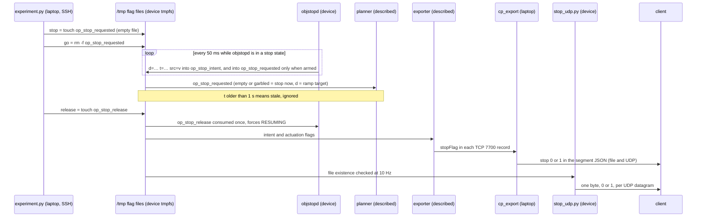
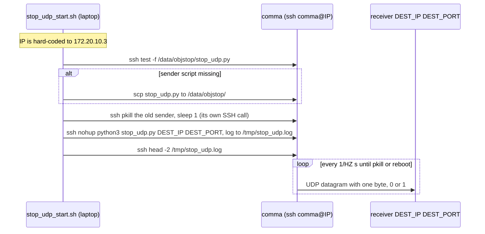

# 0/1 stop signal over UDP

In era 1, `stop_udp.py` on the comma turned the device's stop flags into the simplest possible signal: one ASCII byte per UDP datagram, `1` when the vision/stop system wanted the vehicle stopped and `0` to drive or resume, sent 10 times a second straight from the device to a receiver. A laptop fallback, `manual_stop_send.py`, speaks the same protocol by hand, bypassing the comma and objstopd entirely. This page covers the sender, the one-click start/stop scripts (and their hard-coded device IP), the watcher, the fallback, how to verify the link, and the limitations.

> [!WARNING]
> **Historical (sunnypilot era).** The device side existed only in era 1: `stop_udp.py` in `/data/objstop/`, objstopd and the `/tmp` flags it reads. The device was later re-flashed to openpilot v0.11.1, at an unrecorded date between 2026-08-13 (the last era-1 file) and 2026-10-03 (the era-2 patch), and nothing in `remote/Arman/dashcam_anywhere/` installs objstopd or `stop_udp.py` (inferred; check with `ssh comma@$COMMA_IP 'ls /data/objstop'`). The laptop fallback does not depend on the device and still works.

## At a glance

| | |
|---|---|
| **Audience** | Operators who start and stop the stream; client integrators who consume it |
| **Runs on** | **Device:** [`stop_udp.py`](../remote/Arman/stop_udp.py) (era 1). **Laptop:** [`stop_udp_start.sh`](../remote/Arman/stop_udp_start.sh), [`stop_udp_stop.sh`](../remote/Arman/stop_udp_stop.sh), [`stop_udp_watch.sh`](../remote/Arman/stop_udp_watch.sh), [`manual_stop_send.py`](../remote/Arman/manual_stop_send.py), and the link testers [`_udp_probe.py`](../remote/Arman/_udp_probe.py) and [`_udp_testsend.py`](../remote/Arman/_udp_testsend.py) |
| **Era** | Era 1 — sunnypilot 0.9.7.1. All five stop-UDP files were last modified 2026-08-13. The laptop fallback works with any era |
| **Status** | Device sender: historical (not on the re-flashed device, inferred). Laptop tools: usable. No note records a field result for the 0/1 stream; the behaviour below comes from the code |
| **Key files** | [`stop_udp.py`](../remote/Arman/stop_udp.py), [`stop_udp_start.sh`](../remote/Arman/stop_udp_start.sh), [`stop_udp_stop.sh`](../remote/Arman/stop_udp_stop.sh), [`stop_udp_watch.sh`](../remote/Arman/stop_udp_watch.sh), [`manual_stop_send.py`](../remote/Arman/manual_stop_send.py), [`_udp_probe.py`](../remote/Arman/_udp_probe.py), [`_udp_testsend.py`](../remote/Arman/_udp_testsend.py); flag writers [`objstopd.py`](../remote/Arman/objstopd.py) and [`experiment.py`](../remote/Arman/experiment.py) |

## Purpose

`stop_udp.py`'s docstring defines the signal: "1 = the vision/stop system wants the vehicle stopped, 0 = drive/resume", and "Send ONLY "0" or "1" over UDP, nothing else." A receiver needs no JSON parser and no knowledge of openpilot.

It carries the same decision as the `"stop"` field of the client's segment JSON ([06](06-client-interface-spec.md)), but takes a shorter path:

| | `"stop"` in the segment JSON | 0/1 byte stream (this page) |
|---|---|---|
| Produced by | `cp_export.py` on the laptop, from `stopFlag` in the TCP 7700 records | `stop_udp.py` on the device, from the flag files |
| Needs | the deployed stopFlag exporter (described, not included), the laptop, and `--mode live` (record mode always writes 0) | only the device, its flags and a network path to the receiver |
| Payload | UTF-8 JSON with `ref`, `stop`, `segments` | one byte, `0` or `1` |
| Rate | ≤ 10 Hz (`--udp-hz`) | 10 Hz (`--hz`) |
| Logic | the exporter's derivation, described as "the actuation flag has priority" (`OPERATIONS.md` §3.2), not included | a plain OR of two files' existence |

**Context.** The scripts were last modified on 2026-08-13, after the era-1 no-CAN dashcam mode was enabled (2026-08-06). In that mode, manager autostarted objstopd in shadow. Of the shadow-mode `"stop"` decision, `OPERATIONS.md` §3.2 says the client "can use it directly to drive the truck's own braking". The 0/1 stream carries the same decision without the JSON.

> [!CAUTION]
> **Not a safety system.** The signal comes from an experimental YOLOv8 detector and from manual flags. UDP is fire-and-forget: datagrams can be lost, delayed or duplicated, and the sender never learns whether anyone received them. A crashed objstopd can leave the stream stuck at `1`, and a dead sender leaves the receiver with silence. A vehicle that acts on this signal needs its own independent fail-safe and a human ready to take over.

## Protocol

| Property | Value |
|---|---|
| Transport | UDP over IPv4, one datagram per send, no handshake |
| Payload | exactly one ASCII byte: `0` (0x30) or `1` (0x31). No newline, no JSON (`stop_udp.py` → `stop_now()`) |
| Meaning | `1` = the vision/stop system wants the vehicle stopped; `0` = drive/resume |
| Rate | `--hz`, default 10; the sleep between sends is `1/max(hz, 0.1)` s |
| Destination | host and port are required arguments of `stop_udp.py`. Every example in the scripts uses port 5005 |
| Source | the comma's address; an ephemeral source port (the socket is not bound) |
| Sequence number, timestamp, sender id, acknowledgement | none |
| Errors | an `OSError` on send is ignored and the loop continues |
| Semantics | a **level**, not an event: each datagram repeats the current state |

## Device sender vs laptop fallback

| | Device sender: `stop_udp.py` | Laptop fallback: `manual_stop_send.py` |
|---|---|---|
| Runs on | the comma (era 1), started by `stop_udp_start.sh` over SSH | the laptop |
| Value comes from | whether `/tmp/op_stop_requested` or `/tmp/op_stop_intent` exists | the operator: `--value`, `--pulse`, hotkeys |
| Needs objstopd | for vision decisions, yes. A manual `experiment.py stop` also produces `1` | no; it "bypasses the comma and objstopd" (docstring) |
| Network path | comma → receiver directly. The receiver must be reachable **from the comma's network** | laptop → receiver |
| Default destination | none (required arguments) | `172.20.10.2:5005` |
| Rate | `--hz`, default 10 (floor 0.1 Hz) | `--hz`, default 10 (floor 0.01 Hz) |
| Stops on | `stop_udp_stop.sh` (`pkill`), or a reboot | `q`, Ctrl-C or `--duration` |
| Survives | SSH logout (`nohup`), but not a reboot; manager does not restart it | only its terminal session |

Run only one of them at a time. With both running, the receiver gets interleaved values from two source addresses (Analysis (from code; not field-tested)).

Commands on this page that reach the device assume `$COMMA_IP` is set: `cd remote/Arman && export COMMA_IP=$(./find_comma.sh)`, or set it by hand. `find_comma.sh` returns the first device it finds, so verify it with `ssh comma@$COMMA_IP 'cat /data/params/d/DongleId'` ([02](02-setup-ssh-networking.md)).

Where the bits come from, end to end. This is the same flag protocol as in [07](07-longitudinal-stop.md):



## stop_udp.py (device sender)

[`stop_udp.py`](../remote/Arman/stop_udp.py) is 43 lines of standard-library Python.

### stop_udp.py options

| Argument | Default | Meaning |
|---|---|---|
| `host` | (required) | receiver IP or hostname |
| `port` | (required) | receiver UDP port |
| `--hz` | `10.0` | send rate. The loop sleeps `1/max(hz, 0.1)` s after each send, so the real rate is slightly below `--hz` |

At start it prints one line, for example `[stop_udp] -> 192.168.1.50:5005  10 Hz  (payload: '0' / '1' only)`. It prints nothing else while it runs: there is no per-transition logging, and send errors are ignored silently. It loops until killed.

### Which files make it say 1

`stop_now()` returns `b"1"` if **either** of `STOP_FILES = ("/tmp/op_stop_requested", "/tmp/op_stop_intent")` exists, otherwise `b"0"`. Only existence counts; the content and age are never read. The flag writers are `experiment.py` (`stop` / `go`) and objstopd (`write_flag()`); see [07](07-longitudinal-stop.md#go-vs-release-who-owns-which-flag) for who owns what.

| Situation | `/tmp/op_stop_requested` | `/tmp/op_stop_intent` | Stream |
|---|---|---|---|
| No stop anywhere | absent | absent | `0` |
| Manual `experiment.py stop` | empty file | — | `1` until `go` |
| objstopd in shadow (the default, and the manager autostart) decides to stop | untouched | `d=… t=… src=v` | `1` |
| objstopd with `--arm` decides to stop | `d=… t=… src=v` | the same content | `1` |
| objstopd goes back to RESUMING or DRIVING | its own file removed | removed | `0` (unless a manual stop is active) |
| `experiment.py go` during a vision hold | removed, but an armed objstopd rewrites it within ~50 ms | untouched | stays `1` |
| `experiment.py release` during a vision hold | objstopd removes its own file on its next tick | removed | `0` (unless a manual stop is active) |
| objstopd stopped cleanly (Ctrl-C, SIGTERM) | its own file removed (the `finally` block) | removed | `0` (unless a manual stop is active) |
| objstopd killed with SIGKILL (or ended by an SSH hang-up) during a stop | stale file stays (if armed) | stale file stays | `1` until the files are removed or the device reboots |
| Reboot | cleared (tmpfs) | cleared | no stream: the sender is not restarted |

objstopd's "stop states" are BRAKING and the three STOPPED states. In DRIVING and RESUMING it removes its files ([08](08-vision-stop-objstopd.md)). Analysis (from code; not field-tested): objstopd refreshes a flag by writing `<path>.tmp` and calling `os.replace()`, so the file never disappears during a refresh and the stream does not glitch to `0`. The `.tmp` file is not one of the watched paths.

### Running it by hand

This is exactly what `stop_udp_start.sh` runs over SSH (era-1 interpreter). It needs `/data/objstop/stop_udp.py` on the device ([Self-heal install](#self-heal-install)):

```bash
# device  (ssh comma@$COMMA_IP)
PYTHONPATH=/data/openpilot nohup /usr/local/pyenv/versions/3.11.4/bin/python3 \
  /data/objstop/stop_udp.py <DEST_IP> <DEST_PORT> --hz 10 > /tmp/stop_udp.log 2>&1 < /dev/null &
sleep 1; head -2 /tmp/stop_udp.log # [stop_udp] -> <DEST_IP>:<DEST_PORT>  10 Hz  (payload: '0' / '1' only)
pkill -f '[s]top_udp.py'           # stop it
```

The script uses only the standard library (`argparse`, `os`, `socket`, `time`). Any Python 3 on the device works, and the `PYTHONPATH` is harmless but unnecessary. On an era-2 device, the interpreter that `dashcam.sh` uses is `/usr/local/venv/bin/python3`.

## The one-click scripts

Both scripts run on the laptop from `remote/Arman` and use `set -euo pipefail`.

### stop_udp_start.sh

```bash
# laptop  (the comma must be at 172.20.10.3, or adapt the script first: see the next section)
cd remote/Arman
./stop_udp_start.sh <DEST_IP> <DEST_PORT> [HZ]      # HZ defaults to 10
./stop_udp_start.sh 192.168.1.50 5005               # example from the script header
```

What it does, in order:

1. Checks its arguments. `DEST_IP` and `DEST_PORT` are required (`usage: stop_udp_start.sh <DEST_IP> <DEST_PORT> [HZ]`); `HZ` defaults to `10`.
2. Prints `finding comma ...`, but **does not search**: `IP=172.20.10.3` is hard-coded (see [the next section](#the-hard-coded-device-ip)).
3. Builds `ssh -o StrictHostKeyChecking=no -o ConnectTimeout=6 comma@$IP`.
4. **Self-heal install.** If `/data/objstop/stop_udp.py` is missing on the device, it copies the laptop's `stop_udp.py` there with `scp`.
5. **Kills any previous sender** in a separate SSH call: `pkill -f '[s]top_udp.py' 2>/dev/null; sleep 1; echo cleaned`. That call is allowed to fail (`|| true`).
6. **Starts a fresh sender**, detached with `nohup`, logging to `/tmp/stop_udp.log`, then prints `started`.
7. Waits 1 s, prints `--- sender log ---` and the first two lines of `/tmp/stop_udp.log`.
8. Prints a success banner and two hints.



Expected output, assembled from the script's `echo` lines. The install line, and `scp`'s progress line after it, appear only when the file was missing:

```text
finding comma ...
172.20.10.3
comma at 172.20.10.3
installing stop_udp.py on the comma ...
cleaned
started
--- sender log ---
[stop_udp] -> 192.168.1.50:5005  10 Hz  (payload: '0' / '1' only)

✅ comma is now sending '0'/'1' UDP -> 192.168.1.50:5005 at 10 Hz
   watch what it sends:   ./stop_udp_watch.sh 5005      (if this laptop is the receiver)
   stop it:               ./stop_udp_stop.sh
```

> [!IMPORTANT]
> **The success banner does not prove that the sender is running.** Analysis (from code; not field-tested): the sender is started in the background, so the start command reports `started` even when the interpreter is missing or the sender crashes at once. The only evidence is the `--- sender log ---` section: it must show the `[stop_udp] -> …` line. `nohup: failed to run command …` or a Python traceback there means the sender is not running.

### The hard-coded device IP

Both scripts contain `IP=172.20.10.3`. In `stop_udp_start.sh` the discovery call is commented out:

```bash
# excerpt from stop_udp_start.sh as shipped (not a command to run)
#IP="$("$DIR/find_comma.sh" 2>/dev/null || true)"
IP=172.20.10.3
```

Its header still says "Finds the comma automatically (hotspot/ethernet/wifi)", and the script still prints `finding comma ...`. `stop_udp_stop.sh` has no discovery code and makes no such claim: it just sets the same `IP=172.20.10.3`. In both scripts the `[ -z "$IP" ]` "not found" check can therefore never fire. As shipped, **both scripts work only when the comma is at 172.20.10.3** (erratum 5). On an iPhone hotspot the comma often had that address, but hotspot addresses rotate, and more than one comma can be on the same network.

**How to adapt.** Suggested edit; it is not applied in this repo. Either replace `172.20.10.3` with your device's IP in both files, or make both scripts honour `$COMMA_IP` and fall back to discovery:

```bash
# laptop
cd remote/Arman
sed -i 's#^IP=172\.20\.10\.3$#IP="${COMMA_IP:-$("$DIR/find_comma.sh" 2>/dev/null || true)}"#' stop_udp_start.sh stop_udp_stop.sh
export COMMA_IP=$(./find_comma.sh)                     # or set it by hand
ssh comma@$COMMA_IP 'cat /data/params/d/DongleId'      # must print your own <DONGLE_ID>
```

Analysis (from code; not field-tested): the substitution was checked on scratch copies of both scripts. It changes exactly one line in each, `bash -n` passes, and the existing "not found" checks become live again. `find_comma.sh` returns the **first** device it finds, so keep the DongleId check.

### Self-heal install

The script only checks whether `/data/objstop/stop_udp.py` **exists**. It never updates an older copy. To push a new version:

```bash
# laptop  (from remote/Arman)
scp stop_udp.py comma@$COMMA_IP:/data/objstop/stop_udp.py
```

The copy needs `/data/objstop/` to exist; it did on the era-1 device. Analysis (from code; not field-tested): if the directory is missing, or the device is unreachable, `scp` fails and `set -e` aborts the script right after `installing stop_udp.py on the comma ...`. If the test SSH call itself failed (wrong IP), that line is the misleading first symptom of a connection problem.

### Why pkill runs in its own SSH call

The script's comment explains it: "if the pkill shares a command line with the python invocation below, `pkill -f` matches its own parent shell and kills the whole remote command before it can start anything". SSH runs the whole remote string in one shell on the device, and that shell's command line would contain `/data/objstop/stop_udp.py`, so the pattern would match the shell itself. The `[s]top_udp.py` bracket trick only stops the pattern from matching its own literal text. It cannot protect a parent shell whose command line contains the real file name. Hence the separate call, followed by `sleep 1`. Note that `pkill -f '[s]top_udp.py'` kills **every** `stop_udp.py` on the device, so there is one destination at a time.

### stop_udp_stop.sh

```bash
# laptop
cd remote/Arman && ./stop_udp_stop.sh      # prints "sender stopped" or "no sender running"
```

It runs `pkill -f '[s]top_udp.py' && echo 'sender stopped' || echo 'no sender running'` over SSH, with the same hard-coded `IP=172.20.10.3`. If SSH itself fails, the script exits with the SSH error.

## stop_udp_watch.sh

[`stop_udp_watch.sh`](../remote/Arman/stop_udp_watch.sh) is a "sanity check: print the 0/1 datagrams arriving here (LAPTOP). Use only if THIS laptop is the UDP destination."

```bash
# laptop
cd remote/Arman && ./stop_udp_watch.sh 5005
```

Output from a loopback run on 2026-11-05 (`manual_stop_send.py 127.0.0.1 <port> --pulse 1 --duration 2` as the sender):

```text
listening on udp/59875 (Ctrl-C to stop)
14:51:17  from 127.0.0.1  ->  1
14:51:18  from 127.0.0.1  ->  0
… no datagrams in 5s (sender running? right IP/port?)
```

- It binds UDP `0.0.0.0:<PORT>` on all interfaces and runs the laptop's `python3` from an inline heredoc.
- It prints a line **only when the value changes**: laptop local time, sender address and value. A steady `0` stream prints a single line.
- After 5 s of silence it prints `… no datagrams in 5s (sender running? right IP/port?)`, and repeats that every 5 s.
- It reads at most 16 bytes per datagram (`recvfrom(16)`) and decodes with `errors="replace"`. A longer datagram arriving on the same port, such as the JSON from `cp_export --udp` or `_udp_testsend.py`, shows up as its first 16 bytes. A `_udp_probe.py` probe (`{"probe":N}`, 11 bytes) shows up whole.
- Analysis (from code; not field-tested): the bind fails (`Address already in use`) if another program on the laptop, such as `nc` or the client's receiver, already holds the port. Its output is block-buffered when piped; set `PYTHONUNBUFFERED=1` to see lines live, e.g. through `tee`.

## manual_stop_send.py (laptop fallback)

[`manual_stop_send.py`](../remote/Arman/manual_stop_send.py) is a "fallback sender that runs directly on the LAPTOP. It bypasses the comma and objstopd: the laptop itself sends "0"/"1" to the receiver, with exactly the same protocol as `stop_udp.py` on the device: each datagram's payload is a single ASCII byte, b"0" or b"1"." (docstring, translated from Chinese). It needs only the standard library. It imports `termios` and `tty` for the hotkeys, which are Unix-only, so it runs on Linux and macOS but not on Windows.

### manual_stop_send.py options

| Argument | Default | Meaning (help text translated) |
|---|---|---|
| `host` | `172.20.10.2` | receiver IP (positional, optional) |
| `port` | `5005` | receiver UDP port (positional, optional) |
| `--hz` | `10` | "send rate, default 10". The sleep is `1/max(hz, 0.01)` s |
| `--value {0,1}` | `1` | "initial payload, default 1" |
| `--duration N` | `0` | "exit after sending for N seconds; 0 = send forever" |
| `--pulse N` | `0` | "first send '1' for N seconds, then automatically switch to '0' and keep sending (does not exit)" |

> [!CAUTION]
> **It sends `1` ("stop") from the first datagram** unless you pass `--value 0`. If the receiver brakes a vehicle on `1`, start with `--value 0` and switch with the hotkeys. To end a stop, switch to `0` before you quit: once the program exits, the receiver hears nothing at all ([Pulse and duration](#pulse-and-duration)).

The docstring's examples, with the host made explicit. The docstring claims the default target is `172.20.10.3`, but argparse uses **`172.20.10.2`** (erratum 6), so always pass the host.

```bash
# laptop
cd remote/Arman
python3 manual_stop_send.py <DEST_IP> 5005                        # keep sending "1" at 10 Hz
python3 manual_stop_send.py <DEST_IP> 5005 --value 0              # keep sending "0"
python3 manual_stop_send.py 172.20.10.7 5005                      # another target
python3 manual_stop_send.py <DEST_IP> 5005 --hz 20 --duration 30  # 20 Hz, stop after 30 s
python3 manual_stop_send.py <DEST_IP> 5005 --pulse 3              # "1" for 3 s, then "0" and keep it
```

### Hotkeys

They work only "when the terminal is a tty". No Enter is needed: the terminal is put into cbreak mode and restored on exit.

| Key | Effect |
|---|---|
| `1` | switch to `1` |
| `0` | switch to `0` |
| Space | toggle |
| `q` or Ctrl-C | quit |

The keyboard is polled once per send period, so a key takes effect with the next datagram. When stdin is not a terminal (a pipe, `nohup`), there are no hotkeys: use `--value`, `--pulse` and `--duration`, and stop the program with `kill`.

### Pulse and duration

Analysis (from code; not field-tested):

- `--pulse N` switches the payload to `0` **once**, N seconds after the start. It does **not** force the first N seconds to `1`, as the docstring and the help text suggest: those use `--value`. `--pulse 3 --value 0` sends `0` throughout (A-item A12 in [16](16-errata-and-crosswalk.md#additional-inconsistencies-found-in-this-review)). Hotkeys still work after the switch.
- `--duration N` exits after N seconds. `--pulse 3 --duration 10` sends `1` for 3 s, then `0` for 7 s, then exits. With `--duration` shorter than `--pulse`, the program exits while still sending `1`.
- When the program exits, the receiver simply stops hearing anything. To leave a receiver that latches the last value at `0`, end on `0` (use `--pulse`, or press `0` before `q`).

### Console output

Captured from a loopback run on 2026-11-05 (`127.0.0.1 59871 --duration 2.0 --pulse 0.5`, stdin not a terminal):

```text
[manual] -> 127.0.0.1:59871  10 Hz  起始载荷 '1'
[manual] pulse: 0.5s 后自动转 '0'
[manual] 热键: 1=发1  0=发0  空格=翻转  q=退出


[manual] pulse 结束，转为 '0'
[manual]    1.0s  载荷='0'  已发 11 包  失败 0
[manual] 结束：2.0s，共发 20 包，失败 0
```

The receiver got 5 × `1`, then 15 × `0`.

| Output | Meaning |
|---|---|
| `[manual] -> HOST:PORT  N Hz  起始载荷 'V'` | target, rate and **initial payload** |
| `[manual] pulse: Ns 后自动转 '0'` | "switches to '0' automatically after N s" |
| `[manual] 热键: 1=发1  0=发0  空格=翻转  q=退出` | "hotkeys: 1 = send 1, 0 = send 0, space = toggle, q = quit". Printed even when hotkeys are unavailable |
| `[manual] pulse 结束，转为 '0'` | "pulse over, switched to '0'" |
| `[manual]  T s  载荷='V'  已发 N 包  失败 M` | refreshed once per second: elapsed time, current **payload**, **N datagrams sent**, **M failed** |
| `[manual] 发送失败: <error>` | "send failed". Only the first 3 errors are printed; all are counted |
| `[manual] 结束：T s，共发 N 包，失败 M` | "finished: T s, N datagrams sent in total, M failed" |
| `[manual] 全部失败 —— 检查目标是否可达（ping 一下）` | "all failed — check that the target is reachable (ping it)". See the note below |

> [!IMPORTANT]
> **The "all failed" hint never appears when every send fails.** Analysis (from code; not field-tested): the final check is `if errs and errs == sent`, but `sent` counts only *successful* sends. When every send fails, `sent` is 0 and the hint is skipped. It appears only when exactly half of the attempts failed (A-item A12). Read the `失败` (failed) count instead. Zero failures does not prove delivery either. As `_udp_probe.py`'s docstring puts it, "UDP is fire-and-forget, so "no error" is not proof of delivery". This sender's socket is unconnected, so it normally sees only local errors such as `Network is unreachable`, never a closed port on the receiver.

## Verifying the link

Work outward: first the laptop alone, then the laptop-to-receiver path, then the device-to-receiver path. Commands for the receiving machine are labelled `# receiver`.

### Loopback on the laptop

```bash
# laptop  (terminal A)
cd remote/Arman && ./stop_udp_watch.sh 5005
```

```bash
# laptop  (terminal B)
cd remote/Arman && python3 manual_stop_send.py 127.0.0.1 5005 --pulse 3 --duration 6
```

Terminal A should show `from 127.0.0.1  ->  1`, about 3 s later `->  0`, and then, after the sender exits, the `… no datagrams in 5s …` line.

### Laptop to receiver

```bash
# receiver
nc -u -l 5005            # OpenBSD netcat syntax; traditional netcat needs: nc -u -l -p 5005
```

```bash
# laptop
cd remote/Arman
python3 _udp_probe.py <DEST_IP> 5005
python3 manual_stop_send.py <DEST_IP> 5005 --pulse 3 --duration 6
```

`nc` prints the bytes back to back with no newlines (`1111…0000…`).

> [!IMPORTANT]
> **Restart `nc` before each sender.** OpenBSD netcat, the usual `nc` on Linux, ties its UDP listener to the first sender it hears. `_udp_probe.py` and `manual_stop_send.py` each send from their own source port, so after the probe `nc` shows nothing from `manual_stop_send.py`: the receiver rejects those datagrams with ICMP port unreachable, which the sender's unconnected socket never reports. Press Ctrl‑C and start `nc -u -l 5005` again before the second command, or use the Python listener from [06](06-client-interface-spec.md#link-testing), which accepts any sender. General guidance, not from the original notes.

How to read `_udp_probe.py`, which sends five `{"probe":N}` datagrams 0.4 s apart on a connected socket:

| Probe output | Meaning (from its docstring) |
|---|---|
| `sent #i: ICMP port unreachable -> HOST REACHED, no listener on <port>` | routing is fine; nothing is listening yet |
| `no error` on every line | "either a listener is there and silently consuming, or a firewall is dropping; check on the receiving machine" |
| `Network is unreachable` (or another `OSError`) | "routing problem on this laptop" |

On a Linux loopback test with a closed port (2026-11-05), the ICMP error was reported on the send **after** the one that triggered it, so the lines alternated `no error` / `ICMP port unreachable` (#0 no error, #1 refused, #2 no error, …). The probe's closing hint always says `nc -u -l 5005`, whatever port you passed (A-item A15 in [16](16-errata-and-crosswalk.md#additional-inconsistencies-found-in-this-review)). A Windows receiver needs an inbound UDP rule: `_udp_testsend.py` notes that when nothing arrives on Windows although the sender reports no error, the cause is "almost always Windows Defender Firewall blocking inbound UDP for the listening program". Wireshark filter: `udp.port == 5005`.

### Device to receiver

The device sends directly, so the receiver must be reachable from the comma's network. The test below uses the laptop as the receiver, on the same network as the comma. `DEST_IP` is the laptop's address on that network (`ip -4 addr`; on an iPhone hotspot the laptop was often 172.20.10.2). Unless the comma is at 172.20.10.3, [adapt the scripts' IP](#the-hard-coded-device-ip) first.

```bash
# laptop  (terminal A)
cd remote/Arman && ./stop_udp_watch.sh 5005
```

```bash
# laptop  (terminal B)
cd remote/Arman && ./stop_udp_start.sh <DEST_IP> 5005
ssh comma@$COMMA_IP 'touch /tmp/op_stop_intent'      # watcher shows 1
ssh comma@$COMMA_IP 'rm -f /tmp/op_stop_intent'      # watcher shows 0
./stop_udp_stop.sh
```

Analysis (from code; not field-tested): toggling the **intent** file exercises the sender without braking, because the planner reads only `/tmp/op_stop_requested`. But on an era-1 device with the stopFlag exporter, the client's JSON `"stop"` also goes to 1 during the test (described, not included). A running objstopd leaves your empty file alone, since it has no `src=v`; if objstopd decides to stop during the test, it overwrites the file and later deletes it. Do **not** use `experiment.py stop` for this test while openpilot longitudinal is engaged: it brakes the car ([07](07-longitudinal-stop.md)).

### The JSON path

[`_udp_testsend.py`](../remote/Arman/_udp_testsend.py) checks the other interface. It sends datagrams "shaped exactly like cp_export --udp output": `"test": true`, `seq`, `ts`, the neutral example `ref` (37.7749295, -122.4194155), two sample segments and a `"stop"` that toggles about once a second. Defaults: `172.20.10.2:5005`, 15 s, 10 Hz. See [06](06-client-interface-spec.md).

## Receiver guidance

These are recommendations; nothing in the original project implements them. [06](06-client-interface-spec.md#example-receiver) has an example receiver written for these docs.

- Accept exactly one-byte payloads `0` / `1` and ignore everything else. Probes (`{"probe":N}`) and JSON test datagrams can arrive on the same port.
- Give the 0/1 stream its own port, for example 5006 ([06](06-client-interface-spec.md#one-port-or-two)). The examples on this page use 5005, as the scripts do, but `cp_export --udp` (default `--udp-port` 5005), `_udp_probe.py` and `_udp_testsend.py` all default to 5005 too. If a port must be shared, branch on payload length or on the first byte (`{` = JSON).
- Run a watchdog. Treat silence longer than a few send periods (for example 0.5 s at 10 Hz) as "signal lost", and apply your own safe default instead of acting on the last value forever.
- Optionally accept only the expected source address (the device, or the fallback laptop), so a forgotten test sender cannot interfere.
- Treat it as a level, not an event. Every datagram repeats the full state, so a lost datagram only delays a change by one period.

## Troubleshooting

| Symptom | Likely cause | Fix |
|---|---|---|
| `stop_udp_start.sh` prints `172.20.10.3`, but the comma is elsewhere | discovery commented out; IP hard-coded (erratum 5) | [adapt the scripts](#the-hard-coded-device-ip) |
| `installing stop_udp.py on the comma ...`, then an `ssh`/`scp` connection error | the comma is not at that IP, or not on the network | `find_comma.sh`, then fix the IP |
| `installing stop_udp.py on the comma ...`, then `scp: … No such file or directory` | `/data/objstop/` is missing (for example, on the re-flashed device) | `ssh comma@$COMMA_IP 'mkdir -p /data/objstop'`; note that without objstopd only manual flags produce `1` |
| `--- sender log ---` shows `nohup: failed to run command '/usr/local/pyenv/versions/3.11.4/bin/python3': No such file or directory` | not an era-1 device | start it by hand with `/usr/local/venv/bin/python3` (era 2) |
| The banner says the comma is sending, but nothing arrives | the banner is printed even when the sender failed; the sender died; the receiver is not reachable from the comma's network; a firewall | check the sender log and `ssh comma@$COMMA_IP "pgrep -af '[s]top_udp'"`; test from the laptop on the comma's network; open the firewall |
| The watcher prints `… no datagrams in 5s …` | sender down, or wrong IP/port | as above |
| The watcher fails with `Address already in use` | another program holds the port | stop it, or use another port |
| The receiver is stuck at `1` | a manual stop is active; a vision hold; or stale flags after objstopd was killed with SIGKILL, or ended by the hang-up of its closed SSH session | check both files on the device ([07](07-longitudinal-stop.md#reading-the-status-output)); `experiment.py release` for a vision hold; `go` for a manual stop; `ssh comma@$COMMA_IP 'rm -f /tmp/op_stop_intent'` for a stale intent file |
| `1` although the car is not braking | objstopd in shadow writes the intent flag anyway | by design: `1` means "the vision system wants a stop" |
| `go` did not bring the stream back to `0` | `go` removes only `/tmp/op_stop_requested`, and an armed objstopd rewrites it | `release` (erratum 25) |
| Values alternate between two sources | the device sender and the laptop fallback both running | stop one |
| `REMOTE HOST IDENTIFICATION HAS CHANGED` | more than one comma shares hotspot IPs | verify the DongleId, then `ssh-keygen -f ~/.ssh/known_hosts -R <ip>` ([02](02-setup-ssh-networking.md)) |
| `manual_stop_send.py` prints `发送失败: [Errno 101] Network is unreachable` | no route on the laptop | check the laptop's network |
| The receiver gets nothing, although the laptop sender counts no failures (`失败 0`) | UDP gives no delivery feedback: a firewall on the receiver (on Windows, usually Windows Defender Firewall), a wrong IP or port, or a hotspot that isolates clients | on the receiver, a freshly started `nc -u -l <port>` (`OPERATIONS.md` §7: `nc -lu <port>`; OpenBSD netcat shows only the first sender it hears) or Wireshark; from the laptop, `_udp_probe.py` ([Laptop to receiver](#laptop-to-receiver)); open the firewall |

## Limitations

1. **Only existence is checked.** `stop_udp.py` never reads the files. A stale vision file whose `t` is more than 1 s old, which the v2 planner already ignores, still produces `1` (erratum 25). An empty manual file also produces `1`, which is intended.
2. **Stale flags after SIGKILL or an SSH hang-up.** objstopd cleans up in a `finally` block on SIGINT/SIGTERM, but a SIGKILL skips it. So does the hang-up signal (SIGHUP) that ends a manual run when its SSH session closes (a closed terminal, a dropped hotspot link): objstopd installs no handler for it (Analysis (from code; not field-tested); run it in `tmux`, see [08](08-vision-stop-objstopd.md#manual-run-shadow-first)). The stream then stays at `1` until the files are removed or the device reboots. A fresh objstopd removes stale `src=v` files on its first tick: always the intent file, and the actuation file only when it is started with `--arm`.
3. **`go` does not clear the intent flag.** `experiment.py go` runs `rm -f /tmp/op_stop_requested` and nothing else. `release`, not `go`, ends a vision hold (erratum 25).
4. **Era-1 paths.** The start script hard-codes the era-1 interpreter `/usr/local/pyenv/versions/3.11.4/bin/python3`, the install directory `/data/objstop/` and the device IP 172.20.10.3.
5. **No sequence number, timestamp or sender id**, and no acknowledgement. Loss, reordering and duplication cannot be detected. Because the state repeats 10 times a second, a single lost datagram only costs one period.
6. **Not persistent.** The sender is not managed by manager: it is not restarted after a crash or a reboot, and its log lives in tmpfs.
7. **One destination per device.** The start script kills every `stop_udp.py` before starting a new one.
8. **Rate is approximate.** The loop sleeps a fixed period after each send.
9. **No-CAN behaviour.** Analysis (from code; not field-tested): in the era-1 no-CAN mode no `carState` is published (card never finishes fingerprinting without CAN: `enable_dashcam_mode.py` and `write_carparams_mock.py` docstrings; `OPERATIONS.md` §3.3: "无 vEgo", "no vEgo"), so objstopd's `v_ego` stays 0 and the gas is never pressed.
   - **Stop sign:** a stop sign about 3.5–90 m ahead, once confirmed by at least 3 detections, latches straight to STOPPED_SIGN and produces a `1` pulse of about 3.05–3.1 s. Detections count between 3 and 90 m, and the latch needs more than 0.5 m beyond the 3 m setback. Odometry never advances, so RESUMING ends only on its 15 s timer, and the pulse repeats about every 18.15–18.6 s while the sign is in view.
   - **Red light:** a red light more than 10.5 m ahead (the 10 m setback plus 0.5 m), once confirmed by at least 3 detections, latches and holds `1` until a green is confirmed, or until `release`. The `0` that follows lasts only for RESUMING (15 s): a light that is still red and more than 10.5 m away then latches again.
   - **Pedestrian:** a pedestrian gives `1` until they have been gone for 1.5 s.

## See also

- [06 — Client interface specification](06-client-interface-spec.md): section C specifies the 0/1 byte for the client, next to the segment JSON and its `"stop"` field
- [07 — Longitudinal stop command (Civic, era 1)](07-longitudinal-stop.md): the flag protocol, `experiment.py`, and `go` vs `release`
- [08 — Vision stop daemon (objstopd)](08-vision-stop-objstopd.md): the state machine behind the intent flag, and `objstop_view` / `watch_detect` for seeing why the device says `1`
- [10 — No-CAN truck/bench mode](10-no-can-mode-sunnypilot.md): the era-1 dashcam setup, in which objstopd ran in shadow and its intent flag drove this stream
- [02 — Setup, SSH and networking](02-setup-ssh-networking.md): `find_comma.sh`, hotspots, host keys
- [16 — Errata and crosswalk](16-errata-and-crosswalk.md): errata 5, 6 and 25, A-items A12 and A15, and the crosswalk for the Chinese `manual_stop_send` docstring
