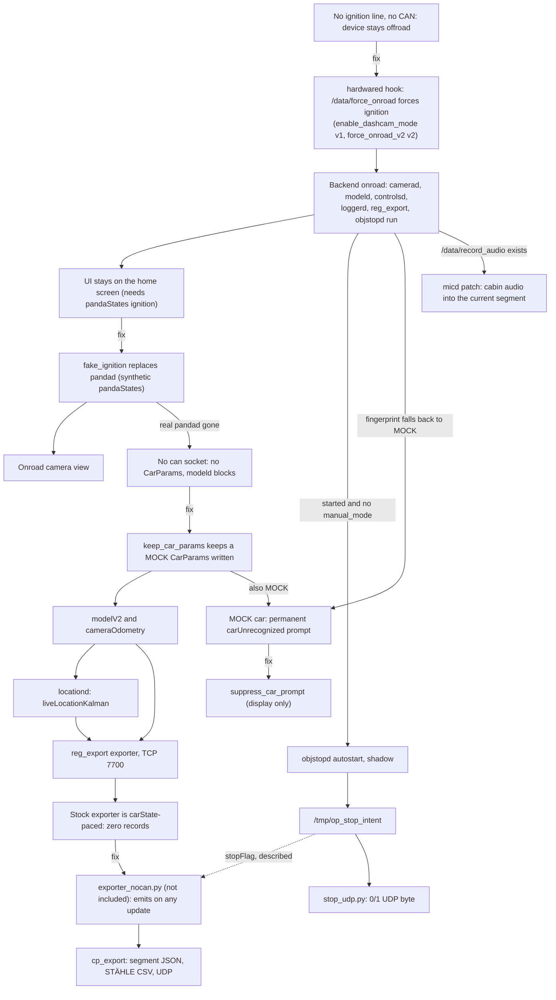

# No-CAN truck/bench mode (sunnypilot era)

In August 2026 the era 1 device, a comma 3X running sunnypilot 0.9.7.1, was adapted to run its camera, driving model, GPS and vision-stop stack in a truck and on a bench with no ignition line and no CAN bus. The aim was to keep producing the client outputs (segment JSON with `"stop"`, and the 0/1 UDP byte) from a vehicle openpilot cannot drive. Five patcher scripts and two helpers removed one blocker after another: the device stayed offroad, the screen stayed on the home UI, `modeld` waited for `CarParams`, and the exporter only emitted records on `carState`. This page records what each script changed, how the mode was operated and diagnosed, and what it could not do; all of it is historical, because the device was re-flashed and dashcam-anywhere (era 2) replaced this approach.

## At a glance

| Field | Value |
|---|---|
| **Audience** | Developers; historical reference |
| **Runs on** | Device: the seven scripts and the probes `_verify_state.py`, `_vipc_probe.py`, `_modeld_diag.py`. Laptop: `_stream_dump.py`, `cp_export.py`, `vision/objstop_view.py` |
| **Era** | **Era 1 — sunnypilot 0.9.7.1** (2026‑07 → 2026‑08; Honda Civic + truck/bench no‑CAN) |
| **Status** | Historical. Gone from the device since the re-flash to **Era 2 — openpilot v0.11.1 `release-tizi` + dashcam‑anywhere**, which replaces it ([11](11-dashcam-anywhere-design.md), [12](12-dashcam-anywhere-field-guide.md)) |
| **Key files** | [`enable_dashcam_mode.py`](../remote/Arman/enable_dashcam_mode.py), [`force_onroad_v2.py`](../remote/Arman/force_onroad_v2.py), [`fake_ignition.py`](../remote/Arman/fake_ignition.py), [`enable_fake_ignition_autostart.py`](../remote/Arman/enable_fake_ignition_autostart.py), [`write_carparams_mock.py`](../remote/Arman/write_carparams_mock.py), [`suppress_car_prompt.py`](../remote/Arman/suppress_car_prompt.py), [`enable_cabin_audio.py`](../remote/Arman/enable_cabin_audio.py), [`_verify_state.py`](../remote/Arman/_verify_state.py), [`_vipc_probe.py`](../remote/Arman/_vipc_probe.py), [`_modeld_diag.py`](../remote/Arman/_modeld_diag.py), [`_stream_dump.py`](../remote/Arman/_stream_dump.py), [`OPERATIONS.md`](../remote/Arman/OPERATIONS.md) §3 |

## Goal and outcome

> [!WARNING]
> **Historical (sunnypilot era).** Everything on this page describes era 1 (sunnypilot 0.9.7.1, August 2026). The device was later re-flashed to openpilot v0.11.1 `release-tizi` (era 2), so none of these patches, launchers or flag files exist on it any more. The commands are kept as a record; do not run them on an era 2 device. In era 2, `/data/force_onroad` means something else: dashcam-anywhere reads it once when manager starts ([11](11-dashcam-anywhere-design.md)).

### Goal

`OPERATIONS.md` §3 (translated from Chinese) states the goal:

> Without CAN it is impossible to control the vehicle (there are no actuators), but camera detection + GPS trajectory + the client JSON (including stop 0/1) are all output as usual.

In practice that meant a passive, camera-only device that still runs the openpilot model, `locationd`, the [vision stop daemon](08-vision-stop-objstopd.md) and the TCP 7700 [telemetry stream](03-telemetry-stream.md), so that the laptop tools keep producing the [client outputs](06-client-interface-spec.md).

### What the notes record

File dates below are last-modified dates of the scripts, not application dates.

| Date | Event | Source | Status |
|---|---|---|---|
| 2026-08-06 | `enable_dashcam_mode.py` applied. Power-up enters dashcam mode: camera, model and GPS start, objstopd runs under manager in shadow, and "the exporter streams as usual even without CAN". "Reboot with no car → IsOnroad=1, camerad/modeld/locationd/objstopd/7700 all online" (translated) | `OPERATIONS.md` §3.1 | Reported |
| 2026-08-06 | `suppress_car_prompt.py` applied on the device | past-session operator note | Reported (operator note, 2026-08-06) |
| not dated | The v1 hook had only run on a bench, which "always has a real ignition line, so it never actually exercised the forced path". A field attempt, "12V connected, never went onroad", left no evidence | [`force_onroad_v2.py`](../remote/Arman/force_onroad_v2.py) docstring | Reported |
| not dated | Backend "verified running with real_ign=False". Only the v2 diagnostic writes `real_ign`, so the v2 hook was installed by then | [`fake_ignition.py`](../remote/Arman/fake_ignition.py) docstring | Implied |
| not dated | Bench test: onroad about 0.6 s after `hardwared` started, across two reboots. The hook sits after the panda-timeout branch, so its priority is correct | past-session operator note | Reported (operator note) |
| 2026-08-12 (file date) | `fake_ignition.py` run by hand: "the camera view appeared, the device reset, and the UI went back to the home screen" | [`enable_fake_ignition_autostart.py`](../remote/Arman/enable_fake_ignition_autostart.py) docstring | Reported |
| 2026-08-12 (file dates) | `enable_fake_ignition_autostart.py` and `write_carparams_mock.py` last modified | file dates | Application not recorded |
| 2026-08-06 (file date) | `enable_cabin_audio.py` last modified | file date | Application not recorded anywhere |
| 2026-08-12 | A bench `cp_export` output locked its origin in the mid-Atlantic at −2854 m altitude: a bogus fix that `_valid_fix()` accepted | unpublished `cp_out/` sample | Described, not included |
| 2026-10-03 | The device, re-flashed at an unrecorded date after 2026-08-13 (the last era 1 file date), runs openpilot v0.11.1 `release-tizi` + dashcam-anywhere (era 2); the era 1 changes are gone ([14](14-device-changes-and-revert.md#why-era-1-is-gone)) | [dashcam-anywhere README](../remote/Arman/dashcam_anywhere/README.md) | Last documented state |

> [!NOTE]
> **Reported in `OPERATIONS.md` §3.1, the script docstrings and past-session operator notes.** The "applied", "verified" and "observed" entries above are field claims from the original notes. None could be re-checked for this documentation, because the device has since been re-flashed.

`OPERATIONS.md` §0 still lists the dashcam mode as "pending enable" (待启用). §3.1 of the same file records it as applied and verified on 2026-08-06, which is the later state (erratum 3 in [16](16-errata-and-crosswalk.md)).

**Outcome.** Forcing ignition did bring the backend onroad without CAN. The screen and `modeld` blockers both got fixes (fake ignition, a MOCK `CarParams`). However, nothing records that the fake-ignition autostart or the cabin-audio patch was installed, and nothing records a complete truck run in which the no-CAN exporter fed `cp_export`. The approach ended with the re-flash. dashcam-anywhere solves the same problems inside openpilot itself: spoofed ignition in `pandad` and `hardwared`, a MOCK car without fingerprinting in `card`, and camera calibration from GPS or visual speed ([11](11-dashcam-anywhere-design.md)).

## Dependency chain

Each fix exposed the next blocker. Problem nodes sit on the main path; the script that fixed each one is named in the node after it. The dashed edge is described, not included.



Where each edge comes from:

- **Offroad → hook → backend onroad.** [`enable_dashcam_mode.py`](../remote/Arman/enable_dashcam_mode.py) docstring ("ignition considered ON, so the device goes onroad and camerad/modeld/locationd/GPS all run WITHOUT a car CAN connection"); the process list is from the [`fake_ignition.py`](../remote/Arman/fake_ignition.py) docstring.
- **Home UI → fake ignition.** [`fake_ignition.py`](../remote/Arman/fake_ignition.py) docstring: the UI computes `scene.started = deviceState.getStarted() && scene.ignition`, and `scene.ignition` comes only from `pandaStates` `ignitionLine`/`ignitionCan`.
- **No `can` socket → `modeld` blocked → MOCK `CarParams`.** [`write_carparams_mock.py`](../remote/Arman/write_carparams_mock.py) docstring ("especially once the real pandad has been replaced, so there is no `can` socket at all") and `keep_car_params()` in [`enable_fake_ignition_autostart.py`](../remote/Arman/enable_fake_ignition_autostart.py): "no modelV2 -> no cameraOdometry -> locationd silent -> reg_export streams zero records".
- **carState-paced exporter → no-CAN exporter.** [`enable_dashcam_mode.py`](../remote/Arman/enable_dashcam_mode.py) docstring; the baseline [`exporter_device.py`](../remote/exporter_device.py) `main()` skips every loop in which `carState` did not update.
- **Car prompt.** [`suppress_car_prompt.py`](../remote/Arman/suppress_car_prompt.py) docstring. **objstopd autostart** and **cabin audio**: the conditions written by `enable_dashcam_mode.py` and `enable_cabin_audio.py`.

## Changes in application order

The order follows the scripts' dependencies and file dates. There is no device log of the actual sequence, and the order among the 2026-08-06 scripts is not recorded. Two dependencies are hard: [`force_onroad_v2.py`](../remote/Arman/force_onroad_v2.py) aborts unless the v1 hook is present verbatim, and [`enable_fake_ignition_autostart.py`](../remote/Arman/enable_fake_ignition_autostart.py) aborts unless the `objstopd` process entry from `enable_dashcam_mode.py` occurs exactly once. Paths are under `/data/openpilot` unless absolute.

| # | Script (last modified) | Device files touched | Anchor(s) | Backup suffix | Flag file | Revert |
|---|---|---|---|---|---|---|
| 1 | `enable_dashcam_mode.py` (2026-08-06) | `system/hardware/hardwared.py`; `tools/reg_export/exporter.py` (overwritten by the staged `/data/objstop/exporter_nocan.py`); `system/manager/process_config.py`; new `tools/objstop_launcher.py` | hardwared: `# Run at 2Hz, plus rising edge of ignition`. process_config: the `reg_export` `PythonProcess` line, `def driverview(`, `from cereal import car` | `.bak_arman` (hardwared), `.bak_arman_nocan` (exporter), `.bak_arman_auto` (process_config) | creates `/data/force_onroad`; the autostart condition reads `/data/objstop/manual_mode` | `rm /data/force_onroad`; restore the three backups; delete the launcher |
| 2 | `force_onroad_v2.py` (2026-08-06) | `system/hardware/hardwared.py`; at runtime appends to `/data/onroad_debug.log` | the v1 hook (verbatim), `should_start_prev = False`, the `# Handle offroad/onroad transition` block | `.bak_arman_v2` (holds the **v1 hook**) | reads `/data/force_onroad` | `.bak_arman_v2` → v1 hook; `.bak_arman` → stock |
| 3 | `suppress_car_prompt.py` (2026-08-06) | `selfdrive/controls/lib/events.py` | `EventName.carUnrecognized: {` up to the next `},` line | `.bak_arman_carprompt` | — | restore the backup, restart controlsd |
| 4 | `enable_cabin_audio.py` (2026-08-06) | `system/micd.py`; at runtime writes `<segment>/cabin_audio_44100_mono_s16le.raw` | seven anchors (see its section) | `.bak_arman_audio` | creates `/data/record_audio` | `rm /data/record_audio`; restore the backup; restart micd |
| 5 | `fake_ignition.py` (2026-08-12) | nothing on disk; kills `pandad` and publishes `pandaStates` + `peripheralState` | — | — | — | `sudo reboot`, unless the autostart (row 7) is installed and `/data/force_onroad` exists |
| 6 | `write_carparams_mock.py` (2026-08-12) | the `CarParams` param (MOCK), once | — | — | — | none: manager clears `CarParams` itself |
| 7 | `enable_fake_ignition_autostart.py` (2026-08-12) | `system/manager/process_config.py`; `tools/fake_ignition_launcher.py` (written on every run) | `def driverview(started: bool, params: Params, CP: car.CarParams) -> bool:`, the `pandad` `PythonProcess` line, the `objstopd` `PythonProcess` line | `.bak_arman_fakeign` | creates `/data/force_onroad` if missing; the process conditions read it | restore `.bak_arman_fakeign`; delete the launcher; or just `rm /data/force_onroad` |

Traits shared by the patchers (from the code):

- **Backup before write.** Each one copies the target to `<file>.<suffix>` with `shutil.copy` before writing.
- **Idempotent.** A marker string in the target means "already patched": `force_onroad` (hardwared, script 1), `dashcam / no-CAN mode` (exporter), `objstop_launcher` (process_config, script 1), `bak_arman_v2`, `bak_arman_carprompt`, `bak_arman_audio`, `bak_arman_fakeign`.
- **Abort when an anchor is missing.** They print an `ERROR: …` line (mostly ending in `aborting, nothing changed`) and exit before writing anything. Exception: in `enable_dashcam_mode.py` a missing `process_config` anchor only prints `ERROR: process_config anchor not found — objstopd auto-start NOT added`, and the script carries on and still creates `/data/force_onroad`.
- **Compile check.** Every patched file goes through `py_compile.compile(..., doraise=True)`. Scripts 2, 3, 4 and 7 copy the backup back if that fails ("patched file does not compile, rolled back"). **Analysis (from code; not field-tested):** `enable_dashcam_mode.py` does not roll back. A compile error raises after the file has been written, and the backup is the only way back.
- **Standard library only.** The patchers import nothing from openpilot, so any Python 3 can run them. The docstrings use a bare `python3`; the commands below use the era 1 interpreter.
- **Wrong tree.** **Analysis (from code; not field-tested):** on an era 2 tree `enable_dashcam_mode.py` should abort at its first step. The v0.11.1 `hardwared.py` has `# Run at 2Hz, plus either edge of ignition` (context line in [`dashcam_anywhere.patch`](../remote/Arman/dashcam_anywhere/dashcam_anywhere.patch)), not the `rising edge` anchor the script needs, and the patch's hardwared hunks do not contain the `force_onroad` string that would make it skip that step. Had it carried on, it would have created `/data/force_onroad`, which in era 2 enables dashcam-anywhere at the next boot.

> [!CAUTION]
> **These scripts patch openpilot in place, and most of the commands below end with `sudo reboot`.** `enable_dashcam_mode.py` and `enable_fake_ignition_autostart.py` create `/data/force_onroad`. From then on the device goes onroad and records video whenever it has power; in a car it keeps doing so after the engine is off and drains the battery (`OPERATIONS.md` §3.1). Forced onroad runs at full load and needs a supply of at least 18 W ([Power](#power)). `fake_ignition.py` stops the real `pandad`, and with the autostart installed the flag keeps it stopped, so openpilot has no CAN at all. To undo: `rm -f /data/force_onroad && sudo reboot` ([Returning to the Civic](#returning-to-the-civic)), the Revert column above for each script, or the ordered revert in [14](14-device-changes-and-revert.md#era-1-ordered-full-revert) for everything.

All seven scripts were staged in `/data/objstop/` and run from there. The sections below describe one script each; they follow the dependency chain of the diagram, not the row numbers. Set `$COMMA_IP` once ([02](02-setup-ssh-networking.md#finding-the-device)):

```bash
# laptop
cd remote/Arman && export COMMA_IP=$(./find_comma.sh)
ssh comma@$COMMA_IP 'cat /data/params/d/DongleId; echo'     # must print your device's dongle id (<DONGLE_ID>)
ssh comma@$COMMA_IP 'test -f /data/openpilot/common/dashcam_anywhere.py && echo era2 || echo era1-or-stock'   # era2: stop here
# era 1, historical: stage the scripts
ssh comma@$COMMA_IP 'mkdir -p /data/objstop'
scp enable_dashcam_mode.py force_onroad_v2.py suppress_car_prompt.py enable_cabin_audio.py \
    fake_ignition.py enable_fake_ignition_autostart.py write_carparams_mock.py comma@$COMMA_IP:/data/objstop/
```

### enable_dashcam_mode.py

The docstring calls it "no-CAN (truck / bench) mode". `main()` changes to `/data/openpilot` and does four things, although the docstring ("What it changes (both backed up …)") lists only the first two (A-item A2 in [16](16-errata-and-crosswalk.md#additional-inconsistencies-found-in-this-review)).

**1. hardwared hook** (backup `.bak_arman`). It inserts this block before the line `    # Run at 2Hz, plus rising edge of ignition` inside hardwared's main loop:

```python
# inserted into system/hardware/hardwared.py by enable_dashcam_mode.py (era 1)
    # Arman bench/dashcam mode: `touch /data/force_onroad` forces ignition so the
    # camera/model/GPS stack runs without a car CAN connection. Remove to revert.
    if os.path.exists('/data/force_onroad'):
      onroad_conditions["ignition"] = True
```

The file test runs on every loop iteration, so in era 1 the flag is checked live (`touch` and `rm` act without a reboot). If `force_onroad` already appears in the file, the step prints `hardwared: already patched`. If the anchor is missing, the whole script stops: `ERROR: hardwared anchor not found — aborting, nothing changed`.

**2. Exporter swap** (backup `.bak_arman_nocan`). If `/data/objstop/exporter_nocan.py` was staged, the script copies it over `tools/reg_export/exporter.py` and asks for a restart with `pkill -f '[t]ools.reg_export'` (manager restarts it). If the live exporter already contains `dashcam / no-CAN mode`, it prints `exporter: already updated`. If nothing was staged, it prints `NOTE: /data/objstop/exporter_nocan.py not staged; exporter unchanged`.

> [!NOTE]
> **Described, not included.** `exporter_nocan.py` is not in this repo. Per the docstring, "with a car, unchanged (carState-paced); without CAN, it emits on any service update (modelV2/loc @20 Hz, throttled 50 Hz max) so cp_export still gets loc + modelV2 + stopFlag". The repo's [`exporter_device.py`](../remote/exporter_device.py) is the 2026-07-14 baseline. It has no `stopFlag`, and on a no-CAN device it streams zero records ([03](03-telemetry-stream.md#which-exporter)).

**3. objstopd autostart** (backup `.bak_arman_auto`). If `tools/objstop_launcher.py` does not exist, the script writes it:

```python
# tools/objstop_launcher.py, written by enable_dashcam_mode.py (era 1)
import os
import sys


def main():
  sys.path.insert(0, '/data/objstop')
  os.chdir('/data/objstop')
  sys.argv = [sys.argv[0]]      # manager argv must not leak into argparse
  import objstopd
  objstopd.main()


if __name__ == '__main__':
  main()
```

It then edits `system/manager/process_config.py`. It anchors on the existing line `  PythonProcess("reg_export", "tools.reg_export.exporter", always_run),` and adds `  PythonProcess("objstopd", "tools.objstop_launcher", objstop_auto),` after it. It inserts this condition before `def driverview(` and adds `import os` before `from cereal import car` if the file lacks it:

```python
# inserted into system/manager/process_config.py by enable_dashcam_mode.py (era 1)
def objstop_auto(started, params, CP) -> bool:
  # vision stop daemon: onroad (incl. forced dashcam mode), shadow by default;
  # `touch /data/objstop/manual_mode` disables auto-start for manual --arm runs
  return started and not os.path.exists('/data/objstop/manual_mode')
```

The autostarted objstopd runs with its default arguments, which means shadow mode (no `--arm`) and `--save-every 0.3` ([08](08-vision-stop-objstopd.md)). The launcher imports `objstopd` from `/data/objstop/`, and objstopd loads `yolo_infer` and its default ONNX models from there, so those files must already be installed ([08](08-vision-stop-objstopd.md)).

**4. Flag.** It always creates `/data/force_onroad` ("power-on enters dashcam mode until you rm it") and asks for `sudo reboot`, so that hardwared and manager load the new code.

```bash
# laptop  — era 1, historical
ssh comma@$COMMA_IP '/usr/local/pyenv/versions/3.11.4/bin/python3 /data/objstop/enable_dashcam_mode.py && sudo reboot'
```

Notes:

- **Evidence.** Applied and verified on 2026-08-06 (`OPERATIONS.md` §3.1). The `.bak_arman_auto` backup already contained the `reg_export` entry: the manager registration of the exporter predates this script and has no recorded backup ([14](14-device-changes-and-revert.md)).
- **"Without the file, behavior is completely stock"** (docstring). That holds for the hardwared hook only. `objstop_auto()` does not look at `/data/force_onroad`, so objstopd also autostarts in the Civic whenever the device is onroad. Before a manual `--arm` run, `touch /data/objstop/manual_mode`, or two instances run (erratum 18).
- `vision/STOP_SIGN_VISION.md` still lists "autostart under manager" under "Not yet done". This script did it on 2026-08-06 (erratum 27).

### force_onroad_v2.py

**Why** (docstring). The v1 hook "works on the bench, but the bench always has a real ignition line, so it never actually exercised the forced path". In addition, hardwared logs `"Startup blocked"` only when ignition is already `True`, so "a boot that stays offroad because ignition is False leaves NO evidence at all". That made the field failure ("12V connected, never went onroad") undiagnosable.

**What** (backup `.bak_arman_v2`). The script makes three edits to `system/hardware/hardwared.py`: one replacement and two insertions. It aborts without changes unless the v1 hook text is found verbatim and both other anchors exist. If the file already contains `bak_arman_v2`, it prints `hardwared: already v2`.

1. It replaces the v1 hook with an explicit form that keeps the real ignition value:

   ```python
   # replaces the v1 hook in system/hardware/hardwared.py (force_onroad_v2.py, era 1)
       # Arman bench/dashcam mode (v2, see bak_arman_v2): `touch /data/force_onroad`
       # forces ignition so the camera/model/GPS stack runs without a car CAN connection.
       # Kept explicit so the diagnostic below can tell a real ignition from a forced one.
       arman_real_ignition = onroad_conditions["ignition"]
       arman_forced = os.path.exists('/data/force_onroad')
       onroad_conditions["ignition"] = arman_real_ignition or arman_forced
   ```

2. After `  should_start_prev = False` it initialises `arman_real_ignition = False`, `arman_forced = False` and `arman_last_state: tuple | None = None`.
3. After the block that computes `should_start` (anchor `    # Handle offroad/onroad transition` plus its next three lines), it appends one line to `/data/onroad_debug.log` whenever the tuple `(should_start, ignition, real_ign, forced)` changes. Write errors are swallowed. The line format is in [The persistent hardwared log](#the-persistent-hardwared-log).

```bash
# laptop  — era 1, historical
ssh comma@$COMMA_IP '/usr/local/pyenv/versions/3.11.4/bin/python3 /data/objstop/force_onroad_v2.py && sudo reboot'
```

- **Revert.** The docstring's `cp system/hardware/hardwared.py.bak_arman_v2 system/hardware/hardwared.py` restores the **v1 hook**, not stock. Stock is `.bak_arman`.
- **Evidence.** Implied by the `fake_ignition.py` docstring, which reports services "verified running with real_ign=False".

### fake_ignition.py and enable_fake_ignition_autostart.py

**Why** (docstrings). `/data/force_onroad` brings the backend onroad, but it "cannot move the *screen*". In the device's `selfdrive/ui/ui.cc` (sunnypilot source, not in this repo), `scene.started = deviceState.getStarted() && scene.ignition`. `scene.ignition` comes only from `pandaStates` `ignitionLine`/`ignitionCan`, and the backlight is gated on the same flag. "This release branch ships a prebuilt `ui` binary with the .cc sources stripped, so the gate can't be patched out — but the message it reads can be published by us."

**`fake_ignition.py` (helper, no disk changes).** `stop_real_pandad()` runs `sudo pkill -f [s]elfdrive.pandad.pandad` and `sudo pkill -x pandad`, then sleeps 2 s. msgq allows one publisher per topic, so the real `pandad` has to go. `main()` then publishes at `RATE = 10` Hz ("pandaStates is a 10 Hz service; hardwared paces its loop off this"):

| Message | Field | Value |
|---|---|---|
| `pandaStates` (one entry, `valid=True`) | `pandaType` | `tres` |
| | `ignitionLine` / `ignitionCan` | `True` / `False` |
| | `controlsAllowed` | `False` |
| | `safetyModel` | `noOutput` |
| | `harnessStatus` | `normal` |
| `peripheralState` (`valid=True`) | `pandaType` | `tres` |
| | `voltage` / `current` | `12000` / `0` |

While it runs "there is no CAN, no safety model and no actuation". Its docstring's revert is `sudo reboot` ("nothing on disk is modified; the real pandad comes back"). That stops holding once `enable_fake_ignition_autostart.py` is installed: while `/data/force_onroad` exists, `pandad_run()` keeps the real `pandad` off after the reboot and `dashcam_rig()` starts the synthetic publisher again.

```bash
# device  (ssh comma@$COMMA_IP)  — era 1, historical; manual run, dies with the next reboot
cd /data/objstop && PYTHONPATH=/data/openpilot:/data \
  /usr/local/pyenv/versions/3.11.4/bin/python3 fake_ignition.py
```

Run by hand, it "dies on every reboot, which is exactly what was observed: the camera view appeared, the device reset, and the UI went back to the home screen" (`enable_fake_ignition_autostart.py` docstring).

**`enable_fake_ignition_autostart.py` (patcher, backup `.bak_arman_fakeign`).** Rather than racing the real `pandad` and killing it, manager does not start `pandad` while `/data/force_onroad` exists, and starts the synthetic publisher instead. The script refuses to run (`ERROR: /data/objstop/fake_ignition.py not staged — scp it first, nothing changed`) unless `fake_ignition.py` is staged. Each of its three anchors must occur exactly once in `process_config.py`. It then:

- inserts two conditions before `def driverview(started: bool, params: Params, CP: car.CarParams) -> bool:`

  ```python
  # inserted into system/manager/process_config.py by enable_fake_ignition_autostart.py (era 1)
  def dashcam_rig(started, params, CP) -> bool:
    # Bench / no-CAN rig (see bak_arman_fakeign): while /data/force_onroad exists the real
    # panda daemon is replaced by tools/fake_ignition_launcher, which publishes a synthetic
    # pandaStates with ignitionLine=True so selfdrive/ui/ui.cc:210 leaves the offroad screen.
    return os.path.exists('/data/force_onroad')


  def pandad_run(started, params, CP) -> bool:
    # one publisher per msgq topic: the real pandad steps aside for the synthetic one
    return always_run(started, params, CP) and not dashcam_rig(started, params, CP)
  ```

- changes `PythonProcess("pandad", "selfdrive.pandad.pandad", always_run)` to `... pandad_run)`;
- adds `PythonProcess("fake_ignition", "tools.fake_ignition_launcher", dashcam_rig)` after the `objstopd` entry;
- (re)writes `tools/fake_ignition_launcher.py` on every run ("this file is ours, and it is the piece that gets iterated on");
- creates `/data/force_onroad` if it is missing, and prints `Expected after boot: camera view on screen, no real pandad, IsOnroad=1`.

```bash
# laptop  — era 1, historical
ssh comma@$COMMA_IP '/usr/local/pyenv/versions/3.11.4/bin/python3 /data/objstop/enable_fake_ignition_autostart.py && sudo reboot'
```

With both process_config patches in place, the one flag file switched two processes; `objstopd` is listed for comparison, because its condition ignores the flag. Manager re-evaluates these conditions while it runs (openpilot manager behaviour, not in this repo; `OPERATIONS.md` §3.3 relies on it: touching `manual_mode` makes manager stop the autostarted objstopd):

| Process | Condition | `/data/force_onroad` present | absent |
|---|---|---|---|
| `pandad` | `pandad_run` = `always_run` and not `dashcam_rig` | not started | started (stock) |
| `fake_ignition` | `dashcam_rig` = the file exists | started, whether onroad or not | not started |
| `objstopd` | `objstop_auto` = `started` and no `/data/objstop/manual_mode` | started once onroad | started once onroad (Civic too) |

**`keep_car_params()`.** The launcher also starts a daemon thread, `keep_car_params()`, before calling `fake_ignition.main()`. Every 1.0 s it calls `write_car_param()` (from the device's `openpilot.selfdrive.car.car_helpers`) if `params.get("CarParams")` is empty, and ignores exceptions. Its docstring explains why:

- `modeld` blocks on `params.get("CarParams", block=True)`.
- `card` writes that param only after fingerprinting, which needs CAN.
- "Writing it once is not enough": `CarParams` is `CLEAR_ON_MANAGER_START` *and* `CLEAR_ON_ONROAD_TRANSITION`, and manager clears it on the onroad transition "~26 s after boot, wiping an early write". MOCK "is the same value card falls back to when no fingerprint matches".

The launcher resets `sys.argv` so manager's arguments do not leak into the script, and puts `/data/objstop` on `sys.path`.

- **Evidence.** The manual run is reported (above). Installation of the autostart is not recorded.
- **Analysis (from code; not field-tested).** The v2 hook copies hardwared's own ignition reading into `arman_real_ignition`, and hardwared reads ignition from `pandaStates`. While the synthetic publisher runs, that reading becomes `True`, so expect `real_ign=True` in `/data/onroad_debug.log`. The forced flag is then redundant for hardwared, but it still selects the processes above.
- **Analysis (from code; not field-tested).** `peripheralState` reports a constant 12.000 V and 0 current, so the device cannot see its real supply voltage in this mode. Brown-outs (see [Power](#power)) give no warning in the telemetry.
- **Analysis (from code; not field-tested).** The docstring's "`rm /data/force_onroad` -> completely stock" refers to `pandad` and ignition only. The objstopd autostart keeps running (`objstop_auto()` ignores the flag), and the hardwared hook, the exporter swap and the events/micd patches stay installed.

### write_carparams_mock.py (superseded)

A one-shot helper from the same day as the launcher, superseded by `keep_car_params()`. It prints `CarParams before: present|MISSING`, calls `write_car_param()` ("defaults to MOCK.MOCK"), reads the param back and prints `carName`, `carFingerprint` and `dashcamOnly`, or `ERROR: CarParams still missing after write` (exit 1). The docstring gives the stall chain:

> no CarParams -> modeld blocked -> no modelV2 / cameraOdometry -> locationd silent -> reg_export has nothing -> TCP 7700 connects but streams zero records

"No process restart is needed because the blocking get polls." It was superseded because a write made before the onroad transition is wiped about 26 s after boot (see `keep_car_params()` above).

```bash
# device  (ssh comma@$COMMA_IP)  — era 1, historical
cd /data/openpilot && PYTHONPATH=/data/openpilot:/data \
  /usr/local/pyenv/versions/3.11.4/bin/python3 /data/objstop/write_carparams_mock.py
```

### suppress_car_prompt.py

**Why** (docstring). With no CAN, "fingerprinting falls back to MOCK, so controlsd raises EventName.carUnrecognized and the screen permanently shows `Dashcam Mode / ⚙️ -> "Vehicle" to select your car`". There is nothing to select: the truck is not a supported car, and the aim is not to control it.

**What** (backup `.bak_arman_carprompt`). In `/data/openpilot/selfdrive/controls/lib/events.py` it finds the line `  EventName.carUnrecognized: {` and the next line equal to `  },`. It inserts a two-line `# Arman: …` note and comments out every line in between as `    #<line>`. That leaves an empty dict, "the same shape EventName.cruiseMismatch already has in this file, so it is a supported form". The car stays MOCK/`dashcamOnly`, openpilot stays read-only, and camera, model, GPS, objstopd and the exporter keep running. "Display only." It prints the patched block and `Restart to apply:  sudo reboot   (or: pkill -f '[s]elfdrive.controls.controlsd')`.

```bash
# laptop  — era 1, historical
ssh comma@$COMMA_IP '/usr/local/pyenv/versions/3.11.4/bin/python3 /data/objstop/suppress_car_prompt.py && sudo reboot'
```

- **Evidence.** Reported (operator note, 2026-08-06): applied on the device.
- **Analysis (from code; not field-tested).** In the Civic the car is recognized, so this alert never fires there and the patch has no visible effect.

### enable_cabin_audio.py

> [!CAUTION]
> **Recording consent.** Cabin audio records the people in the vehicle. In some jurisdictions every party to a conversation must consent to its recording (all-party consent laws). Get informed consent from every occupant and check local law before running `enable_cabin_audio.py`: the script creates `/data/record_audio` itself, so recording starts as soon as micd restarts with the patch and loggerd is filling a segment. **Analysis (from code; not field-tested):** the patch adds no on-screen indicator. Only a `cloudlog` line marks that recording started. To stop recording: `ssh comma@$COMMA_IP 'rm -f /data/record_audio'`. To remove the patch as well, see [14](14-device-changes-and-revert.md#partial-reverts).

**Why a patch and not a new daemon** (docstring). `micd` already holds the only PortAudio/ALSA capture stream on the device (`sdm845-tavil-snd-card`), and capture devices generally cannot be opened twice.

**What** (backup `.bak_arman_audio`). In `/data/openpilot/system/micd.py`, `micd` normally computes a sound pressure level and discards the samples. The patch keeps a copy and appends it to the segment that loggerd is currently filling, so "the existing loggerd deleter cleans audio up together with the video — important, /data runs ~90% full". Seven anchors must each occur exactly once, or nothing changes:

| Anchor | Insertion |
|---|---|
| `import numpy as np` | `import collections`, `import glob`, `import os` |
| `from openpilot.common.swaglog import cloudlog` | `from openpilot.common.params import Params` |
| `SAMPLE_BUFFER = 4096 # (approx 100ms)` | `AUDIO_FLAG = '/data/record_audio'`, `AUDIO_NAME = f'cabin_audio_{SAMPLE_RATE}_mono_s16le.raw'`, `AUDIO_SEG_RECHECK = 20` |
| `self.sound_pressure_level_weighted = 0` | queue (`collections.deque`), file handle, current segment, tick counter, `Params()` |
| `self.pm.send('microphone', msg)` + `self.rk.keep_time()` | calls `self.write_audio()` between the two |
| `self.measurements = np.concatenate((self.measurements, indata[:, 0]))` | the PortAudio callback appends a copy of `indata[:, 0]` to the queue while a file is open (the callback only queues; file I/O there "would cause input overruns") |
| `def callback(self, indata, frames, time, status):` | new methods `current_segment()` and `write_audio()` before it |

At runtime:

- **Segment check.** Every `AUDIO_SEG_RECHECK` = 20 `update()` calls ("re-check segment every 2s"), and only while `/data/record_audio` exists, `current_segment()` reads the `CurrentRoute` param. It globs `/data/media/0/realdata/<route>--*` and picks the highest segment number.
- **Segment change.** When the segment changes, the old file is closed, the queue is cleared, and `<segment>/cabin_audio_44100_mono_s16le.raw` is opened for append.
- **Every tick.** The queue is drained as 16-bit samples (`clip(-1, 1) × 32767`) and flushed.
- **Errors.** Any exception is logged as `cabin audio write failed` and closes the file. Every added step "is wrapped so an audio failure can never take micd down". The SPL path is untouched.
- **Output.** Headerless signed 16-bit little-endian mono PCM at 44.1 kHz, about 5 MB/min. It is headerless "on purpose: a WAV header is only finalized on close, so pulling power mid-drive would leave a corrupt file".
- **Stopping.** `rm /data/record_audio` stops recording at the next re-check; micd is otherwise unchanged.

```bash
# laptop  — era 1, historical
ssh comma@$COMMA_IP '/usr/local/pyenv/versions/3.11.4/bin/python3 /data/objstop/enable_cabin_audio.py'   # also creates /data/record_audio
ssh comma@$COMMA_IP 'pkill -f "[s]ystem.micd"'                                                          # manager restarts micd with the patch
# after copying a segment folder to the laptop, convert:
ffmpeg -f s16le -ar 44100 -ac 1 -i cabin_audio_44100_mono_s16le.raw cabin_audio.wav
```

- **Evidence.** None: applying this patch is not recorded anywhere.
- **Analysis (from code; not field-tested).** Samples are routed to a new segment only at the 2 s re-check. Up to about 2 s of audio after a segment rollover lands in the previous segment's file, and the queue is cleared at the switch, so the audio-to-video alignment is approximate.
- In era 2 there is no such patch. Audio is recorded only when openpilot's own `RecordAudio` setting is on, and dashcam-anywhere leaves that setting as in stock (the [dashcam-anywhere README](../remote/Arman/dashcam_anywhere/README.md), known limitations; [11](11-dashcam-anywhere-design.md#known-limitations)).

## Operating truck/bench mode

> [!WARNING]
> **Historical (sunnypilot era).** This is how the mode was meant to be used in August 2026 (`OPERATIONS.md` §3, translated). For the same job on today's device, use [12](12-dashcam-anywhere-field-guide.md).

### Power

`OPERATIONS.md` §3.1 (translated): "forced onroad at full load draws a lot of power — a weak desktop USB charger may not keep up (it browns out and disconnects). In the truck use an in-vehicle 12V→USB-C supply with enough wattage (≥18W); for bench tests use a good charger." Supplies and brown-outs are covered in [02](02-setup-ssh-networking.md#power).

### Device side

"Comma: just power it on — objstopd has already auto-started (shadow), nothing to type" (`OPERATIONS.md` §3.2). `/data/force_onroad` was persistent, so every power-up entered dashcam mode. Optional checks:

```bash
# laptop  — era 1, historical
ssh comma@$COMMA_IP 'cat /data/params/d/IsOnroad; echo; tail -n 3 /data/onroad_debug.log'
ssh comma@$COMMA_IP 'ps aux | grep -E "objstop|reg_export|modeld|fake_ignition" | grep -v grep'
```

### Laptop side: client JSON

From `OPERATIONS.md` §3.2, adapted to `$COMMA_IP` and given an explicit mission origin. Run from `remote/Arman`:

```bash
# laptop  (from remote/Arman)
python3 cp_export.py --ip $COMMA_IP --mode live --out-dir ./cp_out \
        --udp <CLIENT_IP>:<CLIENT_PORT> --ref-lat <MISSION_LAT> --ref-lon <MISSION_LON>
# outdoors: wait for a GPS fix (the heartbeat says so); indoors / no GPS: --local-frame instead of --ref-*
python3 vision/objstop_view.py --ip $COMMA_IP      # optional: detection status board
```

Always pass your own mission origin with `--ref-lat/--ref-lon`. The coordinate 37.7749295, -122.4194155 in the notes is a neutral example. `_valid_fix()` rejects only (0, 0), so a bogus first fix can otherwise become the origin (erratum 14). Options and outputs are in [05](05-curvepoints-pipeline.md). `OPERATIONS.md` §3.3 recommends GPS **record mode** (`--mode record`) on the truck, because the live trajectory from `modelV2` is skewed there (see [Camera calibration on a different vehicle](#camera-calibration-on-a-different-vehicle)). Record mode always writes `"stop": 0` (erratum 12), so the stop flag reaches the client only from a live-mode run or from the 0/1 UDP byte ([09](09-stop-signal-udp.md)). After each run, copy `cp_out/` away: its JSON and CSV files are the deliverables (`OPERATIONS.md` §8).

### Local-frame fallback (no GPS)

`--local-frame` is `cp_export`'s fallback for a run without GPS ("body-fixed North-up frame (NOT true North)"). What it actually does, traced in [`cp_export.py`](../remote/Arman/cp_export.py) → `run()`. **Analysis (from code; not field-tested)**:

| Situation | What `cp_export` does |
|---|---|
| `--ref-lat/--ref-lon` given, no fix | Without `--local-frame`: nothing is produced until a valid pose arrives. With `--local-frame`: the dummy origin is skipped (an origin already exists), but the body-frame pose below is still used, so body-frame output goes out labelled with your real `ref` and cannot be told apart from ENU |
| Valid fix on the first record | The origin locks to that fix, because the lock check runs before the fallback; output is ENU while the pose stays valid. If the pose is lost later, `--local-frame` silently switches to the body-frame pose below, still labelled with that real `ref` |
| No `--ref-*`, no fix yet, `--local-frame` set | Origin = dummy (0, 0, 0). Prints `[cp_export] --local-frame: dummy origin (0,0); NOT true North/ENU` |
| Live mode, still no pose (dummy origin) | Vehicle pinned at (0, 0) with θ = π/2 and v = 0. `frame.car_point_to_enu()` then maps a model point to x = right offset, y = forward distance. Writes `track_live.*` (and, with `--udp`, sends datagrams) with `"ref": {"latitude": 0.0, "longitude": 0.0}`; no ego-history tail. The CSV header still says `x=East y=North` |
| Live mode heartbeat | Keeps printing `have origin, waiting for valid GPS pose (lat/lon/yaw)` even while the files are being written, so the `OK -> track_live.{csv,json}` line that `OPERATIONS.md` §2.2 tells you to expect never appears |
| Record mode, no pose | The route never grows past one point (0, 0), so nothing is written, not even on Ctrl‑C |
| A fix arrives later (dummy origin) | The pose becomes valid against the (0, 0) origin, so real positions millions of metres from (0, 0) mix into the run |

Use `--local-frame` only in live mode, only when GPS stays absent for the whole run, and without `--ref-lat/--ref-lon`. `cp_view` has no such flag (erratum 13). Run that way, a receiver can recognise local-frame output by its `ref` of (0, 0).

### Stop semantics without CAN

From `OPERATIONS.md` §3.2 (translated): "objstopd writes the 'intent flag' even in shadow — when it detects a reason to stop (stop sign/red light/pedestrian) → JSON/UDP top-level `"stop":1`; when it recovers → `0`. The client can use it directly to drive the truck's own brakes. Manual override: `experiment.py stop/go` work as usual (the actuation flag takes priority)."

> [!CAUTION]
> **Not safety-rated.** `"stop"` and the 0/1 byte come from an experimental camera detector and flag files. A receiver that brakes a vehicle on them needs its own independent safety layer ([06](06-client-interface-spec.md#stop-semantics)). Without CAN the signal is cruder still (analysis in [What objstopd does with no carState](#what-objstopd-does-with-no-carstate)). A stop sign gives a pulse of about 3.05–3.1 s that starts when the sign is confirmed, anywhere about 3.5–90 m ahead, so it is not tied to the stop line. A gas tap cannot end a hold; only a confirmed green, the pedestrian leaving or `experiment.py release` can.

| Path | Works without CAN? | Notes |
|---|---|---|
| objstopd → `/tmp/op_stop_intent` | yes | rewritten on every 50 ms tick while a stop is wanted and deleted otherwise, shadow included ([`objstopd.py`](../remote/Arman/objstopd.py) → `main()`, `write_flag()`) |
| → [`stop_udp.py`](../remote/Arman/stop_udp.py) 0/1 byte | yes | sends `"1"` while `/tmp/op_stop_requested` or `/tmp/op_stop_intent` exists ([09](09-stop-signal-udp.md)) |
| → exporter `stopFlag` → `cp_export` `"stop"` | only with the deployed no-CAN exporter | **Described, not included.** With this repo's baseline exporter, `"stop"` stays 0 (and no records flow) |
| `experiment.py stop` / `go` | yes | `touch` / `rm -f /tmp/op_stop_requested` ([07](07-longitudinal-stop.md)); `go` does not clear the intent flag (erratum 25) |
| `experiment.py release` | yes | one-shot `/tmp/op_stop_release`: from `BRAKING` or a `STOPPED_*` hold, objstopd forces `RESUMING` (in other states it is consumed with no effect) |
| Gas tap to override | **no** | there is no `carState`, so `gasPressed` never arrives |

The no-CAN `stopFlag` logic ("actuation has priority") is described in `OPERATIONS.md` §3.2, not included. The full table of `"stop"` states is in [06](06-client-interface-spec.md).

### What objstopd does with no carState

**Analysis (from code; not field-tested).** This assumes no `carState` is published, as the notes report: `OPERATIONS.md` §3.3 lists "no vEgo", and the carState-paced exporter "emitted NOTHING". In [`objstopd.py`](../remote/Arman/objstopd.py) → `main()`, `v_ego` and `gas` change only when `carState` updates, so they stay at their initial `0.0` and `False`. Traced through `VisionStopSM.update()` and `Track`:

| Mechanism | With `carState` | With v = 0 |
|---|---|---|
| `Track.predict()` dead reckoning | `d -= v·dt` | `d` changes only with detections; the variance still grows by 0.005² per tick |
| Latency compensation in `main()` | `d − v_ego·lat` | none |
| Dilemma guard in `_try_latch()` | waive if v²/(2·d_line) > 1.1 m/s² | never waives on speed (a_req = 0); still waives when `d_line ≤ 0.5` m ("too close to stop") |
| `BRAKING` → `STOPPED_*` | when v < 0.3 m/s | on the very next tick |
| `BRAKING` → `RESUMING` on green during approach | green confirmed and v > 1 m/s | never |
| `RESUMING` → `DRIVING` | odometry > 8 m or 15 s | odometry never advances: 15 s timer only |
| Gas override | `gasPressed` | never; the only manual escape from a hold is `release` |
| 640-px model | used when `v_ego > 8` m/s | never: always the 320-px model, so shorter detection range |

What the `"stop"` intent then looks like:

| Trigger (narrow camera) | Latches when | Resulting "1" |
|---|---|---|
| Stop sign | ≥ 3 hits and `d − 3 m > 0.5 m` (measurements are accepted for 3–90 m), i.e. about 3.5–90 m with the default `--sign-setback 3` | One tick of `BRAKING`, then `STOPPED_SIGN` for `--wait-sec` 3 s: a pulse of about 3.05–3.1 s. Then `RESUMING` for 15 s ("0"), then `DRIVING`. While the sign stays in view it latches again: a pulse about every 18.15–18.6 s (the real `VisionStopSM` stepped at 50 ms ticks with detections at 5 Hz). Entering `RESUMING` resets every track, but a sign ≥ 12 m away is tracked again during `RESUMING` and re-latches one tick after it ends (≈ 18.15 s). A closer sign must first collect 3 fresh hits (≈ 18.6 s) |
| Red light (colour red, centre in the top 60 % of the frame) | ≥ 3 hits and `d − 10 m > 0.5 m` (more than 10.5 m) with the default `--tl-setback 10` | One tick of `BRAKING`, then `STOPPED_RED`: "1" until a green is confirmed (≥ 2 green events within the last 1.5 s, the oldest ≥ 0.5 s and the newest < 0.8 s ago), or a `release`. Either way `RESUMING` then gives "0" for 15 s; a light that is still red and more than 10.5 m away latches again as soon as `RESUMING` ends. After 120 s with no light visible it only raises an alert and keeps holding |
| Pedestrian | 2 sightings within 1 s in the forward zone | `STOPPED_PED`: "1" until no sighting for `--clear-sec` 1.5 s; re-triggers from `RESUMING` if a pedestrian reappears; alert after 20 s |

The per-state flag mapping and the full state machine are in [08](08-vision-stop-objstopd.md).

### Camera calibration on a different vehicle

`OPERATIONS.md` §3.3, limitation ② (translated): "the modelV2 trajectory uses the camera calibration stored for the Civic; mounted on a truck windshield the angle differs and the trajectory geometry is biased — in the truck, prefer **GPS record mode** to produce the route, or make the vision stop flag the main deliverable."

**Analysis (from code; not field-tested).** Era 1 had no way to re-learn the calibration on the truck. Stock `calibrationd` accepts a sample only when `carState.vEgo` is above its speed threshold. That is visible on the `orig` side of the calibrationd hunk in [`dashcam_anywhere.patch`](../remote/Arman/dashcam_anywhere/dashcam_anywhere.patch), which is openpilot v0.11.1; sunnypilot 0.9.7.1 is assumed to be similar. With no `carState` there are no samples. Calibrating from GPS or visual speed is exactly what dashcam-anywhere added in era 2 ([11](11-dashcam-anywhere-design.md)).

Limitation ③: dashcam mode records video, so `/data/media` grows; clean up after long use.

## Diagnostics

The general onroad checks (`IsOnroad`, records vs. open port, swaglog) are in [02](02-setup-ssh-networking.md#is-the-device-onroad). This section covers the four era 1 probes and the no-CAN symptoms. The device probes only subscribe and read; they change nothing. They were written for era 1 and are not tested on era 2.

### Is the device onroad

- **Ground truth** is `/data/params/d/IsOnroad` (`1` or `0`).
- **Records vs. open port.** Records flowing on TCP 7700 mean onroad. An open port only means the exporter is up, because manager ran it as `always_run` (erratum 17). In no-CAN mode even an onroad device sends no records through the baseline exporter.
- **The screen.** A road view means onroad, because the UI needs `deviceState.started` for it. Without fake ignition a home screen proves nothing, because the UI stayed on the home screen while the backend was onroad.
- **Network.** A laptop that cannot reach the device is a network problem, not proof of offroad.

### Device probes

```bash
# laptop  (from remote/Arman)
scp _verify_state.py _vipc_probe.py _modeld_diag.py comma@$COMMA_IP:/data/objstop/
```

```bash
# device  (ssh comma@$COMMA_IP)  — era 1, historical
cd /data/objstop
PYTHONPATH=/data/openpilot:/data /usr/local/pyenv/versions/3.11.4/bin/python3 _verify_state.py
PYTHONPATH=/data/openpilot:/data /usr/local/pyenv/versions/3.11.4/bin/python3 _vipc_probe.py
PYTHONPATH=/data/openpilot:/data /usr/local/pyenv/versions/3.11.4/bin/python3 _modeld_diag.py
```

| Probe | Listens | Prints | Read it as |
|---|---|---|---|
| [`_verify_state.py`](../remote/Arman/_verify_state.py) | 10 s on `deviceState`, `pandaStates`, `roadCameraState`, `modelV2`, `liveLocationKalman`, `carState`, `cameraOdometry` | `deviceState.started = …`; `pandaStates: ignitionLine=… harness=…`; a count per service, with `<-- NOTHING` for silent ones | `started=True` but `ignitionLine=False` → the home-screen case (fake ignition needed). `modelV2`/`cameraOdometry` NOTHING → modeld stalled. `carState` NOTHING is expected without CAN (analysis) |
| [`_vipc_probe.py`](../remote/Arman/_vipc_probe.py) | the VisionIPC streams camerad advertises; then `VISION_STREAM_ROAD`, `_WIDE_ROAD`, `_DRIVER`, each connected for up to 5 s and read for 4 s | `connected: <w>x<h> buffer_len=…` and `frames in 4s: N (frame_id a -> b) OK`, or `NOT CONNECTED`, or `frames in 4s: 0 <-- NO FRAMES; this is what stalls modeld` | "camerad can be publishing 20 Hz of cameraState metadata while the VisionIPC stream delivers nothing, which is exactly what makes modeld sit in its recv loop at ~0.6% CPU producing no modelV2" |
| [`_modeld_diag.py`](../remote/Arman/_modeld_diag.py) | 6 s on `roadCameraState`, `wideRoadCameraState`, `driverCameraState` ("modeld needs road + wideRoad"); then the 6 newest `/data/log/swaglog*` files | counts with `<-- NOTHING`; then every modeld/locationd log line as `[level] file:line message` (message cut at 220 characters), or `(nothing found)` | a camera stream missing, or modeld log lines saying what it waits for |

### Laptop probe: _stream_dump.py

[`_stream_dump.py`](../remote/Arman/_stream_dump.py) shows whether the device puts a trajectory on TCP 7700. It imports `stream_lib` from its own folder. The IP is the only argument (default `172.20.10.3`, erratum 5) and the port is fixed at 7700. For the first 3 records, and for the first 2 records with `modelV2._upd`, it prints the top-level keys, `modelV2._upd/_valid` and keys, `pos_x`/`pos_y`/`vel_x` (length and first 5 values) and `loc` lat/lon/yaw/`_valid`. It stops after 120 records with `<n> records, <m> with modelV2 updated`.

```bash
# laptop  (from remote/Arman)
python3 _stream_dump.py $COMMA_IP
```

**Analysis (from code; not field-tested).** If the port is open but nothing is sent, as with the baseline exporter on a no-CAN device, `stream_lib.stream()` hits its 5 s socket timeout and reconnects forever. It prints `[stream] disconnected (timed out); retrying in 1s...` again and again and never reaches the summary line.

### The persistent hardwared log

The v2 hook (era 1 only) appends to `/data/onroad_debug.log`, which lives on `/data` and so survives reboots with no network needed. A line is written only when `(should_start, ignition, real_ign, forced)` changes:

```text
<unix time> mono=<s since boot> should_start=<bool> ignition=<bool> real_ign=<bool> forced_file=<bool> onroad={...} startup={...}
```

| Pattern | Meaning |
|---|---|
| no file, or no new line after a boot | the v2 hook is not installed (v1 logs nothing) |
| `forced_file=False` | hardwared did not see `/data/force_onroad` |
| `forced_file=True ignition=True should_start=False` | ignition was forced, but another condition blocks: find the `False` entry in `onroad={…}` or `startup={…}` |
| `should_start=True` | hardwared decided to go onroad |
| `real_ign=True` | a real ignition line (the bench), or, by analysis, the synthetic `pandaStates` of fake ignition |

**Analysis (from code; not field-tested).** Changes inside the two dicts that do not change the tuple are not logged. The unix time comes from a clock with no RTC battery, so it can be wrong until a GPS fix; `mono` is reliable within one boot.

```bash
# device  (ssh comma@$COMMA_IP)  — era 1, historical
tail -n 20 /data/onroad_debug.log
grep -h "Startup blocked" /data/log/swaglog.* | tail -n 1
```

### Swaglog

`/data/log/swaglog.*` also survives reboots. Search it for `"Startup blocked"` and read which `startup_conditions` / `onroad_conditions` entry is false ([02](02-setup-ssh-networking.md#is-the-device-onroad)). Per the `force_onroad_v2.py` docstring, the era 1 hardwared logged that message only when ignition was already `True`. So a boot that stayed offroad with no `Startup blocked` line at all means ignition was `False`, and the hook did not fire.

### Symptom table

| Symptom | Check | Cause and fix |
|---|---|---|
| Powered up, screen on the home UI, `IsOnroad` = 0 | `tail /data/onroad_debug.log`; swaglog `Startup blocked` | `forced_file=False` → `touch /data/force_onroad` (or the hook is missing). Ignition forced but `should_start=False` → the `False` condition. No log line and no `Startup blocked` → ignition was `False` |
| `IsOnroad` = 1, screen on the home UI | `_verify_state.py`: `started=True`, `ignitionLine=False` | UI gate on panda ignition → fake ignition (autostart) |
| Camera view appeared, home UI again after a reboot | — | `fake_ignition.py` was run by hand and died with the reboot → `enable_fake_ignition_autostart.py` |
| TCP 7700 connects, no records | `_stream_dump.py` repeats `disconnected (timed out)` | baseline exporter is carState-paced → no-CAN exporter (not included); or modeld is stalled (next row) |
| `modelV2` / `cameraOdometry` = NOTHING | `ssh comma@$COMMA_IP 'test -s /data/params/d/CarParams && echo present \|\| echo MISSING'`; `_modeld_diag.py`; `_vipc_probe.py` | `CarParams` missing → `keep_car_params()` / `write_carparams_mock.py`; camera frames missing → `NO FRAMES` in `_vipc_probe` |
| Permanent "Dashcam Mode / select your car" banner | — | MOCK car → `suppress_car_prompt.py` (display only) |
| `experiment.py check` reports no stream data | — | not onroad / flag not set → `touch /data/force_onroad` (`OPERATIONS.md` §7) |
| `cp_export` keeps printing `waiting for GPS fix …`, or, with `--ref-lat/--ref-lon` and no `--local-frame`, `have origin, waiting for valid GPS pose` | — | indoors, no fix, and nothing is written until it arrives → outdoors wait 1–2 min (`OPERATIONS.md` §7). For a run with no GPS at all, restart with `--local-frame` and without `--ref-*` ([Local-frame fallback](#local-frame-fallback-no-gps)) |
| `cp_export --local-frame` keeps printing `have origin, waiting for valid GPS pose` | `ls -l cp_out/` | expected without GPS: live mode still writes `track_live.*` (analysis above) |
| Device reboots or drops off the network under load | the supply | ≥ 18 W supply ([Power](#power)) |
| UDP byte stuck at "1" after objstopd was killed | `ls -l /tmp/op_stop_*` | stale flag files ([09](09-stop-signal-udp.md)) |

## Honest limitations

1. **No control, by design.** Without CAN there are no actuators (`OPERATIONS.md` §3). With fake ignition there is not even a `pandad`: no CAN, no safety model.
2. **No vEgo.** "The distance KF has no dead reckoning, so distance estimates are less precise (detection itself is unaffected)" (`OPERATIONS.md` §3.3 ①, translated). See [What objstopd does with no carState](#what-objstopd-does-with-no-carstate) for the pulse and hold behaviour this causes. That behaviour is analysis, not a field result.
3. **Civic calibration on another vehicle.** The `modelV2` geometry is biased, and era 1 could not re-learn it (`OPERATIONS.md` §3.3 ②).
4. **Disk.** Recordings grow `/data/media` (§3.3 ③). Cabin audio adds about 5 MB/min.
5. **The key piece is not in the repo.** `exporter_nocan.py` and the `stopFlag` exporter are not included. With this repo's baseline exporter, a no-CAN device streams nothing on TCP 7700, so `cp_export` gets no input. Only `stop_udp.py`, which reads the flag files directly, works unchanged.
6. **Thin evidence.** The fake-ignition autostart, the cabin-audio patch and a complete truck run are not recorded. Per the `force_onroad_v2.py` docstring, the v1 bench verification ran with a real ignition line, so it did not exercise the forced path.
7. **`cp_export` traps.** `--local-frame` (record mode writes nothing, a late fix mixes in a (0, 0) origin, a misleading heartbeat), `_valid_fix()` rejecting only (0, 0), and record mode always writing `"stop": 0`. See errata 12, 13 and 14.
8. **No power telemetry.** The synthetic `peripheralState` always reports 12.000 V (analysis).
9. **One file, several switches.** In era 1, `/data/force_onroad` forced ignition and, with the autostart, also replaced `pandad`. See [Returning to the Civic](#returning-to-the-civic).
10. **Stale flags.** `stop_udp.py` only checks whether the flag files exist. A killed objstopd can leave a stale "1" (erratum 25; [09](09-stop-signal-udp.md)).

## Returning to the Civic

> [!WARNING]
> **Historical (sunnypilot era).** This applied to the era 1 device only.

1. **Remove the rig flag before normal driving** (`OPERATIONS.md` §3.1, §8). Otherwise "after the engine is off the device stays onroad and records, draining power". In era 1 both the hardwared hook and the manager conditions re-check the file live; a reboot makes sure that every process restarts in its stock role.

   ```bash
   # laptop  — era 1, historical
   ssh comma@$COMMA_IP 'rm -f /data/force_onroad && sudo reboot'
   # re-enter the rig later:  ssh comma@$COMMA_IP 'touch /data/force_onroad && sudo reboot'
   ```

2. **Stop cabin audio** if it was enabled. The micd patch records whenever `/data/record_audio` exists and loggerd is filling a segment, in any vehicle: `ssh comma@$COMMA_IP 'rm -f /data/record_audio'`.
3. **objstopd still autostarts** in shadow whenever the device is onroad. For a manual `--arm` run, `touch /data/objstop/manual_mode` first and remove it afterwards (`OPERATIONS.md` §3.3; erratum 18). `--arm` lets objstopd brake the car: closed course only, OP long engaged, a driver ready to take over ([08](08-vision-stop-objstopd.md#arming)).
4. **Calibration.** Nothing to restore: the truck ran on the Civic's stored calibration (`OPERATIONS.md` §3.3 ②).
5. **Check readiness** from the laptop (in `remote/Arman`) with `python3 experiment.py --ip $COMMA_IP check` once the car is on ([07](07-longitudinal-stop.md)).

> [!IMPORTANT]
> **Analysis (from code; not field-tested).** With `enable_fake_ignition_autostart.py` installed, `/data/force_onroad` also keeps the real `pandad` from starting. If the flag is left in place, openpilot in the Civic has no CAN at all: it can neither read nor control the car, and the device stays onroad.

`OPERATIONS.md` §8 also says to remove the flag after every dashcam-mode experiment. That only matters if the device's next trip is in the Civic, since §3.1 treats the flag as persistent ("power-on goes straight into dashcam"). To remove every era 1 change, use the ordered revert in [14](14-device-changes-and-revert.md). Its §9 counterpart in `OPERATIONS.md` is incomplete (erratum 15).

## See also

- [01 Overview](01-overview.md): eras, capability map, timeline
- [02 Setup, SSH and networking](02-setup-ssh-networking.md): finding the device, interpreters, "is it onroad", power
- [03 Telemetry stream (reg_export)](03-telemetry-stream.md): the baseline exporter and its record schema
- [05 Curvepoints pipeline](05-curvepoints-pipeline.md): `cp_export` options, including `--local-frame`
- [06 Client interface specification](06-client-interface-spec.md): the `"stop"` semantics table
- [08 Vision stop daemon (objstopd)](08-vision-stop-objstopd.md): the state machine and flags
- [09 0/1 stop signal over UDP](09-stop-signal-udp.md): `stop_udp.py` and its launch scripts
- [11 dashcam-anywhere: design and validation](11-dashcam-anywhere-design.md): the era 2 successor
- [13 Operations runbook](13-operations-runbook.md): scenario B (truck, no CAN)
- [14 Device changes and revert](14-device-changes-and-revert.md): every backup and the ordered revert
- [16 Errata and crosswalk](16-errata-and-crosswalk.md): errata 3, 5, 12, 13, 14, 15, 17, 18, 25, 27
