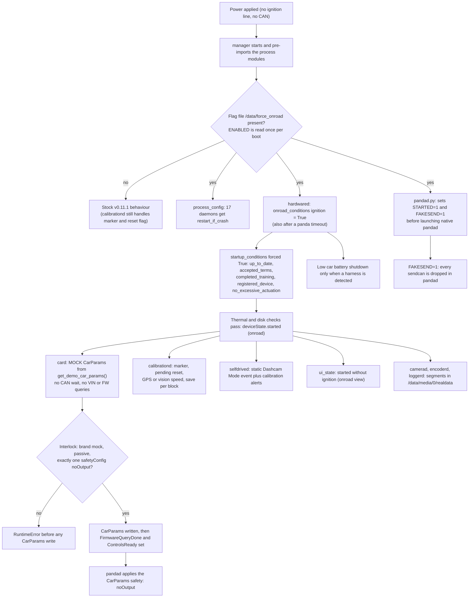
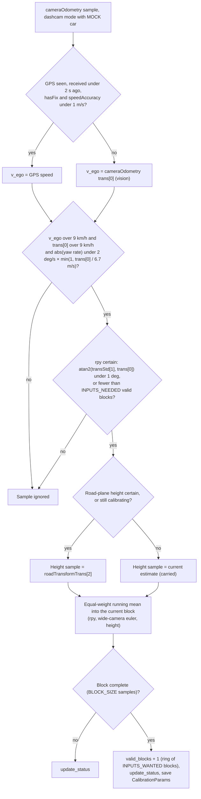

# dashcam-anywhere: design and validation

dashcam-anywhere is a 10-file patch for openpilot v0.11.1 `release-tizi`. It turns a comma 3X into a recording-only dashcam for robots and small vehicles that have no ignition signal and no CAN bus. When the flag file `/data/force_onroad` exists at boot, the device goes onroad as soon as it has power, runs openpilot's passive MOCK car with `noOutput` panda safety, and learns its camera calibration from GPS or visual-odometry speed instead of CAN wheel speed. This page covers every hunk of the patch, the CAN-free calibration, the safety interlocks, the recorded validation, and how to install and remove the patch. Day-to-day operation is in the [field guide](12-dashcam-anywhere-field-guide.md).

## At a glance

| Field | Value |
|---|---|
| Audience | Developers, and maintainers who re-install or remove the patch |
| Runs on | **Device:** the patched tree in `/data/openpilot`, plus `status.py` and `replay_calib.py` in `/data/dashcam_anywhere/`. **Laptop:** `dashcam.sh`, which drives the device over SSH |
| Era | **Era 2 — openpilot v0.11.1 `release-tizi` + dashcam‑anywhere** (from 2026‑10‑03) |
| Status | Current. Installed on the device as local commit `8acb496`, tag `dashcam-anywhere-v1` (per the dashcam README) |
| Key files | [`dashcam_anywhere.patch`](../remote/Arman/dashcam_anywhere/dashcam_anywhere.patch), [`README.md`](../remote/Arman/dashcam_anywhere/README.md) (Chinese), [`replay_calib.py`](../remote/Arman/dashcam_anywhere/replay_calib.py), [`status.py`](../remote/Arman/dashcam_anywhere/status.py), [`dashcam.sh`](../remote/Arman/dashcam_anywhere/dashcam.sh), [`LAPTOP_GUIDE.md`](../remote/Arman/dashcam_anywhere/LAPTOP_GUIDE.md) (Chinese) |

> [!NOTE]
> **How to read this page.** Everything said about the patch, `status.py`, `replay_calib.py` and `dashcam.sh` was checked against the files in this repo. The field results (unit tests, replay numbers, bench acceptance, boot time, temperatures, storage) come from the Chinese dashcam README and are labelled **Reported in `dashcam_anywhere/README.md`**. The patch also relies on stock openpilot constants that it does not show: block sizes, mount-angle limits, recalibration spreads, temperature thresholds and power-monitoring limits. Their values cannot be checked in this repo.

## Summary and baseline

| Item | Value |
|---|---|
| Stock base | openpilot v0.11.1, branch `release-tizi`, commit `70e157462304e5ce7d03ffbec6cb7f45bf347bb7` (short `70e1574`) |
| Patched commit | `8acb496` on the device's local `release-tizi` branch |
| Tag | `dashcam-anywhere-v1` |
| Patch file | [`dashcam_anywhere.patch`](../remote/Arman/dashcam_anywhere/dashcam_anywhere.patch): `diff -ruN` output with `orig/` and `new/` path prefixes, so it applies with `-p1` from the openpilot root |
| Size | 10 files, +375 / −25 lines: one new file, nine modified (counted from the patch; `git apply --stat` gives the same) |
| Written | 2026‑10‑03. The `+++` timestamps in the patch run from 15:13 to 15:54 local time |
| Device in the notes | comma 3X, dongle `<DONGLE_ID>`, reached as `comma@192.168.1.231` on the lab Wi‑Fi |
| Switch | `/data/force_onroad`, evaluated once per boot |

The design follows four rules, and they show up in every hunk:

1. **One switch, read once.** Every patched runtime module asks `dashcam_anywhere.enabled()` (calibrationd caches the answer as `DASHCAM`), and that returns a value computed when the module is imported. Manager pre-imports the process modules and forks the daemons from itself, so the whole system sees one value from manager start until the next reboot.
2. **No flag means stock.** Each behavioural change sits behind `enabled()` (or calibrationd's `DASHCAM`). Only one piece of code also runs without the flag: calibrationd's start-up handling of two files, the mode-change marker and a pending reset request.
3. **Never control anything.** No fingerprinting, a passive MOCK car, an interlock on the CarParams, `noOutput` panda safety, and every `sendcan` dropped inside pandad.
4. **Record unattended.** Ignition is forced on through panda resets, crashed daemons are restarted in place, and calibration progress is saved after every block.

> [!IMPORTANT]
> **Era 2 semantics of `/data/force_onroad`.** In this era the file is read **once**, when manager starts. Touching or removing it by hand changes nothing until the next reboot (`dashcam.sh enable` and `disable` reboot for you). Era 1 used a file with the same name but different, live-checked semantics. See [No-CAN truck/bench mode](10-no-can-mode-sunnypilot.md).

## Behaviour when enabled

This is the README's "What it does" table, mapped to the code.

| Capability | How it is done | Patched file → symbol |
|---|---|---|
| Records as soon as it has power. No ignition, harness or CAN needed | Native pandad starts with `STARTED=1` (spoofed ignition). hardwared forces `onroad_conditions["ignition"]`. The UI counts the device as started without ignition | `pandad.py`; `hardwared.py`; `ui_state.py` → `started` |
| Skips start-up checks that don't fit an offline dashcam moved between vehicles | `up_to_date`, `accepted_terms`, `completed_training`, `registered_device` and `no_excessive_actuation` are forced True. **The thermal and disk-space checks still apply.** The install also sets `DisableUpdates=1` | `hardwared.py` → `startup_conditions` |
| Never controls anything | No fingerprinting and no VIN/firmware queries. The MOCK car comes from `get_demo_car_params()` (passive). An interlock refuses any CarParams that are not mock + passive + `noOutput`. pandad puts the panda in `noOutput`, and `FAKESEND=1` drops every `sendcan` | `card.py`; `pandad.py` |
| Calibrates pitch, yaw and camera height without CAN | Speed comes from GPS (good fix) or visual odometry. There is a 9 km/h gate and a straight-line gate that scales with speed. Samples are averaged with equal weight per block. The height is kept when the road plane is uncertain. Progress is saved after every block | `calibrationd.py` → `main()`, `Calibrator.handle_cam_odom()` |
| Calibration survives reboots and can be reset by hand | Per-block save. `dashcam.sh reset-calib` (or `touch /data/reset_calib`) starts over from zero within about 1 s. Settings → Device → Reset Calibration on the screen does the same | `calibrationd.py` → `consume_reset_request()`; `device.py` |
| Civic and dashcam calibrations never mix | The marker `/data/calib_from_dashcam`: entering or leaving the mode wipes `CalibrationParams` | `calibrationd.py` → `reset_on_mode_change()` |
| Runs unattended | 17 processes (recording, calibration and thermal related) are restarted in place after a crash | `process_config.py` → `DASHCAM_RESTART_IF_CRASH` |
| Screen | A static "Dashcam Mode" banner. "Calibrating: x% / Drive Above 9 km/h" until calibrated. No "no car" start-up alert | `selfdrived.py` |
| Car battery | Only behind a car harness: shuts down after the car voltage stays low | `hardwared.py` |

Without `/data/force_onroad` the device behaves exactly like stock, except for the calibration marker and the reset flag.

> [!NOTE]
> **Reported in `dashcam_anywhere/README.md`.** The README says the restart and reset take "about 1 s". Its bench record lists the "Calibrating: 0% / Drive Above 9 km/h" screen; the "Dashcam Mode" text comes from its feature table. The code checks for a reset request when more than 1.0 s has passed since the last check (see [Reset requests](#reset-requests)).

## Boot path

What happens between power-on and recording when the flag is present. The nodes come from the patch hunks. Power-on, manager start, the started state and the logging processes are stock steps, shown for context.



The same sequence in words:

1. **Import.** `common/dashcam_anywhere.py` sets `ENABLED = os.path.isfile("/data/force_onroad")` when it is first imported. Every patched process reads that value.
2. **Restart policy.** `system/manager/process_config.py` sets `restart_if_crash = True` on 17 processes (listed [below](#systemmanagerprocess_configpy)).
3. **pandad.** The Python supervisor exports `STARTED=1` and `FAKESEND=1` before it launches the native `./pandad`. The bench run reported `ignitionLine=True` with no car attached.
4. **hardwared.** The `ignition` onroad condition is forced True on every loop, and a panda timeout no longer clears it. Five start-up conditions are forced True. The thermal and disk conditions still gate the start.
5. **Started.** `deviceState.started` becomes True. The README reports onroad within 55 s on the bench; the field guide says about 30–60 s.
6. **card.** It builds the MOCK car right away, refuses unsafe CarParams, writes the CarParams, and sets `FirmwareQueryDone` and `ControlsReady`.
7. **pandad safety.** Per the card hunk's comment, pandad needs those two params "to apply the CarParams safety (noOutput) instead of ELM327". The normal-values table in `LAPTOP_GUIDE.md` §5 notes that `safetyModel` can read `elm327` for a few seconds after boot.
8. **calibrationd.** It handles the mode-change marker and a pending reset, then calibrates from GPS or vision speed (see [Calibration without CAN](#calibration-without-can)).
9. **selfdrived.** It shows the static "Dashcam Mode" banner plus calibration progress.
10. **UI.** `ui_state.started` no longer requires ignition, so the onroad camera view stays up even while the panda reconnects.
11. **Logging.** camerad, encoderd and loggerd record to `/data/media/0/realdata/<route>--<segment>/` (stock behaviour).

## Per-file changes

All hunks live in [`dashcam_anywhere.patch`](../remote/Arman/dashcam_anywhere/dashcam_anywhere.patch). The citations below name the patched file and symbol.

| # | Patched file | +/− | Change | Active without the flag |
|---|---|---|---|---|
| 1 | `common/dashcam_anywhere.py` (new) | +25 / −0 | The switch: `FLAG`, `RESET_CALIB_FLAG`, `CALIB_MARKER`, `ENABLED`, `enabled()` | Imported; `ENABLED` is False |
| 2 | `selfdrive/car/card.py` | +26 / −2 | MOCK car with no CAN wait or fingerprinting; CarParams interlock; sets `FirmwareQueryDone` and `ControlsReady` | No |
| 3 | `selfdrive/locationd/calibrationd.py` | +112 / −15 | CAN-free calibration; save per block; runtime reset; mode-change marker | **Partly:** the marker and the start-up reset run in both modes |
| 4 | `selfdrive/locationd/test/test_calibrationd.py` | +142 / −3 | 8 new dashcam tests; one stock test branches on `DASHCAM` | Tests run either way |
| 5 | `selfdrive/pandad/pandad.py` | +6 / −0 | `STARTED=1` and `FAKESEND=1` for native pandad | No |
| 6 | `selfdrive/selfdrived/selfdrived.py` | +17 / −2 | `dashcamMode` instead of `carUnrecognized`; no `startupNoCar`; calibration alerts while passive | No |
| 7 | `selfdrive/ui/layouts/settings/device.py` | +7 / −0 | The UI's Reset Calibration also creates `/data/reset_calib` | No |
| 8 | `selfdrive/ui/ui_state.py` | +3 / −1 | `started` no longer needs ignition | No |
| 9 | `system/hardware/hardwared.py` | +27 / −2 | Forced ignition; five start-up checks skipped; low-battery shutdown behind a harness | No |
| 10 | `system/manager/process_config.py` | +10 / −0 | `restart_if_crash` for 17 processes | No |

### common/dashcam_anywhere.py (new)

This new module holds the whole switch.

| Name | Value | Meaning (from the module) |
|---|---|---|
| `FLAG` | `/data/force_onroad` | `touch` enables, `rm` disables; reboot to apply |
| `RESET_CALIB_FLAG` | `/data/reset_calib` | Restart camera calibration from scratch; consumed by calibrationd |
| `CALIB_MARKER` | `/data/calib_from_dashcam` | "CalibrationParams were learned in dashcam mode" |
| `ENABLED` | `os.path.isfile(FLAG)` | Evaluated once at import |
| `enabled()` | returns `ENABLED` | The mode test that every other patched module calls. calibrationd and `device.py` also read `RESET_CALIB_FLAG`, and calibrationd reads `CALIB_MARKER` |

The docstring requires the module to stay "dependency-free and without import-time side effects", because manager-preimported daemons, the UI and the tests all import it.

### selfdrive/car/card.py

The hunk adds imports for `dashcam_anywhere` and `get_demo_car_params` (from `opendbc.car.car_helpers`) and makes three changes:

1. **MOCK car, no CAN wait.** When no car interface was passed in (`CI is None`) and the mode is on, card logs `dashcam_anywhere: forcing MOCK car, skipping CAN wait and fingerprinting`. It then takes `CP = get_demo_car_params()`, sets `CP.fingerprintSource` to `fixed`, and builds the car and radar interfaces for `CP.carFingerprint`. The stock branch (it prints "Waiting for CAN messages..." and then fingerprints) becomes an `elif CI is None`. The patch comment says no VIN/FW queries are sent.
2. **Interlock.** Before any CarParams are written, card checks that `brand == "mock"`, `passive` is set, there is exactly one safety config, and its `safetyModel` is `noOutput`. If any of these fails it raises `RuntimeError("dashcam_anywhere: refusing to write non-noOutput CarParams")`.
3. **Unblock pandad.** After `CarParamsCache` and `CarParamsPersistent` are written, card does a blocking `put_bool` of True for `FirmwareQueryDone` and `ControlsReady`. Patch comment: a passive card never runs `controls_update()`, and the MOCK path skips the fingerprinting step that sets `FirmwareQueryDone`. pandad needs both before it applies the CarParams safety (`noOutput`) instead of ELM327. Both are cleared on every onroad transition, so card sets them on every start.

### selfdrive/locationd/calibrationd.py

This is the largest hunk (+112 / −15). It is described in full under [Calibration without CAN](#calibration-without-can). In short:

- **Constants.** `DASHCAM` is read once per process. The dashcam values of `MIN_SPEED_FILTER` and `MAX_VEL_ANGLE_STD` replace the stock ones. New: `YAW_RATE_REF_SPEED`, `GPS_MAX_AGE` and `GPS_MAX_SPEED_STD`.
- **New functions.** `running_mean()`, `Calibrator.reset_calibration()`, `consume_reset_request()` and `reset_on_mode_change()`.
- **`Calibrator.handle_cam_odom()`.** A speed-scaled yaw-rate gate, a relaxed certainty rule, a carried height, the equal-weight mean, and a save after each block.
- **`main()`.** Subscribes to GPS in dashcam mode. Picks GPS or vision speed for the MOCK car. Runs the marker and reset handling at start, polls for a reset request about once per second, and limits the validity check to `cameraOdometry` when it uses the alternative speed.

### selfdrive/locationd/test/test_calibrationd.py

Changes to the stock tests:

- The helper `process_messages()` gets a `cam_odo_height` argument (default `None`, which means `HEIGHT_INIT`).
- `test_calibration_speed_std_height_reject` branches on `calibrationd.DASHCAM`. With the flag set, pitch and yaw keep learning (`valid_blocks == INPUTS_WANTED`) and the height stays at `HEIGHT_INIT`. Without it, the stock assertion `valid_blocks == INPUTS_NEEDED` applies.
- A new helper, `process_messages_feedback()`, reproduces modeld's loop: the motion it feeds is relative to the calibration currently in use.

The new class `TestCalibrationdDashcam` tests the dashcam paths whether or not the device flag is set. Its helper `_dashcam()`, used by the first six tests, monkeypatches `DASHCAM`, `MIN_SPEED_FILTER` (9 km/h) and `MAX_VEL_ANGLE_STD` (1°). The last two tests patch file paths instead, and `test_reset_on_mode_change` sets `DASHCAM` itself:

| Test | Setup | Asserts |
|---|---|---|
| `test_low_speed_calibration` | Feedback loop with a true calibration of `[0.0, 0.03, -0.02]` rad, at 9 km/h + 0.5 m/s, for `BLOCK_SIZE * INPUTS_WANTED` samples | `valid_blocks == INPUTS_WANTED`, status `calibrated`, rpy within 1e‑3 rad of the truth |
| `test_below_dashcam_speed_reject` | Speed 0.2 m/s below 9 km/h | No valid block |
| `test_yaw_rate_gate_scales_with_speed` | 3.0 m/s, where the scaled limit is 2°/s × 3.0 / 6.7 = 0.9°/s | A yaw rate of 1.5°/s gives 0 blocks; 0.5°/s gives `INPUTS_NEEDED` blocks |
| `test_block_running_mean` | Half a block at yaw 0, then half at 0.02 rad | The block's yaw is 0.01 (±1e‑4). The test comment says stock linear decay would give about 0.02 |
| `test_uncertain_height_is_carried` | `INPUTS_NEEDED` blocks at height 1.0, then `INPUTS_WANTED` blocks at height 0.5 with height std 1e3 | The height stays at 1.0 and `valid_blocks == INPUTS_WANTED` |
| `test_reset_calibration` | Calibrated, then a pitch step of 1.1 × `MAX_ALLOWED_PITCH_SPREAD` → `recalibrating`, then `reset_calibration()` | 0 valid blocks, `uncalibrated`, rpy 0, height `HEIGHT_INIT`, `calPerc == 0` |
| `test_consume_reset_request` | Flag path monkeypatched into `tmp_path` | No flag → False and the params are untouched. Flag present → True, the flag is gone and `CalibrationParams` is removed |
| `test_reset_on_mode_change` | Marker path monkeypatched into `tmp_path` | Normal car without marker: untouched. Entering the mode: removed and marker created. Staying: kept. Leaving: removed and marker deleted |

### selfdrive/pandad/pandad.py

Just before the Python supervisor runs `subprocess.Popen(["./pandad"], ...)` (with `MANAGER_DAEMON=pandad`), the patch adds this when the mode is on:

- `STARTED=1`: "spoof ignition so the device goes onroad".
- `FAKESEND=1`: "drop every sendcan in pandad".

The comment adds: "pandad only checks that these are set, never set them to '0'". In other words, the value `0` would still switch them on. What native pandad does with the two variables is described only by that comment and by the bench result, because pandad's C++ source is not part of the patch.

### selfdrive/selfdrived/selfdrived.py

- `self.dashcam_anywhere = dashcam_anywhere.enabled()` is stored next to `car_recognized = self.CP.brand != 'mock'`.
- **Start-up alert.** A car that is not recognised gets `startup_event = None` instead of `startupNoCar`. The comment: "the static Dashcam Mode banner is enough, there is no car or driver here".
- **Static event.** `EventName.dashcamMode` (static) replaces `carUnrecognized` and the `Offroad_CarUnrecognized` offroad alert ("intentional no-car dashcam, not an unrecognized car").
- **Calibration alerts.** The stock event update returns early for passive cars ("Don't add any more events while in dashcam mode"). In this mode it first adds at most one event from `liveCalibration.calStatus`: `calibrationIncomplete` (uncalibrated), `calibrationRecalibrating` or `calibrationInvalid`. A calibrated device gets none.

### selfdrive/ui/layouts/settings/device.py

The Device panel's Reset Calibration handler removes `CalibrationParams` and then, per the hunk context, `LiveTorqueParameters`, `LiveParameters` and `LiveParametersV2`. When the mode is on, it also creates `/data/reset_calib`; on `OSError` it logs "failed to request calibration reset". The patch comment explains why: "calibrationd saves after every block in this mode, make sure the restarted instance starts fresh".

> [!NOTE]
> **Analysis (from code; not field-tested).** Without the request file, a calibrationd that is still running could write its in-memory calibration back at the next completed block. With it, the running instance consumes the request within about a second, and a restarted instance consumes it at start-up.

### selfdrive/ui/ui_state.py

`self.started = self.sm["deviceState"].started and (self.ignition or dashcam_anywhere.enabled())`. The comment: "no real ignition, keep the onroad view while the panda reconnects".

### system/hardware/hardwared.py

- **Imports.** `VBATT_PAUSE_CHARGING` and `VOLTAGE_SHUTDOWN_MIN_OFFROAD_TIME_S` from `power_monitoring`. Their values are stock and not in this repo.
- **Panda timeout.** When `pandaStates` is older than `DISCONNECT_TIMEOUT`, stock code clears `ignition` and logs "panda timed out onroad". In this mode it doesn't.
- **Forced ignition.** On every loop, `onroad_conditions["ignition"] = True`. The comment: "no ignition signal on a robot/test vehicle, stay onroad while powered. This also keeps recording through the panda resets pandad does before every (re)start."
- **Skipped start-up checks.** `up_to_date`, `accepted_terms`, `completed_training`, `registered_device` and `no_excessive_actuation` are set to True. The comment: "Thermal, disk space and onroad-cycle conditions still apply."
- **Low-voltage shutdown.** This applies when the mode is on, `in_car` is set (`harnessStatus != notConnected`), `car_voltage_mV < VBATT_PAUSE_CHARGING * 1e3`, and `DisablePowerDown` is off. A timer starts; once more than `VOLTAGE_SHUTDOWN_MIN_OFFROAD_TIME_S` has passed, hardwared logs `dashcam_anywhere: car battery low (... mV), shutting down` and sets `DoShutdown`. If any condition stops holding, the timer resets. The comment explains: "dashcam-anywhere never goes offroad, so the check above can't protect a car battery".

### system/manager/process_config.py

`DASHCAM_RESTART_IF_CRASH` lists 17 processes: `camerad`, `encoderd`, `loggerd`, `sensord`, `micd`, `qcomgpsd`, `timed`, `modeld`, `dmonitoringmodeld`, `dmonitoringd`, `locationd`, `calibrationd`, `card`, `selfdrived`, `soundd`, `hardwared`, `pandad`. In this mode each one gets `restart_if_crash = True`. The comment explains why: "forced onroad never goes through an offroad->onroad cycle, which is the only time crashed processes are started again". The README reports that after `pkill -9 encoderd` the manager restarted it in about 1 s and recording continued.

## Calibration without CAN

Stock calibrationd takes `carState.vEgo` (CAN wheel speed) as its speed. It only learns above 15 mph (about 24 km/h), with tight certainty limits. A MOCK car has no wheel speed, and a robot rarely drives at 24 km/h. The patch changes four things: where the speed comes from, the gates, the averaging, and how the result is stored.

### Speed source and sample acceptance

`main()` sets `alt_speed = DASHCAM and CP.brand == 'mock'`. In dashcam mode it also subscribes to the GPS service that openpilot's `get_gps_location_service()` selects. That service is marked `ignore_alive`, `ignore_avg_freq` and `ignore_valid`, so missing GPS never invalidates `liveCalibration`. Each `cameraOdometry` update (about 20 Hz) then goes through this:



Points to note:

- **With a GPS fix, both speeds must clear 9 km/h.** `v_ego` (GPS) and `trans[0]` (vision) are both checked. Without a fix, both checks fall on the vision speed.
- **The yaw-rate gate scales with vision speed, not GPS speed:** `max(trans[0], 0.0)`. The patch comment: "while turning, the camera ahead of the rotation center sees a lateral velocity that reads as yaw. Keep the max accepted curvature what it is at YAW_RATE_REF_SPEED."
- **Validity.** `liveCalibration` validity uses `sm.all_checks(['cameraOdometry'])` when the alternative speed is in use (stock checks `cameraOdometry` and `carState`). It is published on every 5th `cameraOdometry` frame, about 4 Hz.
- **Stock mode** (flag absent) keeps `carState.vEgo`, the 15 mph gate, the fixed 2°/s yaw gate, the rule that a sample needs both rpy and height certainty, and the stock averaging.

> [!NOTE]
> **Analysis (from code; not field-tested).** Below 6.7 m/s the yaw gate keeps the largest accepted curvature fixed at 2°/s ÷ 6.7 m/s ≈ 0.0052 rad/m. That is a turn radius of about 190 m. In practice a slow robot only collects samples on essentially straight runs. At the 9 km/h minimum the yaw-rate limit is about 0.75°/s.

### Constants

| Constant | Dashcam mode | Stock | Where |
|---|---|---|---|
| `MIN_SPEED_FILTER` | `9 * CV.KPH_TO_MS` = 2.5 m/s. The comment says it is "also shown in the 'Drive Above' alert" | `15 * CV.MPH_TO_MS` ≈ 6.71 m/s (24.1 km/h) | `calibrationd.py` module level |
| `MAX_VEL_ANGLE_STD` | 1.0°: "low-speed pose is noisier per sample, blocks average it out" | 0.25° | same |
| `MAX_YAW_RATE_FILTER` | Unchanged at 2°/s; the gate uses a scaled local copy, `yaw_rate_limit` = 2°/s × min(1, max(`trans[0]`, 0) / `YAW_RATE_REF_SPEED`) | 2°/s | module level; scaled in `Calibrator.handle_cam_odom()` |
| `YAW_RATE_REF_SPEED` | `15 * CV.MPH_TO_MS` ≈ 6.71 m/s | — | module level |
| `GPS_MAX_AGE` | 2.0 s | — | module level; `status.py` uses the same value |
| `GPS_MAX_SPEED_STD` | 1.0 m/s (`speedAccuracy`) | — | same |
| `MAX_HEIGHT_STD` | e^−3.5 ≈ 0.030 m (unchanged; the comparison itself is outside the hunk) | same | module level |
| Block average | `running_mean()` | `moving_avg_with_linear_decay()` | `handle_cam_odom()` |
| `BLOCK_SIZE`, `INPUTS_NEEDED`, `INPUTS_WANTED` | stock | stock | Not visible in this repo. The notes imply one block ≈ 5 s of valid samples, calibrated after 5 blocks, a 50-block window |
| Mount limits | stock | stock | Not visible. Notes: pitch −5.2° (up) to +9.7° (down), yaw ±4° |
| Recalibration trigger | stock | stock | Not visible. Notes: yaw change > 2° or pitch change > 4° |

### Equal-weight block averaging

Stock code folds each sample into the current block with `moving_avg_with_linear_decay(prev, new, idx, B) = (idx·prev + (B − idx)·new) / B`. That is not an equal-weight mean. The patch's `running_mean(prev, new, idx, B) = (idx·prev + new) / (idx + 1)` gives every sample in the block the same weight. At `idx == 0` it still overwrites the slot being recycled. `test_block_running_mean` pins the difference: half a block at 0 and half at 0.02 rad gives 0.01 rad, where the stock formula would give about 0.02.

> [!NOTE]
> **Reported in `dashcam_anywhere/README.md`.** Without the two low-speed fixes (equal-weight block averaging and the scaled yaw gate), the replay's yaw in the robot speed band drifted to 1.02°, against 0.62° with them.

### Height when the road plane is uncertain

In dashcam mode a sample counts when `rpy_certain or calibrating`. The height is learned only when `height_certain or calibrating`. Otherwise the current estimate is carried (`self.height.copy()`). The comment says: "unusual camera heights: an uncertain road plane must not stop pitch/yaw learning". In stock mode a sample needs both certainties (or the calibration still in progress), and the height is taken from the road plane whenever one is reported.

### Persistence

In dashcam mode, `handle_cam_odom()` writes `CalibrationParams` after **every completed block** (`DASHCAM and block_done and self.param_put`). The comment: "slow vehicles that are switched off by cutting power keep their progress". The stock save, guarded by `write_this_cycle`, is still there; its schedule is stock code outside the hunk.

> [!NOTE]
> **Reported in `dashcam_anywhere/README.md` and `LAPTOP_GUIDE.md`.** One block is about 5 s of valid samples and adds about 20 % to the progress. The device shows "calibrated" after about 25 s of valid samples; replay at low speed measured about 1–2 minutes of driving. About 4 minutes of samples fill the 50-block window.

### Reset requests

There are three ways to request a reset, and they all end in the same function:

| Trigger | What it does |
|---|---|
| `dashcam.sh reset-calib` | Runs `touch /data/reset_calib` over SSH (with no confirmation prompt) |
| Settings → Device → Reset Calibration (screen) | Stock removal of the learned params, plus `/data/reset_calib` in dashcam mode |
| `touch /data/reset_calib` on the device | Same as the first row |

`consume_reset_request()` removes the flag file **first** ("a stuck flag must not reset every second"). If the file is missing it returns False. On any other `OSError` it logs "calibrationd: cannot remove calibration reset flag, ignoring it" and returns False. Otherwise it removes the `CalibrationParams` param, logs "calibrationd: calibration reset requested", and returns True.

It is called at two points:

- **At calibrationd start, in both modes:** before `Calibrator()` reads `CalibrationParams`, so the new instance starts empty.
- **At runtime, in dashcam mode only:** whenever more than 1.0 s has passed since the last check. A True result calls `Calibrator.reset_calibration()`, which runs `reset()`, forces the status to `uncalibrated` ("recalibrating is sticky in update_status") and recomputes the status. Per the comment, runtime resets are limited to dashcam mode because a reset "makes the model warp jump".

Both calls, and the marker handling below, run only when `OPENPILOT_PREFIX` is not set (`real_device`). Replays and tests that use prefixed params never touch the device's real files.

### Mode-change marker

`reset_on_mode_change()` runs once at calibrationd start on a real device. Its rule: "never carry a calibration between dashcam-anywhere mode and the normal car".

| Mode this boot (`DASHCAM`) | `/data/calib_from_dashcam` | Action | Log line |
|---|---|---|---|
| on | absent | Remove `CalibrationParams`, create the marker | `calibrationd: entered dashcam mode, calibration reset` |
| on | present | Nothing; keep the dashcam calibration | — |
| off | present | Remove `CalibrationParams`, delete the marker | `calibrationd: left dashcam mode, calibration reset` |
| off | absent | Nothing (stock) | — |

An `OSError` is logged as "calibrationd: dashcam calibration marker update failed". calibrationd runs only onroad (as `status.py` notes), so after a mode switch the marker takes effect at the first onroad start. That is why `dashcam.sh restore-civic` works offroad: it copies the backup and deletes the marker, so the restored Civic calibration survives the next start. See [Returning to the Civic](12-dashcam-anywhere-field-guide.md#returning-to-the-civic).

## Safety interlocks

> [!CAUTION]
> **Recording only, never control.** This mode must never be connected to a vehicle bus. `LAPTOP_GUIDE.md` §2.2: do not connect any CAN wires (a robot has no vehicle CAN, and a bus with a different bit rate could be disturbed). If `status` ever shows non-zero `txCnt` or `fwdCnt`, cut power at once and check the wiring (`LAPTOP_GUIDE.md` §5).

| Layer | Mechanism | Code | Bench result (reported) |
|---|---|---|---|
| No identification traffic | MOCK path: no CAN wait, no fingerprinting, no VIN/FW queries | `card.py` | — |
| Passive car | `get_demo_car_params()`; `passive` is required by the interlock | `card.py` | `brand=mock`, `passive` |
| CarParams interlock | `RuntimeError` unless the brand is mock, the car is passive and the only safety config is `noOutput`. Runs before any CarParams write | `card.py` | `safetyConfigs=[noOutput]` |
| Panda safety | pandad applies the CarParams safety once `FirmwareQueryDone` and `ControlsReady` are set | `card.py` (comment) | `safetyModel=noOutput`, `controlsAllowed=False`, `safetyTxBlocked=0` |
| Drop all sends | `FAKESEND=1` for native pandad | `pandad.py` | tx and fwd counts 0 on all three CAN buses; no `sendcan` |
| Checks kept | Thermal, disk space, onroad-cycle | `hardwared.py` | — |
| Battery behind a harness | Low car voltage for longer than `VOLTAGE_SHUTDOWN_MIN_OFFROAD_TIME_S` → `DoShutdown` | `hardwared.py` | Not part of the reported bench test (USB power, no car) |

> [!NOTE]
> **Analysis (from code; not field-tested).** If the interlock ever fired, card would raise before writing CarParams. card is in the restart list, so it would keep failing rather than run with other parameters, and pandad would not get the params it waits for from card. `FAKESEND=1` would still drop any `sendcan`.

The patch does **not** change driver monitoring, the driver-facing camera, the microphone (`RecordAudio`) or uploads (see [Known limitations](#known-limitations)).

## Installing on a re-flashed device

> [!IMPORTANT]
> **Reconstructed procedure.** The notes record the result of the original installation: commit `8acb496`, tag `dashcam-anywhere-v1`, a backup in `/data/dashcam_backup/20261003/`, and `DisableUpdates=1`. They do not record the commands. The steps below were rebuilt from the patch format, `dashcam.sh`, `status.py` and the README, and have not been run as written. The patch was made against `70e1574`; on any other commit, stop and port it by hand.

First find the device and set `$COMMA_IP` (or set it by hand), then stay in `remote/Arman/dashcam_anywhere`. Every laptop block below runs from there.

```bash
# laptop
cd remote/Arman && export COMMA_IP=$(./find_comma.sh)
ssh comma@$COMMA_IP 'cat /data/params/d/DongleId'      # must print your device's dongle id
cd dashcam_anywhere
```

**1. Check the stock base.**

```bash
# device  (ssh comma@$COMMA_IP)
cd /data/openpilot
git rev-parse HEAD            # expect 70e157462304e5ce7d03ffbec6cb7f45bf347bb7
git status --short            # expect no output
test -f common/dashcam_anywhere.py && echo "already patched"
```

**2. Back up the Civic's learned params** before enabling the mode, because entering the mode deletes `CalibrationParams`. The README lists the original backup's contents: `CalibrationParams`, `CarParams*`, `LiveParametersV2`, `LiveDelay`, `LiveTorqueParameters` and the git revision. `dashcam.sh restore-civic` reads the hard-coded path `BACKUP=/data/dashcam_backup/20261003`. Use that directory, or change `BACKUP=` in `dashcam.sh` to match yours.

```bash
# device  (ssh comma@$COMMA_IP)
B=/data/dashcam_backup/20261003        # the path dashcam.sh restore-civic expects
mkdir -p "$B" && cd /data/params/d
for k in CalibrationParams CarParams* LiveParametersV2 LiveDelay LiveTorqueParameters; do
  [ -f "$k" ] && cp -p "$k" "$B/"
done
git -C /data/openpilot rev-parse HEAD > "$B/git_rev"     # file name is our choice; the original's is not recorded
ls -l "$B"
```

**3. Dry-run, then apply.** The patch headers are `orig/...` and `new/...`, hence `-p1`. The commands feed the patch over SSH from the laptop, so no copy is needed.

```bash
# laptop
ssh comma@$COMMA_IP 'cd /data/openpilot && patch -p1 --dry-run' < dashcam_anywhere.patch
ssh comma@$COMMA_IP 'cd /data/openpilot && patch -p1' < dashcam_anywhere.patch
ssh comma@$COMMA_IP 'cd /data/openpilot && git status --short'
# expect nine " M" lines and "?? common/dashcam_anywhere.py"
```

If `patch` is not installed on the device, `git apply --check` and `git apply` (they read the patch from stdin) do the same job. Optionally, commit the result on the local branch and tag it `dashcam-anywhere-v1`, as the original install did. The hash will differ from `8acb496`, and you need a git identity. Committing also makes the [full rollback](#full-rollback) remove the new file.

**4. Disable updates.** The README records `DisableUpdates=1` as part of the install, and its full rollback removes the param to bring back normal `release-tizi` updates.

```bash
# device  (ssh comma@$COMMA_IP)
cd /data/openpilot && PYTHONDONTWRITEBYTECODE=1 PYTHONPATH=/data/openpilot /usr/local/venv/bin/python3 -B -c "from openpilot.common.params import Params; Params().put_bool('DisableUpdates', True)"
```

**5. Copy the device-side scripts** to the path `dashcam.sh` and the README use:

```bash
# laptop
ssh comma@$COMMA_IP 'mkdir -p /data/dashcam_anywhere'
scp status.py replay_calib.py comma@$COMMA_IP:/data/dashcam_anywhere/
```

**6. Enable and verify.** `enable` asks for confirmation, refuses if `/data/openpilot/common/dashcam_anywhere.py` is missing, then touches `/data/force_onroad` and reboots.

> [!WARNING]
> **After this step the device records whenever it has power.** It goes onroad at every boot and does not shut itself down unless the panda reports a harness (see [Known limitations](#known-limitations), including the privacy note). To switch the mode off, run `./dashcam.sh disable` ([Rollback](#rollback)).

```bash
# laptop
./dashcam.sh enable
# about one minute later
./dashcam.sh status
```

Compare the output with the [normal values](12-dashcam-anywhere-field-guide.md#normal-values): `brand=mock passive=True safetyConfigs=['noOutput']`, `safetyModel=noOutput`, all tx/fwd counts 0, and `DisableUpdates: True`.

> [!CAUTION]
> **Running the unit tests on the device.** The README reports 15/15 passing, but not the command it used. `test_consume_reset_request` and `test_reset_on_mode_change` write and delete `CalibrationParams` through a plain `Params()`. They are safe only when the test harness points `Params` at a temporary prefix. That harness is openpilot's own pytest setup, which is not in this repo; check it before you run the tests on a calibrated device.

## Validation record

> [!NOTE]
> **Reported in `dashcam_anywhere/README.md`** (validation dated 2026‑10‑03). These results were not re-run for this documentation. `replay_rlogs/` (206 MB of Civic rlogs) exists only on the desktop and is not in this repo.

**Unit tests.** `selfdrive/locationd/test/test_calibrationd.py` has 15 tests (7 stock + 8 dashcam), and all passed. They also passed 15/15 with the mode switched on. The 8 dashcam tests are the ones listed [above](#selfdrivelocationdtesttest_calibrationdpy).

**Replay.** `replay_calib.py` was run on 19 Civic rlog segments, the same count as the script's default list (16 low-speed + 3 highway). The reference is the stock CAN-speed logic on all the data: pitch 3.37°, yaw 0.65°.

| Subset | dashcam result (pitch / yaw) | Difference from the stock reference | False recalibrations | Max yaw spread |
|---|---|---|---|---|
| CAN speed < 6.7 m/s | 3.44° / 0.64° | 0.07° / 0.02° | 0 | 0.81° |
| CAN speed < 3.1 m/s (robot speed band) | 3.51° / 0.62° | 0.13° / 0.03° | 0 | 0.68° |

Without the two low-speed fixes, yaw in the robot speed band drifted to 1.02°.

> [!NOTE]
> **Analysis (from code; not field-tested).** `replay_calib.py` computes the differences from unrounded angles, which is why they can be 0.01° off the rounded columns (for example 3.51 − 3.37). The CAN < 6.7 m/s subset is roughly the data that stock calibration (15 mph gate) never uses.

**Bench acceptance** (2026‑10‑03; USB power, no car, indoors):

- Onroad within 55 s of boot. A route started recording (fcamera, ecamera, dcamera, qcamera, rlog, qlog).
- CarParams: `brand=mock`, `passive`, `safetyConfigs=[noOutput]`.
- Panda: `ignitionLine=True`, `safetyModel=noOutput`, `controlsAllowed=False`, `safetyTxBlocked=0`. The tx and fwd counters were 0 on all three CAN buses, and there was no `sendcan`.
- The screen showed "Calibrating: 0% / Drive Above 9 km/h". The marker logic had cleared the Civic calibration automatically.
- After `pkill -9 encoderd`, manager restarted it in about 1 s and recording continued.
- `touch /data/reset_calib` was consumed within 1 s and logged to cloudlog.
- With the device standing still on the indoor bench, the vision-speed noise had a median of 0.74 m/s and a maximum of 1.5 m/s, below the 2.5 m/s gate, so it produced no false samples. Indoors there is no GPS and only the vision speed is available. When mounting, let the camera see a normal road scene.

## Re-running the replay

`replay_calib.py` is a read-only replay of the calibration logic on recorded drives. It runs **on the device**, because it imports the patched `calibrationd`. For each logged `cameraOdometry` sample it:

- finds the latest `liveCalibration.rpyCalib` at or before the sample, and skips the sample if there is none or it does not hold three angles;
- takes the latest `carState.vEgo` as the CAN speed (0.0 if there is none);
- takes the GPS speed if the latest `gpsLocation` is less than `GPS_MAX_AGE` old (in log nanoseconds), has a fix and has `speedAccuracy < GPS_MAX_SPEED_STD`;
- feeds the sample to a `Calibrator` built with `__new__`. That skips `__init__` and `Params()`, so nothing is written. Before each sample it sets `old_rpy` to the logged calibration, with weight `1 + 1/SMOOTH_CYCLES`, so the smoothed rpy equals the one modeld actually used. That reproduces the calibration feedback loop.

It compares four configurations by setting calibrationd's module globals (`DASHCAM`, `MIN_SPEED_FILTER`, `MAX_VEL_ANGLE_STD`):

| Config | Dashcam logic | Min speed | Max angle std | Speed source |
|---|---|---|---|---|
| `stock` | off | 15 × 0.44704 ≈ 6.71 m/s | 0.25° | CAN |
| `lowspeed_only` | off | 9 / 3.6 = 2.5 m/s | 1.0° | GPS if usable, else vision |
| `dashcam` | on | 2.5 m/s | 1.0° | GPS if usable, else vision |
| `dashcam_vision` | on | 2.5 m/s | 1.0° | vision only |

`stock` on all the data is the reference. Each of the other three runs on the subsets `all`, `CAN<6.7` and `CAN<3.1`, which drop the samples whose CAN speed is at or above the limit. **Acceptance** in `main()`: `dashcam` must, on both CAN subsets, have 0 recalibrations, a max yaw spread under 1.5°, |Δpitch| and |Δyaw| under 0.2° against the reference, **and** status `calibrated`. The docstring leaves out the last condition. The script prints `ACCEPTANCE: PASS` or `FAIL` and exits 0 or 1.

Each result line has: pitch and yaw (°), `h` (height, m), `vb` (valid blocks), the status, `recal` (number of entries into `recalibrating`), `spread(p,y)` (largest calibration spread while calibrated, °), `blockstd(p,y)` (standard deviation of the completed block means, °), `t_cal` (seconds of fed data until the first `calibrated`, counted at 20 samples/s), and `fed` (seconds of data fed). The first line reports the sample count, the minutes, and the share of samples with usable GPS.

Command (from the README and the script's docstring). It needs `replay_rlogs/`, which is desktop-only, copied to `/data/dashcam_anywhere/replay_rlogs` first. The expected layout is `<root>/<segment>/rlog.zst`.

```bash
# laptop
ssh comma@$COMMA_IP 'cd /data/openpilot && PYTHONDONTWRITEBYTECODE=1 PYTHONPATH=/data/openpilot /usr/local/venv/bin/python3 -B /data/dashcam_anywhere/replay_calib.py --root /data/dashcam_anywhere/replay_rlogs'
```

| Argument | Default | Meaning |
|---|---|---|
| `--root DIR` | `/data/media/0/realdata` | Directory that holds `<segment>/rlog.zst` |
| `SEGMENT ...` | The 19 Civic segments in `LOW_SPEED` + `HIGHWAY` | Segment directory names; missing ones are reported on stderr and skipped |

To replay the device's own recordings, leave out `--root` and name the segments, for example `00000066--3f2a9c1b7e--0`.

> [!NOTE]
> **Analysis (from code; not field-tested).** Recordings made in dashcam mode come from the MOCK car, which has no wheel speed. Every sample then has a CAN speed of 0 and lands in both CAN subsets, and the `stock` reference never calibrates, so its pitch and yaw stay at the initial 0°. On such logs `ACCEPTANCE` fails unless the mount happens to sit within 0.2° of zero pitch and yaw. Read the `dashcam` and `dashcam_vision` lines of the `all` subset instead. The README does not say which configuration its 1.02° figure comes from; `lowspeed_only` (lowered gates, stock block logic) is the closest match.

## Known limitations

From the README, with the corrections that apply:

- **Camera height.** The driving model was trained at car camera height. On a small robot with a low camera, the vision speed and the camera height may be off in scale. Pitch and yaw come from the direction of motion and do not depend on scale. Use the `vision/GPS speed ratio` in `status` to judge it.
- **Power.** The device records whenever it has power and, unless the panda reports a harness, never shuts itself down.
  - **Correction:** the README says there is "no low-voltage protection". That is only true without a car harness. Behind a harness, hardwared shuts the device down on a low car battery (see [hardwared](#systemhardwarehardwaredpy)). The test is the panda's harness status, not the vehicle type: whenever `status` shows `harness=notConnected` (as in the guide's sample output), the battery needs an external switch or BMS. **Analysis (from code; not field-tested):** if a robot's 12 V comes in through a harness box and the panda reports a harness, the check applies to that supply, and setting `DisablePowerDown` turns it off.
  - Cutting the power may truncate the last segment.
- **Temperature** (stock thresholds, reported, not verifiable here): above 75 °C at boot, recording does not start. Onroad, above 107 °C recording stops, and it resumes below 88 °C.
- **No RTC battery.** Offline, the system clock is wrong until the first GPS fix. Route names come from a counter and are not affected.
- **Storage.** About 230 MB/min with three cameras, giving a ring buffer of about 5.5 h; the oldest recordings are deleted automatically.
- **Unchanged stock features.** Audio recording (`RecordAudio`), the driver-facing camera and driver monitoring stay as in stock. With internet access, the device uploads qlog and qcamera files as stock does.
- **HUD speed** shows 0, because the MOCK car has no speed.
- **Indoors** there is no GPS, so calibration relies on vision speed alone (see the bench note above).

> [!CAUTION]
> **Privacy and consent.** The device keeps its driver-facing camera running, records audio when the stock `RecordAudio` setting is on, and uploads when it has internet. On a robot this can capture bystanders. Some jurisdictions require consent from everyone recorded, especially for audio. Check the rules where you operate and switch `RecordAudio` off if needed. `./dashcam.sh disable` ends the always-on recording ([Soft rollback](#soft-rollback)).

Further limits found while reading the code. **Analysis (from code; not field-tested):**

- calibrationd picks its GPS service with `get_gps_location_service()`, but `status.py` and `replay_calib.py` always read `gpsLocation`. If a device published GPS under another service name, `status` would show "no gpsLocation" even while calibration uses GPS.
- The `source:` line in `status.py` does not check whether the mode is on. In normal (CAN) mode it still says GPS or vision, although calibrationd then uses `carState`.
- While the patch is installed, the marker and start-up reset logic stays active even with the flag removed (rule 2 above). A leftover `/data/calib_from_dashcam` therefore wipes the car's calibration at the next onroad start.
- `/data/force_onroad` is read once per boot. A flag touched or removed by hand needs a reboot.

## Rollback

### Soft rollback

```bash
# laptop
cd remote/Arman/dashcam_anywhere        # from the root of your clone
./dashcam.sh disable                    # removes /data/force_onroad and reboots
```

The patch stays installed but inactive: the device needs a real ignition to go onroad. Back in the Civic, either run `./dashcam.sh restore-civic` while offroad, or just drive. In the second case the marker logic drops the robot calibration at the first onroad start, and the Civic recalibrates from scratch (straight driving above about 24 km/h, the stock gate). Before `restore-civic`, make sure `status` shows `pending reset: no`. **Analysis (from code; not field-tested):** calibrationd consumes a leftover `/data/reset_calib` at its next start in either mode ([Reset requests](#reset-requests)), which would delete the restored calibration. Details: [Returning to the Civic](12-dashcam-anywhere-field-guide.md#returning-to-the-civic).

### Full rollback

> [!IMPORTANT]
> **Before you run it.** The full rollback resets `/data/openpilot` to the stock commit, deletes the three flag files and the `DisableUpdates` param, and reboots. It does not restore the Civic params. To keep the Civic calibration, first run `./dashcam.sh disable` and then, once the device is offroad, `./dashcam.sh restore-civic` (details below the commands). To undo the rollback, reinstall as in [Installing on a re-flashed device](#installing-on-a-re-flashed-device).

From the README:

```bash
# device  (ssh comma@$COMMA_IP)
rm -f /data/force_onroad /data/reset_calib /data/calib_from_dashcam
cd /data/openpilot && git reset --hard 70e157462304e5ce7d03ffbec6cb7f45bf347bb7
PYTHONPATH=/data/openpilot /usr/local/venv/bin/python3 -c "from openpilot.common.params import Params; Params().remove('DisableUpdates')"
sudo reboot
```

The README's comment on the first line: stock code does not use these files, and a marker left behind would later wipe the Civic calibration by mistake (if the patch is ever installed again, per rule 2 above). After the reboot the updater rebuilds its staging area automatically, and the device returns to normal `release-tizi` updates (reported).

- **Restoring the Civic params.** `disable` comes before `restore-civic` because `restore-civic` refuses while the flag exists or the device is onroad. **Analysis (from code; not field-tested):** without `restore-civic`, the rollback deletes the marker but leaves `CalibrationParams` as it is. If the robot calibration is still there, stock openpilot starts from it instead of starting empty. The backup stays in `/data/dashcam_backup/20261003/`, holding the Civic's `CalibrationParams`, `CarParams*`, `LiveParametersV2`, `LiveDelay`, `LiveTorqueParameters` and the git revision.
- **An uncommitted patch.** **Analysis (from code; not field-tested):** if the patch was applied but never committed (see the [install](#installing-on-a-re-flashed-device) steps), `git reset --hard` keeps the untracked `common/dashcam_anywhere.py`. Remove it by hand. Otherwise `dashcam.sh enable`, and the era check in the [operations runbook](13-operations-runbook.md), still think the patch is installed.

For the inventory of every device change across both eras, see [Device changes and revert](14-device-changes-and-revert.md).

## See also

- [dashcam-anywhere: field guide](12-dashcam-anywhere-field-guide.md): operator procedure, `dashcam.sh`, reading `status`, downloads
- [Setup, SSH and networking](02-setup-ssh-networking.md): keys, networks, `find_comma.sh`
- [Operations runbook](13-operations-runbook.md): scenario C (robot dashcam)
- [Device changes and revert](14-device-changes-and-revert.md): era‑2 flags, backup and rollback
- [No-CAN truck/bench mode (sunnypilot era)](10-no-can-mode-sunnypilot.md): the era‑1 predecessor
- [Errata and crosswalk](16-errata-and-crosswalk.md): corrections to the original notes
- [File reference](15-file-reference.md)
