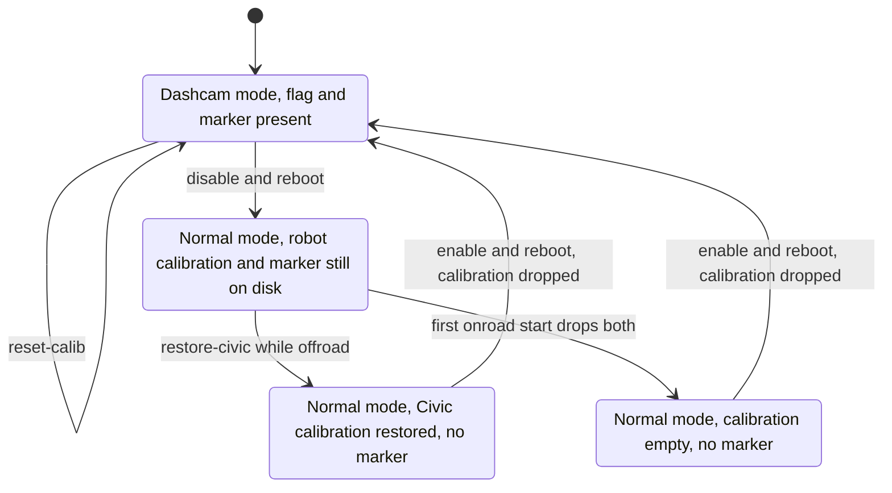

# dashcam-anywhere: field guide

This guide is for operators who use the comma 3X as a recording-only dashcam on a robot or small vehicle (era 2). It is the English version of the Chinese [`LAPTOP_GUIDE.md`](../remote/Arman/dashcam_anywhere/LAPTOP_GUIDE.md) §0–§11, checked against `dashcam.sh`, `status.py`, `find_comma.sh` and the patch, and corrected where the original was wrong. You drive everything from a Linux laptop with `dashcam.sh`. The device itself needs nothing but power. How the patch works is explained in [dashcam-anywhere: design and validation](11-dashcam-anywhere-design.md).

## At a glance

| Field | Value |
|---|---|
| Audience | Operators running robot or small-vehicle experiments with a laptop |
| Runs on | **Laptop:** `dashcam.sh`, `find_comma.sh`, `ssh`, `rsync`, `ffmpeg`. **Device:** `status.py` (called by `dashcam.sh status`) and the patched openpilot |
| Era | **Era 2 — openpilot v0.11.1 `release-tizi` + dashcam‑anywhere** (from 2026‑10‑03) |
| Status | Current |
| Key files | [`dashcam.sh`](../remote/Arman/dashcam_anywhere/dashcam.sh), [`status.py`](../remote/Arman/dashcam_anywhere/status.py), [`find_comma.sh`](../remote/Arman/find_comma.sh), [`ETHERNET_SETUP.md`](../remote/Arman/ETHERNET_SETUP.md), [`LAPTOP_GUIDE.md`](../remote/Arman/dashcam_anywhere/LAPTOP_GUIDE.md) (Chinese original), [`README.md`](../remote/Arman/dashcam_anywhere/README.md) (Chinese) |

The original was written for one device: a comma 3X with dongle `<DONGLE_ID>`, at 192.168.1.231 on its saved Wi‑Fi, running openpilot v0.11.1 + the dashcam-anywhere patch (commit `8acb496`). On that device:

- it records whenever it has power;
- it never controls the vehicle;
- it calibrates itself from GPS or vision speed;
- it keeps its calibration across reboots.

> [!NOTE]
> **Sources and labels.** Script behaviour (`dashcam.sh`, `status.py`, `find_comma.sh`) was checked against the code. Field numbers were not re-measured: boot time, temperatures, file sizes, transfer rates and GPS fix time all come from `LAPTOP_GUIDE.md` or the dashcam README. **Correction** marks a place where this guide differs from the original. **Analysis (from code; not field-tested)** marks a conclusion drawn from reading the code.

## Cheat sheet

Prerequisites: the device runs era 2 (the patch is installed and `status.py` is in `/data/dashcam_anywhere/`; see [Installing on a re-flashed device](11-dashcam-anywhere-design.md#installing-on-a-re-flashed-device)), it has power, and the laptop is on the same network.

```bash
# laptop
cd remote/Arman/dashcam_anywhere        # inside your clone
export COMMA_IP=192.168.43.1            # comma tethering; for other networks see "Connecting the laptop"

./dashcam.sh status             # one-screen status: run it before every experiment
./dashcam.sh reset-calib        # new robot or moved mount: recalibrate from zero
./dashcam.sh poweroff           # clean shutdown: run it before cutting power
./dashcam.sh disable            # dashcam mode off (reboots)
./dashcam.sh enable             # dashcam mode on (reboots)
./dashcam.sh restore-civic      # after disable, before going back to the Civic: restore its calibration
```

If you don't know the device's IP, let the discovery script find it, or set it by hand:

```bash
# laptop  (in remote/Arman/dashcam_anywhere)
export COMMA_IP=$(../find_comma.sh)      # the script dashcam.sh itself falls back to; check the dongle id afterwards
```

- `enable`, `disable`, `restore-civic` and `poweroff` print the dongle id and wait for `y`. `-y` skips the prompt and must come **first**: `./dashcam.sh -y poweroff`.
- **Calibration:** drive straight at a GPS speed of **≥ 10 km/h** for about 1–2 minutes in total. The "Calibrating x%" banner disappears when it is done.
- If `COMMA_IP` is unset and no IP argument is given, `dashcam.sh` runs `../find_comma.sh` itself. Always confirm the dongle id (see [Connecting the laptop](#connecting-the-laptop)).

> [!WARNING]
> **`reset-calib` acts at once.** **Correction:** the original says every command that changes the device asks for confirmation, but `reset-calib` shows no dongle id and asks nothing. On whichever device it reaches (IP argument, `COMMA_IP` or discovery), the calibration is deleted within about 1 s if the device is onroad in dashcam mode, otherwise at calibrationd's next start. There is no undo: the device calibrates again from zero on the next calibration drive. Check the dongle id before you run it.

## One-time prep

### Get the tools onto the laptop

- **Clone the repo.** The field tools are `remote/Arman/dashcam_anywhere/`, plus `remote/Arman/find_comma.sh` and `remote/Arman/ETHERNET_SETUP.md`. Keep that layout: `dashcam.sh` calls `../find_comma.sh` relative to its own folder.
- **How the original was set up.** The tools were copied from the desktop, either with `rsync -av --exclude replay_rlogs dashcam_anywhere find_comma.sh ETHERNET_SETUP.md <laptop>:~/Desktop/Drive/remote/Arman/` (run in the desktop's `~/Desktop/Drive/openpilot/Arman`, at that time over Tailscale to `<LAPTOP_USER>@<TAILSCALE_IP>`) or on a USB stick when offline. `replay_rlogs/` (206 MB) is only for validating the calibration algorithm. It isn't needed on the laptop and isn't in this repo.
- **Original paths.** To use the paths quoted in the notes (`~/Desktop/Drive/remote/...`): `mkdir -p ~/Desktop/Drive && ln -s <clone>/remote ~/Desktop/Drive/remote`, where `<clone>` is the clone's absolute path ([02](02-setup-ssh-networking.md#original-paths-optional-symlink)).
- **Lost executable bits.** If the files lost them (for example, a download as an archive), run `chmod +x dashcam.sh ../find_comma.sh` in `remote/Arman/dashcam_anywhere`.

### SSH keys

- The SSH user is lowercase `comma`. `Comma@...` fails with `Permission denied (publickey)` because that user does not exist.
- The device only accepts the public keys of the GitHub account configured in its SSH settings. Test from the laptop:

```bash
# laptop
ssh -o BatchMode=yes comma@$COMMA_IP 'cat /data/params/d/DongleId'     # should print your dongle id (<DONGLE_ID> in the notes)
```

**Analysis (from code; not field-tested):** on a laptop that has never connected to this IP, the test fails with `Host key verification failed.` instead. `BatchMode=yes` cannot answer the new-host-key question, and `dashcam.sh` has the same limit. Log in once without it (`ssh comma@$COMMA_IP`, answer `yes`), or add the `accept-new` host block below first.

If the test fails with `Permission denied (publickey)`, the recommended fix is to create a key on this laptop and add its public key to that GitHub account (details in [Setup, SSH and networking](02-setup-ssh-networking.md#keys)). The device keeps the copy of the keys it downloaded when the GitHub username was entered on it, so a newly added key can be refused until the username is entered again in the device's SSH key setting (general openpilot behaviour, not verified in this repo). The original guide's fallback was to copy the desktop's private key over (`scp ~/.ssh/id_rsa <laptop>:~/.ssh/id_rsa_comma`). That is discouraged: don't move private keys between machines. The block below creates the key, prints its public half for GitHub, and adds a host block like the one in the original §1.2, adapted to the new key:

```bash
# laptop
ssh-keygen -t ed25519 -f ~/.ssh/id_ed25519_comma
cat ~/.ssh/id_ed25519_comma.pub          # add this public key to the GitHub account the device trusts
cat >> ~/.ssh/config <<'EOF'
Host 192.168.*.* 10.42.*.* 172.20.*.*
  User comma
  IdentityFile ~/.ssh/id_ed25519_comma
  StrictHostKeyChecking accept-new
EOF
```

- The three patterns cover the networks in this guide: comma tethering (192.168.43.1), the lab Wi‑Fi (192.168.1.x), Ethernet (10.42.0.x or 192.168.5.x) and phone hotspots (172.20.10.x). They also catch any other host in those ranges, so narrow them if you SSH to other machines there.
- `accept-new` stores new host keys automatically but still refuses a **changed** one. More than one comma has been on the same hotspot IPs, so the warning `REMOTE HOST IDENTIFICATION HAS CHANGED` is expected. Fix it with `ssh-keygen -f ~/.ssh/known_hosts -R <ip>`; `known_hosts` is hashed, so `grep` won't find the IP.

> [!NOTE]
> **Reported in `LAPTOP_GUIDE.md` §1.2.** On 2026‑10‑03 it was checked that `~/.ssh/id_rsa` (fingerprint `<SSH_KEY_FINGERPRINT>`) on the original laptop `<LAPTOP_HOSTNAME>` is registered in that GitHub account. That laptop logs in directly with no key copying. The steps above are only needed on a different computer.

### Laptop software

- **Required:** `ssh` and `rsync`.
- **Optional:** `nmap`, which makes `find_comma.sh` scan faster, and `ffmpeg`, to convert recordings to mp4.
- `find_comma.sh` uses the Linux `ip` command and bash's `/dev/tcp`, so run it on a Linux laptop.

```bash
# laptop
sudo apt install -y rsync nmap ffmpeg     # Ubuntu
```

## Mounting

The mount decides whether calibration can succeed at all.

- **Position.** Centre the device, facing straight ahead, so the camera sees the ground and the road ahead.
- **Angles.** Pitch from −5.2° (up) to +9.7° (down), yaw ±4°, and **no roll**: it must be level left to right.
- **Rigid mount.** It must not wobble; vibration and shaking make the calibration worse.
- **Clear view.** Nothing in front of the lens and no reflections. If there is a windshield, mount the device against the glass.
- **Out of range.** The device still records, but the screen shows "Calibration Invalid" and the model outputs are unusable.
- **Low cameras.** The driving model was trained at car camera height. A low camera on a small robot can give the vision speed and the height estimate a scale error. Pitch and yaw do not depend on scale. Check the `vision/GPS speed ratio` in [status](#reading-the-status-output).
- **Sign conventions.** In `status`, positive pitch means the camera points down and positive yaw means it points left.

> [!NOTE]
> **Reported in `LAPTOP_GUIDE.md` §2.1 and the dashcam README.** The angle limits are stock openpilot constants quoted in the notes. Their values are not visible in this repo.

## Power and thermals

- **Supply.** **12 V is recommended**, through a harness box or an OBD-C cable, from a supply of **at least 18 W**.
- **5 V USB-C** also works, but at full load it leaves only about 1 V of margin. As soon as the input drops below 4 V the device is forced off. In past sessions, weak desktop USB chargers browned out and dropped the device.
- **Do not connect any CAN wires.** A robot has no vehicle CAN, and connecting the device to a bus that runs at another bit rate can disturb that bus.
- **No internal battery.** Losing power shuts the device down at once. To finish cleanly, run `./dashcam.sh poweroff`, wait for the screen to go dark, then cut power. Otherwise the last minute or so of video can be damaged.
- **Cooling.** On the bench (indoors, no airflow) the highest temperature measured was 84 °C, with the fan at 87 %.
  - Above 107 °C the device stops recording. The README adds that it resumes below 88 °C.
  - Above 75 °C at boot, recording does not start.
  - On the robot, keep it ventilated and out of direct sun.

> [!CAUTION]
> **No CAN connection, ever.** This mode is built never to transmit. If `status` shows any non-zero `txCnt` or `fwdCnt`, cut power immediately and check for a connected CAN wire.

**Correction (battery protection).** The original says the device never shuts down by itself, so battery protection is up to the robot. The patch adds one exception: when the panda reports a harness (`harness` is not `notConnected` in `status`), hardwared shuts the device down after the car battery voltage stays low (see [hardwared](11-dashcam-anywhere-design.md#systemhardwarehardwaredpy)). With `harness=notConnected`, as in the guide's sample output, nothing protects the battery: use the robot's own switch or BMS. **Analysis (from code; not field-tested):** if the robot's 12 V comes in through a harness box and `status` shows a harness, the same check applies to the robot's supply, so a supply that stays below the stock threshold shuts the device down mid-experiment. The threshold and the delay are stock constants not visible in this repo. Setting the stock `DisablePowerDown` param turns the check off.

## What happens at power-on

1. After about 30–60 s of boot, the screen switches to the road view (onroad) and **recording starts automatically**, including the cabin camera (see the [privacy caution](#transfer-speed-uploads-and-timestamps)). No ignition and no action are needed.
2. The bottom of the screen shows **"Dashcam Mode"**. While not yet calibrated it also shows **"Calibrating: x% / Drive Above 9 km/h"**.
3. After calibration, only "Dashcam Mode" remains.

The mode is decided once at boot by the file `/data/force_onroad` (era‑2 semantics). If you change that file by hand, reboot; `dashcam.sh enable` and `disable` reboot for you. If the device is hotter than 75 °C at boot, recording waits until it cools. The full start-up sequence is in [Boot path](11-dashcam-anywhere-design.md#boot-path).

## Connecting the laptop

Pick one of these:

| Option | Device side | Laptop side | Device IP |
|---|---|---|---|
| **A. comma tethering** (no other equipment needed) | **After every boot:** on the screen, tap the gear in the left sidebar → Settings → **Network** → turn on **Enable Tethering**. The hotspot setting does not survive a reboot | Join the Wi‑Fi `weedle-<DONGLE_ID_PREFIX>` (a `weedle…` network). The default password is `swagswagcomma`; it can be changed under Tethering Password | **192.168.43.1** |
| **B. Phone hotspot or travel router** (recommended; least hassle long-term) | The first time, choose the hotspot under Settings → Network on the screen and enter its password. After that the device joins it automatically at boot | Join the same hotspot | Run `../find_comma.sh`, or look at the phone's list of connected devices. iPhone hotspots use 172.20.10.x, and the addresses change |
| **C. Lab Wi‑Fi** (saved on the device as `<LAB_WIFI_SSID>`) | Joins automatically when in range | Join the same Wi‑Fi | 192.168.1.231 (DHCP, so it can change) |
| **D. USB‑C Ethernet adapter** (wired) | See [`ETHERNET_SETUP.md`](../remote/Arman/ETHERNET_SETUP.md) and [Ethernet](#ethernet-option-d) below | Same | Plan A: 10.42.0.x; Plan B: 192.168.5.2 |

Notes:

- The Settings screen falls back to the road view after 10 s with no input, so work through it without pausing.
- Set the IP, then make sure it is the right device:

```bash
# laptop
export COMMA_IP=192.168.43.1                               # replace with the real IP
ssh comma@$COMMA_IP 'cat /data/params/d/DongleId'          # must be your device's dongle id (<DONGLE_ID> in the notes)
```

- There is another comma on the same networks (the one in a Mazda CX-3), so **always check the dongle id**.

### How find_comma.sh finds the device

From [`find_comma.sh`](../remote/Arman/find_comma.sh):

1. It lists the laptop's global IPv4 subnets (`ip -o -4 addr show scope global`).
2. In each subnet it looks for hosts with TCP port 22 open. If `nmap` is installed it uses `nmap -n -p22 --open -T4 --host-timeout 2s`. Otherwise it sweeps the /24 around the laptop's own address in parallel, with a 0.4 s timeout per host.
3. For each candidate that is not one of the laptop's own addresses, it tries two checks in order. First, is TCP 7700 open? That is the era‑1 telemetry exporter's port. Second, does `ssh -o StrictHostKeyChecking=no -o ConnectTimeout=3 -o BatchMode=yes comma@<ip> 'test -d /data/openpilot'` succeed?
4. It prints the **first** match on stdout and logs to stderr. If nothing matches it prints `comma not found on: ...` and exits 1. Passing any argument (for example `-v`) also logs each candidate.

> [!NOTE]
> **Analysis (from code; not field-tested).**
> - Nothing in `dashcam_anywhere/` reinstalls the era‑1 telemetry exporter, so on the era‑2 device port 7700 is presumably closed and the SSH check is what finds it. Discovery then needs a key the device accepts; without one it reports `comma not found` even when the device is on the network. That is inferred; verify with `nc -z $COMMA_IP 7700`. Candidates are tried one at a time in scan order, and the first that passes either check is printed. A host with 7700 open passes without any SSH login, so another comma that still runs the exporter is accepted even if your key cannot log in to it.
> - The SSH check runs with `StrictHostKeyChecking=no`, so it can succeed even when the host key has changed. `dashcam.sh` uses normal host-key checking with `BatchMode=yes`, so it then fails with `Host key verification failed`. Clear the old key as described in [SSH keys](#ssh-keys).

### Ethernet (option D)

A summary of [`ETHERNET_SETUP.md`](../remote/Arman/ETHERNET_SETUP.md); the full version is in [Setup, SSH and networking](02-setup-ssh-networking.md#usb-c-ethernet).

- **Hardware.** The comma 3X has no RJ45 port. Plug a USB‑C → Ethernet adapter into the comma's USB‑C (OBD-C) port. Then, over the hotspot or Wi‑Fi you are already using, check that a new interface came up: `ssh comma@$COMMA_IP 'ip -br link'`. If none appears, AGNOS does not support the adapter's chipset; stay on the wireless link.
- **Plan A (recommended).** The laptop shares its connection, so the comma gets a 10.42.0.x address by DHCP. `<ETH_IFACE>` is the laptop's Ethernet interface (see `ip -br link` on the laptop):

```bash
# laptop
nmcli con add type ethernet ifname <ETH_IFACE> con-name comma-share ipv4.method shared
nmcli con up comma-share
cd remote/Arman && export COMMA_IP=$(./find_comma.sh)      # from the clone root; expect 10.42.0.x
```

- **Plan B (fallback).** Static addresses at both ends: the laptop at 192.168.5.1/24 and the comma at 192.168.5.2/24. You set up the comma's side with `sudo nmcli` over an SSH session through the hotspot first, with the adapter plugged in.

> [!NOTE]
> **Never confirmed in the field.** `ETHERNET_SETUP.md` ends with a "Field checklist (tomorrow)" and no recorded result. It also puts the adapter in the OBD-C port, which this guide recommends for the 12 V supply, and the notes never say how power and the adapter share that port. Sort this out before relying on option D.

## Standard procedure per experiment

Run every `./dashcam.sh` command on the laptop, from `remote/Arman/dashcam_anywhere`.

1. **Power on.** Wait for the road view on the screen (about 1 minute).
2. **Connect.** Use one of the options in [Connecting the laptop](#connecting-the-laptop) and set `COMMA_IP`.
3. **Check.** Run `./dashcam.sh status` and compare each line with the [normal values](#normal-values).
4. **New robot or moved mount?** Run `./dashcam.sh reset-calib`; the screen goes back to "Calibrating: 0%".
   - Same robot with the mount untouched: do **not** reset. The calibration is kept.
5. **Calibration drive.** On open, flat ground, drive **straight** at ≥ 10 km/h (GPS) at a steady speed. Turn as little as possible and avoid hard acceleration or braking.
   - Every ~5 s of valid driving completes one block. That adds about 20 % and is saved automatically, so a power cut does not lose it.
   - After about 25 s of valid driving the device shows calibrated; at low speed that takes 1–2 minutes in practice. About 4 more minutes of driving make it more stable.
   - Confirm `status=calibrated` with `./dashcam.sh status` or on the screen.
6. **Run the experiment.** The device records the whole time; nothing else to do.
7. **Finish.** Run `./dashcam.sh poweroff`, wait for the screen to go dark, then cut power.
8. **Download the data** (see [Downloading recordings](#downloading-recordings)). The disk holds roughly the most recent 5.5 hours, and older recordings are deleted automatically, so **download promptly**.

## Command reference

### Arguments and device address

Synopsis: `./dashcam.sh [-y] <command> [IP]` ([`dashcam.sh`](../remote/Arman/dashcam_anywhere/dashcam.sh)).

| Element | Behaviour |
|---|---|
| `-y` | Recognised **only as the first argument**. It skips the `proceed? [y/N]` prompt. Anywhere else it is taken as the command or as the IP: `./dashcam.sh poweroff -y` tries to reach `comma@-y` |
| `<command>` | `status`, `reset-calib`, `enable`, `disable`, `restore-civic` or `poweroff`. With no command, the script prints its header comment and exits 1. An unknown command does the same, but only after the IP is resolved, so it may run discovery first (and stop there with `comma not found; pass the IP`) |
| `[IP]` | Taken from the argument after the command. If there is none, `$COMMA_IP`. If that is empty, `../find_comma.sh` (printing `no IP given, discovering ...`). If discovery fails: `comma not found; pass the IP`, exit 1 |
| SSH | `ssh -o ConnectTimeout=8 -o BatchMode=yes comma@<IP>`. It never prompts, so a rejected key or a changed host key fails immediately. So does an unknown host key, unless `~/.ssh/config` sets `StrictHostKeyChecking accept-new` ([SSH keys](#ssh-keys)) |
| Device Python | `cd /data/openpilot && PYTHONDONTWRITEBYTECODE=1 PYTHONPATH=/data/openpilot /usr/local/venv/bin/python3 -B` |
| Shell options | `set -euo pipefail` |

**Confirmation.** The script prints `device <IP>  dongle <id>  -> <action>`, then `proceed? [y/N] `. Only `y` or `Y` continues; anything else prints `aborted` and exits 1. The dongle id is read over SSH, so a `?` in its place means the SSH connection failed.

### dashcam.sh commands

| Command | Asks first | What it runs on the device | Reboots | Prints |
|---|---|---|---|---|
| `status` | no | `/data/dashcam_anywhere/status.py` with the device Python; listens 3 s; read-only | no | The status screen (see [below](#reading-the-status-output)) |
| `reset-calib` | **no** | `touch /data/reset_calib` | no | `reset requested; calibrationd consumes it within ~1 s while onroad (or at its next start)` |
| `enable` | yes | Checks that `/data/openpilot/common/dashcam_anywhere.py` exists (otherwise `dashcam-anywhere patch is not installed on this device`, exit 1), then `touch /data/force_onroad && sudo reboot` | yes | `rebooting; expect the onroad camera view within ~1 min` |
| `disable` | yes | `rm -f /data/force_onroad && sudo reboot` | yes | A reminder to run `restore-civic` (offroad), or simply drive, because the robot calibration is dropped automatically |
| `restore-civic` | yes | Refuses if `/data/force_onroad` exists (`dashcam mode still on, run disable first`) or if `IsOnroad` is not `0` (`device is onroad, retry offroad`). Otherwise copies each of `CalibrationParams`, `CarParamsPersistent`, `LiveParametersV2`, `LiveDelay`, `LiveTorqueParameters` that exists in `/data/dashcam_backup/20261003` into `/data/params/d/` (`cp -p`), deletes `/data/calib_from_dashcam`, and runs `sync` | no | `restored <key>` for each file copied |
| `poweroff` | yes | Sets the `DoShutdown` param (`Params().put_bool("DoShutdown", True, block=True)`) | shuts down | `shutting down cleanly` |

Things to know:

- **Longer listen.** `status` always listens for 3 s. To listen longer, run `status.py` on the device with the number of seconds as its argument:

```bash
# device  (ssh comma@$COMMA_IP)
cd /data/openpilot && PYTHONDONTWRITEBYTECODE=1 PYTHONPATH=/data/openpilot /usr/local/venv/bin/python3 -B /data/dashcam_anywhere/status.py 10
```

- **Backup path.** The path used by `restore-civic` is hard-coded as `BACKUP=/data/dashcam_backup/20261003`. If a re-flashed device keeps its backup elsewhere, change that line (see [Installing on a re-flashed device](11-dashcam-anywhere-design.md#installing-on-a-re-flashed-device)).
- **Missing backup files.** `restore-civic` silently skips keys that are missing from the backup and still deletes the marker.

### Failure behaviour

> [!NOTE]
> **Analysis (from code; not field-tested).**
> - `enable` prints "patch is not installed on this device" for **any** failure of its SSH check: a wrong IP, a rejected key or a changed host key, not only a missing patch.
> - `disable` prints its "rebooting into normal mode" message even when the SSH command failed, because the call ends in `|| true` (to tolerate the connection drop at reboot). `enable` has the same `|| true` on its reboot call, but a dead connection already stops it at the patch check. If the confirmation line showed `dongle ?`, nothing happened. Check with `status` a minute later.
> - `status`, `reset-calib`, `restore-civic` and `poweroff` stop with a non-zero exit status when SSH fails (`set -euo pipefail`).

## Reading the status output

### Sample output

`./dashcam.sh status` runs `status.py` on the device. It listens to the live services for 3 s, prints one screen and writes nothing. The layout below follows the code; `x` and `..` are placeholders. (The original guide's sample shortens some section headers and lines.)

```text
== dashcam-anywhere
flag /data/force_onroad: present   calib marker: present   pending reset: no   DisableUpdates: True
this boot: CarParams brand=mock passive=True safetyConfigs=['noOutput']
IsOnroad: True

== panda (expect ignitionLine=True, safety noOutput, no TX)
ignitionLine=True safetyModel=noOutput controlsAllowed=False safetyTxBlocked=0 txCnt=[0, 0, 0] fwdCnt=[0, 0, 0] harness=notConnected
sendcan messages in 3 s: 0

== calibration
status=calibrated calPerc=100% validBlocks=50 valid=True
pitch +x.xx deg (+ = pointing down)  yaw +x.xx deg (+ = pointing left)  height x.xxx m  spread pitch x.xx yaw x.xx deg

== speed used for calibration (needs > 9 km/h, straight)
GPS: hasFix=True speed=xx.x km/h acc=0.xx m/s age=0.x s lat=xx.xxxxxx lon=xx.xxxxxx
vision: xx.x km/h
vision/GPS speed ratio: 1.0x
source: GPS

== device
thermalStatus=green maxTempC=.. fan=..% freeSpace=..% started=True
processes that should run but are down: none
latest segment: 000000xx--xxxxxxxxxx--N  (NNN segments on disk)
```

Lines you may see instead (from `status.py`):

- `this boot: no CarParams yet (offroad, or card not started)`
- `no pandaStates received`
- `no liveCalibration (calibrationd runs onroad only)`
- `GPS: no gpsLocation yet (no fix, or offroad)`
- `source: vision (no usable GPS)`: GPS is used only when it was received less than 2 s ago, has a fix and has a speed accuracy below 1 m/s (the same rule as calibrationd).
- The `vision/GPS speed ratio` line appears only when GPS is usable and faster than 1 m/s.
- The list of down processes deliberately ignores `updated`, which exits right away when `DisableUpdates` is set.

### Normal values

| Item | Normal | If not |
|---|---|---|
| `flag` | `present` | `absent`: dashcam mode is off. Run `./dashcam.sh enable` |
| `calib marker` | `present` in dashcam mode (created at the first onroad start) | Informational |
| `pending reset` | `no` | `yes` that persists while onroad: calibrationd is not consuming it. Check the down processes |
| `DisableUpdates` | `True` | Informational. It was set as part of the install (README); the full rollback removes it to bring back normal updates |
| `brand / passive / safetyConfigs` | `mock` / `True` / `['noOutput']` | Anything else: run `poweroff` at once and report the status output |
| `IsOnroad`, `started` | `True` | `False`: check the temperature (above 75 °C at boot, recording doesn't start). Still `False` after 1–2 minutes: reboot |
| `safetyModel` | `noOutput` | Can read `elm327` for a few seconds after boot, then should become `noOutput` |
| `txCnt / fwdCnt` | All 0 | Non-zero means CAN transmission: **cut power immediately** and check whether a CAN wire is connected |
| `harness` | `notConnected` when no harness is attached (as in the sample) | Anything else: a harness is detected, so the low-voltage shutdown is armed (see [Power and thermals](#power-and-thermals)) |
| `sendcan messages` | 0 (as on the bench) | Non-zero means some process asked to send CAN messages. `FAKESEND=1` should drop them in pandad (check that `txCnt`/`fwdCnt` stay 0), but treat it like a wrong CarParams line: `poweroff` and report the status output (Analysis (from code; not field-tested)) |
| `status` (calibration) | `calibrated` during experiments | `uncalibrated`: keep doing calibration driving. `invalid`: the mount angle is out of range; fix the mount, then `reset-calib`. `recalibrating`: a mount change was detected and it is re-learning |
| `pitch / yaw` | Stable and roughly matching the mount | Very different after every reboot: the mount is loose |
| `GPS hasFix` | `True` outdoors | The first fix after an offline cold start takes 1–2 minutes. Indoors there is no GPS and vision speed is used |
| `vision/GPS ratio` | About 0.9–1.1 | Far off: a low camera gives the vision speed a scale error. Note it and report it; GPS has priority during calibration, so the impact is small |
| `thermalStatus` | `green` or `yellow` (see the correction below) | `red` or `danger`: cool the device or it will stop recording |
| `processes ... down` | `none` | An occasional entry restarts within about 1 s. If it persists, reboot the device |
| `latest segment` | Grows by 1 every minute | Not growing means not recording: reboot the device |

> [!NOTE]
> **Correction, Analysis (from code; not field-tested).** The original guide shows `thermalStatus=ok` and lists `ok/yellow` as normal. `status.py` prints the raw `deviceState.thermalStatus` enum name, and in stock openpilot that enum is `green`, `yellow`, `red` or `danger` (the enum definition is not in this repo). Expect `green` where the original says `ok`.

## Calibration explained

### Sampling conditions

A camera frame counts towards calibration only if **all** of these hold:

- **Speed above 9 km/h.** With a GPS fix, both the GPS speed and the vision speed must be above 9 km/h. Without a fix, only the vision speed is checked.
- **Nearly straight.** The allowed yaw rate shrinks as the speed drops, so at low speed you must turn even less.
- **Visual pose certain enough.**

The exact rules, from the patch: GPS counts if it was received less than 2 s ago, has a fix and has a speed accuracy below 1 m/s. The yaw rate must stay under 2°/s × min(1, vision speed / 6.7 m/s), which is about 0.75°/s at 9 km/h. The full flow is in [Calibration without CAN](11-dashcam-anywhere-design.md#calibration-without-can). The README advises a GPS speed of **9.5–10 km/h or more**, because GPS reads about 3 % lower than the true speed (reported).

> [!TIP]
> **Analysis (from code; not field-tested).** Below 6.7 m/s the yaw gate keeps the largest accepted curvature fixed, at a turn radius of about 190 m. For a slow robot that means straight lines only.

### Progress and saving

- Each block is about 5 s of valid samples. It adds about 20 % and is **saved immediately**, so a power cut does not lose it.
- The device shows calibrated after about 25 s of valid samples (1–2 minutes of driving at low speed). About 4 minutes of samples fill the 50-block window.
- Outdoors with GPS, the speed source is GPS. Without GPS it is the vision speed. The first GPS fix after an offline cold start takes 1–2 minutes.
- `reset-calib` takes effect within about 1 s while the device is onroad in dashcam mode. Otherwise it waits for calibrationd's next start.

### Calibration troubleshooting

| Symptom | Cause / action |
|---|---|
| Stuck at 0 % | The speed is below 9 km/h (check the GPS and vision speeds in `status`, and **drive above 10 km/h**). Or you are turning all the time. Or the camera is blocked |
| Progress fast, then slow | Normal: only straight, steady stretches count |
| Progress survives a power cut | Normal: it is saved after every block |
| `Calibration Invalid` | The mount angle is out of range (pitch −5.2° to +9.7°, yaw ±4°). Fix the mount, then run `reset-calib` |
| `Recalibrating` | A mount change was detected automatically (a yaw change over 2° or a pitch change over 4°). It re-learns by itself |
| After moving to another vehicle or mount | **Always** run `./dashcam.sh reset-calib`. Otherwise the old calibration is used at first and takes a long time to be washed out by new data |

Settings → Device → Reset Calibration on the screen has the same effect on the calibration as `reset-calib`: in dashcam mode it also creates `/data/reset_calib`. It additionally clears other learned params, such as `LiveTorqueParameters`, `LiveParameters` and `LiveParametersV2`. Use it only while the robot is standing still.

> [!NOTE]
> **Reported in `LAPTOP_GUIDE.md` §6.** The mount limits and the recalibration triggers (2° yaw, 4° pitch) are stock openpilot constants. Their values are not visible in this repo.

## Downloading recordings

### Files per segment

The data lives in `/data/media/0/realdata/<route>--<segment>/`, one directory per 1-minute segment. Route names look like `00000066--3f2a9c1b7e`, and every boot starts a new route.

| File | Content | Size per minute |
|---|---|---|
| `fcamera.hevc` | Forward narrow road camera (high resolution) | ~75 MB |
| `ecamera.hevc` | Forward wide-angle camera | ~75 MB |
| `dcamera.hevc` | Cabin (driver) camera | ~75 MB |
| `qcamera.ts` | Low-resolution preview video (plays directly) | ~1 MB |
| `rlog.zst` | Full log: GPS, IMU, model outputs, calibration and more | ~10 MB |
| `qlog.zst` | Reduced log | ~0.2 MB |

A `*.lock` file next to a file means that segment is still being written; ignore it when downloading.

### Download commands

```bash
# laptop
# list the routes on the device, with their segment counts
ssh comma@$COMMA_IP 'ls /data/media/0/realdata | grep -- -- | sed "s/--[0-9]*$//" | sort | uniq -c'

# download a whole route (all segments)
ROUTE=00000066--3f2a9c1b7e        # the example name from the original; use one from the list above
mkdir -p ~/robot_data && rsync -av --progress "comma@$COMMA_IP:/data/media/0/realdata/${ROUTE}--*" ~/robot_data/

# download only the preview video and the reduced log (fast)
rsync -avm --include='*/' --include='qcamera.ts' --include='qlog.zst' --exclude='*' \
  comma@$COMMA_IP:/data/media/0/realdata/ ~/robot_data/

# turn the hevc into an mp4 (lossless remux, 20 fps)
ffmpeg -r 20 -i ~/robot_data/${ROUTE}--0/fcamera.hevc -c copy ~/robot_data/${ROUTE}--0_fcamera.mp4
```

### Transfer speed, uploads and timestamps

- **Transfer speed.** Over a Wi‑Fi hotspot, expect about 5–10 MB/s. One hour of full recording is about 14 GB. For large downloads, use the wired link (option D) or fetch only the segments you need.
- **Timestamps.** The device has no RTC battery. After an offline boot, the system time is corrected only once GPS has a fix (about 1–2 minutes). Until then, the wall-clock times in files and logs are wrong; they show a date around 2026-03-24. To line the data up with other devices, use the GPS time in the rlog. Route names come from a counter and are not affected.
- **Uploads.** With network access, the device uploads qlog and qcamera files to comma connect as usual.

> [!CAUTION]
> **Privacy.** `dcamera.hevc` is the cabin camera, and audio is recorded when the stock `RecordAudio` setting is on. On a robot, this can capture bystanders. Get consent where the law requires it, and switch `RecordAudio` off if needed; `./dashcam.sh disable` ends the always-on recording. See the consent note in [Known limitations](11-dashcam-anywhere-design.md#known-limitations).

## Shutdown and power

- **Normal shutdown:** `./dashcam.sh poweroff`. The onroad screen has no power-off button.
- **Reboot:** `ssh comma@$COMMA_IP 'sudo reboot'`, or Settings → Device → Reboot on the screen.
- **Pulling the power** also works, but the last minute or so of recording may be incomplete.
- **No automatic shutdown.** The device records the whole time it has power. Unless `status` shows a harness, battery protection must come from the robot's own switch or BMS.
- **Correction:** when the panda reports a harness (`harness` is not `notConnected`), hardwared does shut the device down on a low car battery. Without one, nothing does (see [Power and thermals](#power-and-thermals)).

## Troubleshooting

| Symptom | What to do |
|---|---|
| The road view never appears | Wait 2 minutes. Check the temperature: above 75 °C at boot, recording doesn't start, and it starts by itself once the device has cooled. In `status`, check `started` and the down processes |
| `ssh: Permission denied (publickey)` | A key problem; see [SSH keys](#ssh-keys). Also check that the user is lowercase `comma` |
| `WARNING: REMOTE HOST IDENTIFICATION HAS CHANGED` or `Host key verification failed` | Expected when commas share hotspot IPs. Run `ssh-keygen -f ~/.ssh/known_hosts -R <ip>`, reconnect, and check the dongle id. From `dashcam.sh` on an IP this laptop has never used, it means the new host key could not be accepted: log in once with plain `ssh comma@$COMMA_IP`, or add the `accept-new` host block from [SSH keys](#ssh-keys) |
| `find_comma.sh` finds nothing, or `dashcam.sh` stops with `comma not found; pass the IP` | Make sure the laptop and the device are on the same network. With comma tethering the IP is always 192.168.43.1. On the era‑2 device, discovery presumably relies on the SSH check, so a key the device refuses also hides it; test with `ssh -o BatchMode=yes comma@<ip> true` (Analysis (from code; not field-tested)) |
| The `weedle-…` network is missing | Tethering does not survive a reboot. On the screen, Settings → Network → Enable Tethering again, in one go: the Settings page closes after 10 s without input |
| It found another comma | Check the dongle id (`<DONGLE_ID>` in the notes) and set `COMMA_IP` explicitly |
| The confirmation line shows `dongle ?` | SSH failed. Answer N and fix the connection first |
| The prompt shows `device -y` | `-y` came after the command. Put it first |
| `enable`: "patch is not installed on this device" | First rule out an SSH failure (`dongle ?`). Otherwise the device was re-flashed without the patch; see [Installing on a re-flashed device](11-dashcam-anywhere-design.md#installing-on-a-re-flashed-device) |
| `status` fails with `can't open file '/data/dashcam_anywhere/status.py'` | The device-side script is missing, for example after a re-flash. Copy it as in step 5 of [Installing on a re-flashed device](11-dashcam-anywhere-design.md#installing-on-a-re-flashed-device) |
| `restore-civic`: "dashcam mode still on, run disable first" | Run `./dashcam.sh disable` first |
| `restore-civic`: "device is onroad, retry offroad" | Wait until the device is offroad and retry |
| The screen shows "Calibration Invalid" | The mount angle is out of range; see [Mounting](#mounting) and [Calibration troubleshooting](#calibration-troubleshooting) |
| Disk full | It can't fill up: the oldest recordings are deleted automatically. Download what you want to keep in time |
| Recording stops or the segment number doesn't grow | Check the down processes and `thermalStatus` in `status`. Crashed processes restart within about 1 s; if that doesn't help, reboot the device. Above 107 °C recording stops until the device cools below 88 °C |
| The device switches itself off or drops out under load | Power. On 5 V USB-C the margin is only about 1 V, and below 4 V the device is forced off: use 12 V from a supply of at least 18 W. If `status` shows a harness, the low-voltage shutdown may also have acted (see [Power and thermals](#power-and-thermals)) |
| The laptop can't reach the device | This is a network problem, not proof that recording stopped. Look at the screen: the road view means onroad and recording |
| Not onroad and you need to know why | `ssh comma@$COMMA_IP 'grep -h "Startup blocked" /data/log/swaglog.* \| tail -n 3'`, then look for the `false` entry under `startup_conditions` or `onroad_conditions`. The swaglog survives reboots (from past operating sessions) |
| Wall-clock times are wrong | There is no RTC. Wait for a GPS fix; for alignment, use the GPS time in the rlog |
| Something is wrong and you can't find why | Run `./dashcam.sh status > status.txt` and `ssh comma@$COMMA_IP 'tail -n 300 /data/log/swaglog.*' > swaglog.txt`, then send both files to whoever maintains the device |

## Returning to the Civic

```bash
# laptop  (in remote/Arman/dashcam_anywhere)
./dashcam.sh disable           # dashcam mode off + reboot; afterwards the device needs a real ignition to go onroad
./dashcam.sh status            # after the reboot: the flag line should show "pending reset: no" (see below)
./dashcam.sh restore-civic     # once it has rebooted and is offroad: restore the Civic calibration and learned params
```

- **Skipping `restore-civic`** is fine. The robot calibration is cleared automatically, and the Civic recalibrates from scratch: drive straight above 24 km/h for a few minutes.
- **A pending reset.** **Analysis (from code; not field-tested):** calibrationd consumes a leftover `/data/reset_calib` at its next start in either mode, so a pending request would delete the restored Civic calibration. If `status` shows `pending reset: yes`, remove the file before `restore-civic`: `ssh comma@$COMMA_IP 'rm -f /data/reset_calib'` (as in [Device changes and revert](14-device-changes-and-revert.md#back-to-the-civic)).
- **Back to the robot:** `./dashcam.sh enable`. On entering dashcam mode, the Civic calibration is cleared automatically, so it is never carried over to the robot.
- **Full return to stock openpilot,** including automatic updates: see [Full rollback](11-dashcam-anywhere-design.md#full-rollback) (the README's "Rollback" section).

How the calibration files move between the modes (from `dashcam.sh` and calibrationd's marker logic):



> [!WARNING]
> **Historical (sunnypilot era).** The era‑1 sunnypilot setup on the Civic (the telemetry stream, the stop command, objstopd) was erased by the re-flash and does not come back with `disable`. In this section, "the Civic" means the Civic running this era‑2 software: stock openpilot v0.11.1 behaviour with the patch dormant. See [Device changes and revert](14-device-changes-and-revert.md) and the [Operations runbook](13-operations-runbook.md).

## File list

| File | Purpose | Runs on |
|---|---|---|
| [`dashcam.sh`](../remote/Arman/dashcam_anywhere/dashcam.sh) | Laptop control script; the main tool of this guide | laptop |
| [`status.py`](../remote/Arman/dashcam_anywhere/status.py) | Status script. On the device it lives at `/data/dashcam_anywhere/status.py`, and `dashcam.sh status` calls it | device |
| [`README.md`](../remote/Arman/dashcam_anywhere/README.md) | Patch design, validation record, full rollback (Chinese; the English version is [doc 11](11-dashcam-anywhere-design.md)) | — |
| [`LAPTOP_GUIDE.md`](../remote/Arman/dashcam_anywhere/LAPTOP_GUIDE.md) | The Chinese original of this guide | — |
| [`dashcam_anywhere.patch`](../remote/Arman/dashcam_anywhere/dashcam_anywhere.patch) | The patch itself; use it to reinstall after a re-flash | device |
| [`replay_calib.py`](../remote/Arman/dashcam_anywhere/replay_calib.py) + `replay_rlogs/` | Replay validation of the calibration algorithm. `replay_rlogs/` was desktop-only and is not in this repo | device |
| [`../find_comma.sh`](../remote/Arman/find_comma.sh) | Finds the device's IP | laptop |
| [`../ETHERNET_SETUP.md`](../remote/Arman/ETHERNET_SETUP.md) | Wired (USB‑C Ethernet) connection | — |

## See also

- [dashcam-anywhere: design and validation](11-dashcam-anywhere-design.md): what each patch hunk does, calibration internals, validation, install and rollback
- [Setup, SSH and networking](02-setup-ssh-networking.md): keys, networks, finding the device
- [Operations runbook](13-operations-runbook.md): scenario C (robot dashcam) next to the era‑1 scenarios
- [Device changes and revert](14-device-changes-and-revert.md): what is on the device, and how to undo it
- [Errata and crosswalk](16-errata-and-crosswalk.md): where this guide corrects `LAPTOP_GUIDE.md`
- [File reference](15-file-reference.md)
