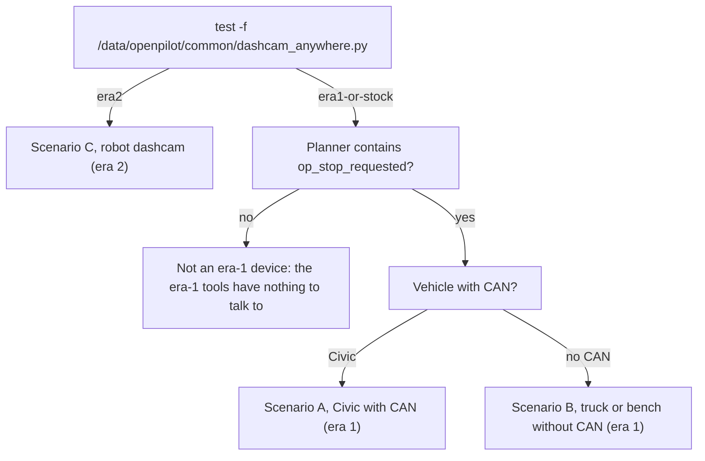

# Operations runbook

This is the English operator runbook: the original `OPERATIONS.md` and `EXPERIMENT_RUNBOOK.md` (era 1), merged with the daily era-2 procedure from `LAPTOP_GUIDE.md` §4 and §8–§10. Scenarios A (Civic with CAN) and B (truck or bench without CAN) record how the era-1 device was operated, and Scenario C (robot dashcam) is the current procedure. Every command block says where it runs, and conclusions drawn only from the code are labelled.

## At a glance

| Item | Details |
|---|---|
| Audience | Operators |
| Runs on | Laptop (most commands) and the device, over SSH |
| Era | Scenarios A and B: **Era 1 — sunnypilot 0.9.7.1** (2026-07 → 2026-08; Honda Civic + truck/bench no-CAN). Scenario C: **Era 2 — openpilot v0.11.1 `release-tizi` + dashcam-anywhere** (from 2026-10-03; robots/small vehicles). |
| Status | A and B are historical: the device was re-flashed and no longer has the era-1 changes. C is current. |
| Key files | [`OPERATIONS.md`](../remote/Arman/OPERATIONS.md), [`EXPERIMENT_RUNBOOK.md`](../remote/Arman/EXPERIMENT_RUNBOOK.md), [`LAPTOP_GUIDE.md`](../remote/Arman/dashcam_anywhere/LAPTOP_GUIDE.md), [`experiment.py`](../remote/Arman/experiment.py), [`cp_export.py`](../remote/Arman/cp_export.py), [`objstopd.py`](../remote/Arman/objstopd.py), [`dashcam.sh`](../remote/Arman/dashcam_anywhere/dashcam.sh) |

> [!WARNING]
> **Historical (sunnypilot era).** Scenarios A and B describe a device state that no longer exists. The device was re-flashed to openpilot v0.11.1 between the two eras, at an unrecorded date between 2026-08-13 and 2026-10-03, which erased every era-1 change: the planner, interface and controlsd patches, the exporter, objstopd and the `/data/objstop/` folder. They are written down for reference and for anyone who rebuilds era 1. On the current device, use [Scenario C](#scenario-c-robot-dashcam-era-2).

> [!CAUTION]
> **Safety.** In era 1, openpilot longitudinal control (OP long) disabled the Civic's stock radar and AEB. `--arm` and manual stops were for a closed course only, and the driver was the only safety net (`OPERATIONS.md` header; `EXPERIMENT_RUNBOOK.md` §2). See [Safety](#safety).

## Before you start

1. Set `COMMA_IP` and check the dongle id, as described in [Setup, SSH and networking](02-setup-ssh-networking.md#finding-the-device):

   ```bash
   # laptop — from the clone's top folder
   cd remote/Arman && export COMMA_IP=$(./find_comma.sh)
   ssh comma@$COMMA_IP 'cat /data/params/d/DongleId'        # must be your device's dongle id
   ```

   The laptop blocks below start with `cd remote/Arman` (or `cd remote/Arman/dashcam_anywhere`), relative to the clone's top folder. Skip that line if you are already there.

2. Find out which era is on the device. This is the same test `dashcam.sh enable` runs before it turns the mode on:

   ```bash
   # laptop
   ssh comma@$COMMA_IP 'test -f /data/openpilot/common/dashcam_anywhere.py && echo era2 || echo era1-or-stock'
   ```

3. If it prints `era1-or-stock`, check for the era-1 pieces. The planner test is the same one `experiment.py check` runs for its `planner stop patch` line:

   ```bash
   # laptop
   ssh comma@$COMMA_IP 'grep -q op_stop_requested /data/openpilot/selfdrive/controls/lib/longitudinal_planner.py && echo planner-patched || echo planner-not-patched'
   nc -z $COMMA_IP 7700 && echo "7700 open (exporter running)" || echo "7700 closed"
   ```



> [!NOTE]
> **Inferred; verify with `nc -z $COMMA_IP 7700`.** Nothing in `remote/Arman/dashcam_anywhere/` reinstalls the reg_export exporter or objstopd. On the era-2 device, the era-1 laptop tools (`experiment.py`, `cp_export.py`, `cp_view.py`, `objstop_view.py`, `watch_detect.py`) therefore presumably have nothing to connect to.

## Scenario A: Civic with CAN (era 1)

> [!WARNING]
> **Historical (sunnypilot era).** The 2020 Honda Civic (Bosch) with sunnypilot 0.9.7.1, from the original `OPERATIONS.md` §2 and `EXPERIMENT_RUNBOOK.md`. The device no longer runs this software.

### What the era-1 device ran

`OPERATIONS.md` §0 listed what was active or on standby on the device (last modified 2026-08-06):

| Component | Location on the device | Role |
|---|---|---|
| Planner distance ramp v2 | `selfdrive/controls/lib/longitudinal_planner.py` | Read `/tmp/op_stop_requested` (`d=<m> t=<ts>`) and glided to the stop line. An empty file meant stop now. A stale flag was released after 1 s. |
| Launch assist | `selfdrive/car/honda/interface.py` | `startingState=True, startAccel=0.6`: a firm start from standstill |
| controlsd display hook | `selfdrive/controls/controlsd.py` | The comma screen showed `VISION: RED LIGHT / braking...` (LOWEST priority, display only) |
| Vision stop daemon objstopd v2.1 | `/data/objstop/` | Camera → YOLO → distance Kalman filter → state machine → stop flags. Shadow by default. |
| Exporter with `stopFlag` | `tools/reg_export/exporter.py` | The TCP 7700 stream, including `stopFlag.stop=0/1` |
| `DisengageOnAccelerator=0` | params | The gas pedal overrode and released instead of disengaging. The brake still disengaged immediately. |
| Dashcam (no-CAN) mode | `/data/objstop/enable_dashcam_mode.py` | Without CAN, `touch /data/force_onroad` forced the camera, model and GPS to run. §0 still called it "pending enable", but §3.1 records it as enabled and verified on 2026-08-06. |

All backups were named `*.bak_arman*`. See [Device changes and revert](14-device-changes-and-revert.md) for the complete, corrected list.

> [!NOTE]
> **Described, not included.** The planner, Honda interface and controlsd patches, and the exporter variant with `stopFlag`, existed only on the device. This repository has the baseline [`exporter_device.py`](../remote/exporter_device.py) (no `stopFlag`), the deployed [`objstopd.py`](../remote/Arman/objstopd.py), and an on-disk mirror of the planner's flag parsing in [`test_stopsm.py`](../remote/Arman/vision/test_stopsm.py) (`parse_flag`, `planner_ramp`). See [Longitudinal stop command](07-longitudinal-stop.md).

### Power-up and self-check

The era-1 procedure (`OPERATIONS.md` §2.1; `EXPERIMENT_RUNBOOK.md` §0–§1):

1. Switching the car on brought the comma onroad automatically, with the road view on the screen. The camera, model and stream only ran onroad.
2. After engaging openpilot, the operator ran the readiness check on the laptop. Every line had to show ✓ before continuing:

   ```bash
   # laptop
   cd remote/Arman
   python3 experiment.py --ip $COMMA_IP check
   ```

3. If `longActive ✗` appeared after engaging, the OP-long configuration needed a fresh boot: `ssh comma@$COMMA_IP 'sudo reboot'`, wait about 45 s, engage again and re-run the check. Reboot only with the car stopped: the reboot ends openpilot control at once and clears every `/tmp` flag (`OPERATIONS.md` §4).

The target output (`EXPERIMENT_RUNBOOK.md` §1) was `OP-long param set ✓`, `planner stop patch ✓` and `device onroad ✓`. Then `longActive (OP long) ✓` (openpilot is controlling longitudinal), and `GPS fix ✓` plus `modelV2 trajectory ✓` (the JSON export will have data). The bottom line read `LONGITUDINAL ready: ✓    JSON export ready: ✓`.

What each line of `check` means ([`experiment.py`](../remote/Arman/experiment.py) → `main()` and `sample_stream()`):

| Line | Where the value comes from | ✓ when |
|---|---|---|
| `OP-long param set` | SSH: `cat /data/params/d/ExperimentalLongitudinalEnabled` | the file contains `1` |
| `planner stop patch` | SSH: `grep -q op_stop_requested` in the planner | the planner refers to the flag file |
| `device onroad` | SSH: `cat /data/params/d/IsOnroad` | the file contains `1` |
| `stream records ✓ (n)` | 6 s sample of TCP 7700 (`--port`, default 7700) | at least one record. Otherwise it prints `no stream data (<error>). If offroad, turn the car on & engage.` and skips the rest. |
| `openpilot enabled … state=` | the last `carControl.enabled`, `controlsState.state` | `enabled` is true |
| `longActive (OP long) … accel= vEgo=` | the last `carControl.longActive`, `carControl.accel`, `carState.vEgo` | `longActive` is true |
| `GPS fix (loc) … loc=` | `loc.lat`, `loc.lon`, `loc.yaw` | some record had abs(lat) or abs(lon) above 1e-6 |
| `modelV2 trajectory` | `modelV2.pos_x` | some record had a non-empty `pos_x` |
| `LONGITUDINAL ready` | | `longActive` |
| `JSON export ready` | | GPS fix **and** modelV2 trajectory |

When a ready line fails, it adds a hint: `→ engage openpilot; confirm OP long (longActive ✓). If ✗ onroad, reboot after ExpLong=1.` or `→ need a GPS fix + onroad model. Or run cp_export with --ref-lat/--ref-lon / --local-frame.`

> [!IMPORTANT]
> **Known bug, reproduced while writing this page (not a field observation).** If the SSH call in `check` fails (key refused, timeout), the three configuration lines still print ✓. The placeholder value `"?"` counts as true in `yn()`. Running `check` against an unreachable address printed ✓ for all three, followed by `no stream data (timed out)`. Trust those three lines only when `python3 experiment.py --ip $COMMA_IP status` also works.

> [!NOTE]
> **Reported in `EXPERIMENT_RUNBOOK.md`.** "Verified offroad (2h before): config ✓, planner patch ✓, stop flag ✓, cp_export JSON ✓." The onroad confirmation it called for (longActive ✓ + first smooth stop + JSON segs>0) has no recorded result in that file. Later onroad drives on 2026-08-04 are reported in [`STOP_SIGN_VISION.md`](../remote/Arman/vision/STOP_SIGN_VISION.md) v2.1.

### Client JSON output

From `OPERATIONS.md` §2.2 and `EXPERIMENT_RUNBOOK.md` §3. `cp_export.py` turns the stream into the client's two formats:

```bash
# laptop
cd remote/Arman
python3 cp_export.py --ip $COMMA_IP --mode live --out-dir ./cp_out \
        --udp <CLIENT_IP>:<PORT>             # --udp is optional; --udp-hz 10 is the default
```

- `./cp_out/track_live.json` is the client segment format, with a top-level `"stop": 0/1`.
- `./cp_out/track_live.csv` is the STÄHLE per-point curvepoints (East, North, theta, kappa, kph).
- Live mode rewrites both files at most about 20 times a second ([`cp_export.py`](../remote/Arman/cp_export.py) → `run()`, 0.05 s write gate). With `--udp`, it also sends the compact JSON as one datagram per update, at most `--udp-hz` per second. A datagram over 60,000 bytes is skipped.

The heartbeat (about 1 Hz, printed only while records arrive) tells you what is missing:

| Heartbeat | Meaning | What to do |
|---|---|---|
| `[cp_export] waiting for GPS fix (or pass --ref-lat/--ref-lon, or --local-frame)` | No origin yet | Go outdoors and wait 1–2 min, or pass `--ref-lat/--ref-lon` |
| `[cp_export] have origin, waiting for valid GPS pose (lat/lon/yaw)` | Origin set but no valid fix with a yaw | Wait for the fix. With `--local-frame` this line stays, although live output is still written (Analysis (from code; not field-tested)). |
| `[cp_export] GPS ok, waiting for modelV2 trajectory (is the car onroad?)` | Live mode: the record that triggered this heartbeat has no `modelV2.pos_x`. The baseline exporter sends `pos_x` only on the roughly 1 in 5 records where modelV2 updated, so a working export mostly prints this line, with an occasional `OK` line (Analysis (from code; not field-tested); A-item A9; see [heartbeat quirks](05-curvepoints-pipeline.md#heartbeat-and-log-lines)) | Only if no `OK` line ever appears and `track_live.*` is not being rewritten: check that the device is onroad |
| `[cp_export] OK -> track_live.{csv,json}  segs=N` | Output is being written | none |

Other lines you may see: `[cp_export] mode=live  streaming from <ip>:7700 ... (Ctrl-C to stop)`, `[cp_export] ref fixed at <lat>,<lon>`, `[cp_export] ref locked at first fix <lat>,<lon>`, `[cp_export] --local-frame: dummy origin (0,0); NOT true North/ENU`, `[cp_export] UDP -> <host>:<port> at <= 10.0 Hz`, `[cp_export] UDP payload <n>B too large, skipped` and `[cp_export] UDP send failed: <error>`. If no records arrive at all, there is no heartbeat, only `[stream] disconnected (...)` lines (see [Is the device onroad](02-setup-ssh-networking.md#is-the-device-onroad)).

**Recording a whole route.** `--mode record` accumulates the driven GPS route, adding a point whenever the vehicle has moved at least 0.5 m (`RECORD_MIN_MOVE`). Once there are 3 points, it rewrites `route_track.{csv,json}` every 2 s during the drive (and, with `--udp`, sends the whole route as one datagram each time, skipped once it exceeds 60,000 bytes), and once more on Ctrl-C (`[cp_export] finalizing route ...`). Each write prints `[cp_export] wrote route_track.{csv,json}  points=N segments=M`. Record mode always writes `"stop": 0`, because the stop flag is only live in `--mode live`. **Analysis (from code; not field-tested):** in record mode the heartbeat's `segs=` stays 0, so watch the `wrote` lines instead.

**Origin.** Without `--ref-lat/--ref-lon`, the first valid GPS fix is locked as the origin, and it never changes during the run. The notes fix it with `--ref-lat 37.7749295 --ref-lon -122.4194155`. That is a neutral example coordinate: always pass your own mission origin with `--ref-lat/--ref-lon`. `_valid_fix()` rejects only (0, 0), so a wrong fix can become the origin if you do not pass one.

**No GPS at all.** `--local-frame` uses a body-fixed, North-up frame, which is not true North. Use it in live mode only, and only when GPS stays absent. In record mode it collects nothing (there is no pose, so the route never grows). A fix that arrives later is projected against the dummy (0, 0) origin.

**`"stop"` semantics.** In `OPERATIONS.md` §2.2, `1` means the vehicle is being commanded to stop (vision-triggered or manual) and `0` means normal driving or pulling away. `cp_export` copies it from the exporter's `stopFlag` record. That exporter variant is described, not included. With this repository's [`exporter_device.py`](../remote/exporter_device.py) there is no `stopFlag`, so `"stop"` stays 0. The full contract is in the [Client interface specification](06-client-interface-spec.md).

**Client hand-off** (`OPERATIONS.md` §6). Each UDP datagram carries one UTF-8 JSON document, at most 10 per second by default (`--udp-hz`): `{ref:{latitude,longitude}, "stop":0|1, segments:[{start,end,velocity,radius,direction}]}`. Segment `velocity` is in m/s, while the STÄHLE CSV uses kph. §6 reads a final-segment `velocity` of 0.0 as "stop at the end". In the code it is 0.0 whenever the last segment's mean speed is at most 0.35 m/s ([`curvepoints.py`](../remote/Arman/curvepoints.py) → `to_segments()`). The note offered [`udp_snippet.py`](../remote/Arman/udp_snippet.py) as the code to send to the client, but its `send_track()` omits `"stop"` (erratum 11).

`cp_export.py` options, from its argparse:

| Option | Default | Meaning |
|---|---|---|
| `--ip` | none (required, except with `--selftest`) | comma IP |
| `--port` | 7700 | Source TCP port of the stream. It is not the UDP port. |
| `--mode` | `live` | `live` or `record` |
| `--ref-lat`, `--ref-lon` | none | Fixed origin. Without them, the first valid fix is used. |
| `--ref-alt` | 0.0 | Origin altitude |
| `--out-dir` | `./cp_out` | Output folder |
| `--smooth` | 5 in record, 0 in live | Moving-average window on E, N |
| `--stdout` | off | Also print each frame's segment JSON (live mode) |
| `--udp` | none | `HOST[:PORT]`. A bare host uses `--udp-port`. |
| `--udp-port` | 5005 | Destination port for a bare `--udp` host |
| `--udp-hz` | 10.0 | Maximum UDP send rate |
| `--local-frame` | off | No-GPS fallback (see above) |
| `--selftest` | | Unit tests. They rewrite `remote/Arman/_selftest_out/`. |

The pipeline behind these outputs is in [Curvepoints pipeline](05-curvepoints-pipeline.md).

### Visualisation

Optional, one terminal each (`OPERATIONS.md` §2.3):

```bash
# laptop
cd remote/Arman
python3 cp_view.py --ip $COMMA_IP                  # ENU track map in the client frame
python3 vision/objstop_view.py --ip $COMMA_IP      # detection board: three target tiles + NEXT action
python3 watch_detect.py --ip $COMMA_IP             # console: every raw detection and the pedestrian gates
```

- `cp_view.py` shows a North-up ENU map with θ, κ and direction tiles. Use it for the sign check: steer left, and the track should bend counter-clockwise with κ > 0 / DIR LEFT. See [Curvepoints pipeline](05-curvepoints-pipeline.md).
- `objstop_view.py` pulls `/tmp/objstop_status.json` and `/tmp/objstop_last.jpg` over SSH on each redraw (400 ms animation interval). The camera panel needs objstopd to save frames (`--save-every`, default 0.3 s). The footer shows `● LIVE` when the status is less than 1.5 s old, and `○ STALE` otherwise. The age compares the device clock with the laptop clock, and the device has no RTC battery, so STALE can be a clock artefact before a GPS fix. When no status can be read at all (SSH failing, objstopd not started), the board shows `waiting for daemon…` and the mode chip still says `○ SHADOW — not braking`: trust the ARMED/SHADOW chip only while the footer shows an age ([08](08-vision-stop-objstopd.md)).
- `watch_detect.py` defaults to `--ip 172.20.10.3`, so always pass `--ip`. It polls at `--hz 4` and prints only on change unless `--all` is given.

### Manual longitudinal control

> [!CAUTION]
> **Closed course only.** The driver kept a foot over the brake. The stop was openpilot's own jerk- and accel-limited deceleration, not a hard brake. It acted only when openpilot was engaged with OP long, and there was no stock AEB while OP long was on, so the driver was the safety net. The first test was from a slow crawl, checking for a smooth stop, then `go` (`EXPERIMENT_RUNBOOK.md` §2).

```bash
# laptop
cd remote/Arman
# one action at a time; go undoes stop
python3 experiment.py --ip $COMMA_IP stop       # ■ smooth deceleration to a stop
python3 experiment.py --ip $COMMA_IP go         # ▶ clear the manual stop
python3 experiment.py --ip $COMMA_IP release    # ⏩ make the vision daemon let go (test-dummy case)
python3 experiment.py --ip $COMMA_IP status     # configuration + flag state
```

| Action | Command run on the device over SSH | Prints on success | Effect |
|---|---|---|---|
| `stop` | `touch /tmp/op_stop_requested` | `■ STOP requested` | An empty flag file meant "stop now" to the era-1 planner (described, not included) |
| `go` | `rm -f /tmp/op_stop_requested` | `▶ GO (stop cleared)` | Removes the actuation flag, whoever wrote it |
| `release` | `touch /tmp/op_stop_release` | `⏩ RELEASE sent (objstopd will resume)` | objstopd deletes the file on its next 50 ms tick. If it is braking or stopped, it enters RESUMING and drops the pedestrian hold. |
| `status` | `cat` of `ExperimentalLongitudinalEnabled` and `IsOnroad`; `ls /tmp/op_stop_requested` | `ExpLong=…`, `onroad=…`, `stop_flag=ARMED` or `stop_flag=clear` | `ARMED` means the actuation file exists, whatever its content and whoever wrote it. It has nothing to do with objstopd's `--arm`. |

On failure each action prints `failed: <ssh error>`. Other options are `--user` (default `comma`) and `--port` (default 7700, used only by `check`).

**`go` and `release` are different.**

- `go` removes the actuation flag but not `/tmp/op_stop_intent`.
- An armed objstopd that still wants to stop rewrites the actuation flag within 50 ms, so `go` does not end a vision hold. Use `release` (or a light gas tap) for that.

**Analysis (from code; not field-tested):**

- A manual `stop` issued while an armed objstopd is itself braking is overwritten with objstopd's own `src=v` content. objstopd then deletes it when the vision stop ends. Re-issue `stop` afterwards if you still need the manual hold (A-item A16 in [16](16-errata-and-crosswalk.md#additional-inconsistencies-found-in-this-review)).
- `release` acts only on the tick it arrives, and a gas press only on the ticks while it is held ([`objstopd.py`](../remote/Arman/objstopd.py) → `VisionStopSM.update()`). If the pedestrian or dummy is still detected in the forward zone afterwards, two sightings within 1 s set the hold again, about 0.2–0.5 s later at the 4–5 Hz detection rate. In practice, keep the gas pressed until you are past the dummy, or remove the dummy. The unit test `test_operator_release` checks only the first tick after the release.

### Vision stop, shadow then arm

From `OPERATIONS.md` §2.5 and §3.3, corrected for errata 4 and 18 ([Errata and crosswalk](16-errata-and-crosswalk.md)).

> [!CAUTION]
> **Arming brakes the car.** `--arm` makes the car brake for detections. Arm only after shadow mode has shown the right stops and few false positives, on a closed course, with OP long engaged and the driver ready. To disarm, press Ctrl-C, which clears the flags objstopd wrote, and restart without `--arm`. A gas tap or `experiment.py release` ends a single hold.

From 2026-08-06, manager autostarted objstopd in shadow mode whenever the device was started and `/data/objstop/manual_mode` did not exist. That included the Civic (`objstop_auto` written by [`enable_dashcam_mode.py`](../remote/Arman/enable_dashcam_mode.py)). A manual run therefore needed `manual_mode` first, or two instances ran:

```bash
# device  (ssh comma@$COMMA_IP)   — era 1
touch /data/objstop/manual_mode                   # manager stops the autostarted shadow instance
cd /data/objstop && PYTHONPATH=/data/openpilot \
  /usr/local/pyenv/versions/3.11.4/bin/python3 objstopd.py --save-every 0.3
# shadow: shows decisions, never brakes. Watch STATE and the tiles in objstop_view.
# Once it looks reliable: Ctrl-C, then restart armed:
cd /data/objstop && PYTHONPATH=/data/openpilot \
  /usr/local/pyenv/versions/3.11.4/bin/python3 objstopd.py --arm --save-every 0.3
# When done: Ctrl-C (clears the flags on exit), then restore the autostart:
rm /data/objstop/manual_mode
```

**Analysis (from code; not field-tested):** run these commands inside `tmux new -s objstop` on the device. objstopd clears its flags only on Ctrl-C or SIGTERM; if the SSH session running it closes (a closed terminal, a dropped hotspot link), the hang-up ends it without that cleanup, as a SIGKILL would ([08](08-vision-stop-objstopd.md#manual-run-shadow-first)). After a dropped link, `tmux attach -t objstop` gets the console back.

Common parameters from `OPERATIONS.md` §2.5 were `--wait-sec 3 --tl-setback 10 --sign-setback 3 --ped-conf 0.30`. The larger model, `--onnx-320 yolov8s_320.onnx`, ran at 2 Hz and was normally not needed. `--save-every 0.3` is already the default in [`Arman/objstopd.py`](../remote/Arman/objstopd.py).

> [!WARNING]
> **Historical (sunnypilot era).** `EXPERIMENT_RUNBOOK.md` §4 and the v1 part of `STOP_SIGN_VISION.md` start objstopd with `--onnx yolov8n_320.onnx --imgsz 320`. Those v1 flags do not work with the v2 code. Argparse stops with `objstopd.py: error: ambiguous option: --onnx could match --onnx-320, --onnx-640`, and `--imgsz` alone gives `unrecognized arguments`. Use the flags below. The stop-sign wait is 3 s (v1 said 2 s).

What the two modes write ([`objstopd.py`](../remote/Arman/objstopd.py) → `main()`, `write_flag()`):

| Output | Shadow (default) | `--arm` |
|---|---|---|
| `/tmp/op_stop_intent` | written while the state machine wants a stop | written |
| `/tmp/op_stop_requested` (actuation) | not written | written; the planner brakes if engaged with OP long |
| `/tmp/objstop_status.json` | every 50 ms tick | every tick |
| `/tmp/objstop_last.jpg` | every `--save-every` s | same |

- **Flag content.** The flag files contain `d=<m> t=<monotonic> src=v`, rewritten atomically on every tick while a stop is wanted. `d=0.00` means stop now.
- **What objstopd deletes.** objstopd deletes only files that contain `src=v`.
- **Exit.** Ctrl-C or SIGTERM clears the flags it wrote (`[objstopd] exit; flags cleared`). SIGKILL leaves them behind, and so does the hang-up (SIGHUP) of a closed SSH session (Analysis (from code; not field-tested); see the `tmux` note above). The planner ignores a `t` older than 1 s, but `stop_udp.py` only checks that the file exists and keeps sending `"1"` (see [0/1 stop signal over UDP](09-stop-signal-udp.md)).
- **Console output.** On startup: `[objstopd] v2 SHADOW  wait=3.0s setbacks sign=3.0 tl=10.0` (or `ARMED`) and `[objstopd] narrow <W>x<H> connected; wide=ok` (or `NO`). While a flag or alert is active: `[<STATE>] flag=<now or d> reason=<reason> v=<v> <alert>`. On a release: `[objstopd] operator RELEASE received`.

Behaviour (`OPERATIONS.md` §2.5):

- **Stop sign:** stop, wait 3 s, then go automatically, even if the sign is still visible.
- **Red light:** wait for a confirmed green.
- **Pedestrian:** stop for a person ahead, and go 1.5 s after they leave.

When it is stuck, release it with whichever is convenient:

1. A light tap on the gas. With `DisengageOnAccelerator=0` set on the device, this overrode and released without disengaging.
2. `experiment.py release` from the laptop.
3. The pedestrian actually leaves.

The comma screen mirrored the state as a `VISION: ...` bar (the controlsd hook, described, not included). The bar expiring after 2 s was normal (`OPERATIONS.md` §7).

objstopd options, from the argparse in [`Arman/objstopd.py`](../remote/Arman/objstopd.py) (the complete reference is in [Vision stop daemon](08-vision-stop-objstopd.md)):

| Option | Default | Meaning |
|---|---|---|
| `--onnx-320` | `/data/objstop/yolov8n_320.onnx` | Model for the 320 input |
| `--onnx-640` | `/data/objstop/yolov8n.onnx` | Model with 640 input, used on the narrow camera above 8 m/s. `''` disables it. |
| `--arm` | off (shadow) | Write the planner stop flag |
| `--conf` | 0.4 | Detection threshold |
| `--ped-conf` | 0.30 | Person-class threshold (recall) |
| `--wait-sec` | 3.0 | Stop-sign hold from standstill (s) |
| `--clear-sec` | 1.5 | Pedestrian-clear hysteresis (s) |
| `--sign-setback` | 3.0 | Stop target = sign distance minus this (m) |
| `--tl-setback` | 10.0 | Stop target = light distance minus this (m) |
| `--tl-max-cy` | 0.6 | Narrow camera: a light counts only if its centre is in the top 60 % of the frame |
| `--ped-min-h` | 90.0 | Minimum person box height, in native pixels |
| `--ped-band-lo`, `--ped-band-hi` | 0.2, 0.8 | Horizontal band, as fractions of the width, for the person's centre |
| `--ped-min-bottom` | 0.45 | The box bottom must be at or below this fraction of the height |
| `--save-every` | 0.3 | Write `/tmp/objstop_last.jpg` every N s; 0 disables it |

The ONNX models are not included. See [Vision stop daemon](08-vision-stop-objstopd.md) for how they were made and for the AGPL note.

### Optional 0/1 UDP stop signal

From 2026-08-13 (file dates) the stop decision could also go to the client as a single byte, `"0"` or `"1"`. It is sent either from the device (`stop_udp.py`) or from the laptop as a fallback (`manual_stop_send.py`). Before the first run, edit the `IP=` line in both `stop_udp_start.sh` and `stop_udp_stop.sh`: they hard-code the comma at `IP=172.20.10.3` (erratum 5).

```bash
# laptop
cd remote/Arman
./stop_udp_start.sh <DEST_IP> <DEST_PORT>          # the comma sends "0"/"1" to the receiver, 10 Hz by default
./stop_udp_watch.sh <DEST_PORT>                    # only if this laptop is the receiver
./stop_udp_stop.sh                                 # stops the comma's sender
python3 manual_stop_send.py <DEST_IP> <DEST_PORT>  # fallback: the laptop sends "0"/"1" itself
```

> [!CAUTION]
> **The receiver may brake on `"1"`.** `OPERATIONS.md` §3.2 expects the client to use the stop decision to brake its own truck, and this byte carries the same decision. `manual_stop_send.py` sends `"1"` from the start unless you pass `--value 0`. On a terminal, the keys `1`, `0` and space switch the value, and `q` quits. Without a destination it sends to 172.20.10.2:5005. `stop_udp.py` keeps sending `"1"` while a stale flag file exists (see **Exit** under [Vision stop, shadow then arm](#vision-stop-shadow-then-arm)).

Details and limitations are in [0/1 stop signal over UDP](09-stop-signal-udp.md).

## Scenario B: truck / no CAN (era 1)

> [!WARNING]
> **Historical (sunnypilot era).** From `OPERATIONS.md` §3. The no-CAN mode lived in era-1 patches that the re-flash erased.

Without CAN the vehicle cannot be controlled, because openpilot has no actuators to command. Camera detection, the GPS track and the client JSON (including `"stop"` 0/1) all kept working.

### Device state from 2026-08-06

> [!NOTE]
> **Reported in `OPERATIONS.md` §3.1** (applied and verified 2026-08-06):
>
> - `/data/force_onroad` was a persistent file, so the device went onroad as soon as it had power. The camera, model and GPS started, manager autostarted objstopd in shadow mode, and the exporter streamed without CAN.
> - Tested: a reboot with no car gave `IsOnroad=1`, with camerad, modeld, locationd, objstopd and port 7700 all up.

In that test, `IsOnroad=1` is the proof of onroad. An open port 7700 only shows that the exporter was running, because manager ran it as `always_run` (erratum 17; see [Is the device onroad](02-setup-ssh-networking.md#is-the-device-onroad)).

The pieces behind it are documented in [No-CAN truck/bench mode](10-no-can-mode-sunnypilot.md):

- **`enable_dashcam_mode.py`:** the hardwared ignition hook, the no-CAN exporter (`exporter_nocan.py`, not included) and the objstopd autostart. It also creates `/data/force_onroad`.
- **Later scripts:** `force_onroad_v2.py` (diagnostic log), `fake_ignition.py` with its autostart (so the screen leaves the home UI), `suppress_car_prompt.py` and `enable_cabin_audio.py`.
- **What was applied:** only `enable_dashcam_mode.py` and the v2 hook have evidence of being applied. Car-prompt suppression is **reported (operator note, 2026-08-06)** as applied. Applying cabin audio is not recorded anywhere.

The era-1 semantics of `/data/force_onroad`: the hardwared hook (and the fake-ignition process conditions, if installed) re-checked the file continuously. Era 2 reads it only once per boot (see [Scenario C](#scenario-c-robot-dashcam-era-2)). Before normal Civic driving the file had to be removed again; see [Era-1 return to the Civic](#era-1-return-to-the-civic-historical).

Power: forced onroad draws full load, and weak desktop USB chargers could brown out and drop the connection. The note recommended a 12 V → USB-C supply of at least 18 W in the truck, and a good charger on the bench (`OPERATIONS.md` §3.1).

> [!NOTE]
> **Described, not included.** The baseline [`exporter_device.py`](../remote/exporter_device.py) emits a record only on each `carState` frame, so without CAN it streams nothing. The no-CAN variant that emitted on any service update (`modelV2`/`loc` at 20 Hz, throttled to 50 Hz) existed only on the device as `/data/objstop/exporter_nocan.py` ([`enable_dashcam_mode.py`](../remote/Arman/enable_dashcam_mode.py) docstring). Scenario B cannot be reproduced from this repository alone.

### Output flow on the truck

There was nothing to type on the device. It was powered on, and objstopd started by itself in shadow mode (`OPERATIONS.md` §3.2). On the laptop:

```bash
# laptop
cd remote/Arman && export COMMA_IP=$(./find_comma.sh)
python3 cp_export.py --ip $COMMA_IP --mode live --out-dir ./cp_out --udp <CLIENT_IP>:<PORT>
#   outdoors: wait for a GPS fix (the heartbeat says so); indoors with no GPS for the whole run: add --local-frame
#   (body frame, not true North; never together with --ref-lat/--ref-lon, see erratum 13)
python3 vision/objstop_view.py --ip $COMMA_IP      # optional: detection board
```

**`"stop"` in dashcam mode** (`OPERATIONS.md` §3.2 and §3.3):

- objstopd writes the intent flag even in shadow mode. When the vision system would have commanded a stop (stop sign, red light, pedestrian), the JSON and UDP carried `"stop": 1`, and `0` again on resume. The client could use this to drive the truck's own brakes.
- Manual forcing with `experiment.py stop` and `go` still worked, and the actuation flag had priority. How the deployed exporter combined the two flags is described, not included.

### Stop flag without CAN

**Analysis (from code; not field-tested).** Without CAN there is no `carState`, so objstopd's speed `v_ego` stays 0 and odometry never advances ([`objstopd.py`](../remote/Arman/objstopd.py) → `main()`, `VisionStopSM.update()`).

- **Stop sign.** A sign confirmed with at least 3 hits, more than 3.5 m (the 3 m setback + 0.5 m) and less than 90 m ahead on the narrow camera, latches at once. The required deceleration is 0, so the dilemma check never blocks it. BRAKING lasts one 50 ms tick, then STOPPED_SIGN holds for `--wait-sec` (3 s), so `"stop"` is 1 for about 3.05–3.1 s. RESUMING then ends only on its 15 s timer, because the 8 m distance condition is never reached. While the sign stays in view, the pulse repeats about every 18.15–18.6 s:
  - about 18.15 s for a sign at least 12 m away (its track is rebuilt during RESUMING and latches one tick after RESUMING ends);
  - about 18.6 s for a closer sign (RESUMING ignores new detections closer than 12 m, so the track first needs 3 fresh hits).

  These figures come from stepping the real `VisionStopSM` with detections at 5 Hz (see [10](10-no-can-mode-sunnypilot.md#what-objstopd-does-with-no-carstate)).
- **Red light.** A red light confirmed with at least 3 hits more than 10.5 m away (the 10 m setback + 0.5 m) latches and holds `"1"` in STOPPED_RED until a green is confirmed or an `experiment.py release` arrives. A gas tap cannot release it, because without `carState` there is no gas signal. After a release, `"stop"` is 0 only for RESUMING (the full 15 s), and a light that is still red and more than 10.5 m away then latches again as soon as RESUMING ends. A closer light is waived as "too close to stop".
- **Pedestrian.** `"1"` follows the pedestrian hold. After the hold clears, RESUMING again lasts the full 15 s.

### Limitations on the truck

From `OPERATIONS.md` §3.3:

1. Without `vEgo` the distance filter has no dead reckoning, so distance estimates are less precise. Detection itself is unaffected.
2. The modelV2 trajectory used the camera calibration stored from the Civic. On a truck windshield the angle differs, so the trajectory geometry was biased. On the truck, the note preferred the GPS `--mode record` output for the route, or the vision stop flag as the main deliverable. Record mode always writes `"stop": 0`, so live mode or the 0/1 UDP signal is needed when the stop flag matters.
3. Dashcam mode recorded video and `/data/media` grew, so it needed cleaning up after long use.

### When the truck does not go onroad

The checks are described in [Is the device onroad](02-setup-ssh-networking.md#is-the-device-onroad), and the tools in [No-CAN truck/bench mode](10-no-can-mode-sunnypilot.md):

- Look at the screen. Without the fake-ignition autostart, the screen stayed on the home UI even when the backend was onroad.
- Read the persistent `/data/log/swaglog.*` for `"Startup blocked"`, and see which entry of `startup_conditions` or `onroad_conditions` is false.
- Read `/data/onroad_debug.log` (written by `force_onroad_v2.py`).
- Run `_verify_state.py` (which services publish), `_vipc_probe.py` (whether camerad serves VisionIPC frames) and `_modeld_diag.py` (camera streams plus the last modeld/locationd log lines) on the device. Run `_stream_dump.py <ip>` on the laptop to see what the 7700 stream carries.
- A laptop that cannot reach the device (for example a truck without a hotspot) is a network problem, not proof that the device is offroad.

## Scenario C: robot dashcam (era 2)

This is the current procedure. The device runs openpilot v0.11.1 `release-tizi` with the dashcam-anywhere patch (commit `8acb496`). It records whenever it has power, never controls the vehicle, calibrates itself from GPS or vision speed, and keeps its calibration across reboots (`LAPTOP_GUIDE.md` top). It also records the in-cabin camera; see the consent note in [Safety](#safety). The full field guide, with the status sample, normal values, calibration details and download commands, is [dashcam-anywhere: field guide](12-dashcam-anywhere-field-guide.md). The design is in [dashcam-anywhere: design and validation](11-dashcam-anywhere-design.md).

### Standard procedure per experiment

From `LAPTOP_GUIDE.md` §4. Run every `./dashcam.sh` command on the laptop from `remote/Arman/dashcam_anywhere/` (see [dashcam.sh at a glance](#dashcamsh-at-a-glance)).

1. **Power on.** Wait for the road view on the screen (about 1 minute).
2. **Connect.** Use one of the options in [Network options](02-setup-ssh-networking.md#network-options) and set `COMMA_IP`.
3. **Check.** Run `./dashcam.sh status` and compare each item with the normal values in the [field guide](12-dashcam-anywhere-field-guide.md).
4. **New robot or new mount.** Run `./dashcam.sh reset-calib`; the screen returns to "Calibrating: 0%". It acts at once, without a confirmation prompt, and the old calibration is gone. On the same robot with an untouched mount, do **not** reset: the calibration is kept.
5. **Calibration drive.** Drive **straight** in an open, flat area at 10 km/h or more (GPS), as steadily as possible, with few turns and no hard acceleration or braking.
   - Each block of about 5 s of valid driving adds about 20 % and is saved immediately, so a power loss does not lose it.
   - The status shows calibrated after about 25 s of valid driving; at low speed this takes 1–2 minutes in practice. About 4 more minutes of driving make it more stable.
   - Confirm `status=calibrated` with `./dashcam.sh status` or on the screen.
6. **Experiment.** The device records the whole time; nothing needs to be done.
7. **Finish.** Run `./dashcam.sh poweroff`, wait until the screen goes dark, then cut power.
8. **Download.** See the [field guide](12-dashcam-anywhere-field-guide.md). The disk holds only about the last 5.5 hours of recordings, and older ones are deleted automatically, so download promptly.

### dashcam.sh at a glance

```bash
# laptop
cd remote/Arman/dashcam_anywhere
export COMMA_IP=192.168.43.1          # with comma tethering; for other networks see doc 02
# reference list: run one command at a time, not the whole block
./dashcam.sh status                   # one-screen status (check it before every experiment)
./dashcam.sh reset-calib              # new robot or mount -> calibrate again from zero
./dashcam.sh poweroff                 # clean shutdown, before cutting power
./dashcam.sh disable                  # dashcam mode off (reboots)
./dashcam.sh enable                   # dashcam mode on (reboots)
./dashcam.sh restore-civic            # after disable, before going back to the Civic
```

- **Where the IP comes from.** The argument after the command, then `$COMMA_IP`, then `../find_comma.sh`.
- **Confirmation.** `enable`, `disable`, `restore-civic` and `poweroff` print `device <ip>  dongle <id>  -> <action>` and ask `proceed? [y/N]`. Only `y` or `Y` continues. If the line shows `dongle ?`, the SSH call failed: answer N and fix the connection first.
- **`-y`.** It skips the question, and it must come first: `./dashcam.sh -y poweroff`.
- **`reset-calib`.** It does **not** ask for confirmation and shows no dongle id. On whichever device the IP reaches, the calibration is deleted within about 1 s if the device is onroad in dashcam mode, otherwise at calibrationd's next start, and there is no undo: check the dongle id first ([12](12-dashcam-anywhere-field-guide.md#dashcamsh-commands)).
- **Before `restore-civic`.** Check that `./dashcam.sh status` shows `pending reset: no`. **Analysis (from code; not field-tested):** calibrationd consumes a leftover `/data/reset_calib` at its next start in either mode, which would delete the Civic calibration that `restore-civic` just restored; remove it with `ssh comma@$COMMA_IP 'rm -f /data/reset_calib'` ([14](14-device-changes-and-revert.md#back-to-the-civic)).

| Command | What it does on the device ([`dashcam.sh`](../remote/Arman/dashcam_anywhere/dashcam.sh)) |
|---|---|
| `status` | Runs `/data/dashcam_anywhere/status.py` with the era-2 interpreter. Listens for 3 s, read-only. |
| `reset-calib` | `touch /data/reset_calib`, then prints `reset requested; calibrationd consumes it within ~1 s while onroad (or at its next start)` |
| `enable` | Checks that `/data/openpilot/common/dashcam_anywhere.py` exists (otherwise `dashcam-anywhere patch is not installed on this device`), then `touch /data/force_onroad && sudo reboot` |
| `disable` | `rm -f /data/force_onroad && sudo reboot`. Afterwards the device needs a real ignition to go onroad. |
| `restore-civic` | Refuses while `/data/force_onroad` exists or while `IsOnroad` is not 0. Otherwise copies the Civic params back from `/data/dashcam_backup/20261003` and removes `/data/calib_from_dashcam`. |
| `poweroff` | Sets the `DoShutdown` param through the era-2 interpreter and prints `shutting down cleanly` |

In era 2, `/data/force_onroad` is read **once** when manager starts, so `enable` and `disable` reboot to apply it.

### Shutdown and power, era 2

From `LAPTOP_GUIDE.md` §8 and §2.2:

- **Normal shutdown:** `./dashcam.sh poweroff`. The onroad screen has no power-off button.
- **Reboot:** `ssh comma@$COMMA_IP 'sudo reboot'`, or Settings → Device → Reboot on the screen.
- **Cutting power directly** also works, but the last minute or so of recording may be incomplete.
- **No automatic shutdown without a harness.** The device records the whole time it has power. The guide says it never shuts itself down, but the patch's low-battery shutdown acts when the panda reports a car harness (erratum 21). The test is the harness status, not the vehicle type. Whenever `./dashcam.sh status` shows `harness=notConnected`, the robot's own switch or BMS must protect its battery ([Power](02-setup-ssh-networking.md#power)). **Analysis (from code; not field-tested):** a robot fed 12 V through a harness box can make the panda report a harness; the check then applies to the robot's own supply, and the stock `DisablePowerDown` param turns it off ([12](12-dashcam-anywhere-field-guide.md#power-and-thermals)).
- **Supply:** 12 V with at least 18 W recommended. 5 V USB-C leaves only about 1 V of headroom, and below 4 V the device is forced off. Do not connect any CAN wires on a robot.

## Device quick reference

### Device commands, era 1

Historical (`OPERATIONS.md` §4, with the era-1 interpreter written out):

```bash
# device  (ssh comma@$COMMA_IP)   — era 1 (historical)
# reference list: run one line at a time (pkill restarts the exporter, sudo reboot the device)
ps aux | grep -E "objstop|reg_export|modeld"                       # processes
cat /tmp/objstop_status.json | /usr/local/pyenv/versions/3.11.4/bin/python3 -m json.tool   # vision daemon state
ls -l /tmp/op_stop_requested                                       # actuation flag (content d=.. t=.. src=v)
ls -l /tmp/op_stop_intent /tmp/op_stop_release 2>/dev/null         # intent flag; pending release
pkill -f '[t]ools.reg_export'                                      # restart the exporter (manager starts it again)
sudo reboot                                                        # restart everything; all /tmp flags are cleared
df -h /data                                                        # disk; recordings are in /data/media/0/realdata/
```

For a manual objstopd run, its log is its foreground output (`OPERATIONS.md` §4). `/data/force_onroad` and `/data/objstop/manual_mode` show whether forced onroad and the autostart were switched on or off.

### Device commands, era 2

```bash
# device  (ssh comma@$COMMA_IP)   — era 2
# reference list: run one line at a time (sudo reboot starts a new route)
cat /data/params/d/IsOnroad                                        # 1 = onroad
ls -l /data/force_onroad /data/calib_from_dashcam /data/reset_calib 2>/dev/null
cd /data/openpilot && PYTHONDONTWRITEBYTECODE=1 PYTHONPATH=/data/openpilot \
  /usr/local/venv/bin/python3 -B /data/dashcam_anywhere/status.py   # what dashcam.sh status runs
ls /data/media/0/realdata | tail                                   # segment folders (one per minute); status shows the latest
df -h /data
sudo reboot
```

## Laptop quick reference

### Laptop commands, era 1

These work only against an era-1 device (`OPERATIONS.md` §5, extended):

| Task | Command (from `remote/Arman`) | See |
|---|---|---|
| Find the device | `export COMMA_IP=$(./find_comma.sh)` | [02](02-setup-ssh-networking.md) |
| Readiness, stop, go, release, status | `python3 experiment.py --ip $COMMA_IP check` (or `stop`, `go`, `release`, `status`) | [Manual longitudinal control](#manual-longitudinal-control) |
| Client JSON, live | `python3 cp_export.py --ip $COMMA_IP --mode live [--udp HOST:PORT] [--ref-lat LAT --ref-lon LON] [--local-frame]` | [Client JSON output](#client-json-output) |
| Client JSON, whole route | `python3 cp_export.py --ip $COMMA_IP --mode record --ref-lat LAT --ref-lon LON` | [05](05-curvepoints-pipeline.md) |
| Track view | `python3 cp_view.py --ip $COMMA_IP` | [05](05-curvepoints-pipeline.md) |
| Detection board | `python3 vision/objstop_view.py --ip $COMMA_IP` | [08](08-vision-stop-objstopd.md) |
| Raw detections | `python3 watch_detect.py --ip $COMMA_IP` | [08](08-vision-stop-objstopd.md) |
| 0/1 UDP from the device | `./stop_udp_start.sh <DEST_IP> <DEST_PORT>` (edit its `IP=` line first), `./stop_udp_stop.sh` | [09](09-stop-signal-udp.md) |
| 0/1 UDP from the laptop | `python3 manual_stop_send.py <DEST_IP> <DEST_PORT>` | [09](09-stop-signal-udp.md) |
| Is the stream carrying data? | `python3 stream_lib.py --ip $COMMA_IP` or `python3 _stream_dump.py $COMMA_IP` | [03](03-telemetry-stream.md) |

The telemetry tools in `remote/` (`recv_log.py`, `live_plot.py`, `dashboard.py`, `controls_monitor.py`, `unified.py`, `frenet_view.py`) are described in [Telemetry stream](03-telemetry-stream.md) and [Control principles and Frenet outputs](04-control-principles-and-frenet.md).

### Laptop commands, era 2

```bash
# laptop
cd remote/Arman/dashcam_anywhere
./dashcam.sh status > status.txt                                   # keep a copy with each experiment
ssh comma@$COMMA_IP 'ls /data/media/0/realdata | grep -- -- | sed "s/--[0-9]*$//" | sort | uniq -c'   # routes and segment counts
ROUTE=00000066--3f2a9c1b7e                                         # the example from LAPTOP_GUIDE §7; use a name from the list
mkdir -p ~/robot_data && rsync -av --progress "comma@$COMMA_IP:/data/media/0/realdata/${ROUTE}--*" ~/robot_data/
```

More download recipes (preview-only, hevc → mp4) and file sizes are in the [field guide](12-dashcam-anywhere-field-guide.md).

## After each experiment

### After an era-1 session

From `OPERATIONS.md` §8, with the related steps from §3. After each era-1 session:

- **Device:**
  - A manually started objstopd was stopped with Ctrl-C, which clears its flags. `ls /tmp/op_stop_*` confirmed that no stale flag remained.
  - A `manual_mode` file set for an `--arm` run was removed with `rm /data/objstop/manual_mode`, to restore the autostart.
  - A running 0/1 sender was stopped with `./stop_udp_stop.sh` from the laptop.
  - After dashcam (no-CAN) use, `/data/force_onroad` had to be removed (`rm /data/force_onroad`) before the device went back to normal Civic use.
- **Laptop:** the JSON and CSV in `cp_out/` were the deliverables and were copied away and archived. **Analysis (from code; not field-tested):** each run overwrites `track_live.*` (live) or `route_track.*` (record), so give every run its own `--out-dir`, or copy the folder right away.

### After an era-2 session

- Run `./dashcam.sh poweroff`, wait for the dark screen, then cut power.
- Download what you need promptly: the device keeps only about the last 5.5 hours.
- **Timestamps:** the device has no RTC battery. After an offline boot, its wall clock is wrong (around 2026-03-24) until GPS sets it, which takes about 1–2 minutes. To align with other devices, use the GPS time in the rlog (`LAPTOP_GUIDE.md` §7). When a network is available, the device uploads qlog and qcamera to comma connect as stock openpilot does.

## Returning the device to the Civic

### From era 2 (current device)

From `LAPTOP_GUIDE.md` §10:

```bash
# laptop
cd remote/Arman/dashcam_anywhere
./dashcam.sh disable           # dashcam mode off + reboot; afterwards only a real ignition brings it onroad
./dashcam.sh restore-civic     # once rebooted and offroad: restore the Civic calibration and learned params
```

- **`restore-civic` is optional.** Without it, the robot calibration is cleared automatically and the Civic calibrates from scratch: a few minutes of straight driving above 24 km/h.
- **No pending reset.** Before `restore-civic`, `./dashcam.sh status` should show `pending reset: no`. **Analysis (from code; not field-tested):** a leftover `/data/reset_calib` (for example from a `reset-calib` run after `disable`) is consumed at calibrationd's next start even in normal mode, and would delete the Civic calibration just restored. Remove it first with `ssh comma@$COMMA_IP 'rm -f /data/reset_calib'` ([14](14-device-changes-and-revert.md#back-to-the-civic)).
- **What `restore-civic` checks and copies.**
  - It stops with `dashcam mode still on, run disable first` if `/data/force_onroad` still exists.
  - It stops with `device is onroad, retry offroad` unless `IsOnroad` is 0.
  - Otherwise it copies `CalibrationParams`, `CarParamsPersistent`, `LiveParametersV2`, `LiveDelay` and `LiveTorqueParameters` (those present) from `/data/dashcam_backup/20261003` into `/data/params/d/`, printing `restored <key>` for each. It then removes `/data/calib_from_dashcam` and runs `sync`.
- **Back to a robot.** Run `./dashcam.sh enable`. On the first entry into dashcam mode the Civic calibration is cleared automatically, so it does not carry over to the robot.
- **What the Civic gets.** With the flag absent, the device behaves like stock openpilot v0.11.1. The one exception is the calibration marker and reset-flag handling ([dashcam README](../remote/Arman/dashcam_anywhere/README.md)). The era-1 features (stop flag, vision stop, the 7700 stream) are not on this device.
- **Full return to stock openpilot,** including automatic updates: see the rollback in [Device changes and revert](14-device-changes-and-revert.md) and [dashcam-anywhere: design and validation](11-dashcam-anywhere-design.md).

### Era-1 return to the Civic (historical)

- **Before normal driving,** the forced-onroad file had to be removed. Otherwise the device stayed onroad and kept recording after the engine was off, draining power (`OPERATIONS.md` §3.1):

  ```bash
  # laptop
  ssh comma@$COMMA_IP 'rm -f /data/force_onroad && sudo reboot'
  ```

  **Analysis (from code; not field-tested):** the reboot is optional for the hardwared hook, which re-checked the file continuously. `OPERATIONS.md` §9 ends its revert with `rm -f /data/force_onroad; sudo reboot`. To enter dashcam (no-CAN) mode again later, `OPERATIONS.md` §3.1 says `touch /data/force_onroad` on the device (from the laptop: `ssh comma@$COMMA_IP 'touch /data/force_onroad'`).
- **Analysis (from code; not field-tested).** If `enable_fake_ignition_autostart.py` had been applied (no record says it was), manager did not start the real pandad while `/data/force_onroad` existed (`pandad_run` in that script). Without pandad there was no CAN and openpilot could not control the Civic until the file was removed.
- **Full revert** to stock ACC + radar + AEB: the table in `OPERATIONS.md` §9 is incomplete and partly wrong.
  - Its comment "for v1 use `.bak_arman`" is backwards: `.bak_arman` is the stock planner.
  - Use the ordered revert in [Device changes and revert](14-device-changes-and-revert.md) instead. It restores the earliest backup of each file and checks the result with `git diff`.
  - The `EXPERIMENT_RUNBOOK.md` revert snippet (planner from `.bak_arman`, remove `ExperimentalLongitudinalEnabled`, reboot) covers only the planner and the OP-long param.
- All of this is moot on the current device: the re-flash already removed era 1.

## Troubleshooting matrix

Merged from `OPERATIONS.md` §7, `LAPTOP_GUIDE.md` §5 and §9, the past-session operating notes, and code analysis.

| Symptom | Era | Check | Fix | Source |
|---|---|---|---|---|
| `find_comma.sh` finds nothing | both | Same network at both ends? iPhone client isolation? | Android hotspot or cable; try `ping`. With comma tethering the IP is always 192.168.43.1. | `OPERATIONS.md` §7; `LAPTOP_GUIDE.md` §9 |
| It finds a different comma | both | Dongle id | Set `COMMA_IP` explicitly | `LAPTOP_GUIDE.md` §9 |
| `Permission denied (publickey)` | both | User must be lowercase `comma`; key in the GitHub account the device trusts | [SSH access](02-setup-ssh-networking.md#ssh-access) | `LAPTOP_GUIDE.md` §9; past-session notes |
| `REMOTE HOST IDENTIFICATION HAS CHANGED` | both | Another comma had this IP | `ssh-keygen -f ~/.ssh/known_hosts -R <ip>`, reconnect, check the dongle id | past-session notes |
| `check`: `no stream data` | 1 | Car not onroad; dashcam flag not set | Switch the car on. Without CAN (Scenario B): `ssh comma@$COMMA_IP 'touch /data/force_onroad'`, and remove it again before normal Civic driving ([Era-1 return to the Civic](#era-1-return-to-the-civic-historical)) | `OPERATIONS.md` §7 |
| `check` shows ✓ for the three config lines, but SSH is not working | 1 | The SSH call failed and `"?"` printed as ✓ | Confirm with `experiment.py status` or a manual `ssh` | `experiment.py` → `main()`; reproduced against an unreachable address |
| `cp_export` keeps printing `waiting for GPS fix ...` | 1 | Indoors, no fix | Outdoors, wait 1–2 min; or `--local-frame` (live mode only) | `OPERATIONS.md` §7 |
| `cp_export`: `GPS ok, waiting for modelV2 trajectory (is the car onroad?)` and never an `OK` line | 1 | Not onroad, or modeld silent. Mixed with occasional `OK` lines it is normal (see [Client JSON output](#client-json-output)) | Check `IsOnroad`. Without CAN: `_vipc_probe.py`, `_modeld_diag.py` ([10](10-no-can-mode-sunnypilot.md)). | `cp_export.py` → `run()` |
| No heartbeat at all, only `[stream] disconnected (...)` | both | No records arrive (wrong or unreachable address, offroad, no exporter, or no CAN with the baseline exporter) | [Is the device onroad](02-setup-ssh-networking.md#is-the-device-onroad) | `stream_lib.py` |
| `--local-frame` keeps saying `have origin, waiting for valid GPS pose` | 1 | Expected without GPS; live files are still written | Check the timestamps of `cp_out/track_live.*` | Analysis (from code; not field-tested) |
| `"stop"` is always 0 | 1 | Record mode; baseline exporter without `stopFlag`; objstopd not running | Use live mode; check `ls /tmp/op_stop_intent` on the device | Errata 9 and 12 |
| `longActive ✗` after engaging | 1 | CarParams not initialised for OP long | With the car stopped: `ssh comma@$COMMA_IP 'sudo reboot'`, wait about 45 s, then engage again | `OPERATIONS.md` §7 |
| The vision stop does not stop the car | 1 | Shadow mode (not armed), or not engaged | Add `--arm` (closed course only; see [Vision stop, shadow then arm](#vision-stop-shadow-then-arm)). Confirm OP long is engaged: `longActive ✓` in `check`, `long ON` in `controls_monitor`/`dashboard`, `LONG ●` in `unified`. | `OPERATIONS.md` §7 |
| Stopped and will not go | 1 | STATE and NEXT in `objstop_view` | Pedestrian: light gas tap or `release` (it can re-arm while the dummy stays in view). Red light: wait for green, or `release`. | `OPERATIONS.md` §7 |
| `go` does not release a vision stop | 1 | An armed objstopd rewrites the flag every 50 ms | Use `release` | Erratum 25 |
| No `VISION` bar on the comma screen | 1 | objstopd not running, or not onroad | Start objstopd. The bar expiring after 2 s is normal. | `OPERATIONS.md` §7 |
| Unexpected stops or two daemons during a manual run | 1 | The autostart plus a manual instance | `touch /data/objstop/manual_mode` before a manual run | Erratum 18 |
| `objstopd.py: error: ambiguous option: --onnx ...` or `unrecognized arguments: --imgsz ...` | 1 | v1 flags | Use the v2.1 options ([table above](#vision-stop-shadow-then-arm)) | Erratum 4 |
| `objstop_view` shows `○ STALE` while objstopd runs | 1 | Device clock (no RTC battery) versus laptop clock | Wait for a GPS fix; cross-check with `watch_detect.py` | Erratum 24 |
| `objstop_view`: "no camera frame (run objstopd with --save-every 0.3)" | 1 | objstopd started with `--save-every 0`, not running yet, or the SSH pull failing | Restart objstopd with `--save-every 0.3`; check `ssh comma@$COMMA_IP 'ls -l /tmp/objstop_last.jpg'` | `objstop_view.py` |
| The client receives no UDP | both | Firewall, IP, port | First verify locally with `nc -lu <port>`; confirm the route; probe with `_udp_probe.py` ([06](06-client-interface-spec.md)) | `OPERATIONS.md` §7 |
| `stop_udp_start.sh` cannot reach the comma | 1 | Hard-coded `IP=172.20.10.3` | Edit the `IP=` line | Erratum 5 |
| The device does not go onroad without a car | 1 | Screen, swaglog `"Startup blocked"`, `/data/onroad_debug.log` | [When the truck does not go onroad](#when-the-truck-does-not-go-onroad) | Past-session notes |
| The device drops out under load | both | Power supply | At least 18 W, 12 V → USB-C | `OPERATIONS.md` §3.1; `LAPTOP_GUIDE.md` §2.2 |
| The screen never shows the road view | 2 | Wait 2 min; temperature (above 75 °C at boot it does not start recording, and starts once cooled); `status` → `started` and processes; the swaglog's `"Startup blocked"` entry ([Is the device onroad](02-setup-ssh-networking.md#is-the-device-onroad)) | Cool it down; reboot if still stuck | `LAPTOP_GUIDE.md` §9; past-session notes |
| `Calibration Invalid` on the screen | 2 | Mount outside pitch −5.2°…+9.7°, yaw ±4°, or rolled | Adjust the mount, then `reset-calib` | `LAPTOP_GUIDE.md` §2.1, §6, §9 |
| Disk full? | 2 | It does not fill: the oldest recordings are deleted automatically | Download what you need in time | `LAPTOP_GUIDE.md` §9 |
| Recording interrupted, or the segment number does not grow | 2 | `status` → processes down | Crashed processes restart within about 1 s; otherwise reboot | `LAPTOP_GUIDE.md` §9 |
| `brand/passive/safetyConfigs` not `mock / True / ['noOutput']` in `status` | 2 | | `poweroff` immediately and keep the status output | `LAPTOP_GUIDE.md` §5 |
| `txCnt` / `fwdCnt` not all 0 in `status` | 2 | Something is transmitting on CAN | **Cut power immediately** and check for a connected CAN wire | `LAPTOP_GUIDE.md` §5 |
| `dashcam.sh`: `comma not found; pass the IP` | 2 | Discovery failed | Pass the IP or set `COMMA_IP` | `dashcam.sh` |
| `dashcam.sh`: the confirmation line shows `dongle ?` | 2 | The SSH call failed (key, address, host key) | Answer N; fix SSH first ([SSH access](02-setup-ssh-networking.md#ssh-access)) | `dashcam.sh` → `confirm()` |
| `restore-civic`: `dashcam mode still on, run disable first` or `device is onroad, retry offroad` | 2 | `/data/force_onroad` still exists, or `IsOnroad` is not 0 | Run `./dashcam.sh disable` first; wait until the device is offroad, then retry | `dashcam.sh` → `restore-civic` |
| `dashcam.sh enable`: `dashcam-anywhere patch is not installed on this device` | 2 | The patch is missing (for example after a re-flash). The same message appears when the SSH call itself fails; the confirmation line then shows `dongle ?` (Analysis (from code; not field-tested)) | Fix SSH first ([SSH access](02-setup-ssh-networking.md#ssh-access)); if SSH works, reinstall the patch ([11](11-dashcam-anywhere-design.md)) | `dashcam.sh` → `confirm()`, `enable` |
| Anything unexplained | 2 | | `./dashcam.sh status > status.txt` and `ssh comma@$COMMA_IP 'tail -n 300 /data/log/swaglog.*' > swaglog.txt`; send both to the maintainer | `LAPTOP_GUIDE.md` §9 |

## Safety

> [!WARNING]
> **Historical (sunnypilot era).** Scenarios A and B describe a device state that no longer exists after the re-flash. Rebuilding it means re-flashing sunnypilot 0.9.7.1 and re-applying patches that are only described, not included, in this repository.

> [!CAUTION]
> **Era 1 in the Civic.** With OP long enabled, the stock radar and AEB were off. `--arm` and manual stops were for a closed course only, and the driver was the only safety net (`OPERATIONS.md` header).

The era-1 safety checklist for every test, merged from [`STOP_COMMAND.md`](../remote/Arman/STOP_COMMAND.md), [`STOP_SIGN_VISION.md`](../remote/Arman/vision/STOP_SIGN_VISION.md) and `EXPERIMENT_RUNBOOK.md`:

- [ ] Closed, empty area; low speed (≤ about 15 km/h to start).
- [ ] The driver's hands are ready and the foot is over the brake. A real brake press overrides everything.
- [ ] OP long is confirmed engaged before testing stops or `--arm`.
- [ ] The first stop is from a slow crawl: smooth deceleration, no jerk, full stop. Then `go`.
- [ ] `go` clears cleanly and the car resumes only as expected.
- [ ] The vision stop was validated in shadow mode first (right stops, few false positives) before `--arm`.
- [ ] After a vision stop, resume works and no stale flag remains (`ls /tmp/op_stop_requested`).
- [ ] A reboot clears all `/tmp` flags (`/tmp` is tmpfs).

**Era 2 on a robot** (`LAPTOP_GUIDE.md` §2.2 and §5):

- The device never controls the vehicle. Check every session that `status` shows `brand=mock passive=True safetyConfigs=['noOutput']`, `safetyModel=noOutput`, `txCnt`/`fwdCnt` all 0 and `sendcan messages in 3 s: 0`. If the CarParams line is wrong, power off. If anything was transmitted, cut power at once.
- Do not connect CAN wires on a robot.
- The device does not shut itself down on a low battery unless the panda reports a car harness (erratum 21). Whenever `status` shows `harness=notConnected`, the robot's own switch or BMS must protect its battery.

> [!CAUTION]
> **Recording consent.** In era 2 the device records the in-cabin camera (`dcamera.hevc`), keeps driver monitoring on, and records audio when the stock `RecordAudio` setting is on: the patch leaves all three as in stock openpilot ([dashcam README](../remote/Arman/dashcam_anywhere/README.md), known limitations). With a network connection it also uploads qlog and qcamera to comma connect (`LAPTOP_GUIDE.md` §7). Era 1 had an optional cabin-audio patch (`/data/record_audio`), whose application is not recorded. Some jurisdictions require the consent of everyone recorded. Tell occupants and bystanders, and get consent where the law requires it. To stop era-2 audio, switch `RecordAudio` off; `./dashcam.sh disable` ends the always-on recording.

## See also

- [Setup, SSH and networking](02-setup-ssh-networking.md): connecting, finding the device, interpreters, onroad checks, power.
- [Longitudinal stop command (Civic, era 1)](07-longitudinal-stop.md): the stop flag, the planner ramp, `experiment.py`.
- [Vision stop daemon (objstopd)](08-vision-stop-objstopd.md): detection, the state machine, all options.
- [Curvepoints pipeline](05-curvepoints-pipeline.md) and [Client interface specification](06-client-interface-spec.md): what `cp_export` produces and what the client receives.
- [0/1 stop signal over UDP](09-stop-signal-udp.md): `stop_udp.py`, `manual_stop_send.py`, link testing.
- [No-CAN truck/bench mode (sunnypilot era)](10-no-can-mode-sunnypilot.md): the era-1 forced-onroad scripts and diagnostics.
- [dashcam-anywhere: field guide](12-dashcam-anywhere-field-guide.md) and [design and validation](11-dashcam-anywhere-design.md).
- [Device changes and revert](14-device-changes-and-revert.md), [File reference](15-file-reference.md), [Errata and crosswalk](16-errata-and-crosswalk.md).
