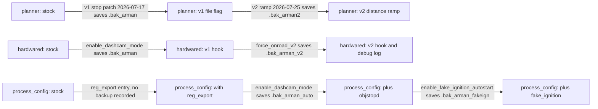

# Device changes and revert

This page lists every change made to the comma 3X in both eras and how to undo each one. Era 1 (sunnypilot 0.9.7.1) edited files in place next to `.bak_arman*` backups, set params and left flag files. The re-flash erased all of it, so the era 1 revert here is a corrected record of `OPERATIONS.md` §9, not a to-do. Era 2 (openpilot v0.11.1 + dashcam-anywhere) is one local git commit, three flag files, one param and a backup directory, with a soft and a full rollback.

## At a glance

| Field | Value |
|---|---|
| **Audience** | Maintainers |
| **Runs on** | Device (inventory, revert, full rollback); laptop (`dashcam.sh` for the era 2 soft rollback, and SSH one-liners) |
| **Era** | Both: **Era 1 — sunnypilot 0.9.7.1** (2026‑07 → 2026‑08; Honda Civic + truck/bench no‑CAN) and **Era 2 — openpilot v0.11.1 `release-tizi` + dashcam‑anywhere** (from 2026‑10‑03) |
| **Status** | Era 1 sections: historical record, already gone from the device. Era 2 sections: apply to the last documented device state |
| **Key files** | [`OPERATIONS.md`](../remote/Arman/OPERATIONS.md) §0/§9, [`STOP_COMMAND.md`](../remote/Arman/STOP_COMMAND.md), [`STOP_SIGN_VISION.md`](../remote/Arman/vision/STOP_SIGN_VISION.md), [`EXPERIMENT_RUNBOOK.md`](../remote/Arman/EXPERIMENT_RUNBOOK.md), the patchers [`enable_dashcam_mode.py`](../remote/Arman/enable_dashcam_mode.py), [`force_onroad_v2.py`](../remote/Arman/force_onroad_v2.py), [`enable_fake_ignition_autostart.py`](../remote/Arman/enable_fake_ignition_autostart.py), [`suppress_car_prompt.py`](../remote/Arman/suppress_car_prompt.py), [`enable_cabin_audio.py`](../remote/Arman/enable_cabin_audio.py) and the helper [`fake_ignition.py`](../remote/Arman/fake_ignition.py); [dashcam-anywhere `README.md`](../remote/Arman/dashcam_anywhere/README.md), [`dashcam.sh`](../remote/Arman/dashcam_anywhere/dashcam.sh), [`dashcam_anywhere.patch`](../remote/Arman/dashcam_anywhere/dashcam_anywhere.patch) |

## Both eras compared

| | Era 1 — sunnypilot 0.9.7.1 | Era 2 — openpilot v0.11.1 `release-tizi` + dashcam-anywhere |
|---|---|---|
| How code was changed | In-place edits by hand and by patcher scripts, almost all leaving a `<file>.bak_arman*` copy (the `reg_export` manager entry has no recorded backup) | One local git commit `8acb496` (tag `dashcam-anywhere-v1`) on top of stock `70e1574` |
| Files outside the checkout | `/data/objstop/`, `/data/force_onroad`, `/data/onroad_debug.log`, `/data/record_audio`, `/tmp` flags | `/data/force_onroad`, `/data/reset_calib`, `/data/calib_from_dashcam`, `/data/dashcam_anywhere/`, `/data/dashcam_backup/20261003/` |
| Params | `ExperimentalLongitudinalEnabled=1`, `DisengageOnAccelerator=0` | `DisableUpdates=1` |
| Meaning of `/data/force_onroad` | re-checked live by the hardwared hook and the manager conditions | read once when manager starts; reboot to apply (erratum 22) |
| Undo | ordered restore of the earliest backups ([below](#era-1-ordered-full-revert)) | `dashcam.sh disable` (soft) or `git reset --hard 70e1574…` (full) |
| On the device now | gone ([why](#why-era-1-is-gone)) | last documented state |

## How to inventory the changes on a device

Run these before changing anything, and again afterwards to confirm the result. Set `$COMMA_IP` first and confirm that it is the right device; more than one comma can share a network ([02](02-setup-ssh-networking.md#finding-the-device)).

### Which era is on the device

```bash
# laptop  (from the root of your clone)
cd remote/Arman && export COMMA_IP=$(./find_comma.sh)          # or set it by hand
ssh comma@$COMMA_IP 'cat /data/params/d/DongleId; echo'     # must print your device's dongle id (<DONGLE_ID>)
ssh comma@$COMMA_IP 'test -f /data/openpilot/common/dashcam_anywhere.py && echo era2 || echo era1-or-stock'
nc -z $COMMA_IP 7700 && echo "7700 open" || echo "7700 closed"
```

The `test -f` line is the same check `dashcam.sh enable` makes before it touches anything ([`dashcam.sh`](../remote/Arman/dashcam_anywhere/dashcam.sh), `enable)` branch).

### Tracked files, backups and added files

```bash
# device  (ssh comma@$COMMA_IP)
git -C /data/openpilot log --oneline -3
git -C /data/openpilot status --short
git -C /data/openpilot diff --stat
find /data/openpilot -name '*.bak_arman*'
```

- `status --short` shows edited tracked files as `M`. Additions such as the backups, the launchers and `tools/reg_export/` show as `??`, unless the checkout's `.gitignore` hides them. `find` lists the backups either way.
- `diff --stat` shows uncommitted edits only. The era 2 patch is a commit, so compare it with its parent: `git -C /data/openpilot diff --stat 70e157462304e5ce7d03ffbec6cb7f45bf347bb7 HEAD`.

### Flags, params and helper directories

```bash
# device  (ssh comma@$COMMA_IP)
ls -ld /data/force_onroad /data/record_audio /data/onroad_debug.log /data/objstop \
       /data/reset_calib /data/calib_from_dashcam /data/dashcam_anywhere /data/dashcam_backup 2>&1
for k in ExperimentalLongitudinalEnabled DisengageOnAccelerator DisableUpdates IsOnroad; do
  printf '%s=' "$k"; cat "/data/params/d/$k" 2>/dev/null || printf '(unset)'; echo
done
ls -l /tmp/op_stop_* /tmp/objstop_status.json /tmp/stop_udp.log 2>&1
```

On era 2, `./dashcam.sh status` prints the flag, the marker, a pending reset and `DisableUpdates` on one line under its `== dashcam-anywhere` heading ([`status.py`](../remote/Arman/dashcam_anywhere/status.py) → `main()`).

### What to expect

**Analysis (from code; not field-tested)** for the era 1 column, which can no longer be observed.

| Check | Era 1, fully patched (historical) | Era 2 (dashcam-anywhere) | Stock |
|---|---|---|---|
| era test | `era1-or-stock` | `era2` | `era1-or-stock` |
| `git log --oneline -3` | the sunnypilot 0.9.7.1 release commit (not recorded here) | `8acb496` (tag `dashcam-anywhere-v1`), then `70e1574` | the release commit |
| `git status --short` | `M` for the 7 edited files; `??` for backups, launchers, `tools/reg_export/` | clean | clean |
| `git diff --stat` | the 7 edited files | empty; against `70e1574` the 10 patch files (+375/−25 if the device carries exactly this patch) | empty |
| `find … '*.bak_arman*'` | up to 11 files | none | none |
| `/data/force_onroad` | present = no-CAN rig on | present = dashcam-anywhere on (from the next boot) | absent |
| `/data/calib_from_dashcam` | — | present once calibrationd has started in dashcam mode | absent |
| `DisableUpdates` | not set by this work | `1` | (unset) |
| `ExperimentalLongitudinalEnabled` / `DisengageOnAccelerator` | `1` / `0` | not set by this work | not set by this work |
| TCP 7700 | open whenever manager runs (`always_run`, erratum 17) | expected closed (inferred: nothing in `dashcam_anywhere/` installs an exporter) | closed |

## Era 1 changes

> [!WARNING]
> **Historical (sunnypilot era).** This is the device as it was in July and August 2026. The re-flash to era 2 removed all of it ([Why era 1 is gone](#why-era-1-is-gone)).

### File changes and backups

All paths are under `/data/openpilot`. Backup paths and suffixes were checked against the patcher scripts; the planner, Honda and controlsd suffixes come from the notes.

| File | Change | Backup suffix | Made by (date) | Backup holds | Applied? | Restore for a full revert |
|---|---|---|---|---|---|---|
| `selfdrive/controls/lib/longitudinal_planner.py` | v1: `import os`; `/tmp/op_stop_requested` exists → `v_cruise = 0.0` | `.bak_arman` | v1 stop patch, `STOP_COMMAND.md` (2026-07-17) | stock | yes ("DEPLOYED") | **`.bak_arman`** |
| same | v2: parses `d=<m> t=<monotonic> src=v`, square-root ramp, latch | `.bak_arman2` | v2 ramp, `STOP_SIGN_VISION.md` v2 (2026-07-25) | v1, by the order of application | yes (`OPERATIONS.md` §0) | — |
| `selfdrive/car/honda/interface.py` | `startingState=True, startAccel=0.6` | `.bak_arman2` | launch assist, `STOP_SIGN_VISION.md` v2 (2026-07-25) | before the launch assist | yes (v2.1 rlog forensics: "standstill → starting, accel 0.6") | **`.bak_arman2`** (its only backup) |
| `selfdrive/controls/controlsd.py` | `VISION: …` status line on the screen (LOWEST priority, display only) | `.bak_arman_ui` | display hook (`OPERATIONS.md` §0/§9; date not recorded) | before the hook | yes (`OPERATIONS.md` §0) | **`.bak_arman_ui`** |
| `system/hardware/hardwared.py` | v1 forced-ignition hook | `.bak_arman` | `enable_dashcam_mode.py` (2026-08-06) | stock | yes (`OPERATIONS.md` §3.1) | **`.bak_arman`** |
| same | v2 explicit hook + `/data/onroad_debug.log` | `.bak_arman_v2` | `force_onroad_v2.py` (2026-08-06 file date) | v1 hook | implied (`fake_ignition.py` docstring) | — |
| `tools/reg_export/exporter.py` | no-CAN exporter copied over the deployed one | `.bak_arman_nocan` | `enable_dashcam_mode.py` (2026-08-06) | the exporter live before the swap | yes, per `OPERATIONS.md` §3.1 ("the exporter streams even without CAN") | delete all of `tools/reg_export/` (not part of sunnypilot) |
| `system/manager/process_config.py` | `PythonProcess("reg_export", "tools.reg_export.exporter", always_run)` | none recorded | manager registration (described, not included) | — | yes (the anchor of `enable_dashcam_mode.py`) | git |
| same | `import os`, `objstop_auto()`, the `objstopd` entry | `.bak_arman_auto` | `enable_dashcam_mode.py` (2026-08-06) | already has the `reg_export` entry | yes (`OPERATIONS.md` §3.1: objstopd autostarts) | git, or this one minus the `reg_export` line |
| same | `dashcam_rig()`, `pandad_run()`, the `fake_ignition` entry | `.bak_arman_fakeign` | `enable_fake_ignition_autostart.py` (2026-08-12) | before fake ignition | not recorded | — |
| `selfdrive/controls/lib/events.py` | `carUnrecognized` alert commented out | `.bak_arman_carprompt` | `suppress_car_prompt.py` (2026-08-06) | stock | Reported (operator note, 2026-08-06) | **`.bak_arman_carprompt`** |
| `system/micd.py` | cabin-audio tap | `.bak_arman_audio` | `enable_cabin_audio.py` (2026-08-06 file date) | stock | not recorded anywhere | **`.bak_arman_audio`** |

> [!NOTE]
> **Reported in `STOP_COMMAND.md`, `STOP_SIGN_VISION.md`, `OPERATIONS.md` and past-session operator notes.** The "Applied?" column repeats what those notes say. Nothing in it could be re-checked on the device after the re-flash.

"Stock" means that no earlier change to the file is recorded. Each arrow below is one patch; the backup it created holds the state on the arrow's left. A full revert restores the backup of the leftmost arrow:



> [!NOTE]
> **Described, not included.** The planner v1/v2, Honda `interface.py` and `controlsd.py` patches, the `reg_export` manager registration and the deployed exporter variants are not in this repo. Only the notes and the backup names describe them. [`vision/test_stopsm.py`](../remote/Arman/vision/test_stopsm.py) → `parse_flag()` / `planner_ramp()` mirrors the planner v2 logic ([07](07-longitudinal-stop.md)).

### Params

| Param | Value set | When and source | Revert |
|---|---|---|---|
| `ExperimentalLongitudinalEnabled` | `1` | 2026-07-17, `STOP_COMMAND.md` ("OP longitudinal enabled (verified after reboot)") | remove it, then reboot so `CarParams` re-initialise |
| `DisengageOnAccelerator` | `0` (gas = override/resume, not disengage) | about 2026-08-06: a "pending user decision" in `STOP_SIGN_VISION.md` v2.1, shown as applied in `OPERATIONS.md` §0 (erratum 19). It was `1` before (v2.1 rlog forensics) | set back to `1`, as `OPERATIONS.md` §9 does |
| `CarParams` | MOCK | only if `keep_car_params()` or `write_carparams_mock.py` (both last modified 2026-08-12) actually ran, which is not recorded, and only while the no-CAN rig ran | none: per the `keep_car_params()` docstring it is `CLEAR_ON_MANAGER_START` and `CLEAR_ON_ONROAD_TRANSITION` |
| `EnforceTorqueLateral`, `CustomStockLong` | `1`, `1` | the baseline listed in [`controls_principles.md`](../remote/controls_principles.md); no note records that this work set them | none |

### Created files and flags

| Path | Created by | Purpose | Lifetime | Remove with |
|---|---|---|---|---|
| `/data/openpilot/tools/reg_export/exporter.py` (+ `.bak_arman_nocan`) | manual install, [`README.md`](../remote/README.md) §1 (baseline of 2026-07-14) | TCP 7700 telemetry ([03](03-telemetry-stream.md)) | persistent | `rm -rf tools/reg_export`, after its manager entry is gone |
| `/data/openpilot/tools/objstop_launcher.py` | `enable_dashcam_mode.py` | manager shim for objstopd | persistent | `rm`, after `process_config.py` is restored |
| `/data/openpilot/tools/fake_ignition_launcher.py` | `enable_fake_ignition_autostart.py` | manager shim: fake ignition + `keep_car_params()` | persistent | `rm`, after `process_config.py` is restored |
| `/data/objstop/` | operator `scp` | `objstopd.py`, `yolo_infer.py`, the ONNX models (`yolov8n_320.onnx`, `yolov8n.onnx`; optional `yolov8s_320.onnx`; the v1 notes also list a 480 model), the staged `exporter_nocan.py`, the era 1 scripts, `stop_udp.py` (installed by `stop_udp_start.sh`) | persistent | `rm -rf /data/objstop` |
| `/data/objstop/manual_mode` | operator `touch` | disables the objstopd autostart (`OPERATIONS.md` §3.3) | persistent | `rm` |
| `/data/force_onroad` | `enable_dashcam_mode.py`; `enable_fake_ignition_autostart.py` if missing; operator | era 1: forces ignition (hardwared) and, with fake ignition, replaces `pandad` | persistent | `rm` |
| `/data/onroad_debug.log` | the v2 hardwared hook | forced-onroad diagnostic, one line per state change | persistent, append-only | `rm` |
| `/data/record_audio` | `enable_cabin_audio.py` | gates cabin-audio recording | persistent | `rm` |
| `/data/media/0/realdata/<route>--<seg>/cabin_audio_44100_mono_s16le.raw` | the micd patch | raw cabin audio, about 5 MB/min | removed with its segment by loggerd's deleter | delete, or let it rotate |
| `/tmp/op_stop_requested`, `/tmp/op_stop_intent`, `/tmp/op_stop_release`, `/tmp/objstop_status.json`, `/tmp/objstop_last.jpg`, `/tmp/stop_udp.log` | objstopd, `experiment.py`, `stop_udp_start.sh` | stop flags, status, sender log ([08](08-vision-stop-objstopd.md), [09](09-stop-signal-udp.md)) | tmpfs: cleared on every reboot | `sudo reboot` |

The patchers also run `py_compile` on every file they patch and on `tools/fake_ignition_launcher.py` (not on `tools/objstop_launcher.py`), so `__pycache__` bytecode appears in those directories.

### Never deployed

`STOP_COMMAND.md` also describes a param-based design for a desktop openpilot 0.9.8 checkout: a `StopRequested` key in `common/params.cc`, a planner that honours it, and an `Arman/stop_command.py` helper. None of it is in this repo, and it was never put on the device; the deployed design is the file flag (erratum 2; [07](07-longitudinal-stop.md)). A revert never needs to touch `StopRequested`.

## Era 1 ordered full revert

> [!WARNING]
> **Historical (sunnypilot era).** Era 1 is already gone from the device. This procedure is the corrected form of `OPERATIONS.md` §9, kept as a record and for any sunnypilot 0.9.7.1 device that still carries these changes. Do not run it on an era 2 device.

### Rules

1. **Restore the earliest backup of each file.** A later backup holds an earlier patch, not stock: `longitudinal_planner.py.bak_arman2` is v1, and `hardwared.py.bak_arman_v2` is the v1 hook.
2. **`process_config.py` has no stock backup.** Even `.bak_arman_auto` contains the `reg_export` entry. Take the file from git, or restore `.bak_arman_auto` and delete that one line.
3. **Turn the switches off first.** Remove `/data/force_onroad` and `/data/record_audio`; in era 1 both were read live.
4. **Restore `process_config.py` before deleting modules it names.** **Analysis (from code; not field-tested):** manager imports every registered process module (the [dashcam-anywhere patch](../remote/Arman/dashcam_anywhere/dashcam_anywhere.patch) notes that "manager pre-imports every process module" in v0.11.1; sunnypilot 0.9.7.1 is assumed to do the same). A dangling entry for a deleted launcher could stop manager from starting.
5. **Use the era 1 interpreter** for the params, not a bare `python3`.
6. **Verify with git, then reboot,** and only then delete the backups.

### Revert procedure

Run with the car off. The `restore` helper skips any file whose backup does not exist, because a patch that was never applied left no backup.

```bash
# device  (ssh comma@$COMMA_IP)  — era 1 (sunnypilot 0.9.7.1) only; historical record
rm -f /data/force_onroad /data/record_audio          # 0. switches off (re-checked live in era 1)

cd /data/openpilot
restore() {  # restore <file> <backup>
  if [ -f "$2" ]; then cp -p "$2" "$1" && echo "restored $1 <- $2"; else echo "skip $1: no $2"; fi
}
# 1. tracked files: the EARLIEST backup of each
restore selfdrive/controls/lib/longitudinal_planner.py selfdrive/controls/lib/longitudinal_planner.py.bak_arman  # stock (NOT .bak_arman2 = v1)
restore selfdrive/car/honda/interface.py               selfdrive/car/honda/interface.py.bak_arman2              # its only backup
restore selfdrive/controls/controlsd.py                selfdrive/controls/controlsd.py.bak_arman_ui             # before the VISION hook
restore system/hardware/hardwared.py                   system/hardware/hardwared.py.bak_arman                   # stock (NOT .bak_arman_v2 = v1 hook)
restore selfdrive/controls/lib/events.py               selfdrive/controls/lib/events.py.bak_arman_carprompt     # stock
restore system/micd.py                                 system/micd.py.bak_arman_audio                           # stock
git checkout -- system/manager/process_config.py      # every backup still has the reg_export entry

# 2. files this work added (now that process_config.py no longer names them)
rm -f tools/objstop_launcher.py tools/fake_ignition_launcher.py
rm -rf tools/reg_export

# 3. params
PYTHONPATH=/data/openpilot:/data /usr/local/pyenv/versions/3.11.4/bin/python3 -c \
  "from openpilot.common.params import Params; p=Params(); p.remove('ExperimentalLongitudinalEnabled'); p.put_bool('DisengageOnAccelerator', True)"

# 4. data outside the checkout
rm -f /data/onroad_debug.log
rm -rf /data/objstop      # objstopd, yolo_infer, models, staged scripts, manual_mode, stop_udp.py
# optional: cabin audio already written into segments (otherwise loggerd's deleter rotates it out)
# find /data/media/0/realdata -name 'cabin_audio_*_mono_s16le.raw' -delete
```

**To keep the TCP 7700 telemetry** and drop everything else, change two steps:

- **Step 1:** restore `system/manager/process_config.py.bak_arman_auto` instead of running `git checkout`. That keeps the `reg_export` entry and nothing added later.
- **Step 2:** keep `tools/reg_export/`, and restore `tools/reg_export/exporter.py.bak_arman_nocan` to drop the no-CAN variant.

### Verify with git

```bash
# device  (ssh comma@$COMMA_IP)  — era 1, historical
cd /data/openpilot
git diff --stat                     # expect no output
git status --short                  # expect only the *.bak_arman* backups, as ??
grep -c op_stop_requested selfdrive/controls/lib/longitudinal_planner.py    # expect 0
grep -c force_onroad system/hardware/hardwared.py                           # expect 0
sudo reboot                         # clears /tmp; CarParams re-initialise with stock longitudinal
# after a good boot, and only then:
find /data/openpilot -name '*.bak_arman*' -delete
```

- **A file still differs.** If `git diff --stat` still lists a file, its earliest backup was not stock. `git checkout -- <file>` returns it to the release version.
- **The end state.** Stock ACC + radar + AEB, as `STOP_COMMAND.md` puts it ("back to stock ACC + radar + AEB").
- **`experiment.py check`** now reports `planner stop patch ✗`, because it greps the planner for `op_stop_requested` ([`experiment.py`](../remote/Arman/experiment.py) → `main()`).

### Corrections to OPERATIONS section 9

`OPERATIONS.md` §9 is titled "Master revert table (roll back every change at once)". As written, with its comments translated and the first line `ssh comma@$IP` left out:

```bash
# device  (ssh comma@$COMMA_IP)  — OPERATIONS.md §9 as written; superseded, do not use
cd /data/openpilot
cp selfdrive/controls/lib/longitudinal_planner.py.bak_arman2 selfdrive/controls/lib/longitudinal_planner.py   # remove the distance ramp (for v1 use .bak_arman)
cp selfdrive/car/honda/interface.py.bak_arman2 selfdrive/car/honda/interface.py                               # remove the launch assist
cp selfdrive/controls/controlsd.py.bak_arman_ui selfdrive/controls/controlsd.py                               # remove the screen display
cp system/hardware/hardwared.py.bak_arman system/hardware/hardwared.py 2>/dev/null                            # remove the dashcam hook
cp tools/reg_export/exporter.py.bak_arman_nocan tools/reg_export/exporter.py 2>/dev/null                      # remove the exporter no-CAN change
python3 -c "from openpilot.common.params import Params; p=Params(); p.remove('ExperimentalLongitudinalEnabled'); p.put_bool('DisengageOnAccelerator', True)"
rm -f /data/force_onroad; sudo reboot     # → fully back to stock ACC + radar + AEB
```

What is wrong with it (erratum 15):

| # | §9 line | Problem | Correct action |
|---|---|---|---|
| 1 | planner ← `.bak_arman2`, "for v1 use `.bak_arman`" | `.bak_arman2` holds **v1**, so the file-flag stop stays wired in. `.bak_arman` is **stock**: the comment is backwards | restore `.bak_arman` |
| 2 | interface ← `.bak_arman2` | correct: its only backup | — |
| 3 | controlsd ← `.bak_arman_ui` | correct | — |
| 4 | hardwared ← `.bak_arman` `2>/dev/null` | correct (stock), which also undoes the v2 hook that §9 never mentions. `2>/dev/null` hides a missing backup | keep, without hiding errors |
| 5 | exporter ← `.bak_arman_nocan` | undoes only the no-CAN copy. The exporter, which is not part of sunnypilot, and its manager entry stay | delete `tools/reg_export/` once `process_config.py` is restored |
| 6 | missing | `process_config.py` (`.bak_arman_auto`, `.bak_arman_fakeign`, the `reg_export` entry): objstopd keeps autostarting, and the fake-ignition entries stay (dormant while `/data/force_onroad` is absent) | `git checkout -- system/manager/process_config.py` |
| 7 | missing | `events.py` (`.bak_arman_carprompt`) | restore it |
| 8 | missing | `micd.py` (`.bak_arman_audio`) and `/data/record_audio`. **Analysis (from code; not field-tested):** if the audio patch was applied, cabin audio keeps recording after this "full" revert | restore it and `rm /data/record_audio` |
| 9 | missing | `tools/objstop_launcher.py`, `tools/fake_ignition_launcher.py`, `/data/objstop/`, `/data/onroad_debug.log` | delete them |
| 10 | `python3 -c …` | a bare `python3` on the device | the era 1 interpreter with `PYTHONPATH` |
| 11 | "fully back to stock ACC + radar + AEB" | longitudinal does return to the stock PCM once the param is gone and the device reboots, but the device is not stock (rows 1, 5–9) | the procedure above |

`OPERATIONS.md` §0 also says "All backups: `*.bak_arman*` (see the §9 revert table)". `find /data/openpilot -name '*.bak_arman*'` is the complete list; §9 is not.

### Partial reverts

| Goal | Steps | Source |
|---|---|---|
| Longitudinal only | planner ← `.bak_arman`; remove `ExperimentalLongitudinalEnabled`; reboot. Add interface ← `.bak_arman2` and controlsd ← `.bak_arman_ui` for the later companions | `EXPERIMENT_RUNBOOK.md` and `STOP_COMMAND.md`, last modified on 2026-07-17, when `.bak_arman` was the only planner backup. Still correct, since it is stock. See [07](07-longitudinal-stop.md#revert) |
| Leave the no-CAN rig | `rm /data/force_onroad`, then reboot | `OPERATIONS.md` §3.1; [10](10-no-can-mode-sunnypilot.md#returning-to-the-civic) |
| Remove the forced-onroad hook | hardwared ← `.bak_arman` (stock), or ← `.bak_arman_v2` (back to the v1 hook) | `force_onroad_v2.py` docstring |
| Stop cabin audio | `rm /data/record_audio`. To remove the patch too: micd ← `.bak_arman_audio`, then `pkill -f '[s]ystem.micd'` (manager restarts it) | `enable_cabin_audio.py` docstring |
| Pause the objstopd autostart | `touch /data/objstop/manual_mode`; `rm` it to resume | `OPERATIONS.md` §3.3 |
| Bring back the car prompt | events ← `.bak_arman_carprompt`; reboot, or `pkill -f '[s]elfdrive.controls.controlsd'` | `suppress_car_prompt.py` docstring |
| Remove fake ignition | process_config ← `.bak_arman_fakeign`; `rm tools/fake_ignition_launcher.py`; reboot. Or simply `rm /data/force_onroad`, which also turns the hook off | `enable_fake_ignition_autostart.py` docstring |
| Stop a manual fake-ignition run | `sudo reboot` (works unless the autostart is installed and `/data/force_onroad` exists) | `fake_ignition.py` docstring |

## Era 2 changes

The era 2 install and design are in [11](11-dashcam-anywhere-design.md); this section lists what it leaves on the device.

### The local commit

From the [dashcam-anywhere README](../remote/Arman/dashcam_anywhere/README.md) (translated): the device runs "openpilot v0.11.1 release-tizi + this patch"; the patch is "commit `8acb496` on the local release-tizi branch, tag `dashcam-anywhere-v1`, parent commit the stock `70e1574`". The full parent hash, from its rollback section, is `70e157462304e5ce7d03ffbec6cb7f45bf347bb7`. The same change is in [`dashcam_anywhere.patch`](../remote/Arman/dashcam_anywhere/dashcam_anywhere.patch): 10 files, +375/−25 by `git apply --stat`. Because it is a commit, no `.bak` files are involved.

| File | Role (details in [11](11-dashcam-anywhere-design.md)) |
|---|---|
| `common/dashcam_anywhere.py` (new) | flag paths; `ENABLED = os.path.isfile(FLAG)` evaluated once, at import |
| `selfdrive/car/card.py` | MOCK car without CAN wait or fingerprinting; refuses to write any `CarParams` that is not mock + passive + a single `noOutput` safety config; sets `FirmwareQueryDone` and `ControlsReady` |
| `selfdrive/locationd/calibrationd.py` | calibration from GPS or visual speed; mode-change marker; reset flag; saves after every block |
| `selfdrive/locationd/test/test_calibrationd.py` | tests for the above |
| `selfdrive/pandad/pandad.py` | `STARTED=1` and `FAKESEND=1` in the `pandad` environment |
| `selfdrive/selfdrived/selfdrived.py` | "Dashcam Mode" event instead of `carUnrecognized`; calibration alerts while passive |
| `selfdrive/ui/layouts/settings/device.py` | Reset Calibration also writes `/data/reset_calib` in dashcam mode |
| `selfdrive/ui/ui_state.py` | onroad view without a real ignition |
| `system/hardware/hardwared.py` | ignition forced; five startup checks skipped (thermal and disk kept); low-battery shutdown behind a car harness |
| `system/manager/process_config.py` | `restart_if_crash` for 17 processes |

### Flags and param

| Item | Meaning | Who reads it | Notes |
|---|---|---|---|
| `/data/force_onroad` | dashcam-anywhere on | `common/dashcam_anywhere.py`, once when manager starts ("from manager start until the next reboot") | reboot to apply. Absent → stock, except the next two rows (README) |
| `/data/reset_calib` | restart calibration from scratch | calibrationd `consume_reset_request()`: on a real device at every calibrationd start (in either mode), and about once a second while it runs in dashcam mode. It deletes the flag first, then `CalibrationParams` | created by `dashcam.sh reset-calib` (no confirmation prompt; erratum 20), by `touch`, or by the UI's Reset Calibration in dashcam mode |
| `/data/calib_from_dashcam` | marker: `CalibrationParams` were learned in dashcam mode | calibrationd `reset_on_mode_change()` at start: dashcam mode without marker → clear the calibration, create the marker; normal mode with marker → clear the calibration, delete the marker | `dashcam.sh restore-civic` deletes it |
| `DisableUpdates` = `1` | no software updates | openpilot's updater (`updated` "exits right away by design when DisableUpdates is set", `status.py`) | set at install, not by the patch; removed in the full rollback |

calibrationd normally runs only onroad (`status.py`: "calibrationd runs onroad only"). The marker and reset logic therefore acts at the first onroad start after a change, not at boot.

### Backup and helper directories

- **`/data/dashcam_backup/20261003/`.** The Civic's `CalibrationParams`, `CarParams*`, `LiveParametersV2`, `LiveDelay`, `LiveTorqueParameters` and the git rev (README). `dashcam.sh restore-civic` copies back whichever of `CalibrationParams`, `CarParamsPersistent`, `LiveParametersV2`, `LiveDelay`, `LiveTorqueParameters` exist there.
- **`/data/dashcam_anywhere/`.** `status.py` (run by `dashcam.sh status`), `replay_calib.py`, and `replay_rlogs/` only if it was copied for a replay run. The 206 MB `replay_rlogs/` lives on the desktop and is not in this repo.
- **Params the patched code writes in dashcam mode.** These are ordinary openpilot keys: the MOCK `CarParams`, `CarParamsCache`, `CarParamsPersistent` (card), `FirmwareQueryDone` and `ControlsReady` (card, on every start), and `CalibrationParams` (after every block). **Analysis (from code; not field-tested):** the next start in a real car rewrites the `CarParams*` keys. The Civic's calibration is handled by `restore-civic` or by recalibrating.

## Era 2 rollback

### Soft rollback

```bash
# laptop  (from remote/Arman/dashcam_anywhere)
./dashcam.sh disable $COMMA_IP          # or: ./dashcam.sh -y disable $COMMA_IP   (-y must come first)
```

`disable` prints `device <ip>  dongle <id>  -> DISABLE dashcam-anywhere and reboot (device then needs a real ignition to go onroad)` and asks `proceed? [y/N]`. It then runs `rm -f /data/force_onroad && sudo reboot` on the device. The IP comes from the argument, else `$COMMA_IP`, else `../find_comma.sh`. After the reboot the patch is inert: `ENABLED` is `False`, and only the marker and reset logic still acts. The commit, `DisableUpdates=1`, the backup directory and `/data/dashcam_anywhere/` stay. Without a real ignition (on a robot, for example) the device now stays offroad and records nothing; `./dashcam.sh enable` undoes the soft rollback ([Re-enabling dashcam-anywhere](#re-enabling-dashcam-anywhere)).

### Back to the Civic

```bash
# laptop  (from remote/Arman/dashcam_anywhere) — after disable, with the device offroad
./dashcam.sh status $COMMA_IP | grep 'pending reset'   # expect "flag /data/force_onroad: absent" and "pending reset: no" (see the note below)
./dashcam.sh restore-civic $COMMA_IP
```

After a confirmation prompt, `restore-civic` runs on the device:

1. It stops with `dashcam mode still on, run disable first` if `/data/force_onroad` exists, and with `device is onroad, retry offroad` unless `IsOnroad` is `0`.
2. It copies each backed-up key into `/data/params/d/` with `cp -p` and prints `restored <key>`.
3. It removes `/data/calib_from_dashcam` and runs `sync`.

Alternatively, skip it and just drive. "The robot calibration is dropped automatically and the Civic recalibrates from scratch" (`dashcam.sh`), which takes a few minutes of straight driving above 24 km/h (`LAPTOP_GUIDE.md` §10).

> [!IMPORTANT]
> **Analysis (from code; not field-tested).** `restore-civic` does not remove a pending `/data/reset_calib`. The patched calibrationd consumes that flag at its next start even in normal mode, which would delete the just-restored Civic calibration. Check that `./dashcam.sh status` shows `pending reset: no`, or run `ssh comma@$COMMA_IP 'rm -f /data/reset_calib'`, before `restore-civic`.

### Full rollback

> [!CAUTION]
> **Hard to undo, and order matters.** The full rollback resets the checkout to stock, re-enables updates and reboots; undoing it means reinstalling the patch ([Re-enabling dashcam-anywhere](#re-enabling-dashcam-anywhere)). **Analysis (from code; not field-tested):** it also keeps whatever is in `CalibrationParams`. Run straight from dashcam mode, that is the robot's calibration, and the stock code has no marker logic to drop it, so the Civic would start from the robot's values. Do the [soft rollback](#soft-rollback) and [`restore-civic`](#back-to-the-civic) first, or remove `CalibrationParams` yourself, and only then run the commands below.

From the README (comments translated), run on the device:

```bash
# device  (ssh comma@$COMMA_IP)  — era 2
rm -f /data/force_onroad /data/reset_calib /data/calib_from_dashcam   # stock code doesn't know these two files; a marker left behind would later wrongly delete the Civic calibration
cd /data/openpilot && git reset --hard 70e157462304e5ce7d03ffbec6cb7f45bf347bb7
PYTHONPATH=/data/openpilot /usr/local/venv/bin/python3 -c "from openpilot.common.params import Params; Params().remove('DisableUpdates')"
sudo reboot
```

"Afterwards the updater rebuilds staging automatically, and the device returns to normal release-tizi updates." The marker warning matters if the patch is ever installed again: the patched calibrationd, seeing a stale marker in normal mode, would delete whatever calibration is current.

Verify:

```bash
# device  (ssh comma@$COMMA_IP)
git -C /data/openpilot log --oneline -1       # expect 70e1574 ...
git -C /data/openpilot status --short         # expect no output
test -f /data/openpilot/common/dashcam_anywhere.py && echo "patch still present" || echo "patch gone"
ls /data/force_onroad /data/reset_calib /data/calib_from_dashcam 2>&1     # expect: No such file or directory (x3)
cat /data/params/d/DisableUpdates 2>/dev/null || echo "DisableUpdates unset"
```

If the `test -f` line reports `patch still present`, the patch was applied without being committed (for example by a reconstructed install, [11](11-dashcam-anywhere-design.md)). `git reset --hard` leaves untracked files alone, so remove `common/dashcam_anywhere.py` by hand. Otherwise `dashcam.sh enable` and the era test above still think the patch is installed.

Optional clean-up: `rm -rf /data/dashcam_anywhere`. Keep `/data/dashcam_backup/20261003/` until the Civic's calibration is confirmed good.

### Re-enabling dashcam-anywhere

- **After a soft rollback:** `./dashcam.sh enable $COMMA_IP`. It asks for confirmation, checks that `common/dashcam_anywhere.py` exists, then runs `touch /data/force_onroad && sudo reboot`. The Civic calibration is cleared automatically on the first dashcam-mode start (`LAPTOP_GUIDE.md` §10).
- **After a full rollback:** reinstall from [`dashcam_anywhere.patch`](../remote/Arman/dashcam_anywhere/dashcam_anywhere.patch) with the procedure in [11](11-dashcam-anywhere-design.md). **Analysis (from code; not field-tested):** the local commit and its tag may survive `git reset --hard`, but once updates are re-enabled the updater can replace the checkout. The patch file in this repo is the durable copy.

## Why era 1 is gone

- **Where the changes lived.** The era 1 changes lived in two places. Inside the sunnypilot 0.9.7.1 checkout at `/data/openpilot`: 7 edited files, up to 11 backups, 2 launchers and `tools/reg_export/`. Outside it: files under `/data` and `/tmp`.
- **What replaced them.** The device was then re-flashed to openpilot v0.11.1 `release-tizi`. The dashcam-anywhere README records the result: stock `70e1574` plus one local commit. A fresh checkout contains none of the era 1 edits or backups, and `/tmp` is cleared on every boot.
- **Nothing brings them back.** Nothing in `remote/Arman/dashcam_anywhere/` reinstalls an era 1 component: no planner ramp, no Honda launch assist, no `VISION` display hook, no `reg_export` exporter, no objstopd, no fake ignition, no `events.py` or `micd.py` patch. This is inferred; verify it with `nc -z $COMMA_IP 7700` from the laptop (closed expected) and `ls -d /data/objstop` on the device (absent expected).
- **No log of the re-flash itself.** This repo has no record of how the re-flash was done, or exactly when: some time between 2026-08-13 (the last era 1 file date) and 2026-10-03 (the era 2 patch). On a device of unknown history, run the [inventory](#how-to-inventory-the-changes-on-a-device): on a cleanly re-flashed era 2 device every era 1 path should be absent.

What follows from this:

- **The era 1 notes are stale.** The era 1 runbooks (`OPERATIONS.md`, `EXPERIMENT_RUNBOOK.md`, `STOP_COMMAND.md`, `STOP_SIGN_VISION.md`) and docs [07](07-longitudinal-stop.md), [08](08-vision-stop-objstopd.md), [09](09-stop-signal-udp.md) and [10](10-no-can-mode-sunnypilot.md) describe a device state that no longer exists. Their device-side commands target sunnypilot 0.9.7.1 and must not be run on era 2: most fail or do nothing there, and `touch /data/force_onroad` now does something else (next point). **Analysis (from code; not field-tested):** `enable_dashcam_mode.py`, `force_onroad_v2.py` and `enable_fake_ignition_autostart.py` should abort on the v0.11.1 tree, because the anchors or staged files they need are missing ([10](10-no-can-mode-sunnypilot.md#changes-in-application-order)).
- **One file name changed meaning.** `/data/force_onroad` kept its name but not its meaning. In era 1 it was re-checked live. In era 2 it is read once when manager starts, so a `touch` or `rm` without a reboot does nothing until the next boot (erratum 22).
- **Rebuilding era 1 needs files that are not here.** It would need sunnypilot 0.9.7.1 plus pieces this repo does not contain: the planner patches, `exporter_nocan.py`, the `stopFlag` exporter and the ONNX models. [15](15-file-reference.md) lists what is included.

## See also

- [01 Overview](01-overview.md): eras, timeline, included vs. not included
- [02 Setup, SSH and networking](02-setup-ssh-networking.md): finding the device, interpreters, "is it onroad"
- [07 Longitudinal stop command](07-longitudinal-stop.md): the planner, launch-assist and display patches
- [08 Vision stop daemon (objstopd)](08-vision-stop-objstopd.md): `/data/objstop/`, the autostart, `manual_mode`
- [10 No-CAN truck/bench mode](10-no-can-mode-sunnypilot.md): the five patcher scripts in detail
- [11 dashcam-anywhere: design and validation](11-dashcam-anywhere-design.md): the era 2 patch and its install procedure
- [12 dashcam-anywhere: field guide](12-dashcam-anywhere-field-guide.md): `dashcam.sh` day to day, returning to the Civic
- [13 Operations runbook](13-operations-runbook.md): which era is on the device, per-scenario procedures
- [15 File reference](15-file-reference.md): every file in the repo, and what is not included
- [16 Errata and crosswalk](16-errata-and-crosswalk.md): errata 2, 3, 15, 17, 19, 20, 22
